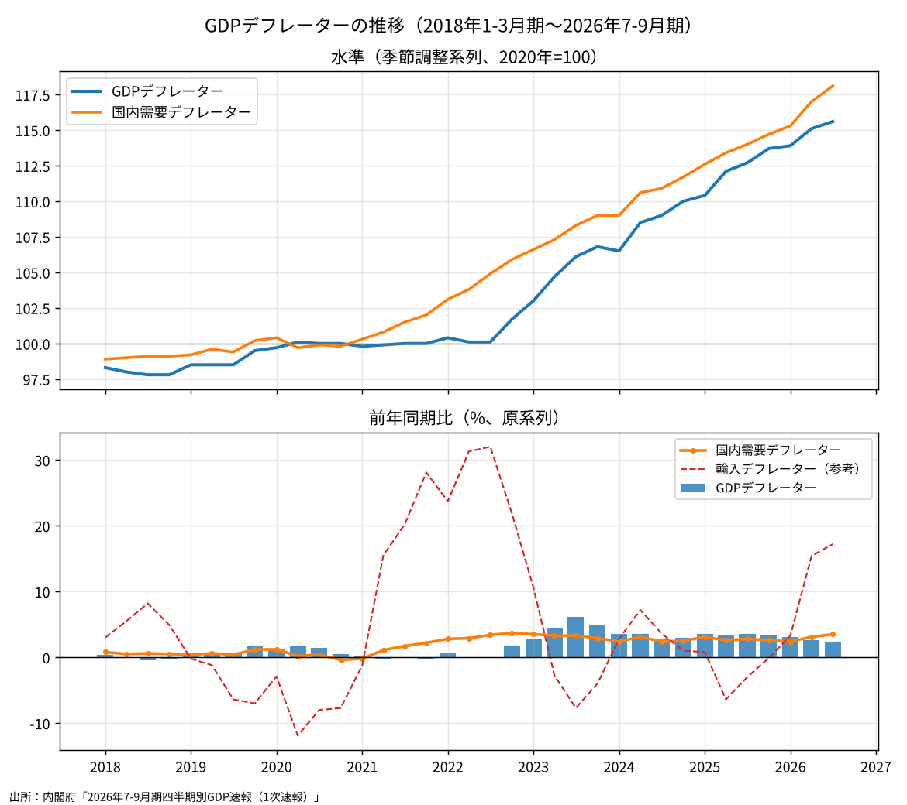

# GDPデフレーターは8年で17.6％上がった──2018〜2026年の推移を国内需要・輸入デフレーターと並べて読む

ウェブ版：[https://p72.github.io/note-draft/GDPデフレーターの推移/01\_2018年以降のGDPデフレーター.html](https://p72.github.io/note-draft/GDP%E3%83%87%E3%83%95%E3%83%AC%E3%83%BC%E3%82%BF%E3%83%BC%E3%81%AE%E6%8E%A8%E7%A7%BB/01_2018%E5%B9%B4%E4%BB%A5%E9%99%8D%E3%81%AEGDP%E3%83%87%E3%83%95%E3%83%AC%E3%83%BC%E3%82%BF%E3%83%BC.html)

GitHub：[https://github.com/p72/note-draft/blob/main/GDPデフレーターの推移/01\_2018年以降のGDPデフレーター.md](https://github.com/p72/note-draft/blob/main/GDP%E3%83%87%E3%83%95%E3%83%AC%E3%83%BC%E3%82%BF%E3%83%BC%E3%81%AE%E6%8E%A8%E7%A7%BB/01_2018%E5%B9%B4%E4%BB%A5%E9%99%8D%E3%81%AEGDP%E3%83%87%E3%83%95%E3%83%AC%E3%83%BC%E3%82%BF%E3%83%BC.md)

※ この記事は、内閣府 経済社会総合研究所（ESRI）「2026年7-9月期四半期別GDP速報（1次速報）」の公表データを使っている。

GDPデフレーターは、国内で生み出された付加価値1単位あたりの価格である。消費者物価のように「買う側が払う物価」ではなく、「国内で生産した側が受け取る物価」を表す。

2018年1-3月期に98.3（2020年＝100、季節調整系列）だったGDPデフレーターは、2026年7-9月期には115.6となった。約8年で17.6％の上昇である。ただし、上がり方は一定ではない。2022年まではほぼ横ばいで、2023年に急上昇し、その後は年3％前後で推移している。

本稿では、GDPデフレーターを、国内需要デフレーター（家計・企業・政府が国内で支払う物価）と輸入デフレーターと並べ、2018年以降の動きを時期ごとに整理する。

結論を先に示す。

- 2021〜2022年は、国内需要デフレーターが3％台まで上がったのに、GDPデフレーターはほぼ0％にとどまった。輸入デフレーターが前年比20〜30％上がり、その分がGDPデフレーターを押し下げたためである。
- 2023年はGDPデフレーターが前年比6.2％まで上がった。輸入価格の上昇が止まり、国内の販売価格への転嫁が表に出た。
- 2023年4-6月期から2026年1-3月期まで、12四半期続けてGDPデフレーターの伸びが国内需要デフレーターの伸びを上回った。
- 2026年は、輸入デフレーターが前年比17％まで再び上がり、GDPデフレーターの伸びが国内需要デフレーターを下回った。2021〜2022年と似た形である。

## 水準と前年同期比の推移

上の図は水準（季節調整系列、2020年＝100）、下の図は前年同期比（原系列）である。下の図には、参考として輸入デフレーターの前年同期比も示した。

水準で見ると、GDPデフレーターと国内需要デフレーターは、2020年ごろまでは1ポイント前後の差で並んで動いている。2021年から国内需要デフレーターだけが先に上がり、2022年7-9月期には両者の差が4.8ポイントまで開いた。その後、GDPデフレーターが追いかけるように上がり、差は2025年10-12月期には1.0ポイントまで縮んだ。2026年に入ると、差は再び開き、2026年7-9月期には2.5ポイントとなった。

## 時期ごとの動き

前年同期比（％、原系列）を時期ごとにまとめると、次のようになる。

| 時期 | GDPデフレーター | 国内需要デフレーター | 輸入デフレーター | 特徴 |
|---|---|---|---|---|
| 2018年 | −0.5〜+0.4 | 0.5〜0.8 | +3.0〜+8.2 | ほぼゼロ |
| 2019年10-12月期〜2020年 | +0.5〜+1.7 | −0.4〜+1.2 | −2.9〜−11.9 | 消費税率の引上げと輸入価格の下落 |
| 2021〜2022年 | −0.3〜+1.7 | −0.2→3.7 | −1.2〜+32.0 | 国内需要の物価は上昇、GDPデフレーターは横ばい |
| 2023年 | +2.7→+6.2 | 2.9〜3.5 | −7.7〜+10.6 | 7-9月期がピーク |
| 2024〜2025年 | +2.7〜+3.6 | 2.4〜3.1 | −6.4〜+7.2 | 3％前後で推移 |
| 2026年 | +3.1→+2.6→+2.4 | 2.4→3.1→3.5 | +3.3→+15.4→+17.2 | 輸入価格が再び上昇 |

年度で見ると、GDPデフレーターの変化率は次のとおりである。

- 2018年度：−0.2％
- 2019年度：1.1％
- 2020年度：0.9％
- 2021年度：0.1％
- 2022年度：1.2％
- 2023年度：4.8％
- 2024年度：3.2％
- 2025年度：3.3％

同じ期間の国内需要デフレーターは、0.5％、0.8％、0.0％、2.0％、3.4％、2.9％、2.8％、2.6％であった。2021〜2022年度は国内需要デフレーターがGDPデフレーターを大きく上回り、2023年度以降は逆にGDPデフレーターが上回っている。

### 2018年〜2020年：ほぼゼロ

2018年のGDPデフレーターは、前年比−0.5〜+0.4％でほとんど動いていない。2019年10-12月期から伸びが1％台に上がったのは、2019年10月の消費税率引上げ（8％→10％）が国内需要の物価を押し上げたことと、輸入デフレーターが下がったことによる。2020年4-6月期には輸入デフレーターが前年比−11.9％となり、GDPデフレーターは1.7％となった。

### 2021年〜2022年：国内需要の物価は上がったが、GDPデフレーターは動かなかった

この時期の特徴は、国内需要デフレーターとGDPデフレーターの乖離である。国内需要デフレーターは2021年4-6月期の1.1％から2022年10-12月期の3.7％まで上がった。一方、GDPデフレーターは2022年7-9月期まで−0.3〜+0.7％にとどまった。

両者の差を生んだのは輸入デフレーターである。輸入デフレーターは2022年7-9月期に前年比32.0％まで上がった。

## 読み解きのポイント

### 輸入デフレーターは引き算で効く

GDPは「国内需要＋輸出−輸入」である。したがって、GDPデフレーターの変化は、おおまかに見れば、国内需要デフレーターと輸出デフレーターの変化から、輸入デフレーターの変化を差し引いたものになる。

輸入品の値上がりが国内の販売価格にそのまま転嫁されれば、国内需要デフレーターは上がるが、GDPデフレーターは変わらない。転嫁しきれなければ、GDPデフレーターはむしろ下がる。GDPデフレーターは、国内で生み出された付加価値の単価だからである。

2021〜2022年に家計や企業が支払う物価（国内需要デフレーター）は上がったが、GDPデフレーターは動かなかった。これは、輸入価格の上昇分が海外への支払いとして流れ出し、国内の付加価値の単価は上がらなかったことを意味する。交易条件の悪化による交易損失の局面であった。

### 2023年以降は国内要因の物価上昇

2023年に輸入デフレーターの上昇が止まり、前年比でマイナスに転じた。それでも国内需要デフレーターは3％前後で上がり続けた。その結果、GDPデフレーターの伸びは2023年7-9月期に6.2％まで高まった。前年までに上がった輸入コストが、遅れて国内の販売価格に転嫁されたためと考えられる。

その後もGDPデフレーターは3％前後で推移し、2023年4-6月期から2026年1-3月期まで、12四半期続けて国内需要デフレーターの伸びを上回った。輸入価格に押し上げられた物価上昇ではなく、国内で生み出された付加価値の単価が上がる局面へ移ったと読める。ただし、付加価値の単価の上昇が賃金と企業収益のどちらに配分されたのかは、デフレーターだけでは分からない。単位労働コストと単位利潤への分解は、次稿で行う。

### 2026年は2021〜2022年と似た形

2026年に入って、輸入デフレーターの前年同期比は1-3月期の3.3％から、4-6月期15.4％、7-9月期17.2％へと急上昇した。国内需要デフレーターの伸びは2.4％から3.5％へ加速した一方、GDPデフレーターの伸びは3.1％から2.4％へ鈍化した。2023年4-6月期以来続いていた「GDPデフレーター＞国内需要デフレーター」の関係は、2026年4-6月期に逆転した。

この形は、2021〜2022年の交易損失の局面とよく似ている。ただし、2026年7-9月期の値は1次速報であり、2次速報や年次推計で改定される。輸入デフレーターの上昇が続くのか、国内の販売価格への転嫁がどの程度進むのかは、今後の公表値で確かめる必要がある。

なお、品目別では民間企業設備のデフレーターが2026年4-6月期・7-9月期に前年比5.1％と、2018年以降で最も高い伸びになっている。

## データについて

- 内閣府 経済社会総合研究所「四半期別GDP速報」2026年7-9月期1次速報（2026年11月公表）
  - 前年同期比：`rdef-qg2631.csv`（デフレーター 前年同期比、原系列）
  - 水準：`def-qk2631.csv`（デフレーター、季節調整系列、2020年＝100）
  - 年度変化率：`rdef-fy2631.csv`
- QEの季節調整系列は公表のたびに1994年までさかのぼって改定される。本稿の値はすべて最新回（2026年7-9月期1次速報）の公表値であり、過去の公表回の値とは混ぜていない。
- 国内需要デフレーターは、QEの「国内需要」のデフレーターである。
- 出典ページ：[https://www.esri.cao.go.jp/jp/sna/sokuhou/sokuhou\_top.html](https://www.esri.cao.go.jp/jp/sna/sokuhou/sokuhou_top.html)
- 統計表一覧：[https://www.esri.cao.go.jp/jp/sna/data/data\_list/sokuhou/files/2026/qe263/gdemenuja.html](https://www.esri.cao.go.jp/jp/sna/data/data_list/sokuhou/files/2026/qe263/gdemenuja.html)

## コードとデータ

データの取得と作図に用いたコードとデータは、本稿と同じフォルダの `code/` に収録した。

- `01_fetch_and_plot.py`：ESRIのCSVを取得し、図（`01_chart_deflator.png`）を作成する
- `deflator_yoy.csv`：デフレーター前年同期比（原系列、1994年〜）
- `deflator_level.csv`：デフレーター水準（季節調整系列、2020年＝100、1994年〜）
