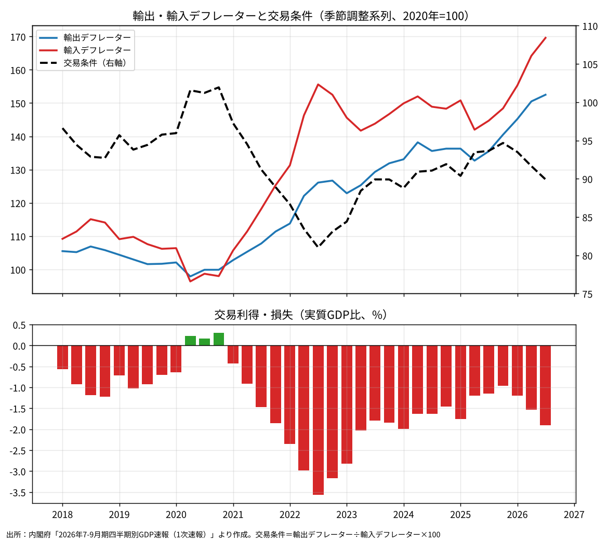
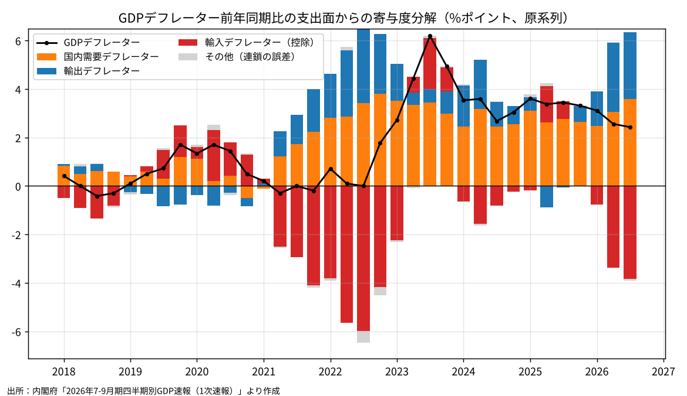
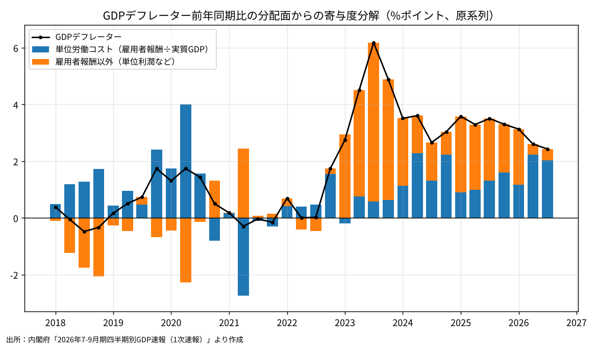
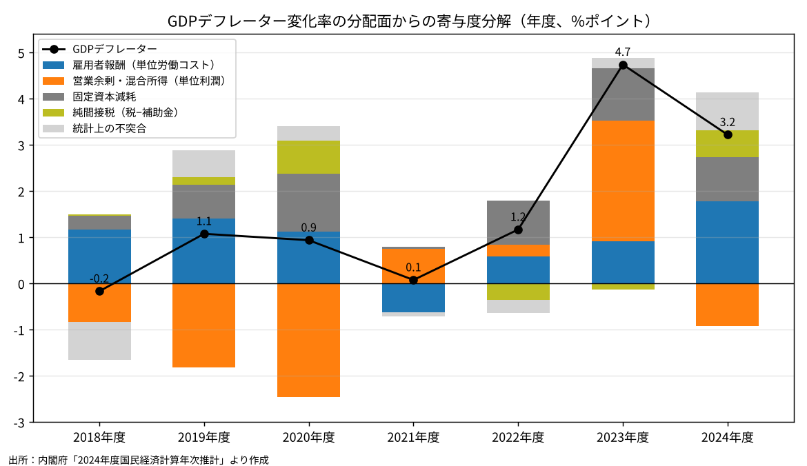

# GDPデフレーターの上昇は賃金と利潤のどちらに回ったか──交易条件と単位労働コスト・単位利潤で2018〜2026年を分解する

ウェブ版：[https://p72.github.io/note-draft/GDPデフレーターの推移/02\_交易条件と単位労働コスト・単位利潤.html](https://p72.github.io/note-draft/GDP%E3%83%87%E3%83%95%E3%83%AC%E3%83%BC%E3%82%BF%E3%83%BC%E3%81%AE%E6%8E%A8%E7%A7%BB/02_%E4%BA%A4%E6%98%93%E6%9D%A1%E4%BB%B6%E3%81%A8%E5%8D%98%E4%BD%8D%E5%8A%B4%E5%83%8D%E3%82%B3%E3%82%B9%E3%83%88%E3%83%BB%E5%8D%98%E4%BD%8D%E5%88%A9%E6%BD%A4.html)

GitHub：[https://github.com/p72/note-draft/blob/main/GDPデフレーターの推移/02\_交易条件と単位労働コスト・単位利潤.md](https://github.com/p72/note-draft/blob/main/GDP%E3%83%87%E3%83%95%E3%83%AC%E3%83%BC%E3%82%BF%E3%83%BC%E3%81%AE%E6%8E%A8%E7%A7%BB/02_%E4%BA%A4%E6%98%93%E6%9D%A1%E4%BB%B6%E3%81%A8%E5%8D%98%E4%BD%8D%E5%8A%B4%E5%83%8D%E3%82%B3%E3%82%B9%E3%83%88%E3%83%BB%E5%8D%98%E4%BD%8D%E5%88%A9%E6%BD%A4.md)

※ この記事は、内閣府 経済社会総合研究所（ESRI）「2026年7-9月期四半期別GDP速報（1次速報）」と「2024年度国民経済計算年次推計」の公表データを使って計算している。

前稿（[01\_2018年以降のGDPデフレーター](https://p72.github.io/note-draft/GDP%E3%83%87%E3%83%95%E3%83%AC%E3%83%BC%E3%82%BF%E3%83%BC%E3%81%AE%E6%8E%A8%E7%A7%BB/01_2018%E5%B9%B4%E4%BB%A5%E9%99%8D%E3%81%AEGDP%E3%83%87%E3%83%95%E3%83%AC%E3%83%BC%E3%82%BF%E3%83%BC.html)）では、2018年以降のGDPデフレーターを国内需要デフレーター・輸入デフレーターと並べて整理した。2021〜2022年は輸入価格の上昇でGDPデフレーターが横ばいにとどまり、2023年以降は国内需要デフレーターを上回って上昇し、2026年には再び下回った。

本稿では、同じ期間のGDPデフレーターを2つの面から分解する。

1つ目は支出面である。GDPは「国内需要＋輸出−輸入」なので、GDPデフレーターの変化は、国内需要・輸出・輸入の各デフレーターの寄与に分けられる。輸出デフレーターと輸入デフレーターの比が交易条件である。

2つ目は分配面である。GDPは、雇用者報酬と、それ以外（営業余剰・混合所得、固定資本減耗、生産・輸入品に課される税から補助金を引いたもの）に分かれる。それぞれを実質GDPで割ると、生産1単位あたりの賃金コスト（単位労働コスト、ULC）と、生産1単位あたりの利潤など（単位利潤など）になり、その合計がGDPデフレーターになる。

結論を先に示す。

- 交易条件は2020年10-12月期の101.9から2022年7-9月期の81.0まで、約2割悪化した。交易損失は実質GDPの3.6％に達した。2025年10-12月期には94.7まで戻ったが、2026年7-9月期には89.9へ再び悪化している。
- 2023年のGDPデフレーターの急上昇（7-9月期に前年比6.2％）は、ほとんどが雇用者報酬以外の部分、つまり単位利潤などの上昇によるものであった。単位労働コストの寄与は0.6ポイントにとどまる。
- 2024年以降は単位労働コストの寄与が1〜2ポイント台に高まり、賃金と利潤がともにGDPデフレーターを押し上げる形になった。
- 2026年は、単位労働コストの寄与が2ポイント台を保つ一方で、単位利潤などの寄与は0.4ポイントまで縮んだ。輸入価格の上昇が、賃金ではなく企業の取り分を圧迫している。

## 交易条件と交易損失

上の図は、輸出デフレーターと輸入デフレーター（季節調整系列、2020年＝100）と、両者の比である交易条件（右軸）である。下の図は、QEの「交易利得」を実質GDPに対する比率で示したものである。交易利得は、交易条件の変化によって生じる実質所得の増減を表し、マイナスは交易損失を意味する。

交易条件は、2020年には輸入価格の急落で101〜102まで改善したが、2021年から急速に悪化した。輸入デフレーターは2020年10-12月期の98.0から2022年7-9月期の155.6まで6割近く上がった。この間、輸出デフレーターも99.9から126.1へ上がったが、輸入の上昇には追いつかなかった。交易条件は81.0まで下がり、交易損失は実質GDPの3.6％に達した。

その後、輸入デフレーターが下がり、輸出デフレーターが上がり続けたことで、交易条件は2025年10-12月期に94.7まで戻った。交易損失も実質GDPの1.0％まで縮んだ。

2026年に入ると、輸入デフレーターは155.3（1-3月期）から169.6（7-9月期）へ急上昇した。輸出デフレーターも145.2から152.5へ上がったが、交易条件は89.9へ悪化し、交易損失は実質GDPの1.9％へ広がった。

## 支出面からの分解

GDPデフレーターの前年同期比を、国内需要・輸出・輸入の各デフレーターの寄与に分けた。各寄与は、前年同期の名目GDPに占める各項目のシェアに、そのデフレーターの前年同期比を掛けたものである。輸入は控除項目なので、輸入デフレーターの上昇はマイナスの寄与になる。GDPデフレーターは連鎖方式で計算されているため、寄与の合計とは小さな差が残る（図の灰色）。

主な時点の寄与は次のとおりである（％ポイント）。

| 時点 | GDPデフレーター | 国内需要 | 輸出 | 輸入（控除） |
|---|---|---|---|---|
| 2022年7-9月期 | 0.0 | +3.4 | +3.1 | −6.0 |
| 2023年7-9月期 | 6.2 | +3.5 | +0.6 | +2.1 |
| 2025年10-12月期 | 3.3 | +2.6 | +0.7 | 0.0 |
| 2026年7-9月期 | 2.4 | +3.6 | +2.8 | −3.8 |

2022年7-9月期には、国内需要と輸出のデフレーターが合わせて6.5ポイント押し上げたが、輸入デフレーターが6.0ポイント押し下げ、GDPデフレーターの上昇率はほぼ0％になった。2023年7-9月期は、輸入デフレーターの低下がプラスの寄与（2.1ポイント）に転じ、国内需要の3.5ポイントと合わせて6.2％の上昇になった。

2026年7-9月期の形は、2022年に近い。国内需要と輸出の寄与は合わせて6.3ポイントあるが、輸入が3.8ポイント押し下げている。

## 分配面からの分解（四半期）

次に、GDPデフレーターを「単位労働コスト（雇用者報酬÷実質GDP）」と「雇用者報酬以外（単位利潤など）」の2つに分けた。QEは四半期の雇用者報酬を公表しているが、営業余剰などの内訳は公表していない。そのため、ここでは名目GDPから雇用者報酬を引いた残りを、まとめて「雇用者報酬以外」とした。これには営業余剰・混合所得のほか、固定資本減耗と純間接税が含まれる。

### 2019年10-12月期〜2020年：単位労働コストの上昇と利潤の圧縮

2020年4-6月期のGDPデフレーターの上昇率1.7％の内訳は、単位労働コストが+4.0ポイント、雇用者報酬以外が−2.3ポイントであった。実質GDPが前年同期比で9.5％減った一方、雇用者報酬の減少は2.6％にとどまり、生産1単位あたりの賃金コストが大きく上がった。企業は雇用を維持し、その分を利潤で吸収したことになる。2021年4-6月期の大きな振れ（単位労働コスト−2.7ポイント、雇用者報酬以外+2.5ポイント）は、この反動である。

### 2021〜2022年：どちらも動かない

2021年7-9月期から2022年7-9月期まで、単位労働コストと雇用者報酬以外の寄与は、いずれも±0.5ポイント以内にとどまった。前節で見たとおり、この時期には輸入価格の上昇分が海外に流れ出しており、国内の付加価値の単価は賃金側でも利潤側でも上がっていない。

### 2023年：利潤主導の上昇

2023年のGDPデフレーターの急上昇は、ほとんどが雇用者報酬以外の上昇によるものである。2023年7-9月期の上昇率6.2％のうち、雇用者報酬以外が5.6ポイント、単位労働コストは0.6ポイントであった。

前年までに上がった輸入コストを企業が販売価格に転嫁し、その後に輸入価格が下がったため、販売価格と仕入価格の差、つまり利潤の部分が広がったと考えられる。賃金の上昇はこの時点ではまだ小さかった。

### 2024〜2025年：賃金と利潤がともに押し上げる

2024年以降は単位労働コストの寄与が高まった。2024年4-6月期には2.3ポイント、2025年10-12月期には1.6ポイントとなり、雇用者報酬以外（それぞれ1.3ポイント、1.7ポイント）とほぼ同じ大きさになった。雇用者報酬の前年同期比は、2024年4-6月期以降、3.4〜5.1％で推移している。物価上昇の配分は、利潤主導から、賃金と利潤がともに伸びる形へ移った。

### 2026年：利潤が圧迫される

2026年4-6月期・7-9月期には、単位労働コストの寄与が2.2ポイント、2.0ポイントと高い水準を保つ一方で、雇用者報酬以外の寄与は0.4ポイントまで縮んだ。

2026年7-9月期の雇用者報酬は前年同期比5.5％増で、実質GDPの伸び（1.1％）を大きく上回り、単位労働コストは4.4％上がった。一方で、輸入価格の上昇を販売価格に転嫁しきれず、企業の取り分の伸びが鈍っている。2021〜2022年には交易損失を賃金も利潤も吸収しなかった（国内の付加価値の単価が上がらなかった）のに対し、2026年は賃金が上がり続け、その分を利潤が吸収している。

## 分配面からの分解（年度、確報）

年次推計（確報）では、雇用者報酬以外の部分を、営業余剰・混合所得、固定資本減耗、純間接税（生産・輸入品に課される税−補助金）、統計上の不突合に分けられる。2024年度までの寄与は次のとおりである（％ポイント）。

| 年度 | GDPデフレーター | 雇用者報酬 | 営業余剰・混合所得 | 固定資本減耗 | 純間接税 | 統計上の不突合 |
|---|---|---|---|---|---|---|
| 2018 | −0.2 | +1.2 | −0.8 | +0.3 | 0.0 | −0.8 |
| 2019 | 1.1 | +1.4 | −1.8 | +0.7 | +0.2 | +0.6 |
| 2020 | 0.9 | +1.1 | −2.5 | +1.3 | +0.7 | +0.3 |
| 2021 | 0.1 | −0.6 | +0.7 | 0.0 | 0.0 | −0.1 |
| 2022 | 1.2 | +0.6 | +0.3 | +1.0 | −0.4 | −0.3 |
| 2023 | 4.7 | +0.9 | +2.6 | +1.1 | −0.1 | +0.2 |
| 2024 | 3.2 | +1.8 | −0.9 | +1.0 | +0.6 | +0.8 |

年度で見ても、2023年度の上昇4.7％は、営業余剰・混合所得（単位利潤）の2.6ポイントが中心であった。2024年度は、単位労働コストの寄与が1.8ポイントに高まった一方、単位利潤は−0.9ポイントとなった。四半期の「雇用者報酬以外」では2024年度も押し上げに寄与していたが、その中身は固定資本減耗（+1.0ポイント）、純間接税（+0.6ポイント）、統計上の不突合（+0.8ポイント）であり、営業余剰そのものは縮んでいたことになる。

なお、2018〜2020年度は単位利潤のマイナスが続いており、この時期の小幅なGDPデフレーターの上昇は、固定資本減耗と単位労働コストに支えられていた。

## 読み解きのポイント

- 2021〜2022年の交易損失は、国内の付加価値の単価を押し上げず、賃金にも利潤にも回らなかった。家計や企業が支払う物価は上がったが、その分は海外に流れ出た。
- 2023年は、遅れて進んだ価格転嫁と輸入価格の反落が重なり、利潤主導でGDPデフレーターが上がった。
- 2024年度以降は、単位労働コストが前年比2〜4％程度上がる局面に入った。年次推計では、2024年度にはすでに単位利潤が縮小に転じている。
- 2026年の交易条件の再悪化は、2021〜2022年と違い、賃金の上昇が続くなかで起きている。そのため、輸入コストの上昇を販売価格に転嫁しきれない分は、まず企業の取り分を圧迫する形で現れている。この状態が続けば、価格転嫁の強化か、賃金の伸びの鈍化か、いずれかの調整が起こる可能性がある。2026年7-9月期は1次速報であり、2次速報以降の改定も含めて確認が必要である。

2000年代と2020年代の交易損失を比べた分析は、[交易条件とデフレ/01\_交易損失は賃金を下げるのか](https://p72.github.io/note-draft/%E4%BA%A4%E6%98%93%E6%9D%A1%E4%BB%B6%E3%81%A8%E3%83%87%E3%83%95%E3%83%AC/01_%E4%BA%A4%E6%98%93%E6%90%8D%E5%A4%B1%E3%81%AF%E8%B3%83%E9%87%91%E3%82%92%E4%B8%8B%E3%81%92%E3%82%8B%E3%81%AE%E3%81%8B.html)を参照されたい。

## データと計算方法

- 内閣府 経済社会総合研究所「四半期別GDP速報」2026年7-9月期1次速報（2026年11月公表）
  - 名目・実質GDP、国内需要、輸出、輸入（原系列）：`gaku-mg2631.csv`、`gaku-jg2631.csv`
  - デフレーター（原系列・季節調整系列）：`def-qg2631.csv`、`def-qk2631.csv`
  - 交易利得・実質GDP（季節調整系列）：`gaku-jk2631.csv`
  - 雇用者報酬（名目、原系列）：`kshotoku-q2631.csv`
- 内閣府 経済社会総合研究所「2024年度国民経済計算年次推計」
  - 国内総生産勘定（年度）：`2024a1_jp.xlsx`
  - 実質GDP（年度）：`2024ffm1rn_jp.xlsx`
- 支出面の寄与度は、前年同期の名目シェア×各デフレーターの前年同期比で計算した。連鎖方式との差は「その他」として示した。
- 分配面の寄与度は、GDPデフレーターを「名目の各項目÷実質GDP」の合計とみなし、各項目の前年差を前年のGDPデフレーターで割って計算した。名目GDP÷実質GDPと公表デフレーターの差は丸め誤差の範囲である。
- QEの雇用者報酬は居住者が受け取る国民概念の値であり、GDP（国内概念）とは厳密には一致しない。差は小さいため、ここではそのまま用いた。雇用者報酬には雇主の社会負担が含まれる。
- 四半期の雇用者報酬には賞与による季節性があるため、すべて原系列の前年同期比で計算した。
- 出典ページ（QE）：[https://www.esri.cao.go.jp/jp/sna/sokuhou/sokuhou\_top.html](https://www.esri.cao.go.jp/jp/sna/sokuhou/sokuhou_top.html)
- 出典ページ（年次推計）：[https://www.esri.cao.go.jp/jp/sna/data/data\_list/kakuhou/files/2024/2024\_kaku\_top.html](https://www.esri.cao.go.jp/jp/sna/data/data_list/kakuhou/files/2024/2024_kaku_top.html)

## コードとデータ

計算と作図に用いたコードとデータは、本稿と同じフォルダの `code/` に収録した。

- `02_decompose.py`：ESRIのデータを取得し、支出面・分配面の分解と図（`02_chart_tot.png`、`02_chart_expenditure.png`、`02_chart_income_q.png`、`02_chart_income_fy.png`）を作成する
- `decomp_quarterly.csv`：四半期の分解結果（1994年〜）
- `decomp_fiscalyear.csv`：年度の分解結果（確報）
