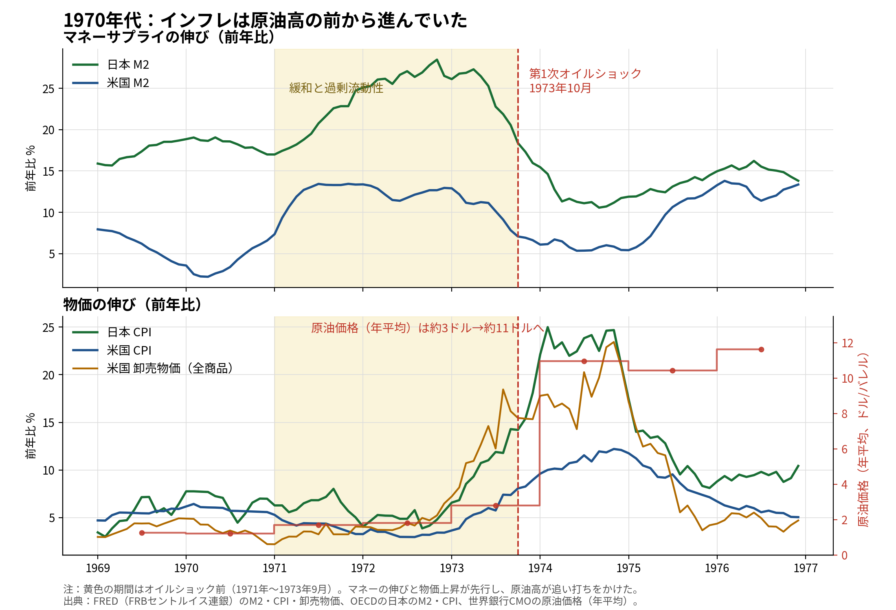
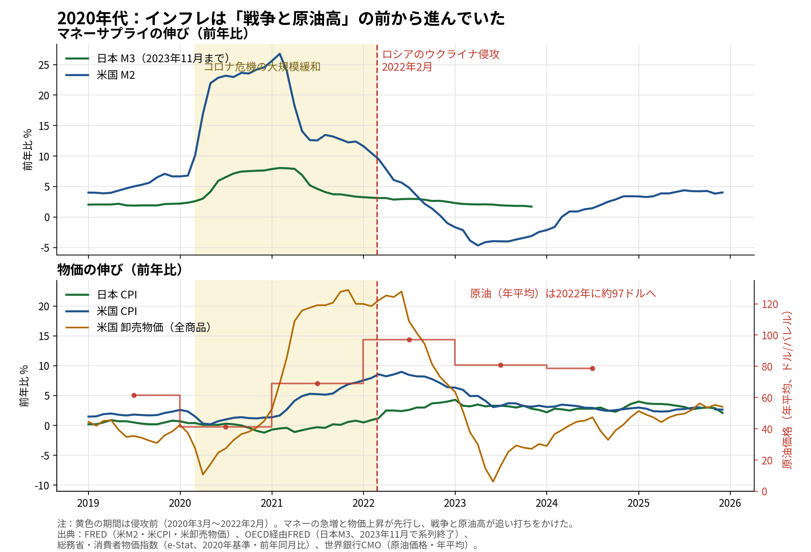

# インフレは原油高の前から進んでいた──1970年代と2020年代のマネーと物価

ウェブ版：[https://p72.github.io/note-draft/インフレと原油高/01\_インフレは原油高の前から進んでいた.html](https://p72.github.io/note-draft/%E3%82%A4%E3%83%B3%E3%83%95%E3%83%AC%E3%81%A8%E5%8E%9F%E6%B2%B9%E9%AB%98/01_%E3%82%A4%E3%83%B3%E3%83%95%E3%83%AC%E3%81%AF%E5%8E%9F%E6%B2%B9%E9%AB%98%E3%81%AE%E5%89%8D%E3%81%8B%E3%82%89%E9%80%B2%E3%82%93%E3%81%A7%E3%81%84%E3%81%9F.html)

GitHub：[https://github.com/p72/note-draft/blob/main/インフレと原油高/01\_インフレは原油高の前から進んでいた.md](https://github.com/p72/note-draft/blob/main/%E3%82%A4%E3%83%B3%E3%83%95%E3%83%AC%E3%81%A8%E5%8E%9F%E6%B2%B9%E9%AB%98/01_%E3%82%A4%E3%83%B3%E3%83%95%E3%83%AC%E3%81%AF%E5%8E%9F%E6%B2%B9%E9%AB%98%E3%81%AE%E5%89%8D%E3%81%8B%E3%82%89%E9%80%B2%E3%82%93%E3%81%A7%E3%81%84%E3%81%9F.md)

※ この記事は、FRED（セントルイス連銀）・OECD・総務省（e-Stat）・世界銀行の公表データと、内閣府「年次世界経済報告」などの公的資料を使って調べている。

「最近のインフレは、戦争と原油高が原因である」という説明をよく聞く。エネルギー価格が上がれば物価が上がる、という話は分かりやすい。しかし、同じ説明は1970年代のオイルショックについても長く使われてきた。当時のデータを確認すると、順序は逆である。インフレは、原油価格が上がる前から進んでいた。

本稿では、1970年代と2020年代について、マネーサプライと物価の推移を並べ、どちらの局面でも「マネーと需要の拡大が先、原油高は後」であったことを確認する。

## 1970年代：石油危機の前に何が起きていたか

### 主要国は同時に拡大政策をとっていた

内閣府「年次世界経済報告」（昭和55年版）は、第1次石油危機の前段を次のように整理している。第1次石油危機が発生する以前、1971年末から73年央にかけて、世界の主要経済圏は同時に極めて早いスピードで拡大した。1972年上期と1973年上期との1年間に、OECDのGNPは実質で7.5%の伸びを示し、鉱工業生産は10%増加した。同報告は「このような高率での拡大は、ほとんどの国が景気拡大策をとったためで、そのこと自体が需給ギャップを縮小させ稼働率を急速に引き上げるなどすでにしてインフレ要因となっていた」と明記している。

さらに重要な要因として挙げられているのが通貨供給量である。同報告によれば、7大国の実質マネーサプライ（M2）は1970年央から急速に増大に転じ、71〜72年は10%を超える増勢を示した。背景には、米国の国際収支赤字の累積とドルへの不信から、米国以外の国で公的部門のドル買い支えが急増したことがあった。ブレトンウッズ体制の末期に、各国は為替を守るための介入を通じて、意図せざる金融緩和を輸入していたのである。

### 日本ではM2が前年比3割近くまで増えた

日本の拡大はとりわけ大きかった。ニクソン・ショック（1971年8月）後の円高への対応として、政府・日銀は円高不況への懸念から1973年春まで金融緩和を続けた。1972年7月に発足した田中角栄内閣は「日本列島改造論」を掲げて積極財政を進めた。財務省の資料も、マネーサプライの急増が物価上昇と土地投機を進めた後に第1次石油危機が発生した、という順序で当時を記述している。

実際に、日本のM2の前年比は1972年11月に+28.5%に達した。米国のM2も1971〜72年に+13%台まで伸びている。

### 物価も原油高に先行して上がっていた

物価の上昇も、1973年10月の石油危機に先行していた。同報告は「国際商品価格が高騰しはじめ、農作物の不作などの要因が加わって、73年に入るとすでにインフレは世界的に加速しだし、物不足感の強まりから投機的在庫積増しが始まっていた。第1次石油危機が発生したのはこの直後である」と書く。

数値で確認すると、石油危機の直前である1973年9月の時点で、消費者物価の前年比は日本が+14.3%、米国が+7.4%であった。米国の卸売物価（全商品）は+16.2%まで上がっていた。原油価格（年平均）は1973年の2.8ドルから1974年に11.0ドルへ跳ね上がるが、それはすでに進んでいたインフレへの追い打ちである。日本の消費者物価は1974年2月に前年比+25.0%でピークを付けた。これが「狂乱物価」と呼ばれた局面である。

同報告の結論は簡潔である。「インフレ期待がすでに深く根をおろしていたことに加えて、数年にわたる通貨供給量の大幅な拡大は、石油ショックのインフレ効果に格好の舞台を提供した」。

米国の研究も同じ結論に達している。NBERのワーキングペーパーは、1970年代の米国インフレについて「主要な失敗は石油危機の前に犯された。1971-72年の緩和は行き過ぎであり、1973年の引き締めは小さく、遅すぎた」と総括している。第2次石油危機（1979年）についても、ダラス連銀の整理によれば、米国のインフレ率は1979年2月に10%に達しており、これはその年の原油価格急騰が本格化する前であった。

上段がマネーサプライの前年比、下段が物価の前年比と原油価格（年平均、右軸）である。黄色の帯が石油危機の前（1971年〜1973年9月）を示す。マネーの伸びのピークと物価の上昇開始は、いずれも赤い破線（1973年10月）の左側にある。

## 2020年代：同じ順序の繰り返し

### コロナ危機対応で米M2は前年比+26.8%になった

2020年のコロナ危機に際して、各国は大規模な財政出動と金融緩和を行った。米国のM2の前年比は2021年2月に+26.8%に達し、現行統計が始まって以来の最大の伸びを記録した。日本のM3も同じ月に+8.1%まで伸びている。規模の差はあるが、マネーの急増が物価上昇に先行した点は1970年代と同じである。

### 侵攻の時点で、米国の物価はすでに上がっていた

物価は2021年を通じて上昇した。ロシアによるウクライナ侵攻（2022年2月24日）の直前、2022年1月の時点で、米国の消費者物価は前年比+7.6%、卸売物価（全商品）は+20.3%であった。内閣府の「世界経済の潮流」も、2021年に入って以降、緩和的な金融環境が続く中で需要が回復し物価が上昇していたところへ、侵攻を受けて「既に上昇していた各国の消費者物価は更に上昇した」という順序で記述している。

原油価格の年平均は2021年の69ドルから2022年に97ドルへ上がり、米国の消費者物価は2022年6月に前年比+9.0%でピークを付けた。原油高がインフレを増幅したことは確かである。しかし、増幅される対象であるインフレそのものは、戦争の前から存在した。

### 日本はマネーの伸びが小さく、インフレも遅く小さかった

日本は対照的である。日本の消費者物価は侵攻の時点で前年比+0.5%にとどまり、ピークは遅れて2023年1月の+4.3%であった。マネーの伸びが米国より小さかったことと、インフレの規模が小さく遅れたことは対応している。この対比は、インフレの主因を原油高に求める説明では得られにくい。原油価格は世界共通であるにもかかわらず、インフレの大きさとタイミングは国ごとに大きく異なったからである。異なるのは、各国のマネーと需要の状況であった。

図の構成は1970年代の図と同じである。黄色の帯が侵攻の前（2020年3月〜2022年2月）を示す。米国のマネーのピーク（2021年2月）と物価の上昇は、赤い破線（2022年2月）の左側で進んでいる。

## なぜ原油高だけでは持続的なインフレにならないのか

原油価格の上昇は、相対価格の変化である。エネルギーの相対価格が上がれば、その分だけ他の支出が圧縮されるのが通常の調整であり、一般物価が継続的に上がり続けるためには、需要の裏付けと金融政策の追随が必要になる。

この点は、モデルでも確認できる。日本銀行の四半期日本経済モデル（Q-JEM）のPython再現（[https://github.com/p72/qjem-python](https://github.com/p72/qjem-python)）で原油価格+50%（恒久的）のショックを与えると、コアCPIの押し上げは4四半期後に+0.54%でピークとなり、その後は縮小して、20四半期後には-0.37%とマイナスに転じる。需給ギャップの悪化が税抜きの国内物価を押し下げるためである。供給ショック単独では、物価の上昇は続かない。

1970年代のインフレが長く続いたのは、ショックの後に金融・財政の緩和が続いたからである。2021〜22年のインフレが比較的短期間で収まったのは、2022年以降に各国の中央銀行が急速な引き締めに転じたからである。原油高は引き金としては大きい。しかし、インフレが一過性で終わるか定着するかは、先行するマネーと需要、およびショック後の政策対応で決まる。1970年代と2020年代は、その順序が共通している。

## データと出典

- 内閣府「年次世界経済報告」（昭和55年版）第2章「石油危機と経済変動」：[https://www5.cao.go.jp/keizai3/sekaikeizaiwp/wp-we80/wp-we80-00203.html](https://www5.cao.go.jp/keizai3/sekaikeizaiwp/wp-we80/wp-we80-00203.html)
- 財務省「Fiscal and Monetary Policies before and after the First Oil Crisis」：[https://www.mof.go.jp/english//pri/publication/policy_1972-1990/Chapter1-2.pdf](https://www.mof.go.jp/english//pri/publication/policy_1972-1990/Chapter1-2.pdf)
- NBER Working Paper 15726「The Great Inflation」：[https://www.nber.org/system/files/working_papers/w15726/w15726.pdf](https://www.nber.org/system/files/working_papers/w15726/w15726.pdf)
- Federal Reserve Bank of Dallas「Lessons from the destabilization of inflation in the 1970s」：[https://www.dallasfed.org/research/economics/2026/0217](https://www.dallasfed.org/research/economics/2026/0217)
- 内閣府「世界経済の潮流」（2022年）第1章：[https://www5.cao.go.jp/keizai3/2022/0203nk/n22_1_1.html](https://www5.cao.go.jp/keizai3/2022/0203nk/n22_1_1.html)

データの取得方法：グラフの系列は2026年11月3日に取得した。米国のM2・消費者物価・卸売物価と日本のM2・M3・消費者物価（1970年代分）はFRED（セントルイス連銀）から（系列はM2SL、CPIAUCSL、PPIACO、MABMM201JPM189N、JPNCPIALLMINMEI、MABMM301JPM189N、いずれもOECD経由を含む）、2020年代分の日本の消費者物価は総務省「消費者物価指数」（2020年基準、総合、前年同月比）をe-Stat APIから、原油価格は世界銀行「Commodity Markets Outlook」の年次データ（3市場の平均）から取得した。前年比はいずれも月次の原系列から算出している。日本のマネーは、2020年代分についてFREDで取得可能なOECD系列の制約によりM3を用い、その系列が2023年11月で終了しているため、図中の日本のマネーの線は同月までである。
