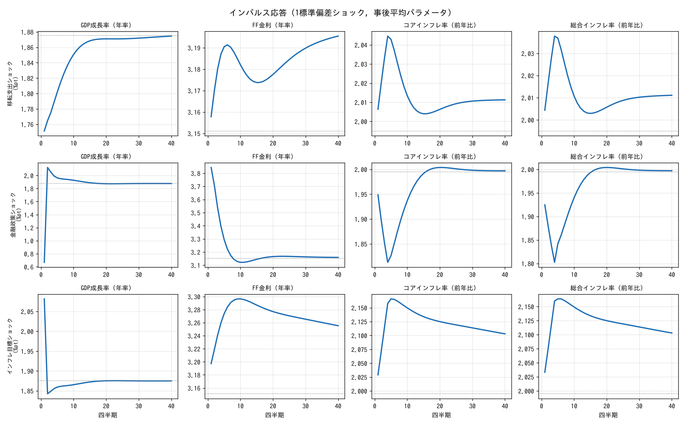
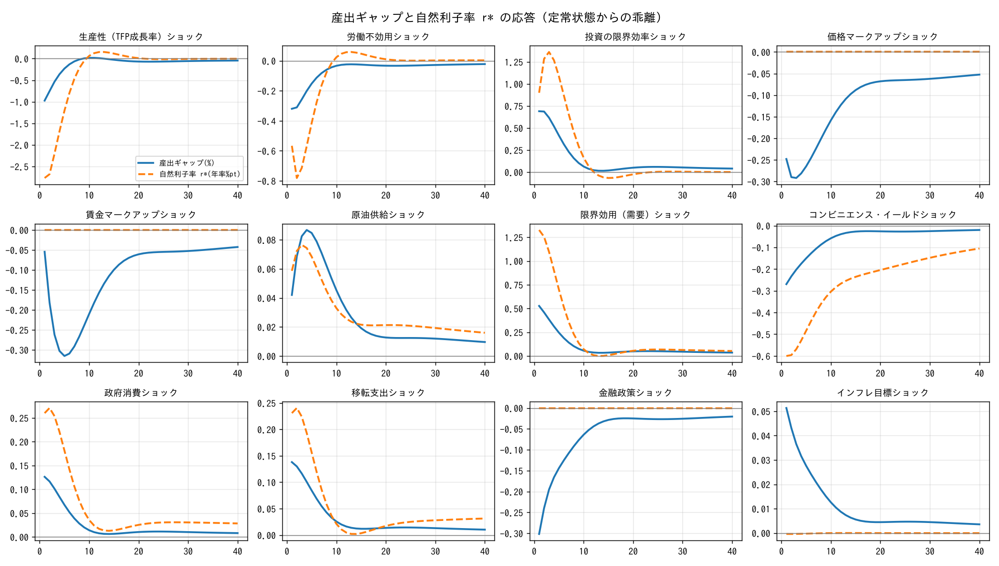
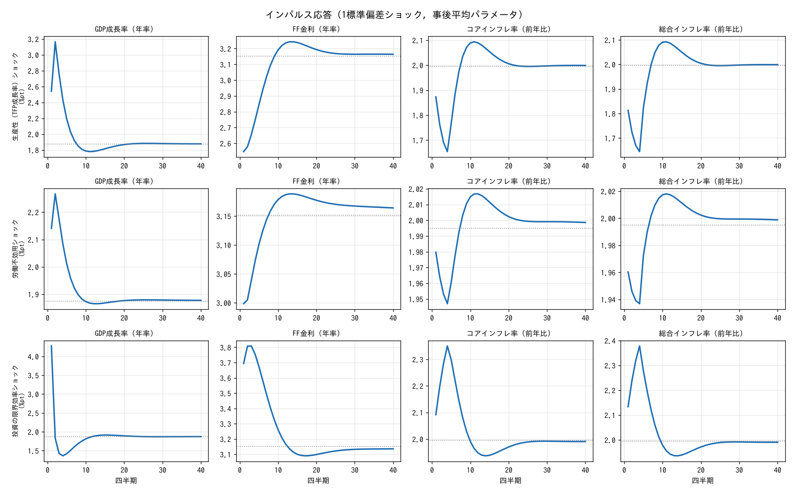

# セントルイス連銀の最新DSGEモデルを Python で動かした──論文の式とパラメータだけでインパルス応答を再現する

ウェブ版：[https://p72.github.io/note-draft/セントルイス連銀のDSGEモデル/01\_セントルイス連銀のDSGEモデルをPythonで動かした.html](https://p72.github.io/note-draft/%E3%82%BB%E3%83%B3%E3%83%88%E3%83%AB%E3%82%A4%E3%82%B9%E9%80%A3%E9%8A%80%E3%81%AEDSGE%E3%83%A2%E3%83%87%E3%83%AB/01_%E3%82%BB%E3%83%B3%E3%83%88%E3%83%AB%E3%82%A4%E3%82%B9%E9%80%A3%E9%8A%80%E3%81%AEDSGE%E3%83%A2%E3%83%87%E3%83%AB%E3%82%92Python%E3%81%A7%E5%8B%95%E3%81%8B%E3%81%97%E3%81%9F.html)

GitHub：[https://github.com/p72/note-draft/blob/main/セントルイス連銀のDSGEモデル/01\_セントルイス連銀のDSGEモデルをPythonで動かした.md](https://github.com/p72/note-draft/blob/main/%E3%82%BB%E3%83%B3%E3%83%88%E3%83%AB%E3%82%A4%E3%82%B9%E9%80%A3%E9%8A%80%E3%81%AEDSGE%E3%83%A2%E3%83%87%E3%83%AB/01_%E3%82%BB%E3%83%B3%E3%83%88%E3%83%AB%E3%82%A4%E3%82%B9%E9%80%A3%E9%8A%80%E3%81%AEDSGE%E3%83%A2%E3%83%87%E3%83%AB%E3%82%92Python%E3%81%A7%E5%8B%95%E3%81%8B%E3%81%97%E3%81%9F.md)

2026年11月、セントルイス連銀（FRB St. Louis）の *Review* に、同連銀の調査部が予測と政策分析に使っている DSGE モデルの解説論文が掲載された（Faria-e-Castro, "The St. Louis Fed DSGE Model", *Review*, Fourth Quarter 2026, Vol. 108, No. 14）。記事ページは [https://www.stlouisfed.org/publications/review/2026/nov/st-louis-fed-dsge-model](https://www.stlouisfed.org/publications/review/2026/nov/st-louis-fed-dsge-model) である。

論文の付録には、均衡条件の一覧、カリブレーション値、パラメータの事後分布がすべて載っている。一方、推計に使った Dynare（MATLAB）のコードは公開されていないようである。

本稿では、付録の式とパラメータだけを使ってモデルを Python に書き起こし、付録Dのインパルス応答（IRF）がどこまで再現できるかを確かめる。コードは [https://github.com/p72/stlouis-dsge-python](https://github.com/p72/stlouis-dsge-python) で公開している。

## このモデルの3つの特徴

土台は Smets-Wouters 型の中規模ニューケインジアンモデルである。そこに、ほかの連銀モデルにはない拡張が3つ加えられている。

### 1. 家計の異質性：労働者と資本家

Cantore and Freund (2021) にならい、家計を2種類に分けている。

| | 資本家（約39%） | 労働者（約61%） |
|---|---|---|
| 働くか | 働かない | 働く（賃金は労働組合が設定） |
| 資産 | 国債・資本・企業を保有 | 国債のみ（ポートフォリオ調整費用あり） |
| 限界消費性向 | 低い（リカーディアン） | 高い。ただし1ではない |

労働者を完全な hand-to-mouth にはせず、調整費用を払えば貯蓄できるようにしている点が工夫である。このため、給付金のような移転支出を分析しても、限界消費性向が1という極端な結果にならない。

### 2. 本格的な財政ブロック

政府消費、移転支出、消費税、労働所得税、資本所得税、国債をすべて明示的に扱う。税率は債務/GDP比に反応する財政ルールに従うので、財政赤字が債務を増やし、それが将来の増税につながる経路がモデルに入っている。

### 3. 原油

原油は生産の投入物であり、消費財でもある（Gagliardone and Gertler, 2023）。どちらの場合も、他の財と強い補完関係にある。このため、原油価格ショックは総合インフレだけでなく、企業の限界費用を通じてコアインフレにも波及する。コアと総合のインフレの違いを描けるのが、このモデルの特徴である。

構造ショックは12個ある（TFP成長率、労働供給、投資効率、価格マークアップ、賃金マークアップ、原油供給、需要、コンビニエンス・イールド、政府消費、移転支出、金融政策、インフレ目標）。推計は1959年1-3月期から2026年4-6月期までの15系列を使ったベイズ推定で、COVID期には特殊なショックを加えている。

## Python への移植

| 工程 | 中身 |
|---|---|
| 均衡条件 | 付録Aの式 (47)〜(99) をトレンド除去後の形でそのまま実装 |
| 伸縮価格経済 | 同時に解いて、産出ギャップと自然利子率 r* を計算 |
| 定常状態 | 解析的に計算（労働=1、原油の実質価格=1 に正規化） |
| 線形化 | 複素ステップ微分で機械精度のヤコビアンを計算 |
| 解法 | `scipy.linalg.ordqz`（QZ分解）による Blanchard-Kahn 型の一次近似解 |
| パラメータ | 表1のカリブレーション値と、表C-1・C-2の事後平均 |

変数は全部で98個である。Blanchard-Kahn 条件（安定根の数 = 98）を満たし、解の残差は 5×10⁻¹² だった。使い方は次のとおりである。

```python
from stlouis_dsge import Model
m = Model().solve()
irf = m.irf('mp', T=40)        # 金融政策ショック（1標準偏差）への応答
ffr = m.series(irf, 'ffr')     # FF金利（年率%）の経路
```

## 結果：12個中10個のショックで論文のIRFをほぼ再現

論文の付録Dと同じく、GDP成長率、FF金利、コアインフレ（前年比）、総合インフレ（前年比）の4変数を描いた。点線は定常状態の値である。



論文の図から目で読み取った値と比べると、次のようになった。

| ショック | FF金利の極値 論文 / Python | コアインフレの極値 論文 / Python |
|---|---|---|
| インフレ目標 | 3.28 / 3.30 | 2.165 / 2.17 |
| 需要（限界効用） | 3.45 / 3.47 | 2.17 / 2.18 |
| コンビニエンス・イールド | 2.75 / 2.69 | 1.73 / 1.73 |
| 原油供給 | 3.18 / 3.19 | 総合 1.84 / 1.85 |
| 価格マークアップ | 3.33 / 3.40 | 2.17 / 2.21 |
| 金融政策 | 3.70 / 3.84 | 1.76 / 1.81 |
| 政府消費 | 3.21 / 3.25 | 2.025 / 2.06 |
| 移転支出 | 3.18 / 3.20 | 2.012 / 2.04 |

公表された式とパラメータだけから、応答の形も大きさもかなりの精度で再現できた。

伸縮価格経済も同時に解いているので、産出ギャップと自然利子率 r* の応答も計算できる。



## 合っていないところ

TFP成長率ショックと労働不効用ショックは、どちらも恒久的なトレンドを動かすショックである。この2つでは、インパクト時のGDP成長率が論文より小さく（TFPショックで論文4.0、Python 2.5）、FF金利とインフレの低下が大きく出る。



原因は、論文に明記されていない実装の細部（賃金フィリップス曲線のトレンド調整や、Dynare での変数のタイミングなど）にあると考えている。原典のコードがないので、確かめることはできていない。

## 今後の課題

1. **歴史分解の再現**。論文の図4は、2020年以降のコアPCEインフレ（前年比）を供給・需要・金融・財政・原油の各ショックに分解し、2021〜23年のインフレには財政（移転支出）と金融政策の寄与が大きかったとしている。これを Python で再現するには、FRED などから15個の観測系列を集め、10年金利などの観測方程式を実装し、カルマン平滑化で構造ショックを取り出す必要がある。
2. 事後モードの推定と MCMC によるベイズ推定。
3. 原油先物やFF金利先物の経路を条件とする条件付き予測。

## データと出典

- Faria-e-Castro, M. (2026) "The St. Louis Fed DSGE Model," Federal Reserve Bank of St. Louis *Review*, 108(14), pp. 1-38：[https://www.stlouisfed.org/publications/review/2026/nov/st-louis-fed-dsge-model](https://www.stlouisfed.org/publications/review/2026/nov/st-louis-fed-dsge-model)（DOI：[https://doi.org/10.20955/r.2026.14](https://doi.org/10.20955/r.2026.14)）
- Cantore, C. and L. B. Freund (2021) "Workers, capitalists, and the government: fiscal policy and income (re)distribution," *Journal of Monetary Economics*, 119, 58–74.
- Gagliardone, L. and M. Gertler (2023) "Oil Prices, Monetary Policy and Inflation Surges," NBER Working Paper 31263.
- Smets, F. and R. Wouters (2007) "Shocks and Frictions in US Business Cycles: A Bayesian DSGE Approach," *American Economic Review*, 97(3), 586–606.
- Python コード：[https://github.com/p72/stlouis-dsge-python](https://github.com/p72/stlouis-dsge-python)

データの取得方法：本稿の計算は観測データを使っていない。パラメータは論文の表1、表C-1、表C-2の値（事後平均）をそのまま用いた。論文の図との比較値は、付録Dの図から目で読み取ったものである。
