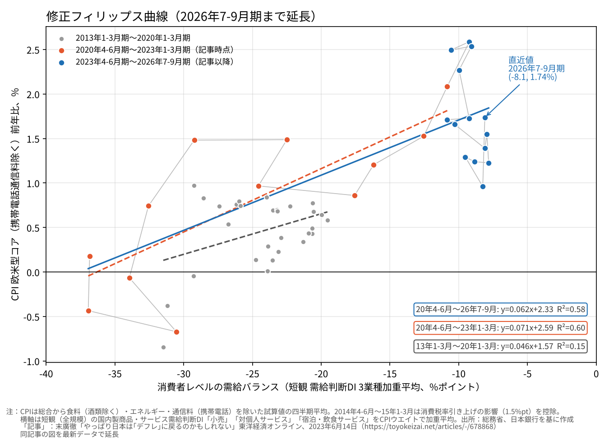
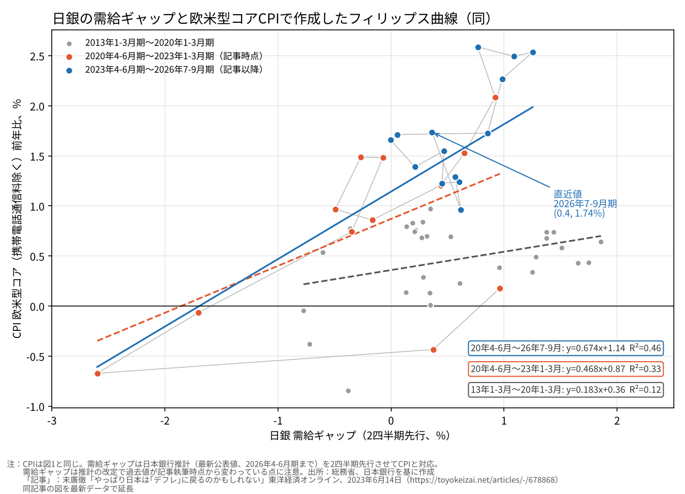
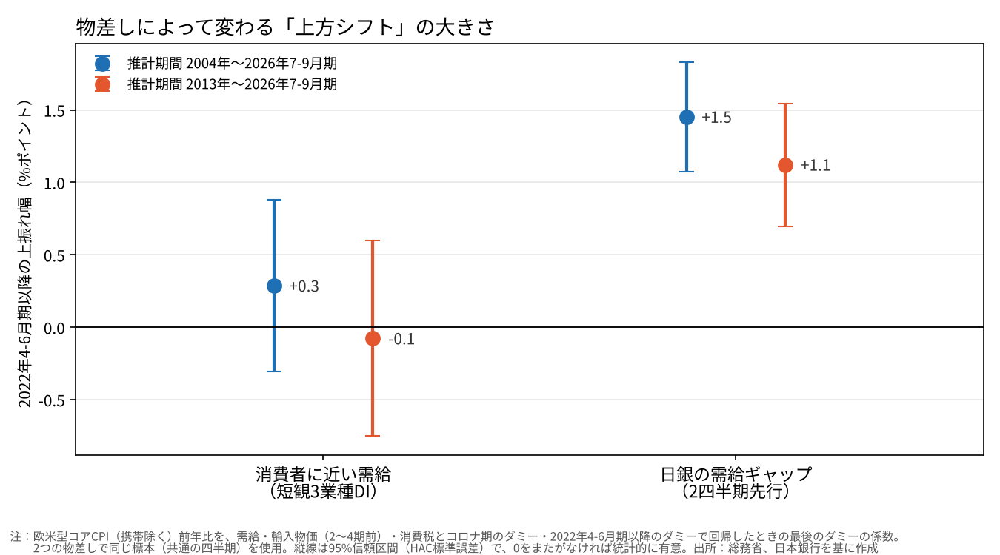
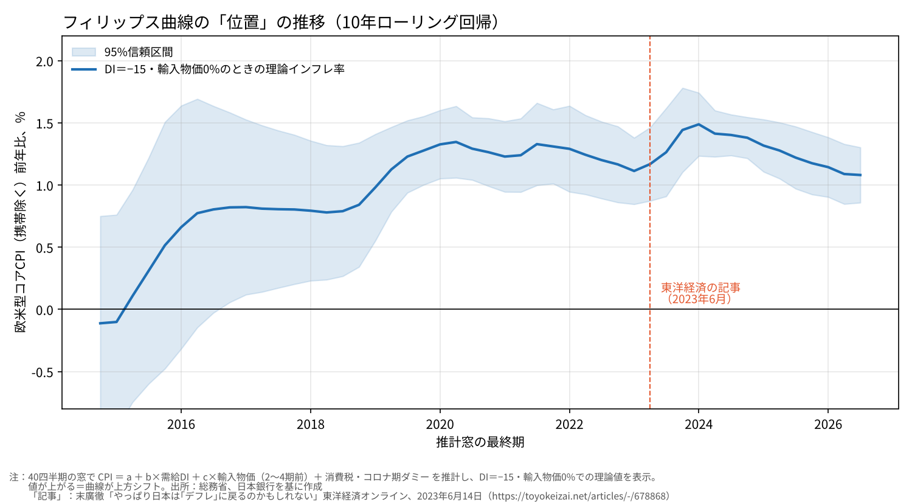
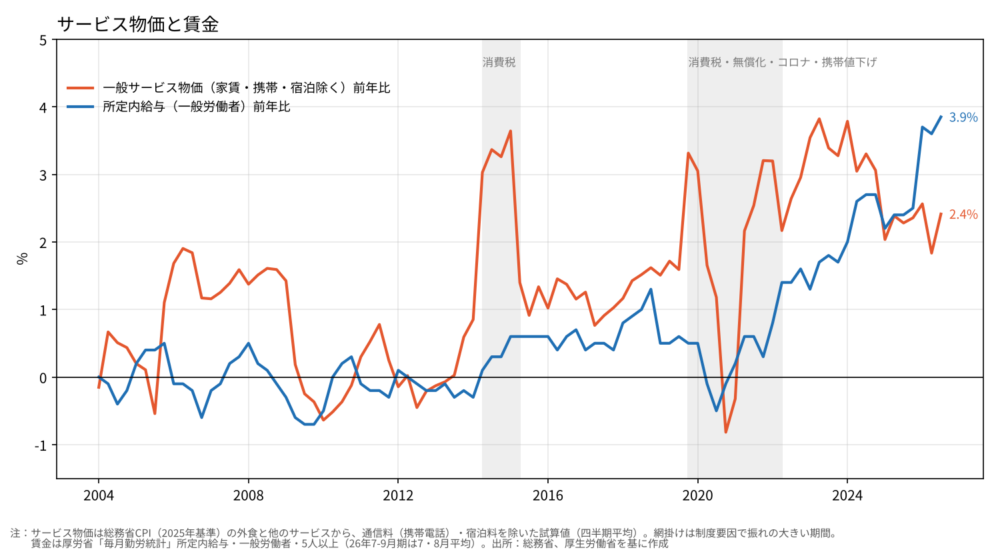

# 日銀の需給ギャップで描くと、フィリップス曲線の上方シフトは大きく見える──上方シフトの評価は需給の物差しに強く依存する

ウェブ版：[https://p72.github.io/note-draft/フィリップス曲線の上方シフト/01\_日銀の需給ギャップでは上方シフトが大きく見える.html](https://p72.github.io/note-draft/%E3%83%95%E3%82%A3%E3%83%AA%E3%83%83%E3%83%97%E3%82%B9%E6%9B%B2%E7%B7%9A%E3%81%AE%E4%B8%8A%E6%96%B9%E3%82%B7%E3%83%95%E3%83%88/01_%E6%97%A5%E9%8A%80%E3%81%AE%E9%9C%80%E7%B5%A6%E3%82%AE%E3%83%A3%E3%83%83%E3%83%97%E3%81%A7%E3%81%AF%E4%B8%8A%E6%96%B9%E3%82%B7%E3%83%95%E3%83%88%E3%81%8C%E5%A4%A7%E3%81%8D%E3%81%8F%E8%A6%8B%E3%81%88%E3%82%8B.html)

GitHub：[https://github.com/p72/note-draft/blob/main/フィリップス曲線の上方シフト/01\_日銀の需給ギャップでは上方シフトが大きく見える.md](https://github.com/p72/note-draft/blob/main/%E3%83%95%E3%82%A3%E3%83%AA%E3%83%83%E3%83%97%E3%82%B9%E6%9B%B2%E7%B7%9A%E3%81%AE%E4%B8%8A%E6%96%B9%E3%82%B7%E3%83%95%E3%83%88/01_%E6%97%A5%E9%8A%80%E3%81%AE%E9%9C%80%E7%B5%A6%E3%82%AE%E3%83%A3%E3%83%83%E3%83%97%E3%81%A7%E3%81%AF%E4%B8%8A%E6%96%B9%E3%82%B7%E3%83%95%E3%83%88%E3%81%8C%E5%A4%A7%E3%81%8D%E3%81%8F%E8%A6%8B%E3%81%88%E3%82%8B.md)

※ この記事は、総務省の消費者物価指数（e-Stat API）、厚生労働省の毎月勤労統計（e-Stat）、日本銀行の短観・輸入物価指数（時系列統計データ検索サイトAPI）と需給ギャップの公表データを使い、Python で作図・推計している。コードとデータは同じフォルダの `code/` にある。2026年10月24日に査読を受けて改訂した（末尾の「改訂履歴」を参照）。

## はじめに

2023年6月、大和証券の末廣徹氏が東洋経済オンラインに「やっぱり日本は『デフレ』に戻るのかもしれない」という記事を書いた。

[https://toyokeizai.net/articles/-/678868](https://toyokeizai.net/articles/-/678868)

当時、植田総裁は就任後初めての講演で、日銀が推計する需給ギャップと消費者物価で描いたフィリップス曲線を示した。コロナ後の点は従来の線より上に位置し、物価と需給の関係が上にずれた（上方シフトした）ようにも見えた。

末廣氏は、この見え方は物差しの選び方に左右されていると指摘した。物価は消費者が払う値段なのだから、需給も経済全体ではなく、消費者に近いところで測るべきだというのである。そこで日銀短観の「小売」「対個人サービス」「宿泊・飲食サービス」の需給判断DIを使って描き直すと、曲線はほとんど動いておらず、当時の物価上昇は需給の引き締まりで説明できた。だとすれば、需給が平時に戻れば、物価上昇率も平時に戻る、というのが記事の結論だった。

それから3年余りが過ぎた。本稿では、末廣氏の2つの図を2026年7-9月期まで延長し、上方シフトがどう見えるかを確かめる。

## 要旨

- 消費者に近い需給は、記事の後も平時に戻らなかった。2023年以降の需給判断DIは、コロナ前に一度も見られなかったほど締まった水準にある。それでも、物価上昇率（欧米型コア）は2%台半ばから1%台半ばまで下がった。
- 同じ物価、同じ説明変数で横軸だけを入れ替えて回帰すると、日銀の需給ギャップでは1〜1.5%ポイント程度の上方シフトがはっきり検出される。消費者に近い需給では、シフトの推計値は小さく、ゼロと区別できない。ただし、0.5%ポイント前後のシフトも否定できない。
- つまり、上方シフトの大きさの評価は、需給の物差しに強く依存する。どちらの物差しが正しいかは、この分析では決められない。消費者に近い需給には、いまの水準がコロナ前の経験の外にあるという弱点もある。
- 筆者は日銀の引き締め姿勢に慎重な立場である。その根拠は「シフトがない」ことではなく、「シフトの大きさが物差し次第でこれほど振れる」ことにある。

## 1. 物差しの違い

フィリップス曲線は、横軸に需給のゆるみ・締まり、縦軸に物価上昇率をとった図である。需給が締まれば物価は上がる。曲線そのものが上に動けば、同じ需給でも物価が高くなる。日銀が目指してきたのは、予想物価上昇率が2%に定着し、この関係が上に切り上がった状態である。

問題は横軸に何を使うかである。日銀の需給ギャップは、資本と労働の稼働状況から経済全体の需給を推計したもので、製造業の設備や労働市場の逼迫も含む。一方、消費者物価が直接映すのは、店頭やサービスの現場での需給である。末廣氏の「修正フィリップス曲線」は、短観のうち消費者に近い3業種の需給判断DIを、消費者物価のウエイトで加重平均して横軸にしたものだ。

縦軸もそろえる。ここでは末廣氏にならい、消費者物価から食料（酒類を除く）とエネルギー、それに2021年の携帯電話料金引き下げの影響を除いた「欧米型コア」を使う。輸入原材料や制度変更の影響をなるべく外し、国内の需給で決まる部分を見るためである。なお、日銀の2%目標は総合の消費者物価についての目標であり、この欧米型コアそのものの目標ではない。

## 2. 3年後の姿

図1の灰色はコロナ前（2013〜20年）、赤は記事執筆時点までのコロナ後（2020〜23年）、青は記事以降（2023〜26年）である。

青の点は右上の一角に固まっている。消費者に近い需給は記事の後も締まったままで、コロナ前のどの時期よりも右にある。末廣氏が見込んだ「需給が平時に戻る」局面は、まだ来ていない。

縦方向の動きははっきりしている。2023年に2%台半ばだった物価上昇率は、需給がほとんど変わらないまま、1%台前半から半ばまで下がった。2023年の高い伸びには、需給の締まりに一時的なコストの押し上げが重なっていたと考えられる。

コロナ前の灰色の線を右に伸ばすと、いまの需給の締まり具合で予想される物価上昇率は1%強になり、青の点はその近く、やや上に散らばる。ただし、この見方には注意が要る。青の点がある範囲には、コロナ前のデータが一つもない。灰色の線を「経験したことのない締まり具合でも直線のまま続く」と仮定して延ばしているにすぎない。

同じ物価を、日銀の需給ギャップに対して描いたのが図2である。こちらでは、コロナ後の点がコロナ前の線から大きく上に離れている。需給ギャップは小幅なプラスで推移しているのに物価が高いので、曲線が上にずれたように見える。こちらは、2023年以降の需給ギャップの値がコロナ前に観測された範囲の中に収まっており、比較の土台は図1よりしっかりしている。

同じ物価でも、横軸の取り方ひとつで「上方シフトした」とも「ほとんどしていない」とも読める。末廣氏が2023年に指摘した構図は、3年後のいまも変わっていない。

## 3. 物差しを替えると上方シフトの大きさが変わる

図の印象を数字で確かめるため、回帰分析で上方シフトの大きさを測った。

考え方は単純である。まず、物価上昇率を需給の締まり具合で説明する式を、長い期間のデータで当てはめる。そのうえで、2022年4-6月期以降の物価が、この式から予想される水準より平均で何%ポイント上にあるかを推計する。これが「シフト」の大きさである。需給だけでは説明できない上振れが続いていれば、シフトはプラスで、ゼロとはっきり区別できる値になる。

起点を2022年4-6月期にしたのは、2021年の携帯電話料金引き下げの影響が前年比から抜け、コロナ期の特殊な動きも一巡した時期だからである。物価には輸入物価の影響が大きく出るので、これも式に入れて取り除いた。消費税率の引き上げや、コロナ期のGo Toトラベル、教育の無償化といった制度要因の時期も、別に扱っている。

この推計を、まったく同じ四半期のデータで、横軸の物差しだけを入れ替えて行った。推計期間は2004年からと2013年からの2つを試した。

結果は物差しによって大きく分かれた（図3）。

- 日銀の需給ギャップを使うと、シフトは1〜1.5%ポイント程度で、どちらの推計期間でもゼロとはっきり区別できる。
- 消費者に近い需給を使うと、シフトの推計値はゼロ近くで、ゼロと区別できない。

ここで、二つのことを区別しておく必要がある。

一つは、「ゼロと区別できない」ことは「シフトがない」ことを意味しない、という点である。消費者に近い需給での推計は幅が広く、0.5%ポイント前後の上方シフトとも矛盾しない。物価目標の議論では、この幅は小さくない。

もう一つは、二つの物差しの結果の差そのものである。2004年からの推計では、日銀の需給ギャップのほうがシフトを1%ポイント余り大きく見積もり、その差は統計的にも明確だった。2013年からの推計でも差の大きさはほぼ同じだが、標本が短いぶん推計の幅が広がり、差がゼロである可能性を排除しきれなかった。

需給の水準によってシフトの大きさが変わる可能性（傾きの変化）を許したモデルでも、2022年以降の平均的な需給の水準で評価したシフトの大きさはほとんど変わらなかった。

以上から言えるのは、**上方シフトの大きさの評価は、需給の物差しに強く依存する**ということである。日銀の需給ギャップに基づく評価が高めに出ている可能性はある。一方で、消費者に近い需給のほうが変化を吸収して、シフトを小さく見せている可能性もある。どちらが真の需給に近いかは、この分析だけでは決められない。

参考として、消費者に近い需給を横軸にした曲線の位置を、10年分のデータで推計をずらしながら追ったのが図4である。一定の需給の締まり具合（需給判断DIが−15）のもとで予想される物価上昇率を計算している。

この値は2010年代後半に上がり、2022年以降は2024年にかけて小幅に上がった後、足元では2010年代後半の水準に戻っている。ただし、推計の窓が動くと古いデータが抜け落ちるので、この上がり下がりを特定の政策の効果と結びつけることはできない。また、傾きも窓ごとに変わるため、この値はあくまで「需給判断DIが−15のときの水準」であり、曲線全体の動きを表すものではない。

## 4. 賃金はどう効いているか

日銀は「賃金と物価の好循環」を重視している。賃上げがサービス価格に波及し、それが次の賃上げにつながる流れである。この流れが強まっていれば、需給とは別に、賃金が物価を押し上げる力が見えるはずだ。

賃金の伸びを、2年分の遅れ（ラグ）までまとめて式に加え、その効果の合計を推計した。需給を式に入れないと、賃金の効果はプラスに出る。しかし需給を入れると、賃金の上乗せ分はゼロ近くか、推計期間によってはマイナスになった。需給が締まる局面では賃金も上がるので、賃金の力のかなりの部分は需給と重なっている。ただ、両者の重なりは推計できないほど強いわけではなく、賃金独自の効果が見えない理由を重なりだけに求めることはできない。直近の数年に、賃金が加速する一方で物価が減速したことが、推計を下に引っ張っている面もある。

賃金の影響を受けやすいサービス物価に絞って見たのが図5である。水準で見ると、賃金もサービス物価もコロナ前より一段高いところに移った。一方、足元では賃金の伸びが4%近くまで加速しているのに、サービス物価の伸びは2%台前半で落ち着いている。

これが、企業が人件費の上昇を利幅で吸収しているためなのか、生産性の上昇で吸収できているためなのかは、ここでは判断できない。図の賃金は一般労働者の月額の所定内給与で、対象のサービス業や労働時間とも一致していない。言えるのは、賃金の加速がサービス価格の加速にすぐつながる動きは、少なくともまだ見えていない、ということまでである。

## 5. この分析の限界

第一に、どちらの物差しが真の需給に近いかは識別できていない。短観の需給判断DIは、企業が自分の業界の需給をどう感じているかという主観的な判断である。人手不足で供給が絞られても、需給は締まったと答えられる。値上げと需要の変化が同時に起きれば、DIと物価は互いに影響し合う。DIが予想物価や価格設定の変化に関わる情報まで吸収していれば、シフトが小さく推計されても、そうした変化がなかったとは言えない。

第二に、消費者に近い需給の現在の水準は、コロナ前の観測範囲から大きく外れている。DIは回答割合の差なので、ある水準より先は動きにくい可能性もある。この領域でのシフトの推計は、直線の関係を延長できるという仮定に強く依存している。

第三に、予想物価上昇率である。短観の企業の物価見通しは、2022年以降、1%前後から2%台半ばへ上がった。これを式に加えると、期待を通じた上方シフトを示唆する結果も出る。ただ、見通しは足元の物価を後追いする面が強く、因果を確定することは難しい。そもそも、本稿で推計したシフトは「需給と輸入物価で説明できない平均的な上振れ」であり、予想物価の構造変化を直接測ったものではない。

第四に、サービス物価に限ると、推計期間を2004年からにした場合に上方シフトが検出される。欧米型コア全体では見えにくくても、サービスの分野では関係が切り上がっている可能性がある。

第五に、計算上の近似がある。携帯電話料金の影響の除去や3業種のウエイトは公表データからの試算である。日銀の需給ギャップも推計の改定で過去の値が変わっており、2023年当時の図とは形が異なる。

最後に、日銀は需給ギャップだけで判断しているわけではない。賃金、予想物価、企業の価格設定行動などを総合して基調的な物価を評価している。本稿の指摘は、その判断材料のうちフィリップス曲線の読み方に関するものにとどまる。

## まとめ

分析からわかったことは二つである。

一つ目に、上方シフトの大きさの評価は、需給の物差しに強く依存する。日銀の需給ギャップで測ると1〜1.5%ポイント程度のシフトが明確に出るが、消費者に近い需給で測ると推計値はゼロ近くになり、ゼロとも0.5%ポイント前後とも区別できない。

二つ目に、消費者に近い需給はコロナ前に経験のないほど締まっているのに、物価上昇率は1%台半ばにとどまっている。

ここからは筆者の意見である。

筆者は、日銀の引き締め姿勢には慎重であるべきだと考えている。その理由は「上方シフトがない」からではない。本稿の分析は、それを示せていない。理由は、上方シフトの大きさが、需給をどう測るかによってゼロから1.5%ポイントまで振れるほど不確かだからである。

もし物価を支えているのが曲線の上方シフトではなく、需給の締まりであれば、引き締めで需要が冷えたとき、物価は曲線に沿って下がる。歴史的に強い需給のもとでも欧米型コアが1%台半ばという事実は、その可能性を軽視できないことを示している。末廣氏が2023年に示した「デフレ寄りへの回帰」のシナリオは、需給が緩んでいないから表に出ていないだけで、消えたとは言い切れない。

政策の効果について大きな不確実性があるときは、政策を小刻みに、慎重に動かすのがよい、という考え方がある。上方シフトの評価がこれほど物差しに依存する以上、それを前提にした引き締めは、需給そのものが崩れないかを確かめながら進めるのが妥当だと考える。2026年に入ってからの輸入物価の急上昇も、まずはコストによる押し上げとして扱い、持続的な関係の変化と区別して見る必要がある。

## データと作り方

- 物価：総務省「消費者物価指数」（2025年基準、e-Stat API、statsDataId＝0004052037）。食料（酒類を除く）及びエネルギーを除く総合から、通信料（携帯電話）を除いた前年比を試算し、四半期平均した
- 消費税率引き上げの扱い：図1・図2では2014年4-6月期〜15年1-3月期の前年比から、前後の段差で推計した1.5%ポイントを差し引いた。回帰（図3・図4と賃金の推計）では差し引かない系列を使い、消費税率引き上げ期のダミーで扱った
- 消費者に近い需給：日本銀行「短観」の国内での製商品・サービス需給判断DI（全規模、実績）のうち小売・対個人サービス・宿泊・飲食サービスを加重平均した（時系列統計データ検索サイトAPI、DB＝CO）。ウエイトは消費者物価のウエイト（2025年基準）から、小売＝食料・エネルギーを除く財（2,152）、対個人サービス＝持家の帰属家賃を除くサービスから外食・宿泊料を除いたもの（2,704）、宿泊・飲食サービス＝外食と宿泊料（626）とした
- 日銀の需給ギャップ：日本銀行「需給ギャップと潜在成長率」の公表値（2026年4-6月期まで）。末廣氏の図にならい2四半期先行させた（物価の各四半期に、2四半期前の需給ギャップを対応させた）
- 図3のシフト：欧米型コアの前年比を、需給、輸入物価（円ベース、前年比、2〜4四半期前の平均）、消費税率引き上げ期（2014年4-6月期〜15年1-3月期、2019年10-12月期〜20年7-9月期）とコロナ期（2020年4-6月期〜21年10-12月期）のダミー、2022年4-6月期以降のダミーで回帰し、最後のダミーの係数をシフトとした。二つの物差しで同じ四半期の標本を使っている。推計値（%ポイント）は、消費者に近い需給で＋0.3（2004年〜、95%信頼区間−0.3〜＋0.9）、−0.1（2013年〜、同−0.8〜＋0.6）、日銀の需給ギャップで＋1.5（2004年〜、同＋1.1〜＋1.8）、＋1.1（2013年〜、同＋0.7〜＋1.5）
- 二つの物差しのシフトの差：同じ標本を4四半期単位で復元抽出するブロック・ブートストラップ（2,000回）で信頼区間を求めた。差は2004年〜で＋1.2（95%信頼区間＋0.7〜＋1.7）、2013年〜で＋1.2（同−0.6〜＋1.5）
- 傾きの変化：上の式に2022年4-6月期以降のダミーと需給の交差項を加え、2022年以降の需給の平均水準でシフトを評価した
- 賃金：毎月勤労統計の所定内給与（一般労働者、5人以上）の前年比。当期から7四半期前までのラグをまとめて式に入れ、係数の合計を累積効果とした
- サービス物価：外食と他のサービスから、携帯電話通信料と宿泊料を除いた前年比の試算値
- 標準誤差：図3、回帰の係数、図4のローリング推計とも、自己相関と不均一分散に頑健な標準誤差（ラグ4）を使った
- 推計結果：`code/shift_est_rev.csv`（シフトと傾き変化）、`code/shift_diff_rev.csv`（シフトの差）、`code/wage_cum.csv`（賃金の累積効果）、`code/rolling.csv`（図4）
- コード：`code/`（パネルの作成は `build.py`・`data2.py`、図3は `plot_shift.py`、追加の検証は `reg_rev.py`・`wage_cum.py`）

## 参考文献

- 末廣徹「やっぱり日本は『デフレ』に戻るのかもしれない 需給が締まって起きた『当たり前のインフレ』」東洋経済オンライン、2023年6月14日
  [https://toyokeizai.net/articles/-/678868](https://toyokeizai.net/articles/-/678868)
- 日本銀行「需給ギャップと潜在成長率」
  [https://www.boj.or.jp/research/research\_data/gap/index.htm](https://www.boj.or.jp/research/research_data/gap/index.htm)
- 日本銀行「短観（全国企業短期経済観測調査）の解説」
  [https://www.boj.or.jp/statistics/outline/exp/tk/extkre.htm](https://www.boj.or.jp/statistics/outline/exp/tk/extkre.htm)
- 日本銀行「物価安定の目標」
  [https://www.boj.or.jp/mopo/outline/target.htm](https://www.boj.or.jp/mopo/outline/target.htm)
- 日本銀行 時系列統計データ検索サイト
  [https://www.stat-search.boj.or.jp/](https://www.stat-search.boj.or.jp/)
- 総務省統計局「消費者物価指数（CPI）」全国月報
  [https://www.stat.go.jp/data/cpi/sokuhou/tsuki/pdf/zenkoku.pdf](https://www.stat.go.jp/data/cpi/sokuhou/tsuki/pdf/zenkoku.pdf)
- 総務省統計局「2025年基準 消費者物価指数の解説」
  [https://www.stat.go.jp/data/cpi/2025/kaisetsu/index.html](https://www.stat.go.jp/data/cpi/2025/kaisetsu/index.html)

## 改訂履歴

- 2026年10月24日：査読を受けて改訂した。主な変更は次の通り
  - 日銀の需給ギャップを2四半期先行させる処理で、最新の四半期（2026年7-9月期）が抜け落ちていた誤りを修正し、二つの物差しを同じ標本で推計し直した（結果はほぼ変わらない）
  - 「ゼロと区別できない」と「シフトがない」を区別し、二つの物差しの差の検定と、傾きの変化を許したモデルを追加した
  - 消費者に近い需給の現在の水準がコロナ前の観測範囲の外にあることを明記した
  - 図4のローリング推計の信頼区間を、自己相関と不均一分散に頑健な標準誤差に改め、特定の政策の効果と結びつけた解釈を削除した
  - 賃金の節で、ラグをまとめて入れた累積効果に改め、利幅についての断定を削除した
  - 中心の主張を「上方シフトの評価は物差しに強く依存する」に置き直し、分析の結論と筆者の意見を分けた
