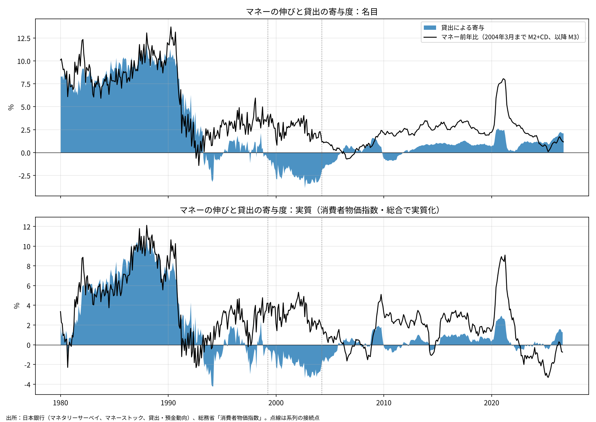
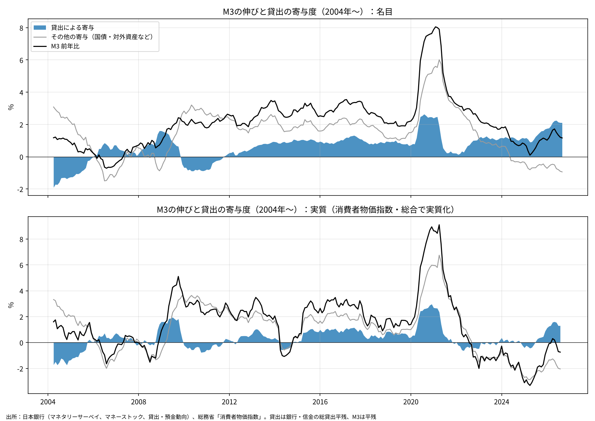

# マネーの伸びのうち貸出によるものはどれだけか──1980年代はほぼ全部、いまは名目で2％ポイント、実質で1％ポイント余り

ウェブ版：[https://p72.github.io/note-draft/マネーストックと貸出/01\_マネーの伸びのうち貸出によるものはどれだけか.html](https://p72.github.io/note-draft/%E3%83%9E%E3%83%8D%E3%83%BC%E3%82%B9%E3%83%88%E3%83%83%E3%82%AF%E3%81%A8%E8%B2%B8%E5%87%BA/01_%E3%83%9E%E3%83%8D%E3%83%BC%E3%81%AE%E4%BC%B8%E3%81%B3%E3%81%AE%E3%81%86%E3%81%A1%E8%B2%B8%E5%87%BA%E3%81%AB%E3%82%88%E3%82%8B%E3%82%82%E3%81%AE%E3%81%AF%E3%81%A9%E3%82%8C%E3%81%A0%E3%81%91%E3%81%8B.html)

GitHub：[https://github.com/p72/note-draft/blob/main/マネーストックと貸出/01\_マネーの伸びのうち貸出によるものはどれだけか.md](https://github.com/p72/note-draft/blob/main/%E3%83%9E%E3%83%8D%E3%83%BC%E3%82%B9%E3%83%88%E3%83%83%E3%82%AF%E3%81%A8%E8%B2%B8%E5%87%BA/01_%E3%83%9E%E3%83%8D%E3%83%BC%E3%81%AE%E4%BC%B8%E3%81%B3%E3%81%AE%E3%81%86%E3%81%A1%E8%B2%B8%E5%87%BA%E3%81%AB%E3%82%88%E3%82%8B%E3%82%82%E3%81%AE%E3%81%AF%E3%81%A9%E3%82%8C%E3%81%A0%E3%81%91%E3%81%8B.md)

※ この記事は、日本銀行の時系列統計（API）と総務省「消費者物価指数」（e-Stat API）の公表データを使い、Python で計算している。取得・計算・作図のコードとデータは同じフォルダの `code/` にある。

## 要旨

銀行が貸出を行うと、借り手の預金口座に同額の預金が生まれる。マネーストックの増加は、この貸出による部分と、銀行の国債購入・対外資産の増加など貸出以外による部分に分けられる。本稿では、マネーの前年比のうち貸出の増加で説明される部分（寄与度）を1980年から2026年8月まで計算し、名目と実質（消費者物価指数で割り引いたもの）で示した。結論は次のとおりである。

- 1980年代は、マネー（M2+CD）の伸びのほぼ全部が貸出によるものだった。1985〜90年の平均でマネーの伸び10.0％に対し、貸出の寄与は9.9％ポイントである。実質でも8.4％ポイントあった。
- 1991年以降、貸出の寄与は急落した。1996〜2005年の平均は−1.2％ポイントで、2003年には−3％ポイントを超えた。それでもマネーは年2〜3％伸びており、伸びを支えたのは貸出以外の部分である。
- 2013〜19年の量的・質的金融緩和の時期も、M3の伸び2.8％のうち貸出の寄与は0.9％ポイントにとどまり、残りの約3分の2は貸出以外による。
- 2026年8月の貸出の寄与は名目2.1％ポイントで、2004年以降では2020〜21年の新型コロナ対応融資の時期に次ぐ高さである。M3の伸び（1.2％）を上回っており、貸出以外の部分は−0.9％ポイントとマイナスになっている。
- 実質で見ると、2022〜25年の貸出の寄与はほぼゼロ（平均−0.1％ポイント）だった。物価上昇率が下がり貸出が加速した2026年には1.3％ポイントまで戻ったが、1980年代の水準とは桁が違う。

## 1. 計算の方法

貸出の寄与度は次の式で計算した。

> 貸出の寄与度（％ポイント）＝（貸出残高の前年差）÷（前年同月のマネー残高）×100

マネーの前年比からこれを引いた残りを「その他の寄与」とした。その他には、銀行の国債保有、対外資産、日本銀行の資産買入れによる預金の増加、自己資本などの負債側の動きがすべて含まれる。

実質値は、貸出残高とマネー残高をそれぞれ消費者物価指数（総合、2020年基準）で割ってから同じ式で計算した。

マネーと貸出の系列は、統計の改定により1本ではつながらない。次の3つをつないだ。

| 期間 | マネー | 貸出 | 残高の種類 |
|---|---|---|---|
| 1980年1月〜1999年3月 | 旧マネタリーサーベイの通貨＋準通貨・CD（M2+CDに相当） | 旧マネタリーサーベイの民間向け貸出 | 末残 |
| 1999年4月〜2004年3月 | 2008年3月までのマネタリーサーベイの通貨＋準通貨・CD | 同、民間向け貸出 | 末残 |
| 2004年4月〜2026年8月 | M3 | 銀行・信用金庫の総貸出 | 平残 |

マネタリーサーベイは、中央銀行と預金取扱機関のバランスシートを合算した統計で、負債側の「通貨＋準通貨・CD」はマネーサプライ統計のM2+CDとほぼ一致する（1979年12月で195.0兆円対195.0兆円）。2003年4月以降の現行のマネタリーサーベイには貸出の内訳がないため、2004年4月以降は「貸出・預金動向」の総貸出平残（銀行・信金計）とM3平残の組み合わせに切り替えた。

## 2. 1980年からの推移

青い面が貸出の寄与、黒線がマネーの前年比である。点線は系列の接続点を示す。

期間ごとの平均は次のとおりである。

| 期間 | マネー前年比（名目） | 貸出の寄与（名目） | マネー前年比（実質） | 貸出の寄与（実質） | 消費者物価前年比 |
|---|---|---|---|---|---|
| 1980〜84年 | 8.4 | 8.0 | 4.3 | 4.3 | 3.9 |
| 1985〜90年 | 10.0 | 9.9 | 8.4 | 8.4 | 1.5 |
| 1991〜95年 | 2.3 | 1.6 | 0.9 | 0.3 | 1.4 |
| 1996〜2005年 | 2.6 | −1.2 | 2.6 | −1.2 | −0.1 |
| 2006〜12年 | 1.3 | 0.2 | 1.4 | 0.3 | −0.1 |
| 2013〜19年 | 2.8 | 0.9 | 2.0 | 0.6 | 0.8 |
| 2020〜21年 | 5.5 | 1.5 | 5.6 | 1.5 | −0.1 |
| 2022〜25年 | 1.7 | 1.0 | −1.2 | −0.1 | 2.9 |
| 2026年1〜8月 | 1.4 | 2.0 | −0.2 | 1.4 | 1.6 |

（単位：％、％ポイント。各月の値の単純平均。2004年3月まではM2+CD、以降はM3）

1980年代は、貸出の寄与とマネーの伸びがほぼ重なる。銀行が貸せば預金が増え、マネーが伸びるという教科書どおりの関係である。1987〜90年には、実質でも貸出の寄与が9〜10％ポイントあった。

1991年を境にこの関係は崩れる。貸出の寄与は1993〜94年にマイナスになり、1990年代末から2005年まではマイナスが続いた。不良債権処理と企業の債務返済が進んだ時期である。この間もマネーは年2〜4％伸びたが、それは銀行が貸出の代わりに国債を買い、また預金が他の金融資産から流れ込んだためで、貸出によるものではない。

2006年以降、貸出の寄与はおおむね0〜1％ポイントの範囲で推移した。マイナスになったのは、リーマン・ショック時の資金繰り融資の返済が進んだ2010〜11年である。

## 3. 2004年以降：貸出とその他に分ける

灰色の線が「その他の寄与」である。2004年以降のM3の伸びを分けると、時期によって主役が交代していることがわかる。

- 2013〜19年は、M3の伸びの大半が「その他」による。日本銀行の大規模な国債買入れで、銀行以外の主体が持っていた国債が日本銀行に移り、その代金が預金として残った分がここに入る。
- 2020〜21年は、新型コロナ対応の資金繰り融資で貸出の寄与が2.5％ポイント前後まで上がったが、それ以上に「その他」が大きかった。特別定額給付金など、国債発行で賄われた財政支出による預金の増加が主な要因と考えられる。
- 2024年に入ると「その他」はマイナスに転じた。2026年8月には、貸出の寄与2.1％ポイントに対し、その他は−0.9％ポイントである。M3の伸び1.2％は、貸出による預金の増加を貸出以外のマイナスが削った結果である。

その他がマイナスになった要因は、このデータだけでは特定できない。日本銀行の国債買入れ減額、預金から投資信託・株式など M3 に含まれない金融資産への移動などが考えられるが、本稿ではそこまで分解していない。

## 4. 実質で見ると

名目と実質の差は、2022年以降に大きく開いた。

2022〜25年の名目の貸出寄与は平均1.0％ポイントあったが、消費者物価が年3％前後上がったため、実質ではほぼゼロ（−0.1％ポイント）になる。M3の実質前年比は2025年4月に−3.3％まで下がった。貸出は名目では増えていたが、物価の上昇を差し引くと、貸出残高の実質的な大きさはほとんど増えていなかった。

2026年に入ると、消費者物価の前年比が1〜2％台に下がり、同時に名目の貸出寄与が2％ポイント台に上がった。この2つが重なって、実質の貸出寄与は2026年4〜5月に1.6％ポイント、8月に1.3％ポイントとなった。実質で1％ポイントを超えたのは、2020〜21年の新型コロナ対応融資の時期以来である。

ただし、その他の寄与は実質で−2.0％ポイント（2026年8月）と大きくマイナスであり、M3全体の実質前年比は−0.7％とマイナスのままである。

## 5. 留保

- 系列は3本をつないでおり、分母は2004年3月までM2+CD、以降はM3である。M3はゆうちょ銀行・農協などの預金も含むため、M2+CDより大きい。また、2004年3月までは末残、以降は平残である。接続点の前後で水準が完全に連続しているわけではない。
- 2004年4月以降の貸出は銀行と信用金庫の総貸出であり、M3に預金が含まれる農協・ゆうちょ銀行などの貸出は入っていない。地方公共団体向け貸出は総貸出に含まれるが、2004年3月までのマネタリーサーベイの民間向け貸出には含まれない。
- 末残ベースの1999年以前の系列は、月末の資金の出入りによる振れが大きい。
- 実質化には消費者物価指数（総合）を使った。2014年4月と2019年10月の消費税率引上げ、2023年以降のエネルギー補助金などの政策要因も実質値に影響している。
- 寄与度は会計上の分解であり、「貸出が増えたからマネーが増えた」という因果関係を示すものではない。

## データと方法

- 日本銀行「マネタリーサーベイ」（時系列統計データ検索サイト、DB：MD03）
  - 旧マネタリーサーベイ（1999年3月まで）：`MASVK_MASV1A51`（旧貸出・民間向け信用）、`MASVK_MASV1L1`（旧通貨）、`MASVK_MASV1L2`（旧準通貨＋CD）。末残、億円。
  - 2008年3月までのマネタリーサーベイ：`MASV4NA51`（民間向け信用・貸出）、`MASV4NL1`（通貨）、`MASV4NL2`（準通貨＋CD）。末残、億円。
- 日本銀行「貸出・預金動向」（DB：MD13）：`FAAP@01`（総貸出平残、銀行・信金計）。
- 日本銀行「マネーストック」（DB：MD02）：`MAM1NAM3M3MO`（M3平残）。
- 総務省「消費者物価指数」（2020年基準）全国・総合・指数。e-Stat API、statsDataId `0003427113`。
- 出典：
  - [https://www.stat-search.boj.or.jp/](https://www.stat-search.boj.or.jp/)
  - [https://www.boj.or.jp/statistics/money/ms/index.htm](https://www.boj.or.jp/statistics/money/ms/index.htm)
  - [https://www.e-stat.go.jp/stat-search/database?statdisp\_id=0003427113](https://www.e-stat.go.jp/stat-search/database?statdisp_id=0003427113)
- コード：`code/01_fetch.py`（取得）、`code/01_plot.py`（計算・作図）。計算結果は `code/contribution.csv`。
