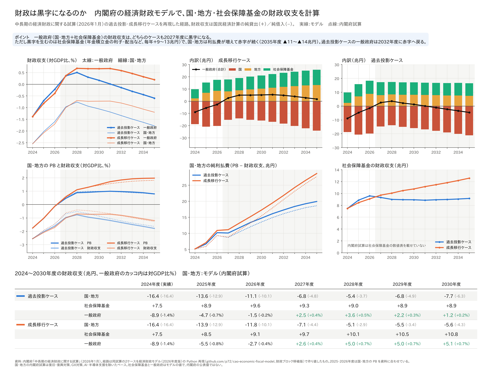

# 日本の財政は黒字になるのか──内閣府の経済財政モデルで、国・地方・社会保障基金の財政収支を計算した

ウェブ版：[https://p72.github.io/note-draft/内閣府の2つのマクロモデル/04\_財政は黒字になるのかを経済財政モデルで計算した.html](https://p72.github.io/note-draft/%E5%86%85%E9%96%A3%E5%BA%9C%E3%81%AE2%E3%81%A4%E3%81%AE%E3%83%9E%E3%82%AF%E3%83%AD%E3%83%A2%E3%83%87%E3%83%AB/04_%E8%B2%A1%E6%94%BF%E3%81%AF%E9%BB%92%E5%AD%97%E3%81%AB%E3%81%AA%E3%82%8B%E3%81%AE%E3%81%8B%E3%82%92%E7%B5%8C%E6%B8%88%E8%B2%A1%E6%94%BF%E3%83%A2%E3%83%87%E3%83%AB%E3%81%A7%E8%A8%88%E7%AE%97%E3%81%97%E3%81%9F.html)

GitHub：[https://github.com/p72/note-draft/blob/main/内閣府の2つのマクロモデル/04\_財政は黒字になるのかを経済財政モデルで計算した.md](https://github.com/p72/note-draft/blob/main/%E5%86%85%E9%96%A3%E5%BA%9C%E3%81%AE2%E3%81%A4%E3%81%AE%E3%83%9E%E3%82%AF%E3%83%AD%E3%83%A2%E3%83%87%E3%83%AB/04_%E8%B2%A1%E6%94%BF%E3%81%AF%E9%BB%92%E5%AD%97%E3%81%AB%E3%81%AA%E3%82%8B%E3%81%AE%E3%81%8B%E3%82%92%E7%B5%8C%E6%B8%88%E8%B2%A1%E6%94%BF%E3%83%A2%E3%83%87%E3%83%AB%E3%81%A7%E8%A8%88%E7%AE%97%E3%81%97%E3%81%9F.md)

※ この記事は、内閣府「経済財政モデル（2026年度版）」を Python で再現したもの（[p72/cao-economic-fiscal-model](https://github.com/p72/cao-economic-fiscal-model)）で計算している。再現の方法と精度は「[内閣府の経済財政モデル（2026年度版）を Python で再現した](03_経済財政モデルをPythonで再現した.md)」に書いた。

「プライマリーバランス（PB）が黒字になる」という話はよく聞く。内閣府の中長期試算（2026年1月）でも、国・地方の PB は2027年度に黒字になる。

ただし PB は利払費を除いた収支である。利払費まで含めた「財政収支」はどうなるのか。さらに、国・地方に社会保障基金（公的年金・医療・介護保険など）を加えた「一般政府」で見るとどうなるのか。

この記事では、中長期試算の過去投影ケースと成長移行ケースを再現した経路から、国民経済計算（SNA）の財政収支（純貸出（＋）／純借入（−））を、国・地方・社会保障基金に分けて取り出した。

結果を先に書くと、次のようになった。

- **一般政府の財政収支は、どちらのケースも2027年度に黒字になる。** 成長移行ケースでは2030年度まで対GDP比+0.7%前後の黒字が続く。過去投影ケースでは黒字は小さく、2032年度に赤字へ戻る。
- **黒字を生んでいるのは社会保障基金である。** 社会保障基金は毎年+9〜13兆円の黒字で、国・地方の赤字（2027年度以降で5〜14兆円）より大きい年に、一般政府が黒字になる。
- **国・地方の財政収支は、PB が黒字になっても赤字のままである。** 金利が上がって利払費が増えるので、2028年度ごろを底に赤字はまた広がっていく。

## 計算の結果

### 2024〜2030年度の財政収支（兆円）

国・地方のカッコ内は内閣府試算の値、一般政府のカッコ内は対GDP比である。

**成長移行ケース**

- **2024年度（実績）**：国・地方 ▲16.4（▲16.4）、社会保障基金 +7.5、一般政府 ▲8.9（▲1.4%）
- **2025年度**：国・地方 ▲13.9（▲12.9）、社会保障基金 +8.5、一般政府 ▲5.5（▲0.8%）
- **2026年度**：国・地方 ▲11.8（▲10.1）、社会保障基金 +9.1、一般政府 ▲2.7（▲0.4%）
- **2027年度**：国・地方 ▲7.1（▲4.4）、社会保障基金 +9.7、一般政府 +2.6（+0.4%）
- **2028年度**：国・地方 ▲5.1（▲2.9）、社会保障基金 +10.1、一般政府 +5.0（+0.7%）
- **2029年度**：国・地方 ▲5.5（▲3.4）、社会保障基金 +10.5、一般政府 +5.0（+0.7%）
- **2030年度**：国・地方 ▲5.6（▲4.3）、社会保障基金 +10.8、一般政府 +5.1（+0.7%）

**過去投影ケース**

- **2024年度（実績）**：国・地方 ▲16.4（▲16.4）、社会保障基金 +7.5、一般政府 ▲8.9（▲1.4%）
- **2025年度**：国・地方 ▲13.6（▲12.9）、社会保障基金 +8.9、一般政府 ▲4.7（▲0.7%）
- **2026年度**：国・地方 ▲11.1（▲10.1）、社会保障基金 +9.6、一般政府 ▲1.5（▲0.2%）
- **2027年度**：国・地方 ▲6.8（▲4.8）、社会保障基金 +9.3、一般政府 +2.5（+0.4%）
- **2028年度**：国・地方 ▲5.4（▲3.7）、社会保障基金 +9.0、一般政府 +3.6（+0.5%）
- **2029年度**：国・地方 ▲6.8（▲4.9）、社会保障基金 +9.0、一般政府 +2.2（+0.3%）
- **2030年度**：国・地方 ▲7.7（▲6.3）、社会保障基金 +8.9、一般政府 +1.2（+0.2%）

### 国・地方：PB は黒字、財政収支は赤字

国・地方の PB（対GDP比）は2027年度に+0.5〜0.6%になり、成長移行ケースでは2035年度に+2.0%まで上がる。一方、財政収支は2028年度の▲0.7〜0.8%を底に、ふたたび赤字が広がる。

PB と財政収支の差は純利払費（利払費−受取利子）である。金利が上がると、国債の借り換えが進むにつれて利払費が増える。純利払費は2024年度の5兆円から、2035年度には過去投影ケースで20兆円、成長移行ケースで29兆円になる。成長移行ケースは金利が高い（2035年度の名目長期金利3.3%）ので、PB は改善しても財政収支の改善はその分だけ小さくなる。

国と地方に分けると、赤字はほとんど国である。地方は PB も財政収支も黒字で、成長移行ケースでは財政収支の黒字が2030年度以降10兆円を超える。

### 社会保障基金：年金積立金の利子・配当で黒字

社会保障基金は、医療・介護では保険料・公費と給付がおおむね釣り合っていて、黒字の大部分は公的年金から来ている。内閣府の試算によると、2024年度の社会保障基金の黒字7.5兆円のうち7.0兆円は財産所得（純）、つまり年金積立金の利子・配当である（SNA では株価の値上がり益は収支に入らない）。

成長移行ケースでは、運用利回りが経済成長とともに上がり、働く女性や高齢者が増えて保険料収入も増えるので、黒字は2035年度に12.6兆円まで広がる。過去投影ケースでは9兆円前後で横ばいである。

### 一般政府：黒字は社会保障基金しだい

一般政府の財政収支は、国・地方の赤字と社会保障基金の黒字の差で決まる。

- **成長移行ケース**：2027年度に黒字になり、2031年度の+5.4兆円が最大。その後は国・地方の利払費の増加に押されて黒字が縮み、2035年度は+1.8兆円（+0.2%）。
- **過去投影ケース**：2028年度の+3.6兆円が最大で、2032年度に赤字へ戻り、2035年度は▲4.6兆円（▲0.6%）。

社会保障基金の黒字は、将来の年金給付のための積立金の運用益である。一般政府が黒字になっても、国・地方の借金（公債等残高）が減るわけではない点に注意が必要である。

## 計算の方法

- **経路**：中長期試算（2026年1月）の過去投影ケース・成長移行ケースの主要計数表を、再現モデルで作り直した経路を使った（3つ目の高成長実現ケースは、資料に財政の詳細計数表がないので省いた）。マクロの前提（成長率、物価、金利など）は資料に合わせ、財政は資料の予算ベースの歳出・税収などを与えて、SNA ベースの収支をモデルで計算している。
- **2025・2026年度**：国・地方の PB を資料の値に合わせている。財政収支と純利払費はモデルの計算である。
- **財政収支**：国（中央政府）、地方（地方政府）、社会保障基金の純貸出（＋）／純借入（−）。一般政府はその合計。
- **内閣府試算との比べ方**：内閣府試算の国・地方の値は、復旧・復興対策、GX対策、AI・半導体支援の経費と財源を除いたベースである。社会保障基金と一般政府は、内閣府試算に数値の表がないので、モデルの値だけを示している。

## 再現の精度と注意

- 国・地方の財政収支は、モデルのほうが内閣府試算より毎年1〜3兆円ほど赤字が大きい（成長移行ケースの2032年度以降はほぼ一致する）。PB はほぼ合っているので、ずれは純利払費である。モデルは国の利払費を会計ベース（国債の利払いや短期証券の割引料など）で計算していて、SNA の利払いより多めに出る。
- 一般政府が黒字になる年（2027年度）は、このずれを考えても変わらない。国・地方の赤字がモデルより小さい内閣府試算の値を使うと、一般政府の黒字はむしろ大きくなる。
- 内閣府は2026年7月に中長期試算を改訂している（ケースの名前と前提が変わり、計算期間は2040年度まで）。この記事の計算は2026年1月版にもとづく。

## 出典

- 内閣府「中長期の経済財政に関する試算」（2026年1月） https://www5.cao.go.jp/keizai3/econome/r8chuuchouki2601.pdf
- 内閣府「中長期の経済財政に関する試算」（2026年7月、経済財政諮問会議 資料2-2） https://www5.cao.go.jp/keizai-shimon/kaigi/minutes/2026/0730shiryo_02-2.pdf
- 内閣府「経済財政モデル（2026年度版）資料集」 https://www5.cao.go.jp/keizai3/econome.html
- 内閣府 経済社会総合研究所「国民経済計算」（2024年度年次推計）
