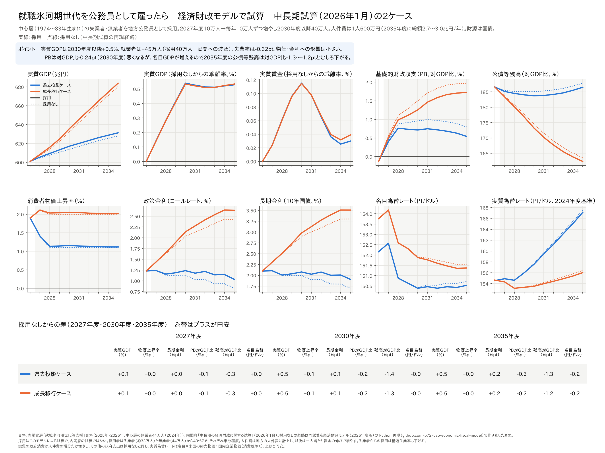

# 就職氷河期世代を公務員として雇うと経済はどうなるか──内閣府の経済財政モデルで試算した

ウェブ版：[https://p72.github.io/note-draft/内閣府の2つのマクロモデル/05\_就職氷河期世代を公務員として雇うと経済はどうなるか.html](https://p72.github.io/note-draft/%E5%86%85%E9%96%A3%E5%BA%9C%E3%81%AE2%E3%81%A4%E3%81%AE%E3%83%9E%E3%82%AF%E3%83%AD%E3%83%A2%E3%83%87%E3%83%AB/05_%E5%B0%B1%E8%81%B7%E6%B0%B7%E6%B2%B3%E6%9C%9F%E4%B8%96%E4%BB%A3%E3%82%92%E5%85%AC%E5%8B%99%E5%93%A1%E3%81%A8%E3%81%97%E3%81%A6%E9%9B%87%E3%81%86%E3%81%A8%E7%B5%8C%E6%B8%88%E3%81%AF%E3%81%A9%E3%81%86%E3%81%AA%E3%82%8B%E3%81%8B.html)

GitHub：[https://github.com/p72/note-draft/blob/main/内閣府の2つのマクロモデル/05\_就職氷河期世代を公務員として雇うと経済はどうなるか.md](https://github.com/p72/note-draft/blob/main/%E5%86%85%E9%96%A3%E5%BA%9C%E3%81%AE2%E3%81%A4%E3%81%AE%E3%83%9E%E3%82%AF%E3%83%AD%E3%83%A2%E3%83%87%E3%83%AB/05_%E5%B0%B1%E8%81%B7%E6%B0%B7%E6%B2%B3%E6%9C%9F%E4%B8%96%E4%BB%A3%E3%82%92%E5%85%AC%E5%8B%99%E5%93%A1%E3%81%A8%E3%81%97%E3%81%A6%E9%9B%87%E3%81%86%E3%81%A8%E7%B5%8C%E6%B8%88%E3%81%AF%E3%81%A9%E3%81%86%E3%81%AA%E3%82%8B%E3%81%8B.md)

※ この記事は、内閣府「経済財政モデル（2026年度版）」を Python で再現したもの（[p72/cao-economic-fiscal-model](https://github.com/p72/cao-economic-fiscal-model)）で計算している。再現の方法と精度は「[内閣府の経済財政モデル（2026年度版）を Python で再現した](03_経済財政モデルをPythonで再現した.md)」に書いた。

「やはり氷河期世代を公務員として雇うしかない」という主張がある。就職氷河期（おおむね1993〜2004年）に社会に出た世代には、いまも失業していたり、働いていなかったりする人が多い。国と自治体はすでに氷河期世代向けの採用試験を行っているが、その実績は2020年度からの5年あまりで国家公務員6,006人、地方公務員18,601人にとどまる。

では、桁をひとつ上げて数十万人を公務員として雇ったら、経済と財政はどうなるのか。この記事では、中長期試算（2026年1月）の過去投影ケースと成長移行ケースを再現した経路に、公務員の大量採用を加えて計算した。

結果を先に書くと、次のようになった。

- **実質GDPは2030年度以降+0.5%、就業者は+45万人。** 採用した40万人に、所得が増えて消費・設備投資が増える分が上乗せされる。失業率は0.3ポイント下がる。
- **人件費は年2.4〜3.0兆円で、PB は対GDP比0.25ポイント悪くなる。** それでも名目GDPが増えるので、2035年度の公債等残高の対GDP比は1.2〜1.3ポイント下がる。
- **物価と金利への影響は小さい。** 消費者物価上昇率は+0.05ポイント以下、長期金利は2035年度に+0.2ポイントである。

## 計算の結果

### 採用なしとの差

数値は成長移行ケース。過去投影ケースもほぼ同じである。

- **2027年度（10万人）**：人件費0.6兆円、実質GDP +0.14%、就業者 +10万人、PB ▲0.06%、公債等残高 ▲0.3ポイント
- **2028年度（20万人）**：人件費1.2兆円、実質GDP +0.28%、就業者 +21万人、PB ▲0.12%、公債等残高 ▲0.6ポイント
- **2029年度（30万人）**：人件費1.9兆円、実質GDP +0.41%、就業者 +31万人、PB ▲0.18%、公債等残高 ▲1.0ポイント
- **2030年度（40万人）**：人件費2.6兆円、実質GDP +0.53%、就業者 +41万人、PB ▲0.24%、公債等残高 ▲1.3ポイント
- **2035年度（40万人）**：人件費3.0兆円、実質GDP +0.53%、就業者 +45万人、PB ▲0.25%、公債等残高 ▲1.2ポイント

### 実質GDP：使ったお金以上に増える

2030年度の人件費2.6兆円は名目GDPの0.3%あまりだが、実質GDPは0.5%増え、名目GDPは5.4兆円増える。使ったお金の2倍の名目GDPが生まれている。

理由は2つある。ひとつは、公務員の給料が家計の所得になり、消費が増えることである（家計の可処分所得は2030年度に+3.5兆円、実質の消費は+0.3%）。もうひとつは、働く人が増えるので、経済の供給力（潜在GDP）も増えることである。このモデルでは潜在GDPは就業者数で決まるので、失業者や無業者が働き始めると、景気が過熱しないまま GDP が増える。物価や金利がほとんど動かないのはこのためである。

### 財政：赤字は増えるが、借金の比率は下がる

増えた人件費の一部は、所得税・消費税などの税収増で戻ってくる。PB の悪化は対GDP比0.25ポイントで、人件費（同0.35ポイント前後）より小さい。

公債等残高は、増えた赤字の分だけ増える。しかし名目GDPがそれ以上に増えるので、残高の対GDP比はむしろ下がる。残高が GDP の1.8倍ほどある日本では、名目GDPが1%増えると、残高の比率が2ポイント近く下がるからである。

### 実質賃金：ほとんど変わらない

一人当たりの実質賃金は、2030年度に+0.1%とほぼ変わらない。採用されるのは働いていなかった人なので、民間の賃金を押し上げる力は弱い。この政策の効果は、一人ひとりの賃金ではなく、働く人の数に出る。

## 計算の方法

- **採用する人数**：就職氷河期世代の中心層（1974〜83年生まれ）の無業者は44万人（2024年、内閣官房）。失業者は、モデルの年齢別失業者（45〜54歳）から約33万人とした。全員は雇えないので、それぞれ半分程度を採用することにし、2027年度10万人から毎年10万人ずつ増やして、2030年度以降は40万人とした。失業者と無業者の割合は43対57である。
- **人件費**：1人600万円（2027年度）。その後は一人当たり賃金の伸びにあわせて増やす。地方公務員として採用するとし、地方の人件費に計上した。増税や他の歳出の削減はせず、財源は国債などの借金である。
- **雇用**：失業者から採用した分は、失業者を減らし、構造的な失業率もその分だけ下げる。無業者から採用した分は、労働力人口と就業者を増やす。
- **政府支出**：実質の政府消費は人件費の増分だけ増やし、その他の政府消費と公共投資は採用なしと同じにした。
- **経路**：中長期試算（2026年1月）の過去投影ケース・成長移行ケースを再現した経路を「採用なし」とし、2027〜2035年度を解き直した。

## 注意

- **採用の規模**：毎年10万人という採用は、これまでの実績（5年あまりで約2.5万人）の20倍以上のペースである。
- **公務員の生産性**：SNA では、公務員の生み出す価値を人件費で測る。この記事の実質GDPの増加は、仕事の中身（どれだけ役に立つ仕事か）を評価したものではない。
- **民間からの転職は入れていない**：民間で非正規として働く人が公務員に移ると、就業者は増えず、民間の働き手が減るだけになる。この記事は失業者と無業者だけを採用した場合である。
- **無業者の事情**：無業者の中には、病気や家族の介護で働けない人もいる。半分程度を採用するという想定は、働く意思のある人がどれだけいるかで大きく変わる。
- **世代の年齢**：中心層は2035年度に52〜61歳になり、その後は定年を迎えはじめる。この記事は2035年度までの計算である。

## 出典

- 内閣官房「就職氷河期世代支援の推進に向けた全国プラットフォーム」資料（中心層の就業等の動向、公務員としての採用実績） [https://www.cas.go.jp/jp/seisaku/shushoku_hyogaki_shien/suishin_platform/dai7/shiryo1.pdf](https://www.cas.go.jp/jp/seisaku/shushoku_hyogaki_shien/suishin_platform/dai7/shiryo1.pdf)
- 内閣官房「新たな就職氷河期世代等支援プログラム」KPI（2026年4月10日） [https://www.cas.go.jp/jp/seisaku/shushoku_hyogaki_shien/kankeikakuryokaigi/pdf/20260410_siryou4.pdf](https://www.cas.go.jp/jp/seisaku/shushoku_hyogaki_shien/kankeikakuryokaigi/pdf/20260410_siryou4.pdf)
- 内閣府「中長期の経済財政に関する試算」（2026年1月） [https://www5.cao.go.jp/keizai3/econome/r8chuuchouki2601.pdf](https://www5.cao.go.jp/keizai3/econome/r8chuuchouki2601.pdf)
- 内閣府「経済財政モデル（2026年度版）資料集」 [https://www5.cao.go.jp/keizai3/econome.html](https://www5.cao.go.jp/keizai3/econome.html)
