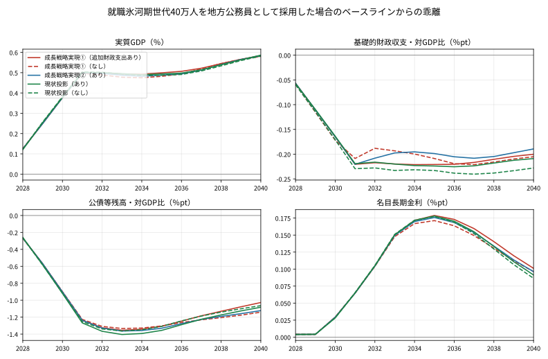

# 就職氷河期世代を公務員として雇うと経済はどうなるか──2026年7月の中長期試算で計算し直した

ウェブ版：[https://p72.github.io/note-draft/内閣府の2つのマクロモデル/09\_就職氷河期世代を公務員として雇うと経済はどうなるか\_2026-7版.html](https://p72.github.io/note-draft/%E5%86%85%E9%96%A3%E5%BA%9C%E3%81%AE2%E3%81%A4%E3%81%AE%E3%83%9E%E3%82%AF%E3%83%AD%E3%83%A2%E3%83%87%E3%83%AB/09_%E5%B0%B1%E8%81%B7%E6%B0%B7%E6%B2%B3%E6%9C%9F%E4%B8%96%E4%BB%A3%E3%82%92%E5%85%AC%E5%8B%99%E5%93%A1%E3%81%A8%E3%81%97%E3%81%A6%E9%9B%87%E3%81%86%E3%81%A8%E7%B5%8C%E6%B8%88%E3%81%AF%E3%81%A9%E3%81%86%E3%81%AA%E3%82%8B%E3%81%8B_2026-7%E7%89%88.html)

GitHub：[https://github.com/p72/note-draft/blob/main/内閣府の2つのマクロモデル/09\_就職氷河期世代を公務員として雇うと経済はどうなるか\_2026-7版.md](https://github.com/p72/note-draft/blob/main/%E5%86%85%E9%96%A3%E5%BA%9C%E3%81%AE2%E3%81%A4%E3%81%AE%E3%83%9E%E3%82%AF%E3%83%AD%E3%83%A2%E3%83%87%E3%83%AB/09_%E5%B0%B1%E8%81%B7%E6%B0%B7%E6%B2%B3%E6%9C%9F%E4%B8%96%E4%BB%A3%E3%82%92%E5%85%AC%E5%8B%99%E5%93%A1%E3%81%A8%E3%81%97%E3%81%A6%E9%9B%87%E3%81%86%E3%81%A8%E7%B5%8C%E6%B8%88%E3%81%AF%E3%81%A9%E3%81%86%E3%81%AA%E3%82%8B%E3%81%8B_2026-7%E7%89%88.md)

※ この記事は、内閣府「経済財政モデル（2026年度版）」を Python で再現したもの（[p72/cao-economic-fiscal-model](https://github.com/p72/cao-economic-fiscal-model)）で計算している。同じ問いは、2026年1月の中長期試算を土台に「[就職氷河期世代を公務員として雇うと経済はどうなるか](05_就職氷河期世代を公務員として雇うと経済はどうなるか.md)」で計算した。この記事は、その土台を2026年7月の試算に置き換えた計算し直しである。土台の再現そのものは「[2026年7月版での中長期見通し](08_2026-7版での中長期見通し.md)」に書いた。

「やはり氷河期世代を公務員として雇うしかない」という主張がある。就職氷河期（おおむね1993〜2004年）に社会に出た世代には、いまも失業していたり、働いていなかったりする人が多い。国と自治体はすでに氷河期世代向けの採用試験を行っているが、その実績は2020年度からの5年あまりで国家公務員6,006人、地方公務員18,601人にとどまる。

では、桁をひとつ上げて数十万人を公務員として雇ったら、経済と財政はどうなるのか。前回（05）と同じシナリオを、2026年7月の中長期試算を再現した経路の上で計算し直した。

## 前回から土台が大きく変わった

2026年7月の試算は、1月の試算から前提が大きく変わっている。

- ケースは「成長戦略実現ケース①・②」と「現状投影ケース」になった。
- 全ケースに、2027年度から毎年実質10兆円の追加財政支出（公需と、企業の資本コストを下げる補助金が半分ずつ）が組み込まれた。
- 国・地方の基礎的財政収支は、成長戦略実現ケースでは試算期間を通じて黒字で推移する見通しになった（2025年度はほぼ均衡まで上方修正された）。
- 計算の horizon は2040年度まで延び、名目長期金利は2040年度に3.8%まで上がる経路である。

土台には08で作った再現経路を使う。成長戦略実現ケース①の2040年度で、名目GDPは1,073.6兆円（公表1,073.6兆円）、基礎的財政収支は対GDP比+1.34%（公表+1.3%）、公債等残高は同170.6%に対して171.0%と、公表値にほぼ一致する。追加財政支出を除いた経路（08の方法で、公需と補助金を半分ずつ除いたもの）では、2040年度の公債等残高は151.2%まで下がる。

## シナリオの前提

前提は05と同じ骨格で、開始年度だけをずらした。

- 2028年度から毎年10万人ずつ、2031年度に累計40万人を地方公務員として採用し、以後40万人を維持する。
- 採用は、失業者と無業者（非労働力人口）だけから行う。内訳は、45〜54歳の失業者（モデル上約33万人）と、中心層（1974〜83年生まれ）の無業者44万人（2024年、内閣官房）のプールの比率に沿って、失業者43%、無業者57%とする。無業者の採用は45〜54歳の労働力率を引き上げ、失業者の採用は構造的失業率もその分だけ下げる。
- 人件費は1人600万円（2028年度）とし、以後は1人当たり賃金の伸びに連動させる。財源は国債で、増税や他の歳出の削減はしない。
- 実質の政府消費が増えるのは人件費の分だけで、他の政府消費と公共投資は変えない。人件費は、地方の人件費の水準が各年度の人件費に一致するように置いた。

## 結果

中心の結果は成長戦略実現ケース①である。追加財政支出の有無でも、他のケースでも、結果はほとんど変わらない。

| 年度 | 採用（累計） | 人件費 | 実質GDP | 潜在GDP | 就業者 | 失業率 | 基礎的財政収支 | 公債等残高 | 消費者物価 | 長期金利 | 賃金 |
|---|---|---|---|---|---|---|---|---|---|---|---|
| 2031年度 | 40万人 | 2.63兆円 | +0.50% | +0.28% | +39.6万人 | −0.25pt | −0.22pt | −1.24pt | +0.05pt | +0.06pt | +0.21% |
| 2035年度 | 40万人 | 2.99兆円 | +0.50% | +0.47% | +39.5万人 | −0.24pt | −0.22pt | −1.31pt | +0.01pt | +0.18pt | +0.23% |
| 2040年度 | 40万人 | 3.53兆円 | +0.58% | +0.55% | +39.7万人 | −0.25pt | −0.20pt | −1.03pt | +0.01pt | +0.10pt | +0.31% |

（ベースラインとの乖離。GDP・就業者・賃金は変化率または人数、他はポイント差。）

読みどころは3つある。

第一に、**経済の押し上げは、はじめ需要、やがて供給になる**。採用が40万人に達した2031年度は、実質GDPの+0.50%のうち潜在GDPの寄与は+0.28%で、残りは需要の上振れである。ところが2040年度には潜在GDPが+0.55%まで上がり、実質GDPの+0.58%とほぼ並ぶ。潜在GDPは就業者数に依存し、 trend の労働力が時間をかけて追いつくためである。物価と金利の反応は最後まで小さく、消費者物価は+0.05pt以下、長期金利は+0.2pt以下にとどまる。

第二に、**財政の負担は人件費より小さい**。2040年度の人件費は3.53兆円だが、国・地方の基礎的財政収支の悪化は2.04兆円（対GDP比では一般政府で−0.20pt）にとどまる。名目GDPが+0.88%（+9.4兆円）増えることで税収が増え（国の税収で+1.05兆円）、人件費の一部が戻ってくるためである。ベースラインで+1.34%の黒字だった基礎的財政収支は、採用をしても+1.1%程度の黒字を維持する。

第三に、**公債等残高の対GDP比は下がる**。2040年度で−1.03pt（171.0%→170.0%）である。財政収支は悪化するのに残高比が下がるのは、分母の名目GDPの拡大が利払いの増加を上回るためである。金利の上昇が小さいことが効いている。

## 前回（2026年1月試算）の結果と比べて

05の結果（成長移行ケース、2035年度）は、人件費3.0兆円、実質GDP+0.53%、基礎的財政収支−0.25pt、公債等残高−1.2pt、長期金利+0.2ptだった。今回の2035年度は、実質GDP+0.50%、基礎的財政収支−0.22pt、公債等残高−1.31pt、長期金利+0.18ptで、**ほぼ同じ**である。

土台の前提は大きく変わったのに、この政策の評価は変わらなかった。理由は単純で、採用による押し上げの中心が供給側（就業者と潜在GDP）にあるためである。需要の過熱で物価と金利が跳ねるかどうかは土台の需給環境に左右されるが、この規模の採用では、7月試算のタイトな需給のもとでも金利の反応は+0.2pt以下にとどまった。変わったのは主に horizon で、2040年度まで見ることで、押し上げが需要から供給へ移っていく姿が見えるようになった。

## 注意

- **採用の規模**：毎年10万人という採用は、これまでの実績（5年あまりで約2.5万人）の20倍以上のペースである。
- **公務員の生産性**：SNA では、公務員の生み出す価値を人件費で測る。この記事の実質GDPの増加は、仕事の中身（どれだけ役に立つ仕事か）を評価したものではない。
- **民間からの転職は入れていない**：民間で非正規として働く人が公務員に移ると、就業者は増えず、民間の働き手が減るだけになる。この記事は失業者と無業者だけを採用した場合である。
- **無業者の事情**：無業者の中には、病気や家族の介護で働けない人もいる。半分程度を採用するという想定は、働く意思のある人がどれだけいるかで大きく変わる。
- **世代の年齢**：中心層（1974〜83年生まれ）は2040年度に57〜66歳になる。定年と年金受給の本格化は2040年代であり、この記事の計算は2040年度までで、その先は扱っていない。
- **計算の方法**：土台の再現と追加財政支出の除き方は08と同じで、シナリオの計算コードは `hire2607.py`（[p72/cao-economic-fiscal-model](https://github.com/p72/cao-economic-fiscal-model) の `src/`）に置いた。結果の数値はすべてこのコードで計算した。

## 出典

- 内閣官房「就職氷河期世代支援の推進に向けた全国プラットフォーム」資料（中心層の就業等の動向、公務員としての採用実績） [https://www.cas.go.jp/jp/seisaku/shushoku_hyogaki_shien/suishin_platform/dai7/shiryo1.pdf](https://www.cas.go.jp/jp/seisaku/shushoku_hyogaki_shien/suishin_platform/dai7/shiryo1.pdf)
- 内閣官房「新たな就職氷河期世代等支援プログラム」KPI（2026年4月10日） [https://www.cas.go.jp/jp/seisaku/shushoku_hyogaki_shien/kankeikakuryokaigi/pdf/20260410_siryou4.pdf](https://www.cas.go.jp/jp/seisaku/shushoku_hyogaki_shien/kankeikakuryokaigi/pdf/20260410_siryou4.pdf)
- 内閣府「中長期の経済財政に関する試算」（2026年7月） [https://www5.cao.go.jp/keizai-shimon/kaigi/minutes/2026/0730shiryo_02-2.pdf](https://www5.cao.go.jp/keizai-shimon/kaigi/minutes/2026/0730shiryo_02-2.pdf)
- 内閣府「経済財政モデル（2026年度版）資料集」 [https://www5.cao.go.jp/keizai3/econome.html](https://www5.cao.go.jp/keizai3/econome.html)
