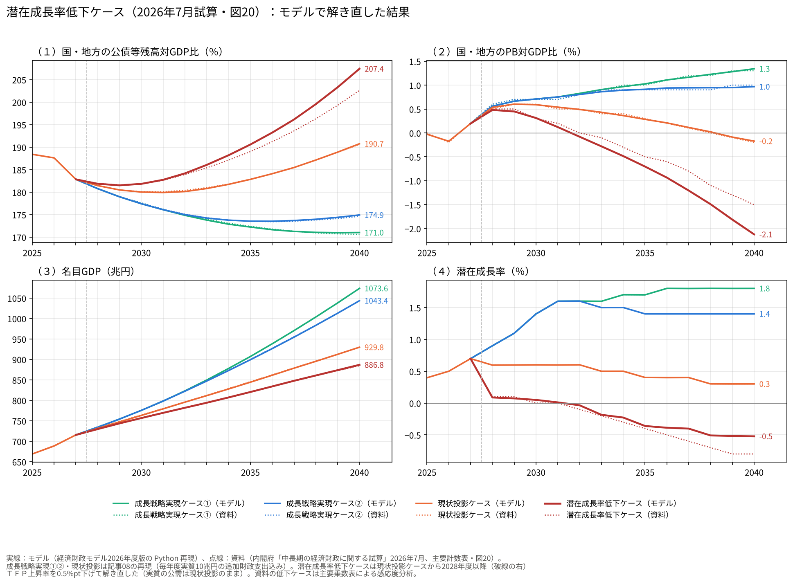
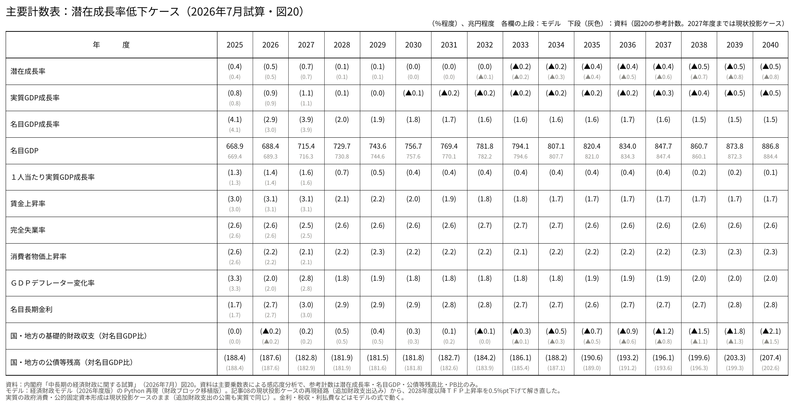
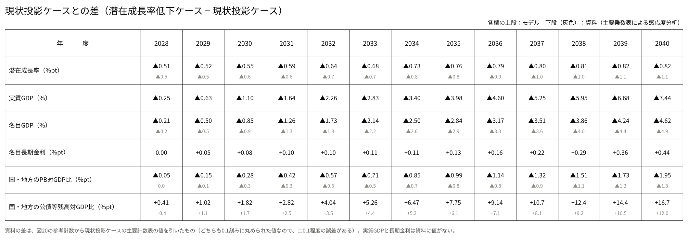
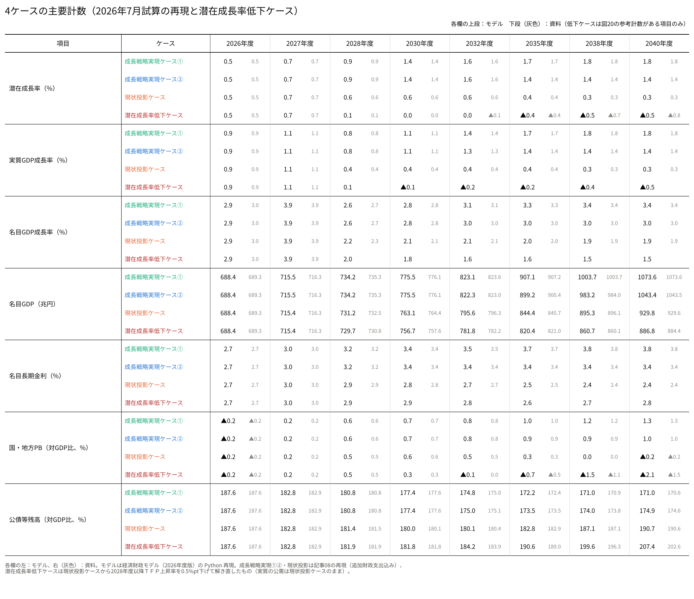

# 潜在成長率が下がったら財政はどうなるか──2026年7月の中長期試算「潜在成長率低下ケース」をモデルで解き直した

ウェブ版：[https://p72.github.io/note-draft/内閣府の2つのマクロモデル/10\_潜在成長率低下ケースをモデルで解き直した.html](https://p72.github.io/note-draft/%E5%86%85%E9%96%A3%E5%BA%9C%E3%81%AE2%E3%81%A4%E3%81%AE%E3%83%9E%E3%82%AF%E3%83%AD%E3%83%A2%E3%83%87%E3%83%AB/10_%E6%BD%9C%E5%9C%A8%E6%88%90%E9%95%B7%E7%8E%87%E4%BD%8E%E4%B8%8B%E3%82%B1%E3%83%BC%E3%82%B9%E3%82%92%E3%83%A2%E3%83%87%E3%83%AB%E3%81%A7%E8%A7%A3%E3%81%8D%E7%9B%B4%E3%81%97%E3%81%9F.html)

GitHub：[https://github.com/p72/note-draft/blob/main/内閣府の2つのマクロモデル/10\_潜在成長率低下ケースをモデルで解き直した.md](https://github.com/p72/note-draft/blob/main/%E5%86%85%E9%96%A3%E5%BA%9C%E3%81%AE2%E3%81%A4%E3%81%AE%E3%83%9E%E3%82%AF%E3%83%AD%E3%83%A2%E3%83%87%E3%83%AB/10_%E6%BD%9C%E5%9C%A8%E6%88%90%E9%95%B7%E7%8E%87%E4%BD%8E%E4%B8%8B%E3%82%B1%E3%83%BC%E3%82%B9%E3%82%92%E3%83%A2%E3%83%87%E3%83%AB%E3%81%A7%E8%A7%A3%E3%81%8D%E7%9B%B4%E3%81%97%E3%81%9F.md)

※ この記事は、内閣府「経済財政モデル（2026年度版）」を Python で再現したもの（[p72/cao-economic-fiscal-model](https://github.com/p72/cao-economic-fiscal-model)）で計算している。土台は「[2026年7月版での中長期見通し](08_2026-7版での中長期見通し.md)」（08）で作った、2026年7月の中長期試算の再現経路である。

2026年7月の中長期試算には、本文の「リスク・不確実性」の節に**潜在成長率低下ケース**という感応度分析がある（図20）。現状投影ケースをもとに、その他の外生変数は変えずに、2028年度以降ＴＦＰ（全要素生産性）上昇率が継続的に0.5%pt程度下振れたとする。資料によれば、2040年度に潜在成長率は1.1%pt程度下がって▲0.8%になり、国・地方の公債等残高対GDP比は12.0%pt程度上がって202.6%、基礎的財政収支（PB）対GDP比は1.4%pt程度悪化して▲1.5%になる。

ただし、この図は**主要乗数表を使った感応度分析**で、モデルを解き直したものではない（図20の備考1）。そこで、08の現状投影ケースの再現経路の上で、実際にＴＦＰを下げてモデルを解き直してみた。

結果を先に書くと、次のようになった。

- **潜在成長率低下ケースは、マイナス成長が続く想定である。** 資料の潜在成長率は2032年度からマイナスになり、2040年度に▲0.8%。モデルでは実質GDP成長率が2030年度から2040年度まで11年続けてマイナス（2040年度▲0.5%）になる。日本の実質GDPが2年を超えて続けてマイナスになったことはない。
- **マイナス成長なのに金利は上がる。** ＴＦＰの低下は需要ではなく供給が減るショックなので、モデルでは需給がむしろ締まり、物価と金利が上がる（後述）。
- **名目GDPは資料とほぼ同じになった。** 2040年度の名目GDPはモデル886.8兆円、資料884.4兆円で、現状投影ケースからの減少率はモデル4.6%、資料4.9%である。
- **財政の悪化はモデルのほうが大きい。** 2040年度の PB 対GDP比はモデル▲2.1%（現状投影から▲1.95%pt）、資料▲1.5%（▲1.3%pt）。公債等残高比はモデル207.4%（+16.7%pt）、資料202.6%（+12.0%pt）である。
- **違いの主な理由は物価と金利。** 供給力が落ちると、モデルでは物価が少し上がり（2040年度に消費者物価上昇率+0.3%pt）、実質で据え置いた歳出が名目で膨らむ。さらに長期金利がモデルの式で+0.44%pt上がり、純利払費が3.6兆円増える。乗数表による感応度分析では、この2つの効き方が小さいとみられる。
- **潜在成長率の落ち方はモデルのほうが小さい。** 2040年度にモデル▲0.82%pt、資料▲1.1%pt。ＴＦＰの0.5%ptに資本の伸び悩みが上乗せされるのは同じだが、資本の伸びの落ち方がモデルのほうが小さい。

## 計算の結果

図の見方：実線がモデル、点線が資料（主要計数表と図20の参考計数）である。成長戦略実現ケース①・②と現状投影ケースは08の再現で、資料とほぼ重なる。潜在成長率低下ケース（濃い赤）は、破線（2027年度と2028年度の間）から右で現状投影ケースから分かれる。

### 主要計数表（潜在成長率低下ケース）

各欄の上段がモデル、下段（灰色）が資料である。資料の図20には潜在成長率・名目GDP・公債等残高比・PB比の4項目しかないので、ほかの項目の2028年度以降は下段が空いている。2027年度までは現状投影ケースと同じである。

### 現状投影ケースとの差

資料の差は、図20の参考計数から現状投影ケースの主要計数表を引いたもの（どちらも0.1刻みの値なので、±0.1程度の誤差がある）。

### 4ケースの主要計数

| 2040年度 | 成長戦略実現① | 成長戦略実現② | 現状投影 | 潜在成長率低下 |
|---|---:|---:|---:|---:|
| 潜在成長率（%） | 1.8（1.8） | 1.4（1.4） | 0.3（0.3） | ▲0.5（▲0.8） |
| 実質GDP成長率（%） | 1.8（1.8） | 1.4（1.4） | 0.3（0.3） | ▲0.5（−） |
| 名目GDP（兆円） | 1073.6（1073.6） | 1043.4（1043.5） | 929.8（929.6） | 886.8（884.4） |
| 名目長期金利（%） | 3.8（3.8） | 3.4（3.4） | 2.4（2.4） | 2.8（−） |
| 国・地方の PB（対GDP比、%） | 1.3（1.3） | 1.0（1.0） | ▲0.2（▲0.2） | ▲2.1（▲1.5） |
| 公債等残高（対GDP比、%） | 171.0（170.6） | 174.9（174.6） | 190.7（190.6） | 207.4（202.6） |

（モデル、カッコ内は資料。成長戦略実現①②・現状投影は08の再現で、潜在成長率・成長率・金利は資料に合わせてある。）

## 読みどころ

### 1. 経済の大きさは、乗数表とモデルでほとんど変わらない

名目GDPの減り方は、モデルと資料でほぼ同じである（2030年度▲0.85%／▲0.89%、2035年度▲2.84%／▲2.92%、2040年度▲4.62%／▲4.86%）。ＴＦＰが毎年0.5%pt下がると、実質GDPは13年間で7.4%低くなる。一方でGDPデフレーターは毎年0.1〜0.4%pt高くなるので、名目GDPの減少は実質より小さい。

実質GDP成長率は2029年度にほぼゼロ、2030年代は▲0.2%前後、2040年度には▲0.5%になる。人口が減るので1人当たりではプラスを保つが、2040年度には+0.15%まで落ちる。

### 2. マイナス成長が11年続く

潜在成長率低下ケースは、**マイナス成長を想定したケース**である。資料の潜在成長率は2028年度に0.1%へ下がり、2032年度からマイナス、2040年度には▲0.8%になる。モデルの実質GDP成長率は次のとおりで、2030年度から2040年度まで11年続けてマイナスになる。

| 年度 | 2027 | 2028 | 2029 | 2030 | 2032 | 2035 | 2038 | 2040 |
|---|---:|---:|---:|---:|---:|---:|---:|---:|
| 実質GDP成長率（%） | 1.1 | 0.1 | 0.0 | ▲0.1 | ▲0.2 | ▲0.2 | ▲0.4 | ▲0.5 |
| 名目GDP成長率（%） | 3.9 | 2.0 | 1.9 | 1.8 | 1.6 | 1.6 | 1.5 | 1.5 |
| （現状投影）実質GDP成長率（%） | 1.1 | 0.4 | 0.4 | 0.4 | 0.4 | 0.4 | 0.3 | 0.3 |

日本の実質GDP成長率が続けてマイナスになったのは、暦年で1998・1999年（▲1.8%、▲0.3%）と2008・2009年（▲1.2%、▲5.9%）の2年ずつだけである（年度では2008・2009年度の▲3.3%、▲3.1%）。11年続くマイナス成長は、日本の経験にも、平時の先進国の経験にもない。ただし1年あたりは▲0.1〜▲0.5%と小さく、危機のときの急な落ち込みとは形が違う。人口が減るためで、1人当たり実質GDPの成長率は2030年度+0.45%、2040年度+0.15%と、プラスを保つ。名目GDP成長率も、物価が上がるので1.5〜2.0%のプラスである。

### 3. マイナス成長なのに、なぜ金利が上がるのか

「不況なのに金利が上がる」のは、このケースのショックが**需要ではなく供給が減るショック**だからである。モデルの中では次のように動く。

1. **供給が需要より大きく減る**：ＴＦＰが下がると、作れる量（潜在GDP）が先に減る。2040年度に潜在GDPは現状投影ケースより8.6%低いが、実際の実質GDPは7.4%低いにとどまる。政府消費と公共投資（追加財政支出の公需の分を含む）を実質で据え置いているので、需要はそれほど減らない。その結果、需給ギャップは現状投影ケースより1.3%ptプラス側にずれ、失業率もわずかに下がる（▲0.05%pt）。
2. **物価が上がり、短期金利が上がる**：需給が締まるので、消費者物価上昇率は+0.3%pt、GDPデフレーターの上昇率は+0.4%pt程度高くなる。物価と需給に反応する短期金利（コールレート）は、2040年度に1.87%（現状投影1.53%）になる。
3. **長期金利は短期金利と残高比で上がる**：モデルの長期金利の式は「短期金利の0.97倍＋前年度の公債等残高比の上昇率×11.1」である。2040年度の長期金利は2.84%（現状投影2.40%）で、+0.44%ptのうち+0.33%pt程度が短期金利から、残りが公債等残高比の上昇が速まる分からくる。

つまりモデルの姿は、成長率は低いのに物価と金利が上がる「スタグフレーション」に近い。消費や投資が落ち込む需要不足の不況なら、金利は下がる方向に動く。また、現実には成長期待が下がって長期金利が下がる力も考えられるが、モデルの長期金利の式には期待成長率の項がない。資料の図20は乗数表による計算で、金利がどう動くかは示されていない。

### 4. 財政の悪化は、モデルのほうが大きい

PB の悪化は2032年度ごろから資料より大きくなり、2040年度にはモデル▲1.95%pt、資料▲1.3%ptになる。2040年度の中身（モデル、現状投影ケースとの差）は次のとおりである。

- **国の税収が4.9兆円少ない**：名目GDPが43兆円小さいため。
- **国の PB 対象経費が2.4兆円多い**：供給力が落ちて物価が上がり（消費者物価上昇率+0.3%pt）、実質で据え置いた政府消費・公共投資（毎年度実質10兆円の追加財政支出の公需の分を含む）が名目で膨らむ。社会保障の歳出も物価に連動して増える。
- **PB 対GDP比は、分母の名目GDPも小さくなるので、さらに悪化する。**

### 5. 金利が上がるので、利払費も増える

モデルの長期金利の式は「短期金利の0.97倍＋前年度の公債等残高比の上昇率×11.1」である。潜在成長率低下ケースでは、物価が上がって短期金利が上がり（2040年度+0.34%pt）、残高比の上昇も速まるので、長期金利は2030年度+0.08%pt、2035年度+0.13%pt、2040年度+0.44%ptになる。国・地方の純利払費は2040年度に33.9兆円から37.5兆円へ3.6兆円増える。

資料の試算でも長期金利はケースの前提だが、潜在成長率低下ケースで長期金利がどう動くかは示されていない。乗数表の感応度分析では、金利のこの動きは小さいか、入っていないとみられる。PB と利払費の両方で悪化が大きいため、公債等残高比の上昇はモデル+16.7%pt、資料+12.0%ptと、4.7%ptの差になる。

### 6. 潜在成長率の落ち方は、資料のほうが大きい

ＴＦＰ上昇率が0.5%pt下がると、潜在成長率はまず0.5%pt下がり（2028年度、モデル▲0.51%pt、資料▲0.5%pt）、その後は設備投資が伸び悩んで資本の伸びが落ちるので、下げ幅が広がる。資料は2040年度に▲1.1%ptまで広がるが、モデルは▲0.82%ptで止まる。資本の減り方がモデルのほうが小さいためだが、その内訳（投資の式のどの項が効いているか）までは調べていない。

### 7. 一般政府の財政収支は、2040年度に対GDP比▲5.5%

社会保障基金まで含めた一般政府の財政収支（SNA の純貸出（＋）／純借入（−））も計算した。潜在成長率低下ケースでは、2028年度に黒字がほぼなくなり、2029年度から赤字になる。2040年度には▲48.9兆円（対GDP比▲5.5%）で、現状投影ケース（▲26.1兆円、▲2.8%）より23兆円（2.7%pt）悪い。PB の悪化（▲1.95%pt）に、利払費の増加が上乗せされるためである。

| 年度 | 成長戦略実現① | 成長戦略実現② | 現状投影 | 潜在成長率低下 |
|---|---:|---:|---:|---:|
| 2024（実績） | ▲8.9（▲1.4%） | 同左 | 同左 | 同左 |
| 2025 | +1.3（+0.2%） | 同左 | 同左 | 同左 |
| 2026 | ▲4.0（▲0.6%） | 同左 | 同左 | 同左 |
| 2027 | ▲0.1（0.0%） | 同左 | 同左 | 同左 |
| 2028 | +2.2（+0.3%） | +2.2（+0.3%） | +0.8（+0.1%） | +0.2（0.0%） |
| 2029 | +1.5（+0.2%） | +1.5（+0.2%） | ▲0.8（▲0.1%） | ▲2.5（▲0.3%） |
| 2030 | 0.0（0.0%） | 0.0（0.0%） | ▲2.3（▲0.3%） | ▲5.1（▲0.7%） |
| 2031 | ▲1.5（▲0.2%） | ▲1.5（▲0.2%） | ▲3.9（▲0.5%） | ▲8.2（▲1.1%） |
| 2032 | ▲3.4（▲0.4%） | ▲3.2（▲0.4%） | ▲6.4（▲0.8%） | ▲12.2（▲1.6%） |
| 2033 | ▲3.5（▲0.4%） | ▲3.3（▲0.4%） | ▲7.2（▲0.9%） | ▲14.7（▲1.8%） |
| 2034 | ▲5.2（▲0.6%） | ▲6.0（▲0.7%） | ▲10.8（▲1.3%） | ▲19.7（▲2.4%） |
| 2035 | ▲7.3（▲0.8%） | ▲8.2（▲0.9%） | ▲13.4（▲1.6%） | ▲24.0（▲2.9%） |
| 2036 | ▲8.4（▲0.9%） | ▲9.3（▲1.0%） | ▲15.5（▲1.8%） | ▲27.8（▲3.3%） |
| 2037 | ▲10.7（▲1.1%） | ▲11.4（▲1.2%） | ▲17.6（▲2.0%） | ▲32.0（▲3.8%） |
| 2038 | ▲12.0（▲1.2%） | ▲13.8（▲1.4%） | ▲20.6（▲2.3%） | ▲37.4（▲4.3%） |
| 2039 | ▲14.6（▲1.4%） | ▲16.2（▲1.6%） | ▲23.8（▲2.6%） | ▲43.4（▲5.0%） |
| 2040 | ▲16.1（▲1.5%） | ▲18.8（▲1.8%） | ▲26.1（▲2.8%） | ▲48.9（▲5.5%） |

（兆円、カッコ内は対GDP比。モデルの値。成長戦略実現①②・現状投影は08の表と同じ。モデルは復旧・復興対策、ＧＸ対策、ＡＩ・半導体支援を含まないので、08と同じく、資料の含んだベースと除いたベースの差を国の財政収支に足して、含んだベースにそろえた。潜在成長率低下ケースの一般政府の値は資料にない。）

## 計算の方法

- **モデル**：内閣府「経済財政モデル（2026年度版）」の Python 再現（[p72/cao-economic-fiscal-model](https://github.com/p72/cao-economic-fiscal-model)、財政ブロック移植版）。
- **土台**：08の現状投影ケースの再現経路（試算の姿。毎年度実質10兆円の追加財政支出込み）。成長戦略実現ケース①・②も08と同じ方法で作り直し、2040年度の名目GDP・PB・公債等残高比は08と同じ値になった。
- **潜在成長率低下ケース**：再現経路の式の誤差項と外生変数をそのまま使い、2028年度から対数ＴＦＰを毎年0.005ずつ下げて（ＴＦＰ上昇率−0.5%pt）解き直した。実質の政府消費・公的固定資本形成は現状投影ケースのまま置いた（2026年1月の試算の感応度分析をこのモデルで再現したときと同じ置き方）。金利（長期・短期）、税収、利払費、社会保障、地方交付税などはモデルの式で動く。

### 歳出の置き方を変えると

実質の公需を据え置くかわりに、歳出の調整項を現状投影ケースのまま（名目の予算の置き方を変えない）にすると、2040年度の PB の悪化は▲0.84%pt、公債等残高比の上昇は+15.4%pt、名目GDPの減少は58.7兆円（▲6.3%）になる。名目の歳出が増えないぶん PB の悪化は資料より小さくなるが、実質の公需が減って名目GDPが大きく減るので、公債等残高比の上昇はあまり変わらない。どちらの置き方でも、公債等残高比の上昇は資料の12.0%ptより大きい。

## 注意

- **資料は乗数表による感応度分析**である。資料の「潜在成長率低下ケース」は、モデルを解き直したものではなく、主要乗数表の値を使って計算したもの。この記事の計算はモデルを実際に解き直したもので、両者の違いは方法の違いを含む。
- **長期金利の上昇はモデルの式による**。長期金利が現状投影ケースと同じだとすれば、利払費の増加は小さくなり、公債等残高比の上昇は資料に近づく。
- **歳出の置き方で結果が変わる**。上に書いたとおり、PB の悪化は実質で据え置くか名目で据え置くかで大きく変わる。
- **2027年度までは現状投影ケースと同じ**。ＴＦＰの下振れは2028年度からで、2025〜2027年度は資料の値に合わせてある。

## 出典

- 内閣府「中長期の経済財政に関する試算」（2026年7月30日、経済財政諮問会議 資料2-2）：[https://www5.cao.go.jp/keizai-shimon/kaigi/minutes/2026/0730shiryo_02-2.pdf](https://www5.cao.go.jp/keizai-shimon/kaigi/minutes/2026/0730shiryo_02-2.pdf)（本文「４．リスク・不確実性」図20、計数表「主要計数表」）
- 内閣府「経済財政モデル（2026年度版）資料集」：[https://www5.cao.go.jp/keizai3/econome.html](https://www5.cao.go.jp/keizai3/econome.html)
- 内閣府 経済社会総合研究所「国民経済計算」（2024年度年次推計）：[https://www.esri.cao.go.jp/jp/sna/data/data_list/kakuhou/files/2024/2024_kaku_top.html](https://www.esri.cao.go.jp/jp/sna/data/data_list/kakuhou/files/2024/2024_kaku_top.html)
- 計算のコード：[code/10\_tfplow2607.py](code/10_tfplow2607.py)（解き直し）、[code/10\_plot\_tfplow2607.py](code/10_plot_tfplow2607.py)（表）、[code/10\_chart\_tfplow2607.py](code/10_chart_tfplow2607.py)（グラフ）。いずれもモデル側リポジトリの `src/` に置いて動かす。結果の数値は [code/10\_tfplow2607\_gen.csv](code/10_tfplow2607_gen.csv)（base＝現状投影ケース、low＝潜在成長率低下ケース）。
