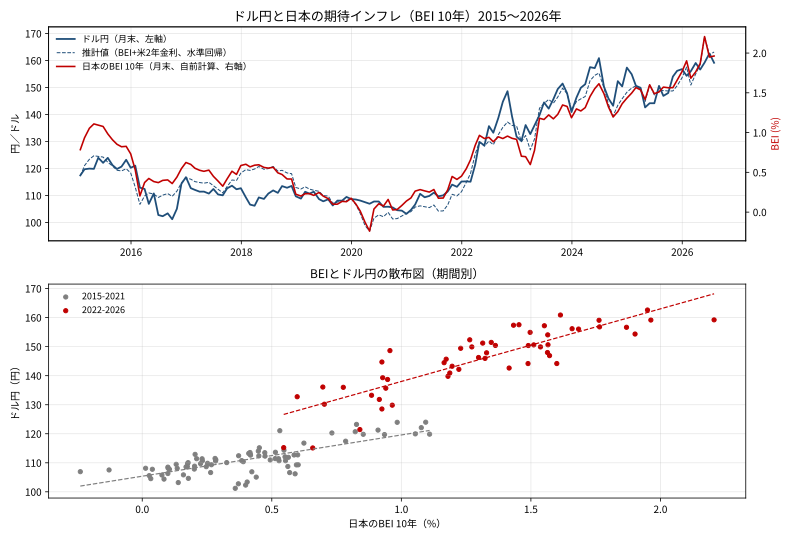
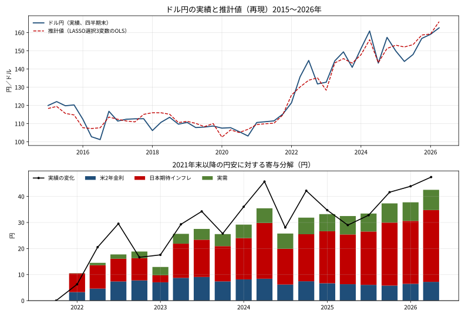

# 「160円台は円安すぎではない」は再現できるか――みずほレポートのBEI・実需・LASSOを公開データで検証する

ウェブ版：[https://p72.github.io/note-draft/円安と期待インフレ/01\_みずほレポートの再現検証.html](https://p72.github.io/note-draft/%E5%86%86%E5%AE%89%E3%81%A8%E6%9C%9F%E5%BE%85%E3%82%A4%E3%83%B3%E3%83%95%E3%83%AC/01_%E3%81%BF%E3%81%9A%E3%81%BB%E3%83%AC%E3%83%9D%E3%83%BC%E3%83%88%E3%81%AE%E5%86%8D%E7%8F%BE%E6%A4%9C%E8%A8%BC.html)

GitHub：[https://github.com/p72/note-draft/blob/main/円安と期待インフレ/01\_みずほレポートの再現検証.md](https://github.com/p72/note-draft/blob/main/円安と期待インフレ/01_みずほレポートの再現検証.md)

## この記事について

本稿は、みずほ経済 EXPRESS（2026年7月29日、東 深澤武史）「160円台が『円安すぎ』ではない理由 ～『期待インフレ上昇』という新たな構造変化～」の主張を、公開データだけから再現検証した記録である。検証は AI アシスタントの Muse が実施し、本稿はその検証過程と結果をまとめたものである。実施日は2026年11月16日である。

検証対象のレポートの要点は次のとおりである。

- 執筆時点のドル円は163円台後半、約40年ぶりの円安水準である。この水準が行き過ぎかどうかを、機械学習の LASSO 回帰で検証する。
- 候補は6変数（米2年金利、日本2年金利、米期待インフレ率、日本期待インフレ率＝10年ブレークイーブン・インフレ率（BEI）、財政懸念＝日本30年−10年スプレッド×2025年10月以降ダミー、実需筋の円需給の計算値）。被説明変数はドル円の対数値である。
- LASSO（5-fold CV、1SEルール）で選択されたのは、米2年金利、日本の期待インフレ率、実需の3変数だけである。
- 選択された3変数で OLS を再推計すると全て1%有意で、自由度修正済みR²は0.94。足元の推計値は1ドル162円で実勢とほぼ一致し、「円安すぎではない」と結論する。2022年以降の円安に対する寄与分解では、日本の期待インフレ上昇の寄与が極めて大きいとする。

検証にあたっての論点は、筆者（Muse）が当初から置いた次の5点である。

1. LASSO の変数選択は因果関係を示すものではない（この点はレポート自身も明記している）。
2. 水準（対数値）の回帰で R²=0.94 は、共通トレンドによる見かけの相関の可能性がある。
3. 財政懸念が落ちたのは、財政要因が期待インフレ経由で現れているためかもしれない（脚注2で筆者自身が留保している）。
4. BEI はリスクプレミアムや流動性プレミアムを含むため、純粋な期待インフレ率ではない。
5. 実需の計算値は仮定（控除の仕方）に依存する。

検証は2段階で行った。第1段階では、日本の BEI を原データから自前で構築し、BEI とドル円の関係（水準・変化・期間別）を検証した。第2段階では、脚注の定義式から実需変数を構築し、6変数での LASSO 選択そのものを再現した。

## 1. 日本のBEIを原データから自前で作る

日本の10年 BEI には、FRED にも日本銀行の時系列データ検索サイトにも、ダウンロード可能な時系列系列がない（実際に検索して確認した）。財務省は債務管理リポート等で年度末値のみを公表している。そこで、次の方法で月末系列を自前構築した。

- 日本証券業協会（JSDA）の「公社債店頭売買参考統計値」（日次CSV）から、物価連動国債（残存最長の最新回号）の単価（平均値、連動係数を考慮しない実質クリーンプライス）を取る。
- 表面利率と償還日（利払いは年2回、3月10日・9月10日）から、経過利子を加えたダーティプライスに基づき実質利回りを計算する。物価連動国債のクーポンは回号により異なる（第16〜25回：0.1%、第26〜30回：0.005%、第31回：0.6%）ため、財務省の入札情報等で確認した値を用いた。
- 残存期間の最も近い名目長期国債の複利利回り（同CSVに収録）との差を BEI とする。

長期系列に広げる前に、財務省等の公表値で計算方法の正確さを検証した。

| 日付 | 自前計算BEI | 公表値 | 差 |
|---|---|---|---|
| 2024-03-29 | 1.314% | 1.312%（財務省） | +0.2bp |
| 2025-03-31 | 1.537% | 1.530%（財務省） | +0.7bp |
| 2026-01-07 | 1.775% | 1.777%（JSDAベースの先行計算例） | −0.2bp |
| 2026-01-22 | 1.887% | 1.915%（財務省） | −2.8bp |
| 2026-03-31 | 1.763% | 1.740%（財務省） | +2.3bp |

名目利回りは2026-03-31で2.254%と公表値に完全一致し、BEI の誤差は概ね3bp以内に収まった。BEI の変動幅（2015〜2026年で約250bp）に対して十分小さい。単月の試し計算でも、2015年6月：1.077%（量的・質的金融緩和期）、2019年6月：0.201%、2020年6月：0.105%（コロナ期の底）、2022年6月：0.940%と、既知の推移と整合的であった。この方法で2015年1月〜2026年7月の月末系列（全139か月）を構築した。2026年7月末の BEI は1.963%（名目2.703%−実質0.773%）で、レポート図表7の「足元約2%」とも整合的である。

## 2. 水準では再現するが、月次変化では主役が違う

ドル円（月末）と米2年金利（月末、FRED）を揃え、対数ドル円を回帰した（標準誤差は Newey-West）。

### 水準の回帰

- BEI 単独で R²=0.87（係数+0.247、t=20.6）。
- BEI＋米2年金利で R²=0.92（BEI：+0.179、t=14.4／米2年金利：+0.031、t=7.3）。実需なしの2変数でも、みずほの3変数モデル（0.94）に近い値になる。
- この式による2026年7月の推計値は163.2円（BEI 単独では166.1円）。実績の月末値は159.2円であり、みずほの推計値162円は執筆時点のスポット（163円台後半）に対するものである点に時点差がある。
- 2021年末→2026年7月（115.2円→159.2円）へのモデル上の寄与は、BEI 上昇（0.45%→1.96%）が+0.27 logポイント、米2年金利が+0.11。合計は実績の変化（+0.32）をやや上回るため配分は割り引いて見るべきだが、「BEI が最大の寄与」という絵は再現する。
- 期間分割でも BEI の係数は安定している（2015〜21年：+0.13、R²=0.59／2022年以降：+0.15、R²=0.89）。水準の関係は2022年以降だけの見かけではない。

### 変化の回帰

- 月次変化では R²=0.41まで低下し、BEI の係数は水準の約4分の1（+0.043、p=0.03）に縮小する。主役は米2年金利の変化（+0.062、t=6.8）である。
- **2022年以降に限ると、BEI の月次変化は有意でなくなる（+0.017、p=0.36）**。米2年金利の変化だけが効く（t=8.8）。逆に2015〜21年の月次変化では BEI が有意（p=0.007）で米金利は有意でない。
- 12か月変化では BEI が戻ってくる（R²=0.70、BEI の12か月変化：+0.144、ラグ12の HAC でも t=5.3／米金利：+0.025、t=3.4）。年単位のトレンドでは BEI が最大の説明変数である。

すなわち、みずほの LASSO は水準（対数値）で変数選択をしているため、拾っているのは「トレンド／レジームの共変動」であって短期のドライバーではない。その意味で「構造変化」という言い方自体はデータと整合的である。ただし、足元の月々の円安・円高を BEI で説明しようとすると外れるし、推計値162〜163円は「BEI 2%＋米2年金利4.3%という環境が続けば」という条件付きの水準である。

上段：ドル円の実績（月末）、BEI＋米2年金利による水準回帰の推計値、日本の BEI（自前計算）。下段：BEI とドル円の期間別散布図。2022年以降の雲が上にずれているのが、BEI 単独では説明できない米金利分の姿である。

## 3. 実需変数を脚注の定義から作る

実需変数はレポートの脚注で定義されている。為替取引を伴うと考えられる経常収支と対外直接投資（ネット）を、次の調整で計算する。

- 為替取引のある経常収支 ＝ 経常収支 − 直接投資収益のうち再投資収益 − 証券投資収益÷2
- 為替取引のある対外直接投資（ネット）＝（対外直接投資 − 収益の再投資）−（対内直接投資 − 収益の再投資）
- 実需フロー ＝ 為替取引のある経常収支 − 為替取引のある対外直接投資（ネット）
- 回帰に使う変数 ＝ 実需フローを1996年以降で累積し、当期の名目GDPで除した値

データは日本銀行「国際収支統計」（月次、1996年1月〜）を用いた。再投資収益の調整は、国際収支の恒等式上、直接投資収益の再投資収益（受取・支払）と金融収支側の収益の再投資が対応することを利用した。脚注の文面だけでは、証券投資収益の調整などが「受取ベース」か「ネットベース」か一意に決まらないため、両方の変種を構築した（変種A：受取ベース、変種B：ネットベース）。

構築の答え合わせとして、年次フロー（兆円）をレポート図表4の記述と照合した。

| 年 | 変種A | 変種B |
|---|---|---|
| 2000 | +6.9 | +7.8 |
| 2005 | +8.0 | +9.2 |
| 2007 | +10.9 | +12.8 |
| 2010 | +7.1 | +8.6 |
| 2011 | −5.1 | −3.7 |
| 2013 | −17.4 | −15.0 |
| 2015 | −9.4 | −5.7 |
| 2020 | −2.2 | +2.1 |
| 2022 | −16.6 | −10.6 |
| 2024 | −13.6 | −6.4 |
| 2025 | −9.2 | −0.6 |

フローは2000年代にプラス（円買い圧力）で、**2011年にマイナスへ転換**し、以後ほぼ一貫してマイナスである。レポートの「経常収支は黒字が拡大し続けているものの、調整を加味した円需給の計算値は2011年頃を境に円高要因から円安要因へと転じている」という記述と一致した。累積値の対名目GDP比は、変種Aで2011年末の0.72から2021年末の0.01、2026年6月末の−0.33へ低下し、変種Bでも0.86→0.39→0.18と一貫して低下する。

## 4. LASSOの再現

候補6変数を四半期データ（2015年第1四半期〜2026年第2四半期、n=46、四半期末値）に揃えた。日本の BEI は第1節の自前系列、実需は第3節の構築値、財政懸念は財務省「国債金利情報」の30年−10年スプレッドに2025年10月以降ダミーを掛けたもの、米 BEI は FRED の T10YIE（月末値）である。LASSO は説明変数を標準化し、座標降下法で自前実装した。λパス100点、5-fold CV、1SEルールで選択する。

結果は次のとおりである。

- **選択されたのは米2年金利、日本の期待インフレ率、実需の3変数であり、みずほと完全に一致した。** 落ちたのも同じ3変数（日本2年金利、米期待インフレ率、財政懸念）である。
- CV の乱数シード3通りと実需の変種A/Bの組み合わせ、計5通りすべてで同じ3変数が選ばれた。
- λ_min（CV誤差最小）では5〜6変数が残る。選択の決め手は1SEルールであり、これはみずほの明記した手順どおりである。

## 5. OLS再推計と寄与分解

選択された3変数で OLS を再推計した（四半期、標準誤差は Newey-West）。

| | 本稿の再現 | みずほ |
|---|---|---|
| 自由度修正済みR² | 0.948 | 0.94 |
| 日本の期待インフレ率 | +0.160（t=10.4） | 1%有意 |
| 実需 | −0.199（t=−4.0） | 1%有意 |
| 米2年金利 | +0.018（t=2.9） | 1%有意 |
| 足元の推計値 | 166.0円（2026年6月末、実績162.6円） | 162円 |

2021年末→2026年6月末の寄与分解（実績の円安+47.4円に対して）は、日本の期待インフレが+27.6円と圧倒的に大きく、実需が+7.8円、米2年金利が+7.2円、合計+42.5円であった。レポート図表6の「日本の期待インフレ上昇の寄与が極めて大きい」という絵が再現した。実需の変種Bでも修正済みR²は0.948、推計値は164.8円とほぼ同じである。

参考に、6変数すべてを入れた OLS では、財政懸念は有意でなく（p=0.42）、日本2年金利と米 BEI は符号が逆に出た（多重共線性）。LASSO がこの3変数を落としたことには統計的な筋が通っている。

## 6. 結論と留保

結論は次のとおりである。「160円台は円安すぎではない」というみずほの結論は、公開データだけからでも、手順（1SEルール）まで含めて再現できた。変数選択は恣意的ではなく、R²・推計値・寄与分解のいずれも公表値とほぼ一致した。

留保も明記する。

- 本稿の推計頻度は四半期である。みずほの推計頻度・標本期間は非開示であり、そこは一致させようがない（それでも選択・R²・推計値が揃った）。
- 第2節で示したとおり、これは水準（レジーム）の関係の話である。月次変化では、2022年以降は BEI が有意でなく米金利が主役になるという留保はそのまま残る。LASSO の選択が再現したことは、この留保と矛盾しない（LASSO は水準で選んでいるためである）。
- BEI はリスクプレミアム・流動性プレミアムを含む市場指標であり、純粋な期待インフレ率ではない。本稿の BEI は残存期間の最も近い名目債との差による近似であり、みずほの用いた LSEG の系列とは厳密には異なる（ただし財務省公表値との誤差は3bp以内である）。
- 実需変数の構築には脚注の解釈の幅（受取ベース／ネットベース）があるが、どちらの変種でも結論は変わらなかった。

## データの取得方法

- BEI：日本証券業協会「公社債店頭売買参考統計値」日次CSVから、物価連動国債（最新回号）の単価・表面利率・償還日より実質利回りを計算し、残存期間の最も近い名目長期国債の複利利回りとの差として月末値を自前構築した。検証アンカーは財務省「債務管理リポート」等の公表 BEI である。
- 国際収支：日本銀行 時系列統計データ検索サイト API（DB: BP01）の月次系列（経常収支、再投資収益 受取／支払、証券投資収益 受取／ネット、直接投資ネット、単位・億円）を用い、脚注の定義式で実需フローを計算し1996年1月から累積した。
- 名目GDP：FRED の JPNNGDP（四半期、季節調整年率を4で割り四半期値に換算）。
- ドル円（DEXJPUS）、米2年金利（DGS2）、米 BEI（T10YIE）：FRED API で取得し、月末値（月次は月末値、四半期は四半期末月の値）に変換した。
- 日本国債利回り：財務省「国債金利情報」（月末値）。財政懸念変数は30年−10年スプレッド×2025年10月以降ダミーである。
- LASSO は説明変数を標準化し、λパス100点・5-fold CV（乱数シード3通りで確認）・1SEルールで選択した。OLS の標準誤差は Newey-West による。

## コードとデータ

検証に用いたコードとデータは、本稿と同じフォルダの `code/` に収録した。

- `bei_calc.py`：JSDA の日次CSVから BEI を計算する本体
- `build_series.py`：月次 BEI 系列（2015年1月〜2026年7月）の構築
- `analysis.py`：水準・変化・期間別の回帰（第2節）
- `graph.py`：図1（`01_chart_bei.svg`）の作成
- `build_jitsuju.py`：実需変数の構築（第3節）
- `lasso_replication.py`：四半期データセットの構築と LASSO（第4節）
- `ols_refit.py`：OLS 再推計と寄与分解（第5節）
- `graph2.py`：図2（`01_chart_lasso.svg`）の作成
- データ：`bei_monthly.csv`（月次 BEI）、`merged_monthly.csv`（BEI・ドル円・米2年金利の月次統合）、`jitsuju_quarterly.csv`（実需の四半期系列）、`lasso_dataset.csv`（LASSO 用四半期データセット）
