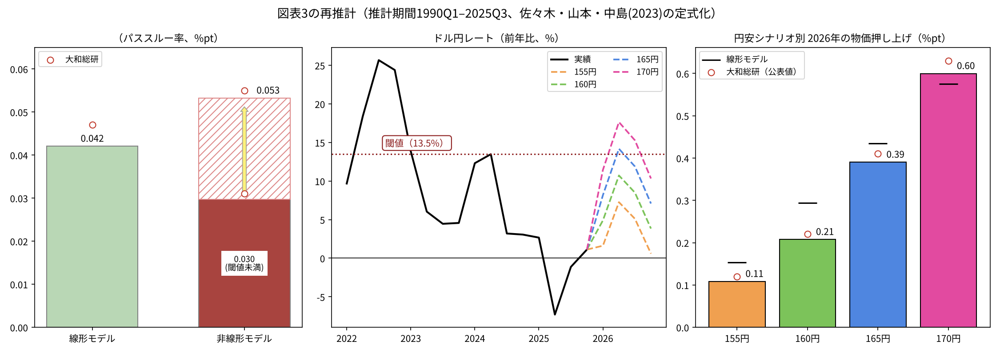
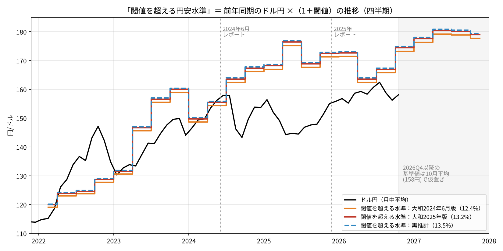
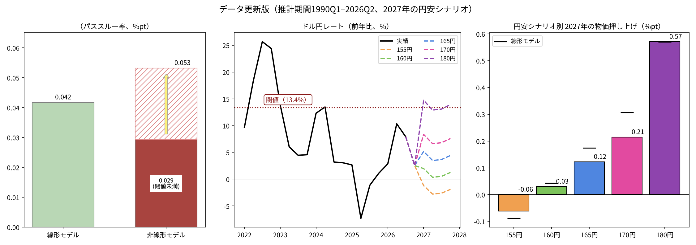

# 閾値を超える円安水準は毎年動く──為替パススルーの閾値モデルを再推計する

ウェブ版：[https://p72.github.io/note-draft/円安と物価の閾値/01\_閾値を超える円安水準は毎年動く.html](https://p72.github.io/note-draft/%E5%86%86%E5%AE%89%E3%81%A8%E7%89%A9%E4%BE%A1%E3%81%AE%E9%96%BE%E5%80%A4/01_%E9%96%BE%E5%80%A4%E3%82%92%E8%B6%85%E3%81%88%E3%82%8B%E5%86%86%E5%AE%89%E6%B0%B4%E6%BA%96%E3%81%AF%E6%AF%8E%E5%B9%B4%E5%8B%95%E3%81%8F.html)

GitHub：[https://github.com/p72/note-draft/blob/main/円安と物価の閾値/01\_閾値を超える円安水準は毎年動く.md](https://github.com/p72/note-draft/blob/main/%E5%86%86%E5%AE%89%E3%81%A8%E7%89%A9%E4%BE%A1%E3%81%AE%E9%96%BE%E5%80%A4/01_%E9%96%BE%E5%80%A4%E3%82%92%E8%B6%85%E3%81%88%E3%82%8B%E5%86%86%E5%AE%89%E6%B0%B4%E6%BA%96%E3%81%AF%E6%AF%8E%E5%B9%B4%E5%8B%95%E3%81%8F.md)

※ この記事は、総務省の消費者物価指数（e-Stat API）、厚生労働省の毎月勤労統計（e-Stat）、日本銀行の企業物価指数とドル円レート（時系列統計データ検索サイトAPI）を使い、Python で推計・作図している。コードとデータは同じフォルダの `code/` にある。

## はじめに

2024年6月、大和総研は「円安進行で高まるインフレリスクと金融政策への示唆」で、ドル円が160円を超えて推移するとインフレ率が非線形的に高まるという試算を示した。円安が大きく進む局面では、企業がコスト上昇を販売価格に転嫁する度合いが強まる。その強まり方を、為替の前年比に「閾値」を置いたモデルで捉えたものである。

2025年12月の「『責任ある積極財政』下で進む長期金利上昇・円安の背景と財政・金融政策への示唆」でも、同じ枠組みを推計期間を延ばして使っている（図表3）。被説明変数を新コアコアCPI（生鮮食品及びエネルギーを除く総合）に替え、ドル円の前年比が＋13.2%を超えるとパススルー率が0.031%ptから0.055%ptに高まるとした。そのうえで、2026年にドル円が165円、170円で推移すると、新コアコアCPIがそれぞれ0.41%pt、0.63%pt押し上げられると試算している。

どちらのレポートも、閾値の設定やラグの選び方は佐々木・山本・中島（2023、日本銀行ワーキングペーパー）を参考にしたと注記している。本稿では、この定式化に沿って大和総研の推計を公表データで再現し、2026年4-6月期までデータを延ばす。そのうえで、二つのレポートを並べると見えてくる点を整理する。閾値は前年比で決まるため、閾値を超えるのに必要なドル円の水準は、前年の水準に合わせて毎年動くという点である。

## 要旨

- 佐々木ほか（2023）の定式化で再推計すると、2025年12月のレポートの数値はほぼ再現できる。閾値は13.5%（大和総研13.2%）、閾値未満のパススルーは0.030（同0.031）、閾値超過時は0.053（同0.055）、2026年の押し上げは165円で0.39%pt（同0.41）、170円で0.60%pt（同0.63）となった。
- 閾値（前年比13〜14%）そのものは、推計期間を延ばしてもほとんど動かない。動くのは、閾値を超えるドル円の水準である。それは「前年同期のドル円×（1＋閾値）」で決まり、2024年4-6月期の約155円から、2025年は168〜177円、2027年には約180円まで上がる。
- 2024年6月の「160円超」は、当時の閾値水準（2024年4-6月期が約155円、7-9月期が約164円）と整合する。しかし円安が定着すれば、閾値水準も1年遅れで上がる。「何円を超えると危ない」という目安は、1年で更新が必要になる。
- データを2026年4-6月期まで延ばしても係数はほぼ変わらない。2026年のドル円の前年比はピークでも10%程度で、閾値を下回っている。2027年に閾値を超えるには、180円前後までの円安が必要である。

## 1. モデル

佐々木ほか（2023）の(1)式は次の形をしている。

　y(t) ＝ c ＋ Σ β(i)・x(i, t−h) ＋ Σ γ(i)・x(i, t−h)・I[ x(i, t−h) ＞ d(i)・σ(i) ] ＋ ε(t)

y は消費者物価の前年比、x は企業物価、ドル円、賃金の前年比である。I[・] は条件を満たすとき1、それ以外で0をとる。σ(i) は推計期間内の標準偏差で、閾値は標準偏差の d(i) 倍とする。d(i) は0.5〜2.0の範囲を0.1刻みで探し、推計誤差が最も小さくなる値を選ぶ。コストの上昇率が閾値を下回るときのパススルーは β、上回るときは β＋γ になる。γ が正で有意なら、パススルーに非線形性があることになる。

ラグ h は1〜4期からAICで選ぶ。ここで注意したいのは、h 期前の値1本だけを説明変数に入れる点である。1〜h 期をまとめて入れるのではない。筆者は最初、1〜4期のラグをまとめて入れて推計した。その場合、1期前と4期前の係数が逆の符号で打ち消し合い、パススルーの合計が小さく出た。論文を確認して単一ラグに改めると、大和総研の数値に近づいた。

論文はラグを3変数で共通にしているが、大和総研の注記は「各変数のラグは1期から4期までの範囲でAICにより最適な次数を設定」となっている。本稿は変数ごとにラグを選んだ。その結果、ドル円は4期前、企業物価と賃金は3期前が選ばれた。

データは次の通りである。

- 物価：新コアコアCPI（2020年基準）の四半期平均の前年比
- 企業物価：国内企業物価指数（消費税を除く、2020年基準）の前年比
- ドル円：東京市場17時時点の月中平均を四半期平均した前年比（プラスが円安）
- 賃金：論文にならい、毎月勤労統計の「きまって支給する給与」（事業所規模30人以上）を「総実労働時間」で割った平均時給の前年比

論文は消費税調整済みの消費者物価を使っている。消費税の影響を除いた新コアコアの長期系列は公表されていないため、本稿では1989年、1997年、2014年、2019年の消費税率の導入・引き上げ（2019年は幼児教育・保育の無償化を含む）と、2021年の携帯電話通信料の引き下げを、それぞれ4四半期のダミー変数で扱った。

## 2. 再現の結果

図1は大和総研の図表3と同じ構成である。左はパススルー率、中央はドル円の前年比とシナリオ、右は2026年の物価押し上げ効果を示す。赤い丸は大和総研の公表値である。シナリオは、2025年10-12月期を実績とし、2026年の各四半期をそれぞれ155円、160円、165円、170円で横ばいとした。

| | 再推計 | 大和総研（2025年12月） |
|---|---|---|
| ドル円の閾値 | 13.5%（d＝1.3） | 13.2% |
| 線形モデルのパススルー | 0.042 | 0.047 |
| 非線形モデル：閾値未満（β） | 0.030 | 0.031 |
| 非線形モデル：閾値超過時（β＋γ） | 0.053 | 0.055 |
| 2026年の押し上げ（155円／160円／165円／170円） | 0.11／0.21／0.39／0.60 | 0.12／0.22／0.41／0.63 |

γ は5%水準で有意で、AICも線形モデル（266）より非線形モデル（238）のほうが小さい。

右の押し上げ効果の計算方法は、公表値から逆算して確かめた。各四半期のドル円の前年比に、閾値を超えていれば β＋γ、下回っていれば β を掛け、2026年の4四半期で平均したものである。大和総研の係数（0.031、0.055、閾値13.2%）をこの式に当てはめると、0.11、0.22、0.41、0.62となり、公表値とほぼ一致する。

同じ方法で2024年6月のレポート（被説明変数はコアCPI、推計期間は2023年10-12月期まで）も再推計した。閾値は13.6%（大和総研12.4%）、閾値未満は0.021（同0.016）、閾値超過時は0.033（同0.045）、線形は0.024（同0.026）となった。方向は一致しているが、2025年版ほどは近くない。この推計では γ は10%水準でも有意でなかった。

論文本体の推計（新コアコア、1991〜2019年、共通ラグ）とも比べた。為替の d は1.5で論文と一致した。閾値超過時のパススルーは0.030（論文0.036）、線形は0.0075（同0.013）である。ラグは論文の2期に対して1期が選ばれ、企業物価と賃金の d も論文とずれた。

## 3. 閾値を超える円安水準は毎年動く

二つのレポートの閾値は12.4%と13.2%で、本稿の推計でも、推計期間を2023年、2024年、2025年、2026年と延ばしても13.4〜13.6%に収まった。閾値（前年比）はかなり安定している。

ところが、閾値が前年比で定義されている以上、閾値を超えるのに必要なドル円の水準は一定ではない。四半期 t に閾値を超えるには、ドル円が「前年同期のドル円×（1＋閾値）」を上回る必要がある。前年に円安が進めば、翌年のハードルもその分高くなる。

図2は、三つの閾値（12.4%、13.2%、13.5%）について、閾値を超える水準を四半期ごとに描いたものである。黒線はドル円の月中平均である。2026年10-12月期以降の閾値水準は、基準となる2026年10-12月期のドル円を10月の平均（158円）で仮置きして計算した。

| 年 | 閾値を超える水準（13.2%） | ドル円の実績（四半期平均） |
|---|---|---|
| 2023年 | 132〜160円 | 132〜148円 |
| 2024年 | 150〜167円 | 149〜156円 |
| 2025年 | 168〜177円 | 145〜154円 |
| 2026年 | 164〜174円 | 157〜159円 |
| 2027年 | 178〜181円 | ― |

2024年6月のレポートが「160円超」を警戒水準とした時点では、閾値水準は4-6月期が約155円、7-9月期が約164円だった。4-6月期の実績は155.9円で、閾値水準とほぼ並んでいた。「160円超でインフレが加速する」という表現は、この時点の閾値水準とよく整合している。

その後、2024年後半から2025年前半は円高方向に戻り、2025年4-6月期は144円台まで下がった。この円高のため、1年後の2026年4-6月期の閾値水準は約164円まで下がり、実績（159円）との差は5円程度まで縮んだ。逆に、2025年後半から158〜160円程度の円安が定着したことで、2027年の閾値水準は約180円まで上がる。

この仕組みからは、二つのことが言える。第一に、「何円を超えると危ない」という円の水準は、1年で更新が必要になる。2024年の「160円」は2024年の目安であって、2026年や2027年の目安ではない。第二に、モデルの上で非線形のパススルーを引き起こすのは「1年で13%を超える急速な円安」であり、ゆっくり進む円安は、水準がどれほど円安でも閾値を超えにくい。ただし、閾値未満でも β（約0.03）のパススルーは働いており、円安が毎年少しずつ進めば、その分の押し上げは続く。

## 4. 2026年と2027年の試算

推計期間を2026年4-6月期まで延ばしても、係数はほとんど変わらなかった。閾値は13.4%、閾値未満は0.029、閾値超過時は0.053、線形は0.042である。

2026年のドル円の前年比は、1-3月期が2.9%、4-6月期が10.3%、7-9月期が7.9%で、10-12月期は10月の水準が続けば2.6%程度となる。いずれも閾値を下回っている。大和総研と同じ計算方法では、2026年の押し上げは0.17%ptとなる。

2027年について、2026年10-12月期を158円とし、2027年の各四半期を一定の水準で横ばいとすると、押し上げは155円で−0.06%pt、160円で0.03%pt、165円で0.12%pt、170円で0.21%ptにとどまる。170円でも前年比は8%程度で、閾値に届かない。閾値を超えるのは180円前後で、その場合の押し上げは0.57%ptになる。

## 5. 留意点

**消費税の扱い。** 論文は消費税調整済みの消費者物価を使っているが、本稿はダミー変数で代替した。消費税率引き上げの前後で物価上昇率がどれだけ動いたかを、データから推計していることになる。ダミーを入れずに推計すると、閾値は13.5%で変わらないものの、線形のパススルーは0.054、閾値未満は0.034、閾値超過時は0.077と大きくなった。1997年と2014年の消費税率引き上げは、ちょうどその1年前（ドル円のラグである4期前）に大幅な円安が進んでいた時期に当たり、増税による物価の上昇が為替の係数に入り込むためとみられる。大和総研の数値との残りの差は、この扱いの違いによる部分があると考えられる。

**押し上げ効果の計算とラグの関係。** 右パネルの押し上げ効果は、当期のドル円の前年比にパススルー率を掛けて求めている。しかし推計で選ばれたドル円のラグは4期である。推計式どおりに4期前のドル円を使うと、2026年の押し上げは2025年の為替の動き（前年比−7%〜＋3%）で決まり、−0.03%ptとなる。2026年の円安の影響は2027年に現れ、0.17%ptとなる。シナリオの水準が効いてくるのは、さらにその翌年である。大和総研の計算方法は、効果の大きさの目安としては分かりやすいが、時期の対応は推計式と一致していない。

**インフレの慣性。** 論文自身が述べているように、このモデルは物価上昇率の過去の値を説明変数に含めていない。コストの押し上げが強まる局面では予測値の上昇が速く、弱まる局面では低下が速くなりやすい。

**閾値の刻み。** d は0.1刻みで探索しているが、ドル円の前年比の標準偏差は約10%なので、閾値は約1%刻みでしか動かない。13.2%と13.5%の差は、この刻みの範囲内である。

**前年比で閾値を置くこと自体。** 企業の値上げ判断が、前年比の急変ではなく、コストの累積的な上昇や円の水準に反応している可能性もある。その場合、ゆっくりした円安でも転嫁が進むことになり、前年比の閾値モデルでは捉えにくい。どちらが実態に近いかは、本稿の分析では判断できない。

## 付記：データと推計の方法

- 物価：総務省「消費者物価指数」（2020年基準、e-Stat API、statsDataId＝0003427113）。生鮮食品及びエネルギーを除く総合（品目コード0178）を新コアコア、生鮮食品を除く総合（0161）をコアとし、月次指数を四半期平均して前年比をとった
- 企業物価：日本銀行「企業物価指数」消費税を除く国内企業物価指数・総平均（2020年基準、系列コード PRCG20\_1200000000）
- ドル円：日本銀行「外国為替市況」東京市場ドル・円スポット17時時点・月中平均（FXERM07）。2026年10月は日次（FXERD04）の10月21日までの平均（158.09円）
- 賃金：厚生労働省「毎月勤労統計調査」全国調査・長期時系列表（2026年8月分）。きまって支給する給与と総実労働時間（いずれも事業所規模30人以上、調査産業計）の前年比から平均時給の前年比を算出した
- 消費税等のダミー：1989年4-6月期〜90年1-3月期、1997年4-6月期〜98年1-3月期、2014年4-6月期〜15年1-3月期、2019年10-12月期〜20年7-9月期（幼保無償化を含む）、2021年4-6月期〜22年1-3月期（携帯電話通信料）
- 推計：最小二乗法。標準誤差は自己相関と不均一分散に頑健なもの（Newey-West、ラグ4）。ラグ h はラグと閾値の全組み合わせを推計し、閾値をRMSE最小で選んだうえでAIC最小の組み合わせを採用した
- 推計結果：`code/scenario2_results.csv`（シナリオ別の押し上げ）、`code/threshold_yen_level.csv`（図2の閾値水準）
- コード：`code/`（データの整形は `build_data.py`、推計は `model2.py`・`est2024.py`、図1・図3は `scenario2.py`、図2は `thresh_level.py`）

## 参考文献

- 佐々木貴俊・山本弘樹・中島上智（2023）「消費者物価への非線形なコストパススルー：閾値モデルによるアプローチ」日本銀行ワーキングペーパーシリーズ、No.23-J-5
  [https://www.boj.or.jp/research/wps\_rev/wps\_2023/wp23j05.htm](https://www.boj.or.jp/research/wps_rev/wps_2023/wp23j05.htm)
- 久後翔太郎・中村華奈子（2024）「円安進行で高まるインフレリスクと金融政策への示唆」大和総研、2024年6月3日
- 久後翔太郎・中村華奈子（2025）「『責任ある積極財政』下で進む長期金利上昇・円安の背景と財政・金融政策への示唆」大和総研、2025年12月11日
  [https://www.dir.co.jp/report/research/economics/japan/20251211\_025467.pdf](https://www.dir.co.jp/report/research/economics/japan/20251211_025467.pdf)
- 日本銀行 時系列統計データ検索サイト
  [https://www.stat-search.boj.or.jp/](https://www.stat-search.boj.or.jp/)
- 政府統計の総合窓口（e-Stat）
  [https://www.e-stat.go.jp/](https://www.e-stat.go.jp/)
