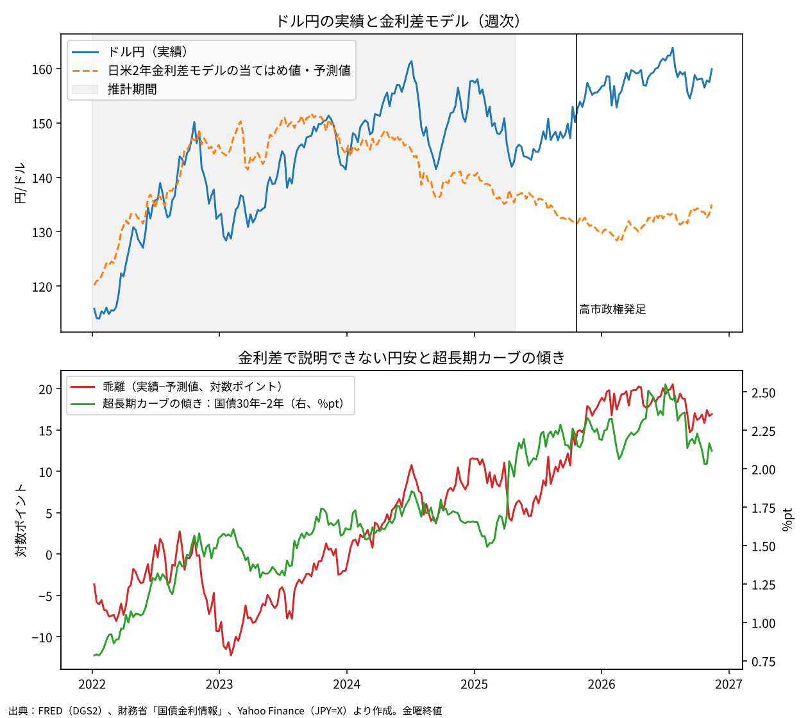
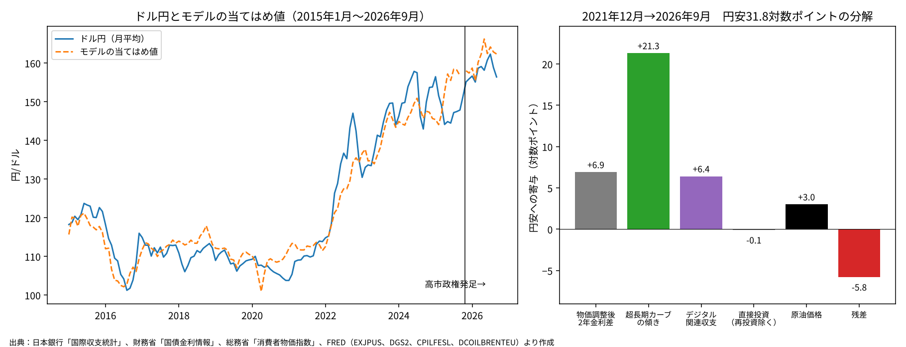
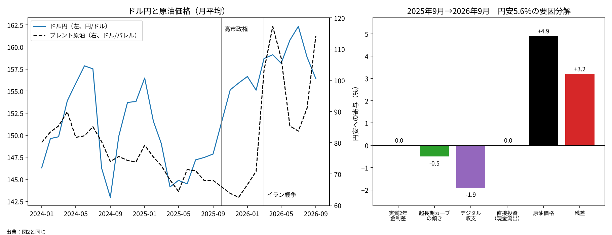
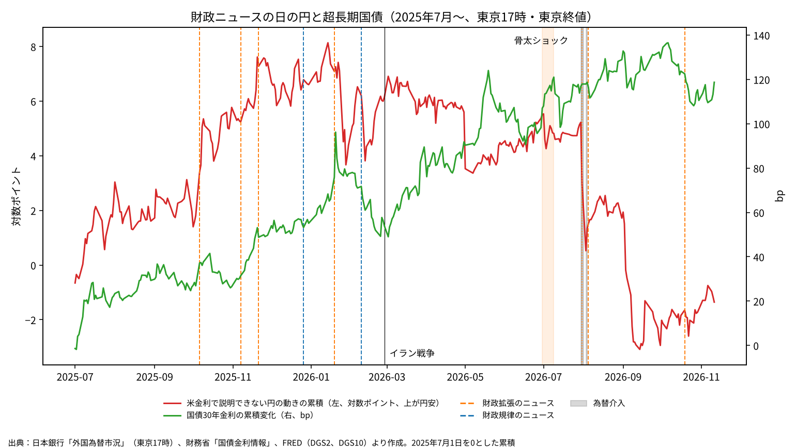

# 高市政権の財政リスクは円安の最大の原因か──金利差・国際収支・原油による分解と財政ニュースのイベントスタディ

ウェブ版：[https://p72.github.io/note-draft/円安と財政リスク/01\_円安の最大の原因は財政リスクか.html](https://p72.github.io/note-draft/%E5%86%86%E5%AE%89%E3%81%A8%E8%B2%A1%E6%94%BF%E3%83%AA%E3%82%B9%E3%82%AF/01_%E5%86%86%E5%AE%89%E3%81%AE%E6%9C%80%E5%A4%A7%E3%81%AE%E5%8E%9F%E5%9B%A0%E3%81%AF%E8%B2%A1%E6%94%BF%E3%83%AA%E3%82%B9%E3%82%AF%E3%81%8B.html)

GitHub：[https://github.com/p72/note-draft/blob/main/円安と財政リスク/01\_円安の最大の原因は財政リスクか.md](https://github.com/p72/note-draft/blob/main/%E5%86%86%E5%AE%89%E3%81%A8%E8%B2%A1%E6%94%BF%E3%83%AA%E3%82%B9%E3%82%AF/01_%E5%86%86%E5%AE%89%E3%81%AE%E6%9C%80%E5%A4%A7%E3%81%AE%E5%8E%9F%E5%9B%A0%E3%81%AF%E8%B2%A1%E6%94%BF%E3%83%AA%E3%82%B9%E3%82%AF%E3%81%8B.md)

※ この記事は、財務省「国債金利情報」、日本銀行「国際収支統計」「外国為替市況」（時系列統計データ検索サイトAPI）、総務省「消費者物価指数」（e-Stat API）、FRED（セントルイス連銀）の公表データを使い、Python で推計・作図している。コードとデータは同じフォルダの `code/` にある。

※ 2026年11月14日改訂：査読（Issue #39）を受けて、前年差の計算の誤り、デジタル関連収支と直接投資の定義を直し、数値と図を全面的に更新した。あわせて、財政ニュースのイベントスタディ（5節）と頑健性の検証（3節・4節）を加え、結論を改めた。同日、再査読を受けて、イベントスタディの日付の対応づけ（東京営業日と米国の金利の対応）の誤りを直し、5節と6節を更新した。さらに、事前に決めたイベントに含めていなかった「骨太ショック」を、別枠で追加して確認した（5節の表5b）。

## はじめに

2025年10月に高市政権が発足してから、円安の原因を財政に求める議論が増えた。首相は就任直後の国会で、単年度のプライマリーバランス（PB）目標を取り下げると述べた。2026年8月には、2027年4月から2年間、飲食料品の消費税率を8%から1%に下げる方針が決まった。減税の財源は2026年10月の臨時国会でも示されず、首相は「国債発行を否定するものではない」と答弁している。

市場の動きも、この見方を支えているように見える。2025年春以降は日米金利差が縮んだのに円安が進み、ドル円は2026年7月に163円台まで下落した。日本の長期金利の上昇と連動していたため、財政規律への懸念が主因だとする見方が有力になった。円安は7月30日の単独介入と31日の日米協調介入で止まった。

この議論は「財政規律の緩みが円安の最大の原因だ」という形で語られることが多い。本稿では、これを検証できる命題として扱う。手順は二つある。第一に、ドル円の月次の動きを金利差、超長期国債のカーブの傾き、国際収支、原油価格に分解し、どの要因と関連しているかを見る。これは記述的な分解であり、因果関係を示すものではない。第二に、財政に関するニュースが出た日に、円と国債がどう動いたかを日次で調べる（イベントスタディ）。財政が円安を生んでいるなら、財政拡張のニュースの日には、米国の金利では説明できない円安が起きているはずである。

本稿では、ドル円を対数×100で扱う。二時点の差は「対数ポイント」で表し、足し合わせることができる。ふつうの変化率とは少しずれるので、必要な箇所ではドル円の上昇率を併記する。

## 要旨

- 日米2年金利差だけのモデルでは、2026年11月13日のドル円は予測値より16.9対数ポイント円安である（実績159.9円、予測値135.0円）。この乖離は国債30年−2年のカーブの傾きと連動している。
- ただし、カーブの傾きは財政懸念だけを表す指標ではない。財政不安が話題にならなかった2015〜2021年でも、傾きとドル円は強く連動していた。
- 物価調整後の2年金利差、カーブの傾き、デジタル関連収支、直接投資、原油価格による月次の分解では、2021年12月から2026年9月までの円安31.8対数ポイント（ドル円は37.4%上昇）のうち、カーブの傾きと関連する部分が21.3、物価調整後の金利差が6.9、デジタル関連収支が6.4、原油が3.0だった。この分解は定式化によって数ポイント単位で変わる。
- 高市政権の発足からイラン戦争前まで（2025年9月→2026年2月）の円安4.8対数ポイントは、どの説明変数でもほとんど説明できない（残差5.6）。財政懸念はその候補の一つだが、残差は財政効果の推計値ではない。
- 財政ニュースのイベントスタディでは、財政拡張のニュース6件（介入日と重なる1件を除く）の後2営業日に、米金利で説明できない円安は平均0.40対数ポイントだった。ランダムな日付と比べた片側p値は0.075で、10%水準でかろうじて有意である。ただしこれは総裁選翌日の1件によるもので、それを除く5件では平均0.12対数ポイント（p＝0.37）にとどまる。30年金利は6件の平均で4.9bp上がった（p＝0.02）。
- 2026年1月の食料品消費税ゼロの報道では、30年金利が2営業日で30.3bp上がった（2営業日の変化の標準偏差の6.5倍）。一方、円の異常変化は−0.10対数ポイントで、ほとんど動かなかった。査読後に追加で確認した2026年6〜7月の「骨太ショック」でも、8営業日で10年・30年金利が約22bp上がる一方、円の異常変化は−0.55対数ポイントだった。
- 米金利で説明できない円安は、政権発足直後の2025年10月に集中している（1か月で約3.8対数ポイント）。総裁選翌日の10月6日には、30年金利が上がる一方で2年金利は下がった。財政拡張の予想と、日銀の利上げが遅れるという予想が同時に動いた日であり、両者は分けられない。
- 以上から、本稿の分析では、財政リスクが円安の最大の原因であることを示す根拠は得られなかった。選んだ財政ニュースの短期の窓では、総裁選翌日を除くと円安方向の反応を確認できない。ただし、これは財政リスクの影響が小さいことの証明ではない。件数が少なく検出力が低いこと、ニュースのうち予想外だった部分を測っていないことが残る。財政リスクの累積的な寄与や、他の要因との順位は判定していない。

## 1. 金利差では説明できない円安

ドル円は長いあいだ、日米金利差でよく説明できた。そこでまず、2022年1月〜2025年4月の週次データで、ドル円を日米2年金利差だけで説明するモデルを推計した。2年金利を使うのは、政策金利の見通しを最もよく映すからである。決定係数は0.41、金利差の係数は5.66で、金利差が1%pt広がると約5.7対数ポイント円安になる。

このモデルの予測値を推計期間の後に延ばすと、実績との差がはっきり開く（図1上段）。乖離は2025年4月に平均5.4対数ポイント、9月に11.3対数ポイントとなった。高市政権の発足後はさらに広がり、2026年7月24日には20.5対数ポイントに達した。その後は介入で少し縮んだが、2026年11月13日時点でも16.9対数ポイントある。実績のドル円は予測値より18.4%高い。

図1下段は、この乖離と国債30年−2年の利回り差（超長期カーブの傾き）を重ねたものである。2年金利は日銀の政策金利の見通しで決まる。そのため、30年との差には、超長期の国債を持つときに投資家が求める上乗せ（期間プレミアム）が出やすい。財政懸念が強まれば、この上乗せが広がると考えられる。2025年5月以降で乖離を傾きに回帰すると、係数は20.6（t値2.8）、決定係数は0.27だった。

週次の変化で見ると、高市政権の前後で係数の推計値は変わっている（表1）。2022年1月〜2025年9月は、日本の10年金利の係数がマイナスだった。日本の金利が上がると円高になる、という通常の関係である。2025年10月〜2026年7月は、金利差の説明力がほぼ消え、日本の10年金利の係数はプラスになった。日本の金利が上がると円安になる、いわゆる「悪い金利上昇」の形である。ただし、政権期のダミーとの交差項で係数の差を検定すると、日本の10年金利の差はp＝0.27、米国の10年金利の差はp＝0.17で、有意ではない。点推定は変わったが、関係が変わったと言える確かな証拠はない。

**表1　ドル円の週次変化の回帰（被説明変数：ドル円の週次変化、対数ポイント）**

| 期間 | 日米2年金利差 | 決定係数 | 米10年金利 | 日本10年金利 | 決定係数 |
|---|---|---|---|---|---|
| 2022年1月〜2025年9月（194週） | 3.70（5.6） | 0.15 | 4.68（4.5） | −1.58（−0.7） | 0.19 |
| 2025年10月〜2026年7月（44週） | 2.52（1.4） | 0.03 | 0.18（0.1） | 3.60（0.9） | 0.03 |

（注）括弧内はt値（Newey-West、ラグ4）。金利差モデルと日米10年モデルは別々に推計した。

## 2. 超長期カーブの傾きは財政プレミアムか

図1だけを見れば、「財政懸念による上乗せが円安を生んだ」と結論したくなる。しかし、この指標には注意が必要である。

2015年1月〜2026年9月の月次データで傾きを含むモデルを推計すると（3節の表2）、財政不安がほとんど話題にならなかった2015〜2021年に限っても、傾きの係数は16.5（t値14.6）と大きく有意だった。2015年6月に1.49%ptあった傾きは、2016年のマイナス金利導入で超長期金利が急低下し、8月には0.55%ptまで縮んだ。同じ時期にドル円は124円から101円まで円高になっている。その後もイールドカーブ・コントロールの下で、傾きは0.5〜0.9%ptにとどまった。

イールドカーブ・コントロールが直接の操作目標にしたのは10年金利であり、30年金利ではない。それでも、日銀の政策が超長期金利にも波及していたことは、この時期の傾きの動きからうかがえる。傾きは財政リスクに固有の指標ではなく、日銀の政策や世界の期間プレミアムも混ざった指標と見るべきである。ただし、このことから、2022年以降の傾きの上昇のうちどれだけが日銀の政策によるものかを決めることはできない。

## 3. 国際収支と原油を加えた月次の分解

円安には、金利以外の要因も挙げられてきた。海外のIT企業に払うデジタル関連の赤字、企業の対外直接投資、個人の対外株式投資、原油高などである。そこで、次の変数でドル円の月次平均を説明するモデルを推計した。推計期間は2015年1月〜2026年9月である。

- 物価調整後の2年金利差：日米の2年国債利回りから、それぞれの過去1年のコア物価上昇率を引いた差。日本は生鮮食品及びエネルギーを除く総合、米国はコアCPIを使った。予想インフレ率で割り引いた実質金利ではなく、足元の物価で調整した代理指標である。2年先までの期間とも一致しない
- 超長期カーブの傾き：国債30年−2年
- デジタル関連収支：日本銀行の定義に合わせ、著作権等使用料、通信・コンピュータ・情報サービス、専門・経営コンサルティングサービスのネットの合計（12か月累計、兆円）
- 直接投資（再投資収益を除く）：直接投資のネットから、資産側の収益の再投資を引き、負債側の収益の再投資を足し戻したもの（12か月累計、兆円）。再投資収益は海外で再投資され、為替取引を伴わない。ただし、残りの取引額も為替市場での円売りと一対一には対応しない
- 原油価格：ブレント原油（対数×100）

2025年10月は米国の政府機関閉鎖で米CPIが公表されなかったため、その月は推計から除いた（水準のモデルは140か月）。前年差は暦月どうしでとり、重なりを減らすため1・4・7・10月の値だけを使った。それでも前年差の期間は9か月ずつ重なるので、標準誤差は Newey-West で補正している。結果は表2の通りである。

**表2　ドル円の分解モデル（被説明変数：ドル円、対数×100）**

| 説明変数 | 水準（2015年1月〜2026年9月） | 前年差（同） | 水準（2015年1月〜2021年12月） | 水準（2022年1月〜2026年9月） |
|---|---|---|---|---|
| 物価調整後2年金利差（%pt） | 0.87（3.3） | 0.29（1.0） | −0.46（−1.6） | 1.21（3.5） |
| 超長期カーブの傾き（%pt） | 15.17（7.4） | 15.06（5.3） | 16.46（14.6） | 8.14（3.4） |
| デジタル関連収支（兆円） | −2.78（−4.4） | −2.52（−1.4） | −0.29（−0.4） | −2.35（−1.5） |
| 直接投資（再投資除く、兆円） | −0.06（−0.3） | 0.33（1.9） | 0.44（3.5） | 0.22（0.7） |
| 原油価格（対数×100） | 0.070（2.5） | 0.069（2.3） | 0.013（1.8） | 0.145（3.2） |
| 決定係数 | 0.94 | 0.61 | 0.81 | 0.83 |
| 観測数 | 140 | 42 | 84 | 56 |

（注）括弧内はt値（Newey-West、水準はラグ12、前年差はラグ4）。

水準でも前年差でも有意なのは、カーブの傾きと原油である。原油が10%上がると、ドル円は約0.7対数ポイント円安になる。カーブの傾きの係数は、2022年以降に限ると8.1と、2021年までの半分ほどになる。

それ以外の変数は、定式化によって結果が変わる。デジタル関連収支は全期間の水準のモデルでは有意で、赤字が1兆円広がると約2.8対数ポイント円安になるが、前年差や期間を分けたモデルでは有意にならない。直接投資は2021年までの水準のモデルだけで有意である。物価調整後の金利差も前年差のモデルでは有意にならない。

貿易収支と対外株式・投資ファンド持分の取得（経済全体）を加えた推計もした（`code/regression_results.csv`）。対外株式・投信の取得は水準でも前年差でも有意に円安方向に効き、1兆円の取得で0.3〜0.4対数ポイント円安になった。ただし、この系列は新NISA経由の個人資金だけを取り出したものではない。

### 単位根と共和分

水準どうしの回帰は、トレンドを持つ系列の間に見かけの相関が出やすい。拡張ディッキー・フラー検定では、ドル円と5つの説明変数はいずれも水準で単位根を棄却できず、差分では棄却できた。水準の回帰の残差について Engle-Granger の検定をすると、統計量は−4.56で、10%の臨界値（−4.52）は下回るが、5%の臨界値（−4.83）は下回らない。長期的な関係があるという証拠は弱く、以下の水準での分解は記述的なものとして読む必要がある。

### 2021年12月以降の分解

この水準のモデルで、2021年12月（113.8円）から2026年9月（156.4円）までの円安31.8対数ポイントを分解したのが図2である。カーブの傾きと関連する部分が21.3対数ポイントと最も大きく、物価調整後の金利差が6.9、デジタル関連収支が6.4、原油が3.0と続く。直接投資はほぼ0で、残差は−5.8である。

2節で見た通り、カーブの傾きの寄与をそのまま財政懸念とみなすことはできない。2021年末の傾きは0.78%ptで、日銀がイールドカーブ・コントロールを続けていた時期にあたる。2023〜2024年の修正と撤廃を経て、傾きは2024年末に1.65%pt、2025年9月に2.22%ptになった。この上昇のうちどれだけが財政懸念によるかは、このモデルでは区別できない。

## 4. 高市政権の1年を二つに分ける

高市政権の1年に限るとどうか。2025年9月（147.9円）から2026年9月（156.4円）までの円安5.6対数ポイントを、同じモデルで分解した（図3右）。

この定式化で最も寄与が大きいのは原油で、3.6対数ポイントである。2026年2月末にイラン戦争が始まり、ブレント原油は月平均で2026年2月の71ドルから9月の114ドルに上がった。カーブの傾きは2.22%ptから2.19%ptとほぼ横ばいだった。30年金利は3.1%から4.1%に上がったが、2年金利も0.9%から1.9%に上がったからである。残差は2.1対数ポイントである。

この1年は、性格の違う二つの時期に分かれる。原油が大きく動いたのはイラン戦争の後だからである。そこで、2026年2月を境に分けて分解した（表3）。

**表3　高市政権期の円安の分解（対数ポイント）**

| 期間 | 円安 | 物価調整後金利差 | カーブの傾き | デジタル関連収支 | 直接投資 | 原油 | 残差 |
|---|---|---|---|---|---|---|---|
| 2025年9月→2026年2月 | 4.8 | −0.4 | −0.8 | 0.0 | 0.0 | 0.3 | **5.6** |
| 2026年2月→2026年9月 | 0.8 | 0.3 | 0.3 | 0.2 | 0.2 | 3.3 | −3.5 |
| 2025年9月→2026年9月 | 5.6 | 0.0 | −0.5 | 0.3 | 0.2 | 3.6 | 2.1 |

（注）表2の水準モデル（2015年1月〜2026年9月）による。

政権発足からイラン戦争前まで（2025年9月→2026年2月）は、ドル円が147.9円から155.1円まで4.8対数ポイント円安になった。この間、原油はほぼ横ばいで、物価調整後の金利差もカーブの傾きも円安方向には動いていない。この円安は、モデルの説明変数ではほとんど説明できない。イラン戦争の後は原油高が円安方向に3.3対数ポイント寄与したが、全体の円安は0.8にとどまり、残差は−3.5だった。7月30日・31日と8月3日の介入で円が買い戻されたことと整合する。

### 定式化による違い

分解は定式化によって変わる。表4は、説明変数や推計期間を変えたときの主な寄与をまとめたものである。

**表4　定式化を変えたときの寄与（対数ポイント）**

| 定式化 | 2021年12月→2026年9月：傾き | 同：デジタル関連 | 同：金利差 | 同：原油 | 政権1年：原油 | 発足〜2026年2月：残差 |
|---|---|---|---|---|---|---|
| 基本（表2の水準） | 21.3 | 6.4 | 6.9 | 3.0 | 3.6 | 5.6 |
| 貿易収支・対外株式を追加 | 19.1 | 9.4 | 0.6 | 3.1 | 3.8 | 4.7 |
| 名目2年金利差に変更 | 23.1 | 5.5 | 4.7 | 0.7 | 0.8 | 6.7 |
| 推計期間を2017年からに | 16.1 | 9.1 | 8.1 | 4.4 | 5.3 | 5.4 |
| 前年差モデルの係数を使用 | 21.2 | 5.8 | 2.3 | 3.0 | 3.6 | 5.3 |

（注）「金利差」は名目2年金利差に変更した行では名目、それ以外は物価調整後。

どの定式化でも、政権発足からイラン戦争前までの残差は4.7〜6.7対数ポイントと大きい。一方、原油の寄与は名目金利差を使うと0.8まで小さくなり、定式化への依存が大きい。「政権1年の円安の大部分は原油高で説明できる」とまでは言えない。

ここで注意したいのは、残差は財政効果の推計値ではないという点である。財政のニュースが予想インフレ率や日銀の政策の見通し、国債のカーブを動かすなら、財政の影響は説明変数の側にも含まれる。逆に、残差には米国側の要因、投機的なポジション、係数の変化、測定誤差も含まれる。残差は、財政効果の上限にも下限にもならない。財政の影響を取り出すには、別の方法が要る。

## 5. 財政ニュースのイベントスタディ

そこで、財政に関するニュースが出た日に、円と国債がどう動いたかを日次で調べた。

### 方法

時点をそろえるため、為替は日本銀行の東京市場17時時点のドル円、国債は財務省の東京終値を使い、両方がそろう日を東京の営業日とした。米国の金利は、各東京営業日の前日（暦日）までに確定した最新のニューヨーク終値を対応させた。米国だけが休みの日はその前の終値を使い、日本だけが休みの日も米国の観測を取りこぼさないようにしている。まず2023年1月〜2025年9月の日次データ（672営業日）で、ドル円の東京営業日ごとの変化を、米国の2年・10年金利の変化で説明する式を推計した。そのうえで、実際の変化と、この式による予測との差を「米金利で説明できない円の動き」（異常変化）とした。

イベントは表5の9件で、分析の前に決めた。財政を拡張する方向のニュースが7件、財政規律を示す方向のニュースが2件である。市場が最初に反応できる東京営業日を0日目、その次の東京営業日を1日目とし、前営業日の東京17時から1日目の東京17時までの2営業日で測った。この区間に為替介入の日（2026年7月30日・31日、8月3日など）が入るイベントは、介入の影響と区別できないため集計から除いた。2026年7月31日のイベントがこれにあたる。

**表5　財政ニュースの日の円と国債（2東京営業日の累積）**

| 0日目 | 1日目 | 種類 | ニュース | 異常変化（対数ポイント、＋が円安） | 標準化 | 30年金利（bp） | 2年金利（bp） |
|---|---|---|---|---|---|---|---|
| 2025年10月6日 | 10月7日 | 拡張 | 自民党総裁選で高市氏が勝利（4日・土） | ＋1.85 | 2.5 | ＋10.5 | −3.6 |
| 2025年11月7日 | 11月10日 | 拡張 | 単年度PB目標の取り下げを国会で答弁 | ＋0.43 | 0.6 | ＋3.6 | ＋0.7 |
| 2025年11月21日 | 11月25日 | 拡張 | 総合経済対策（国費等21.3兆円）を閣議決定 | −0.03 | −0.0 | −3.2 | ＋1.0 |
| 2025年12月26日 | 12月29日 | 規律 | 2026年度予算案を閣議決定（PB黒字、新規国債30兆円未満） | ＋0.06 | 0.1 | ＋2.2 | ＋0.3 |
| 2026年1月19日 | 1月20日 | 拡張 | 食料品消費税ゼロの検討報道（17日・土）と首相会見（19日夜） | −0.10 | −0.1 | ＋30.3 | ＋1.5 |
| 2026年2月9日 | 2月10日 | 規律 | 衆院選で与党圧勝、首相が「赤字国債に頼らず」と表明 | −0.93 | −1.2 | −4.5 | ＋2.2 |
| 2026年7月31日 | 8月3日 | 拡張 | 食料品消費税1%を首相が表明（30日夜）※介入と重なる | （−4.70） | （−6.2） | （＋1.1） | （＋6.5） |
| 2026年8月5日 | 8月6日 | 拡張 | 政府が食料品消費税1%の方針を決定 | ＋0.33 | 0.4 | −7.1 | −0.3 |
| 2026年10月19日 | 10月20日 | 拡張 | 財源について「国債発行を否定するものではない」と答弁 | −0.05 | −0.1 | −4.8 | −0.9 |

（注）標準化は、2023年1月〜2025年9月の介入と重ならない2営業日の異常変化の標準偏差（0.75対数ポイント）で割った値。30年金利の2営業日の変化の標準偏差は4.7bp。括弧内は介入と重なるため集計から除いた。

### 結果

介入と重なる1件を除く財政拡張のニュース6件では、2営業日の異常変化は平均＋0.40対数ポイントだった。これをランダムな日付と比べるため、介入と重ならない2営業日の窓から6件を選ぶ操作を2万回くり返した（プラセボ比較）。2023年1月〜2026年11月の窓から選ぶと、6件の平均がこれ以上の円安になる割合は7.5%、比較の対象を2025年7月〜2026年11月に限ると6.3%だった。10%水準ではかろうじて有意である。30年金利は6件の平均で4.9bp上がり、同じ比較での割合は2.0%（期間を限ると3.2%）だった。

ただし、円の結果は総裁選翌日の1件に強く依存している。2025年10月6日を除く5件では、異常変化の平均は＋0.12対数ポイントで、プラセボ比較の割合は37%となる。30年金利は5件でも平均3.8bp上がっている（同7%）。

ここでの比較は、重なりのある2日窓や、相場の局面が違う日を含む参照分布との比較であり、厳密な無作為割り当てによる検定と同じではない。また、円のp値と国債のp値の大小は、円と国債の反応の差を検定したものではない。

最も象徴的なのは2026年1月の食料品消費税ゼロの報道である。30年金利は1月19日と20日の2営業日で30.3bp上がった。2営業日の変化の標準偏差の6.5倍にあたる。一方、円は米金利で説明できる分を除くと−0.10対数ポイントで、ほとんど動いていない。報道の前後（1月9日〜23日）に広げても、異常変化の累積は＋0.39対数ポイントである。

円安方向にはっきり反応したのは、総裁選翌日の2025年10月6日だけである（＋1.85対数ポイント、標準偏差の2.5倍）。この日は30年金利が10.5bp上がる一方で、2年金利は3.6bp下がった。財政拡張の予想とともに、日銀の利上げが遅れるという予想が強まったことを示している。この日の円安を財政だけに帰すことはできない。

### 追加の確認：骨太ショック

事前に決めた9件には、2026年6〜7月の「骨太ショック」を含めていなかった。骨太の方針2026の原案は6月30日に示され、日本銀行の利上げを牽制するようにも読める記述や、財源の不明確さから、国債が売られた。日本経済新聞などが「骨太ショック」と呼んだ局面である。査読後に気づいて追加で確認したものなので、結果を見てからイベントを選ぶことにならないよう、表5の集計には加えず、別に示す（表5b）。

**表5b　骨太ショック前後の円と国債（東京営業日の累積、査読後に追加）**

| 窓 | 営業日 | 異常変化（対数ポイント、＋が円安） | 30年金利（bp） | 10年金利（bp） | 2年金利（bp） |
|---|---|---|---|---|---|
| 原案の公表（6月30日〜7月1日） | 2 | ＋0.16 | ＋9.8 | ＋6.7 | −1.1 |
| その翌日から（7月1日〜2日） | 2 | −0.92 | ＋6.4 | ＋8.8 | ＋1.3 |
| 骨太ショックの期間（6月30日〜7月9日） | 8 | −0.55 | ＋22.8 | ＋22.2 | ＋3.3 |
| 片山財務相の発言（7月10日〜13日） | 2 | −0.19 | −9.1 | −8.0 | ＋0.7 |
| 閣議決定（7月21日〜22日） | 2 | −0.07 | ＋0.7 | ＋3.0 | ＋1.4 |

（注）各窓の始点は前営業日の東京17時・東京終値。2営業日の異常変化の標準偏差は0.75対数ポイント。

6月30日から7月9日までの8営業日で、10年金利と30年金利はともに約22bp上がった。一方、円の異常変化は−0.55対数ポイントで、米金利で説明できる分を除くと円安は起きていない。ドル円そのものはこの間に0.32対数ポイント円安になったが、それは米金利の上昇でほぼ説明できる。国債は大きく売られたのに、米金利で説明できない円安は出ていない。2026年1月の食料品消費税ゼロの報道と同じ形である。骨太ショックについても、日銀の利上げが遅れるとの観測を高めたことが円安圧力になったと指摘されている。総裁選翌日と同じく、財政と金融政策の見通しが混ざったニュースである。

図4は、米金利で説明できない円の動きを2025年7月から累積したものである。累積は2025年10月の1か月で約3.8対数ポイント上がった。2025年10月〜2026年2月の説明できない円安（4.2対数ポイント）の大部分は、この1か月に生じている。一方、食料品消費税ゼロが争点になった2026年1〜2月には、累積はむしろ下がった（1月5日の7.1から2月27日の6.2）。なお、政権発足前の2025年7〜9月にも、累積は2.0対数ポイント上がっている。

### 日々の動きの記述的な分類

補足として、すべての東京営業日を、30年金利の変化と円の異常変化の符号で分けた（表6）。符号が同じ日は「金利上昇と円安」または「金利低下と円高」、逆の日は「金利上昇と円高」または「金利低下と円安」である。財政リスクが高まる日は同符号になりやすいと考えられるが、インフレのニュース、世界の金利、リスク選好、国債の需給などでも同じ符号になりうる。逆に、財政の影響が他の要因に打ち消されれば逆符号にもなる。したがって、この分類は財政ショックと金融ショックの分解ではなく、日々の動きの記述にとどまる。

**表6　30年金利と円の異常変化の符号による分類（異常変化の合計、対数ポイント）**

| 期間 | 営業日 | 異常変化の合計 | 同符号の日（日数、合計、1日平均） | 逆符号の日（日数、合計、1日平均） | その他の日（日数、合計） |
|---|---|---|---|---|---|
| 2023年1月〜2025年9月 | 672 | 0.00 | 342日、＋16.64、＋0.05 | 308日、−18.07、−0.06 | 22日、＋1.43 |
| 2025年10月〜2026年2月 | 99 | ＋4.18 | 55日、＋1.05、＋0.02 | 42日、＋4.11、＋0.10 | 2日、−0.98 |

（注）その他の日は、30年金利の変化が0だった日。

2025年10月〜2026年2月の説明できない円安4.18対数ポイントは、同符号の日の＋1.05、逆符号の日の＋4.11、その他の2日の−0.98に分かれる。同符号の日の1日平均は、推計期間（＋0.05）と比べて大きくなっていない。超長期金利の上昇と円安が同時に起きる日が、この時期に特に増えたわけではないことを示す記述である。ただし、上で述べた理由から、これを財政リスクが円安の経路でなかったことの証拠とすることはできない。

## 6. 財政リスクは円安の最大の原因か

ここまでの結果をまとめると、次のようになる。

- 2022年以降の円安は、超長期カーブの傾き、物価調整後の金利差、デジタル関連収支、原油価格と統計的に関連している。カーブの傾きは日銀の政策も反映しており、財政懸念だけを測る指標ではない。この分解は記述的なもので、定式化によって数ポイント単位で変わる。
- 高市政権の発足からイラン戦争前までの円安は、これらの変数ではほとんど説明できない。
- 選んだ財政ニュースの短期の窓では、30年金利は上がる傾向があった。円安方向の平均反応は10%水準でかろうじて有意だが、日銀の見通しも同時に変わった総裁選翌日の1件を除くと確認できない。2026年1月の食料品消費税ゼロの報道と、査読後に追加で確認した2026年6〜7月の骨太ショックは、超長期金利を大きく押し上げたが、米金利で説明できない円安は伴わなかった。

したがって、本稿の分析では、「高市政権の財政リスクが円安の最大の原因である」ことを示す根拠は得られなかった。ただし、これはその命題を否定する証拠でもない。イベントは6件と少なく、検出力は低い。ニュースのうち市場にとって予想外だった部分も測っていない。2営業日の窓では、ゆっくりした評価の変化も捉えられない。財政リスクが円安に累積的にどれだけ寄与したか、他の要因と比べてどの順位にあるかは、本稿では判定していない。データとより整合するのは、政権発足直後の円安を、財政と金融政策の見通しが同時に変わったことへの反応と見る解釈である。

## 7. 留意点

**イベントの選び方。** イベントは分析の前に決めたが、どのニュースを含めるかには判断が入る。報道の前に情報が漏れていれば、反応は0日目より前に出る。2025年11月の経済対策は、規模が閣議決定の前から報じられていた。2営業日の窓では、反応が遅れて出る場合も捉えられない。

**同じ日の他のニュース。** イベントの日に米国以外のニュースや、日銀に関する観測が重なれば、異常変化はそれも含む。10月6日がその例である。2026年1月には、当局による口先介入やレートチェックへの警戒から円が買い戻される場面もあった。1月9日〜23日の累積は、その影響を含む可能性がある。

**財政リスクを測る指標。** 本稿は国債30年−2年の傾きを使ったが、日銀の政策の影響が混ざる。国債と金利スワップのスプレッドや日本国債のCDSスプレッドの方が、財政リスクをより直接に映す可能性がある。

**分解の性質。** 水準での分解は、共和分が5%水準で確認できない回帰に基づく記述的なものである。全期間で推計した係数を当てはめたもので、政策を変えた場合の反実仮想でも、予測の精度を検証したものでもない。原油の係数も、供給ショック、世界の需要、ドルの動きを区別していない。

**国際収支の変数。** デジタル関連収支や直接投資は円建ての金額で、為替レートが動くと金額そのものも変わる。逆の因果や換算の効果を取り除いていない。

**物価と欠測。** 日本の消費者物価は2020年基準の系列を使っており、2025年基準への改定で値が少し変わりうる。2025年10月は米CPIが公表されていないため、水準のモデルではその月を除いた。Newey-West の標準誤差は、この1か月の欠落を詰めた系列で計算している。

## 付記：データと推計の方法

- ドル円：週次は Yahoo Finance（JPY=X）の金曜終値（2022年1月〜2026年11月13日）。月次は FRED の EXJPUS（月平均）。日次のイベントスタディは日本銀行「外国為替市況」の東京市場ドル・円スポット17時時点（FXERD04）
- 米国債利回り：FRED の DGS2・DGS10・DGS30（日次）。月次は月平均。イベントスタディでは前日のニューヨーク終値を使った
- 日本国債利回り：財務省「国債金利情報」の2年・10年・30年（日次、`jgbcm_all.csv` と当月分の `jgbcm.csv` を結合）。月次は月平均
- 物価：総務省「消費者物価指数」（2020年基準、e-Stat API、statsDataId＝0003427113）の全国・前年同月比、生鮮食品及びエネルギーを除く総合（0178）。米国は FRED の CPILFESL（コアCPI）の前年比。2025年10月は未公表
- 国際収支：日本銀行「国際収支統計」（時系列統計データ検索サイトAPI、DB＝BP01）。デジタル関連収支は著作権等使用料（BPBP6JYNSN9062）、通信・コンピュータ・情報サービス（BPBP6JYNSN907）、専門・経営コンサルティングサービス（BPBP6JYNSN9082）のネットの合計。直接投資は直接投資ネット（BPBP6JYNFB1）−収益の再投資・資産（BPBP6JYNFA132）＋収益の再投資・負債（BPBP6JYNFL132）。貿易収支（BPBP6JYNTB）、対外株式・投資ファンド持分の取得（BPBP6JYNFA21）は追加の推計に使った。いずれも12か月累計
- 原油：FRED の DCOILBRENTEU（ブレント、月平均）
- 推計：最小二乗法。標準誤差は自己相関と不均一分散に頑健なもの（Newey-West）。週次の予測値（図1）は2022年1月〜2025年4月で推計し、推計期間の後に延ばした。前年差は暦月で計算し、1・4・7・10月を使った。共和分の臨界値は MacKinnon（2010）
- イベントスタディ：異常変化＝ドル円（東京17時）の東京営業日ごとの変化−（2023年1月〜2025年9月に推計した、米2年・10年金利の変化による予測）。米金利は各東京営業日の前日（暦日）までの最新のニューヨーク終値。プラセボ比較は、介入日を区間に含まない2営業日の窓から6件（10月6日を除く場合は5件）を選ぶ操作を2万回
- 推計結果：`code/regression_results.csv`（表1・表2と追加の推計、係数差の検定）、`code/unitroot.csv`（単位根・共和分）、`code/decomposition.csv`（図2・図3、表3・表4）、`code/events.csv`・`code/events_summary.csv`（表5）、`code/events_posthoc.csv`（表5b）、`code/signclass.csv`（表6）
- コード：`code/`（データの取得は `fetch_data.py`、推計は `models.py`、作図は `plots.py`）。`fetch_data.py` は筆者が Claude に持たせているカスタムスキル（fred-data、mof-jgb、boj-api、estat-api）のモジュールを呼び出す。取得日は2026年11月14日。推計は pandas、NumPy、statsmodels、作図は matplotlib による

## 参考文献

- MacKinnon, J. G. (2010) "Critical Values for Cointegration Tests," Queen's Economics Department Working Paper No. 1227.
- 日本銀行（2023）「国際収支統計からみたサービス取引のグローバル化」日銀レビュー、2023-J-9
  [https://www.boj.or.jp/research/wps\_rev/rev\_2023/data/rev23j09.pdf](https://www.boj.or.jp/research/wps_rev/rev_2023/data/rev23j09.pdf)
- 日本銀行「国際収支関連統計 項目別の計上方法」
  [https://www.boj.or.jp/statistics/outline/exp/data/exbpsm6.pdf](https://www.boj.or.jp/statistics/outline/exp/data/exbpsm6.pdf)
- 木内登英「高市首相が消費税減税の財源を国債発行で賄う可能性を示唆か」野村総合研究所、2026年10月20日
  [https://www.nri.com/jp/media/column/kiuchi/20261020.html](https://www.nri.com/jp/media/column/kiuchi/20261020.html)
- 木内登英（コラム）野村総合研究所、2026年10月21日
  [https://www.nri.com/jp/media/column/kiuchi/20261021.html](https://www.nri.com/jp/media/column/kiuchi/20261021.html)
- 木内登英（コラム）野村総合研究所、2026年1月19日
  [https://www.nri.com/jp/media/column/kiuchi/20260119\_4.html](https://www.nri.com/jp/media/column/kiuchi/20260119_4.html)
- 木内登英「骨太ショックで長期金利上昇」野村総合研究所、2026年7月8日
  [https://www.nri.com/jp/media/column/kiuchi/20260708.html](https://www.nri.com/jp/media/column/kiuchi/20260708.html)
- 「『骨太ショック』で約40年ぶりの円安、片山財務大臣の“火消し”で一服も…」楽天証券 トウシル、2026年7月15日
  [https://media.rakuten-sec.net/articles/-/52939](https://media.rakuten-sec.net/articles/-/52939)
- ニューズウィーク日本版「骨太の方針」をめぐる論考
  [https://www.newsweekjapan.jp/articles/-/327626](https://www.newsweekjapan.jp/articles/-/327626)
- 野口悠紀雄「1ドル162円突破の『異常な円安』はなぜ止まらない?」東洋経済オンライン
  [https://toyokeizai.net/articles/-/950245](https://toyokeizai.net/articles/-/950245)
- 「金利差からかい離＝財政規律への懸念が主因とされた円安」マネックス証券 マネクリ
  [https://media.monex.co.jp/articles/-/30459](https://media.monex.co.jp/articles/-/30459)
- 愛宕伸康「2026年の円相場、市場が注目するテーマは引き続き財政リスクか?」楽天証券
  [https://media.rakuten-sec.net/articles/-/51214](https://media.rakuten-sec.net/articles/-/51214)
- みずほリサーチ＆テクノロジーズ「2026年以降の財政運営と金融市場」みずほインサイト、2026年3月13日
  [https://www.mizuhobank.co.jp/corporate/mhri/research/report/pdf/insight-jp260313.pdf](https://www.mizuhobank.co.jp/corporate/mhri/research/report/pdf/insight-jp260313.pdf)
- 浅川雅嗣「日米為替協調介入」国際通貨研究所、2026年9月2日
  [https://www.iima.or.jp/docs/merumaga/2026/20260902asakawa.pdf](https://www.iima.or.jp/docs/merumaga/2026/20260902asakawa.pdf)
- 「日米15年ぶり協調介入 円安是正へ思惑一致」共同通信（熊本日日新聞掲載）、2026年8月2日
  [https://kumanichi.com/articles/2021098](https://kumanichi.com/articles/2021098)
- 「『強い経済』を実現する総合経済対策」を閣議決定（2025年11月21日）、労働政策研究・研修機構
  [https://www.jil.go.jp/kokunai/blt/backnumber/2026/01\_02/seifu\_01.html](https://www.jil.go.jp/kokunai/blt/backnumber/2026/01_02/seifu_01.html)
- Reuters "Japan PM faces challenges selling 'proactive' fiscal policy to bond vigilantes" 2026年2月19日（New Straits Times 掲載）
  [https://www.nst.com.my/amp/business/economy/2026/02/1380749/japan-pm-faces-challenges-selling-proactive-fiscal-policy-bond](https://www.nst.com.my/amp/business/economy/2026/02/1380749/japan-pm-faces-challenges-selling-proactive-fiscal-policy-bond)
- "Takaichi's food tax cut eats into fiscal stability" East Asia Forum、2026年8月12日
  [https://eastasiaforum.org/2026/08/12/takaichis-food-tax-cut-eats-into-fiscal-stability/](https://eastasiaforum.org/2026/08/12/takaichis-food-tax-cut-eats-into-fiscal-stability/)
- 財務省「国債金利情報」
  [https://www.mof.go.jp/jgbs/reference/interest\_rate/index.htm](https://www.mof.go.jp/jgbs/reference/interest_rate/index.htm)
- 日本銀行 時系列統計データ検索サイト
  [https://www.stat-search.boj.or.jp/](https://www.stat-search.boj.or.jp/)
- 政府統計の総合窓口（e-Stat）
  [https://www.e-stat.go.jp/](https://www.e-stat.go.jp/)
- FRED（Federal Reserve Economic Data）
  [https://fred.stlouisfed.org/](https://fred.stlouisfed.org/)
