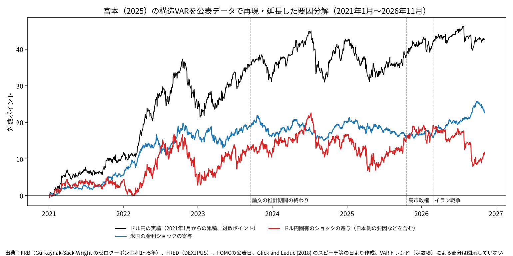

# 金利差で説明できない円安は、財政リスクの証拠か

ウェブ版：[https://p72.github.io/note-draft/円安と財政リスク/01\_円安の最大の原因は財政リスクか.html](https://p72.github.io/note-draft/%E5%86%86%E5%AE%89%E3%81%A8%E8%B2%A1%E6%94%BF%E3%83%AA%E3%82%B9%E3%82%AF/01_%E5%86%86%E5%AE%89%E3%81%AE%E6%9C%80%E5%A4%A7%E3%81%AE%E5%8E%9F%E5%9B%A0%E3%81%AF%E8%B2%A1%E6%94%BF%E3%83%AA%E3%82%B9%E3%82%AF%E3%81%8B.html)

GitHub：[https://github.com/p72/note-draft/blob/main/円安と財政リスク/01\_円安の最大の原因は財政リスクか.md](https://github.com/p72/note-draft/blob/main/%E5%86%86%E5%AE%89%E3%81%A8%E8%B2%A1%E6%94%BF%E3%83%AA%E3%82%B9%E3%82%AF/01_%E5%86%86%E5%AE%89%E3%81%AE%E6%9C%80%E5%A4%A7%E3%81%AE%E5%8E%9F%E5%9B%A0%E3%81%AF%E8%B2%A1%E6%94%BF%E3%83%AA%E3%82%B9%E3%82%AF%E3%81%8B.md)

## はじめに

「日米金利差が縮んだのに、円安が進んでいる。説明できない分は、日本の財政への不安ではないか。」

2025年10月の高市政権発足後、財政運営への懸念と円安を結びつける議論が増えた。単年度のプライマリーバランス（PB）目標の取り下げや、財源が明確でない食料品の消費税減税は、その背景にある。

本稿が検討するのは、**金利差で説明できない円安を、財政リスクが主因である証拠とみなせるか**、という問いである。結論は、それだけでは証拠にならない。金利差モデルが捉えきれていない金融政策の影響も、そこに含まれうるからだ。

財政ニュースの前後を調べても、国債の値下がりと、米金利モデルの予測を上回る円安は必ずしも重ならなかった。目立った円安があった総裁選直後には、日銀の利上げ観測の後退も重なっていた。以下では、この違いを順に見ていく。

## 1. 金利差モデルと円相場の間に、何が起きたか

まず、2022年1月〜2025年4月の週次データから、日米2年金利差とドル円の関係を推計した。その関係が続くと仮定して予測値を延ばすと、実際の円相場との差が広がっている（図1上段）。

2026年11月13日の実績は1ドル＝159.9円で、このモデルの予測値135.0円より18.4%円安だった。ただし、135.0円は適正な為替レートを示すものではない。過去の金利差との関係から計算した、比較の目安である。

図1下段では、実績と予測の乖離を、日本国債の30年金利と2年金利の差に重ねている。両者が連動して見えることは、財政不安による円安という解釈を誘う。しかし、長い年限と短い年限の金利差は、日銀の政策などでも変わる。財政リスクだけを映す指標ではない。

ここで確認できたのは、**この単純な金利差モデルでは、最近の円相場を十分に説明できない**ということだ。モデルから外れた理由は、別に調べる必要がある。回帰の仕様と検定結果は補論Aに示した。

## 2. 金利差で説明できなくても、金融政策の影響は残る

金利差と金融政策は、同じものではない。中央銀行の発表は、現在の金利だけでなく、将来の政策や為替についての市場の予想にも働きかける。その影響を、ある年限の金利差だけで測りきれるとは限らない。

一方井・川本・桜（2024）の[日銀ワーキングペーパー](https://www.boj.or.jp/research/wps_rev/wps_2024/data/wp24j26.pdf)は、日本の非伝統的金融政策に対する為替の反応を調べている。金利差を通じた経路に加え、金利差では予測できない為替の反応を考慮すると、後者が大きい緩和局面があった。著者らは、将来の為替についての予想の変化などが背後にあると解釈している。

また、宮本（2025）の[日銀ワーキングペーパー](https://www.boj.or.jp/research/wps_rev/wps_2025/data/wp25j02.pdf)は、複数年限の米国金利とドル円を使い、FOMCの公表日などの情報から金融政策に関係する金利ショックを取り出している。単に金利と為替が一緒に動いたかを見るだけでは、金利が動いた理由を区別できないためである。

この2本から、本稿にとって重要な点が分かる。**金利差モデルの残差を見ても、金融政策の影響を取り除いたことにはならない。** したがって、その残差を財政リスクと読み替えることはできない。

では、財政リスクの証拠はどこに求めればよいのか。次に、財政に関するニュースが出た前後の市場反応を調べる。

## 3. 財政ニュースの前後に、円と国債はどう動いたか

### 比べ方

分析前に選んだ財政ニュース9件について、市場が最初に反応できる日から2東京営業日の動きを調べた。為替介入と重なる1件は集計から除いている。さらに、査読後に追加した「骨太ショック」を、当初の9件とは分けて確認した。

円相場には米国側の材料も影響する。そこで、過去の米2年・10年金利の変化と円相場の関係から予測値を作り、実績との差を見る。以下では、この差を**「米金利調整後の円変動」**と呼ぶ。プラスなら予測以上の円安、マイナスなら予測より円高であり、実際に円が上がったか下がったかとは区別する。

日本の金利による調整は行わない。財政ニュースが日銀の政策見通しを変え、その経路で円を動かす可能性があるためだ。日本の金利まで差し引くと、その影響も取り除いてしまいかねない。

表1は、反応の違いが分かる3つの事例を抜き出したものだ。全9件の結果、発表時刻、比較方法は補論Bに掲載した。

**表1　財政ニュース前後の円と国債：3つの事例**

| ニュースと観測期間 | 米金利調整後の円変動 | 日本の2年金利 | 日本の30年金利 |
|---|---:|---:|---:|
| 総裁選で高市氏が勝利：2025年10月6〜7日 | ＋1.85 | −3.6bp | ＋10.5bp |
| 食料品消費税ゼロの検討報道：2026年1月19〜20日 | −0.10 | ＋1.5bp | ＋30.3bp |
| 骨太ショック：2026年6月30日〜7月9日（8営業日、追加分析） | −0.55 | ＋3.3bp | ＋22.8bp |

（注）円の単位は対数ポイント。小幅な変化では1対数ポイントはおおむね1%に相当する。金利の1bpは0.01%ポイントで、金利上昇は国債価格の下落に対応する。各期間の前営業日の東京17時・国債終値を起点とした。骨太ショックは観測期間も選定方法も異なるため、ほかの2件と同条件の比較ではない。国債金利の欄は米金利調整前の実際の変化である。

### 国債が大きく売られても、予測以上の円安を伴わない例

2026年1月の食料品消費税ゼロの検討報道では、30年金利が30.3bp上昇した。超長期の国債が大きく値下がりした一方、米金利調整後の円変動は−0.10対数ポイントだった。国債市場の大きな反応に、予測を上回る円安は伴わなかった。

6〜7月の骨太ショックも似ている。30年金利は22.8bp上がったが、米金利調整後の円変動は−0.55対数ポイントだった。

ここで「円は売られなかった」と言い切るのは正確ではない。骨太ショックの期間には、実際のドル円は0.32対数ポイント円安になっている。ただ、米金利の変化と定数項を使ったモデルは0.87対数ポイントの円安を予測していた。実績はその予測を下回ったのである。

### 総裁選直後の円安には、日銀への予想も重なった

対照的に、2025年10月の総裁選直後には、米金利調整後でも1.85対数ポイントの円安があった。しかし、同じ2営業日に30年金利が上がる一方で、2年金利は下がっている。

当時は高市氏の勝利を受け、日銀の10月利上げ観測が後退したと報じられていた。短い年限の金利低下は、その観測と整合する。超長期金利の上昇は財政拡張への予想とも整合するため、この事例から、財政リスクと金融政策見通しの影響を切り分けることはできない。

この関係は、財政と金融政策のどちらか一方を選べば解ける問題でもない。財政運営への予想が日銀の政策見通しを変え、その結果として円が動いた可能性もある。

### ほかのニュースと期間全体を見る

介入と重なる1件を除く財政拡張ニュース6件の平均は、米金利調整後で＋0.40対数ポイントだった。しかし総裁選直後の1件を除くと、＋0.12に縮む。30年金利の平均上昇も、1月の消費税報道への依存が大きい。平均値だけで、一貫した市場反応があったとは言いにくい。

図2は、米金利調整後の円変動を2025年7月から累積したものだ。2025年10月〜2026年2月の累積的な円安の大部分は、2025年10月に生じている。一方、食料品消費税ゼロが争点になった2026年1〜2月には、累積値はむしろ下がった。

もっとも、選んだニュースの前後だけで期間全体の原因が分かるわけではない。公表前の織り込みや、数日を超えて続く評価の変化は、この方法では十分に捉えられない。

## 4. 今回の証拠から言えること

**金利差モデルからの乖離だけでは、財政リスクが円安の主因だとは判断できない。** 金融政策の影響も残りうるためである。

財政ニュース前後の市場反応も、財政主因説を明確に裏づけるものではなかった。超長期国債が大きく売られた事例でも、米金利モデルの予測を上回る円安は観察されなかった。目立った円安があった総裁選直後には、日銀の政策見通しの変化も重なっていた。

追加の分析として、日米の金融政策に関する先行研究の再現・拡張と、円変動の日付別集計も行った。これらも、財政リスクと日銀の政策見通しの影響を切り分けるには至っていない。方法が異なるため、米国・日銀・財政・その他という一つの寄与度分解にはまとめず、補論C〜Eに分けて示した。

本稿の分析では、財政リスクが円安の主因だとする証拠は得られなかった。ただし、イベント数は少なく、事前の織り込みや緩やかな評価の変化を十分に測れていない。財政リスクの影響そのものを否定する結果ではない。

残る課題は、財政ニュースのうち市場にとって予想外だった部分を捉え、金融政策への予想とどう結びついたかを調べることである。「説明できない円安がある」という観察と、「その原因は財政リスクだ」という判断の間には、なお検証が必要である。

---

## 補論の案内

本文の結論を追うために、以下をすべて読む必要はない。数値や手法を確かめたい読者向けに、既存の分析をまとめた。

- **補論A**：週次の金利差モデルと国債カーブ
- **補論B**：財政ニュース全件、発表時刻、比較方法と追加分析
- **補論C**：宮本（2025）の構造VARの再現・延長
- **補論D**：一方井・川本・桜（2024）を参考にした日銀会合ショックの推計
- **補論E**：米金利調整後の円変動の日付別集計
- **補論F**：原油・国際収支などを含む月次の探索的分解
- **補論G**：分析上の留意点

補論で使う「異常変化」は、本文の「米金利調整後の円変動」と同じ、実績と日次モデルの予測との差を指す。構造VARや日銀会合ショックの推計値とは別の量である。

## 補論A　週次の金利差モデルと国債カーブ

過去の金利差との関係を確認するため、2022年1月〜2025年4月の週次データで、ドル円を日米2年金利差だけで説明するモデルを推計した。決定係数は0.41、金利差の係数は5.66で、金利差が1%pt広がると約5.7対数ポイント円安になる。

このモデルは水準どうしの回帰で、単位根や見かけの相関の問題を吟味していない。以下の予測値と乖離は、構造的な効果ではなく、記述的な目安として読む必要がある。予測値を推計期間の後に延ばすと、実績との差がはっきり開く（図1上段）。乖離は2025年4月に平均5.4対数ポイント、9月に11.3対数ポイントとなった。高市政権の発足後はさらに広がり、2026年7月24日には20.5対数ポイントに達した。その後は介入で少し縮んだが、2026年11月13日時点でも16.9対数ポイントある。実績のドル円は予測値より18.4%高い。

図1下段は、この乖離と国債30年−2年の利回り差（超長期カーブの傾き）を重ねたものである。両者は2022年から連動して上がっている。2025年5月以降で乖離を傾きに回帰すると、係数は20.6（t値2.8）、決定係数は0.27だった。

週次の変化で見ると、高市政権の前後で係数の推計値は変わっている（表A1）。2022年1月〜2025年9月は、日本の10年金利の係数がマイナスだった。日本の金利が上がると円高になる、という通常の関係である。2025年10月〜2026年7月は、金利差モデルの決定係数が低下し、日本の10年金利の係数はプラスになった。ただし、政権期のダミーとの交差項で係数の差を検定すると、日本の10年金利の差はp＝0.27、米国の10年金利の差はp＝0.17で、有意ではない。点推定は変わったが、関係が変わったと言える確かな証拠はない。

**表A1　ドル円の週次変化の回帰（被説明変数：ドル円の週次変化、対数ポイント）**

| 期間 | 日米2年金利差 | 決定係数 | 米10年金利 | 日本10年金利 | 決定係数 |
|---|---|---|---|---|---|
| 2022年1月〜2025年9月（194週） | 3.70（5.6） | 0.15 | 4.68（4.5） | −1.58（−0.7） | 0.19 |
| 2025年10月〜2026年7月（44週） | 2.52（1.4） | 0.03 | 0.18（0.1） | 3.60（0.9） | 0.03 |

（注）括弧内はt値（Newey-West、ラグ4）。金利差モデルと日米10年モデルは別々に推計した。

ここまでで言えるのは、「単純な金利差モデルでは説明できない円安が生じた」ということだけである。その原因が何かは、この乖離からは分からない。

### 超長期カーブの傾き

図1下段の傾きについても、同じ注意が要る。補論Fの月次モデルで推計すると、財政不安がほとんど話題にならなかった2015〜2021年に限っても、傾きはドル円と強く連動していた（係数16.5、t値14.6）。2015年6月に1.49%ptあった傾きは、2016年のマイナス金利導入で超長期金利が急低下し、8月には0.55%ptまで縮んだ。同じ時期にドル円は124円から101円まで円高になっている。イールドカーブ・コントロールが直接の操作目標にしたのは10年金利だが、日本銀行の政策は超長期金利にも波及していた。傾きは財政リスクに固有の指標ではない。

## 補論B　財政ニュースの全件と分析方法

### 日本の金利を差し引かない

ここで一つ注意がある。財政ニュースは、次のような経路で円を動かしうる。

財政ニュース → 日本銀行の将来の政策についての予想の変化 → 円相場

たとえば、拡張的な財政を掲げる政治家が勝てば、日本銀行が利上げしにくくなるとの観測が生じうる。この経路があるとき、日本の金利の変化で説明できる分を差し引くと、測りたい財政ニュースの影響まで消してしまう。そこで本稿では、為替の動きからは米国の金利で説明できる分だけを除き、日本の金利は差し引かない。そのうえで、日本の2年・10年・30年の金利の動きを並べて示す。

また、国債安と円安が同時に起きたことだけで、それを財政リスクによる反応とは認定しない。短い年限の金利が下がっていれば、日本銀行の政策見通しが緩和方向に変わった可能性がある。超長期の金利だけが上がっていれば、期間プレミアムの上昇の可能性がある。各イベントについて、発表の時刻、事前の予想、同じ時期のほかの材料も確認する。

### 方法

時点をそろえるため、為替は日本銀行の東京市場17時時点のドル円、国債は財務省の東京終値を使い、両方がそろう日を東京の営業日とした。米国の金利は、各東京営業日の前日（暦日）までに確定した最新のニューヨーク終値を対応させた。まず2023年1月〜2025年9月の日次データ（672営業日）で、ドル円の東京営業日ごとの変化を米国の2年・10年金利の変化で説明する式を推計した。実際の変化とこの式による予測との差を、「米金利で説明できない円の動き」（異常変化）とした。

イベントは表B1の9件で、分析の前に決めた。財政を拡張する方向のニュースが7件、財政規律を示す方向のニュースが2件である。市場が最初に反応できる東京営業日を0日目、その次の東京営業日を1日目とし、前営業日の東京17時から1日目の東京17時までの2営業日で測った。この区間に為替介入の日が入るイベント（2026年7月31日）は、介入の影響と区別できないため集計から除いた。

**表B1　財政ニュースの日の円と日本の金利（2東京営業日の累積）**

| 0日目 | 1日目 | 種類 | ニュース | 円の異常変化（対数ポイント、＋が円安） | 2年金利（bp） | 10年金利（bp） | 30年金利（bp） |
|---|---|---|---|---|---|---|---|
| 2025年10月6日 | 10月7日 | 拡張 | 自民党総裁選で高市氏が勝利（4日・土） | ＋1.85 | −3.6 | ＋1.5 | ＋10.5 |
| 2025年11月7日 | 11月10日 | 拡張 | 単年度PB目標の取り下げを国会で答弁 | ＋0.43 | ＋0.7 | ＋1.8 | ＋3.6 |
| 2025年11月21日 | 11月25日 | 拡張 | 総合経済対策（国費等21.3兆円）を閣議決定 | −0.03 | ＋1.0 | −1.3 | −3.2 |
| 2025年12月26日 | 12月29日 | 規律 | 2026年度予算案を閣議決定（PB黒字、新規国債30兆円未満） | ＋0.06 | ＋0.3 | ＋1.0 | ＋2.2 |
| 2026年1月19日 | 1月20日 | 拡張 | 食料品消費税ゼロの検討報道（17日・土）と首相会見（19日夜） | −0.10 | ＋1.5 | ＋14.8 | ＋30.3 |
| 2026年2月9日 | 2月10日 | 規律 | 衆院選で与党圧勝、首相が「赤字国債に頼らず」と表明 | −0.93 | ＋2.2 | ＋0.5 | −4.5 |
| 2026年7月31日 | 8月3日 | 拡張 | 食料品消費税1%を首相が表明（30日夜）※介入と重なる | （−4.70） | （＋6.5） | （＋2.3） | （＋1.1） |
| 2026年8月5日 | 8月6日 | 拡張 | 政府が食料品消費税1%の方針を決定 | ＋0.33 | −0.3 | −7.5 | −7.1 |
| 2026年10月19日 | 10月20日 | 拡張 | 財源について「国債発行を否定するものではない」と答弁 | −0.05 | −0.9 | −3.1 | −4.8 |

（注）2023年1月〜2025年9月の2営業日の異常変化の標準偏差は0.75対数ポイント、30年金利の2営業日の変化の標準偏差は4.7bp。括弧内は介入と重なるため集計から除いた。

**表B2　各イベントの時刻と同じ時期の材料**

| 0日目 | 発表の時刻と事前の予想 | 同じ時期のほかの材料 |
|---|---|---|
| 2025年10月6日 | 総裁選は4日（土）。事前の予想では小泉氏の勝利が有力視されており、高市氏の勝利は予想外とされた | 高市氏は追加利上げに慎重とされ、日本銀行の10月利上げの観測が後退した |
| 2025年11月7日 | 衆院予算委員会での答弁（日中、東京の引けとの前後は未確認） | 未確認 |
| 2025年11月21日 | 臨時閣議での決定。規模は閣議決定の前から報じられていた | — |
| 2025年12月26日 | 閣議決定。首相は前日25日に、予算の規模や国債への依存度の低下を与党幹部に説明していた | 日本銀行の会合（12月18〜19日）の後 |
| 2026年1月19日 | 食料品消費税ゼロの検討は17日（土）に報道された。首相の会見は19日18時からで、東京の引け後。会見への反応は主に20日に出る | 日本銀行の会合（1月22〜23日）の直前。窓には含まれない |
| 2026年2月9日 | 衆院選は8日（日） | — |
| 2026年7月31日 | 首相の表明は30日夜 | 為替介入（7月30日・31日、8月3日）、日本銀行の会合（7月30〜31日）と重なる |
| 2026年8月5日 | 政府の方針決定（時刻は未確認） | — |
| 2026年10月19日 | 参院予算委員会での答弁（日中、東京の引けとの前後は未確認） | 日本銀行の会合（10月29〜30日）の前 |

（注）「未確認」は、本稿の作成時点で一次資料により時刻や事前予想を確認できていないもの。

### 平均値と無作為抽出による比較

介入と重なる1件を除く財政拡張のニュース6件では、2営業日の円の異常変化は平均＋0.40対数ポイントだった。介入と重ならない2営業日の窓から6件を無作為に選ぶ操作を2万回くり返すと、6件の平均がこれ以上の円安になる割合は、参照期間により6.3〜7.5%だった。ただし、総裁選翌日の1件を除く5件では、平均は＋0.12対数ポイント（割合37%）にとどまる。30年金利は6件の平均で4.9bp上がった（割合2.0〜3.2%）が、2026年1月の1件を除く5件では−0.2bp（同63%）である。円と対称にするため、国債30年金利の変化から前日の米30年金利の変化で説明できる分を除いた値でも見ると、6件の平均は＋4.5bp（同1.6%）、1月を除く5件では−0.4bpで、結論は変わらない。財政規律を示すニュース2件では、円の異常変化は平均−0.44対数ポイントだったが、2件しかないため検定には使っていない。この比較は、重なりのある2日窓や相場の局面が違う日を含む参照分布との比較であり、厳密な検定と同じではない。

### 追加の確認：骨太ショック

事前に決めた9件には、2026年6〜7月の「骨太ショック」を含めていなかった。骨太の方針2026の原案は6月30日に示され、日本銀行の利上げを牽制するようにも読める記述や、財源の不明確さから、国債が売られた。査読後に気づいて追加で確認したものなので、表B1の集計には加えず、別に示す（表B3）。日本銀行は6月15〜16日の会合で政策金利を1.00%程度に引き上げており、原案はその2週間後に示された。

**表B3　骨太ショック前後の円と日本の金利（東京営業日の累積、査読後に追加）**

| 窓 | 営業日 | 円の異常変化（対数ポイント、＋が円安） | 2年金利（bp） | 10年金利（bp） | 30年金利（bp） |
|---|---|---|---|---|---|
| 原案の公表（6月30日〜7月1日） | 2 | ＋0.16 | −1.1 | ＋6.7 | ＋9.8 |
| その翌日から（7月1日〜2日） | 2 | −0.92 | ＋1.3 | ＋8.8 | ＋6.4 |
| 骨太ショックの期間（6月30日〜7月9日） | 8 | −0.55 | ＋3.3 | ＋22.2 | ＋22.8 |
| 片山財務相の発言（7月10日〜13日） | 2 | −0.19 | ＋0.7 | −8.0 | −9.1 |
| 閣議決定（7月21日〜22日） | 2 | −0.07 | ＋1.4 | ＋3.0 | ＋0.7 |

（注）各窓の始点は前営業日の東京17時・東京終値。

6月30日から7月9日までの8営業日で、10年金利と30年金利はともに約22bp上がった。2年金利の変化は＋3.3bpと小さい。この期間のドル円は実際には0.32対数ポイント円安になった。米金利の変化と定数項を用いたモデルの予測は0.87対数ポイントの円安であり、実績はそれを0.55対数ポイント下回った。このモデルの残差としては、追加的な円安は観察されなかった。食料品消費税ゼロの報道と同じく、超長期の国債は大きく売られたが、為替は米金利で説明できる以上には円安にならなかった。

## 補論C　米国の金利ショック：宮本（2025）の再現と延長

宮本（2025）の構造VARを公表データで再現し、2026年まで延長した。以下では、論文の手法と、本稿で置き換えた点・延長した点を分けて示す。

### 論文の手法

宮本（2025）は、米国債1〜5年の金利（Gürkaynak, Sack and Wright 2007 のゼロクーポン金利）の日次変化と、ドル円（Bloomberg）の対数日次変化×100の6変数で、ラグ2のVARを推計した。識別は次の通りである。FOMCの公表日などの誘導型残差の共分散から下三角行列 B^F を求める。金利ショックの列には B_n = x_n B^F_n という制約を置き、全期間の残差の共分散 Ω̂ との差 vech(BB')−vech(Ω̂) の重み付き二乗を最小にする x_n を推計する。FOMC日の金利の動きは主に米国の金融政策のショックによる、という仮定である。この方法で、2021年1月〜2023年9月半ばの約32%の円安のうち約24%が米国の金利の構造ショックで説明されるとした。

### 本稿で置き換えた点

公表データで再現するため、次の置き換えと仮定を置いた。

- 金利：論文と同じ Gürkaynak, Sack and Wright（2007）のゼロクーポン金利1〜5年（FRBの公表データ）を使った
- ドル円：Bloomberg の代わりに FRED の DEXJPUS を使った。これはニューヨーク正午の値で、FOMCの発表（東部時間の午後）より前に決まる。そのため、翌営業日の正午の値を当日の終わりの値とみなした。これで発表後の反応は含められるが、ドル円の観測の窓が金利（当日の終値）と一致せず、翌日の正午までの情報も混ざる
- イベント日：FOMCの政策決定の公表日（臨時を含む）に、Glick and Leduc（2018）の表と注にある議長のスピーチ・議会証言などの7日を加えた（1995〜2023年に243日）。論文がGlick and Leducのどの日を使ったかは本文に記載がないため、この選び方は本稿の仮定である
- ドル円の列は、ドル円のショックが同時点の金利に影響しないとした。重み行列は、1段階目が単位行列、2段階目が vech(u_t u_t') の分散の逆行列である。これらは論文本文に詳しい記載がないため、本稿の仮定である
- 信頼区間は、FOMC日とそれ以外の日を分けて残差を引き直すブートストラップ（200回）で求めた
- 要因分解は論文と同じ定義にそろえた。期首の前の状態から、期間中のショックをすべて0としてVARを回した予測を「VARトレンド」とし、実際の変化からVARトレンドを引いた「VARトレンドからの乖離」を、期間中の各構造ショックの寄与に分ける。実際の変化＝VARトレンド＋各ショックの寄与の合計が成り立つことを確認している

### 再現の結果

論文と同じ期間（1995年1月〜2023年9月15日）で推計すると、2021年1月4日から2023年9月15日までのドル円の変化35.8対数ポイント（ドル円は43.1%上昇）のうち、VARトレンドは3.6、VARトレンドからの乖離は32.2だった。論文の「約32%の円安」は、この乖離にあたる。乖離のうち米国の金利ショックの寄与は19.1対数ポイントで、論文の約24より小さい。90%信頼区間は5.6〜29.7と広く、論文の値はその中に入るが、区間に入ることだけで再現できたとは言えない。1年金利が1%pt上がったときの60営業日後のドル円の反応は5.4%の円安（90%区間3.5〜8.0%）で、論文の「金利が3〜5%上がると約20%の円安」と同じ程度の大きさである。

点推定は仕様によって大きく動く（表C1）。特に、金利の種類とドル円の時点の扱いが効く。FREDの定満期利回りに替えると寄与は14.2に、FOMCの発表前のニューヨーク正午の値をそのまま使うと12.2に下がる。後者は発表当日の反応が入らないためである。

**表C1　再現の感度（2021年1月〜2023年9月の円安35.8対数ポイントのうち、米国の金利ショックの寄与）**

| 仕様 | VARトレンドからの乖離 | うち米国の金利ショックの寄与 | 1年金利1%pt上昇への反応（%、60営業日後） |
|---|---|---|---|
| 基本（GSWの1〜5年、1995年1月から、ラグ2、臨時の決定とスピーチ等の日を含む） | 32.2 | 19.1（90%区間5.6〜29.7） | 5.4（3.5〜8.0） |
| スピーチ等の7日を除く | 32.2 | 19.6 | 5.4 |
| 金利をFREDの定満期利回り（1・2・3・5年）に | 32.2 | 14.2 | 3.8 |
| 推計の始まりを1996年11月に | 33.2 | 23.0 | 6.4 |
| 臨時の決定とスピーチ等の日を除く | 32.2 | 18.3 | 6.0 |
| ラグ1 | 32.3 | 15.8 | 4.8 |
| ラグ5 | 32.2 | 22.8 | 5.8 |
| ドル円を Yahoo の終値に（1996年11月から） | 33.1 | 27.7 | 5.9 |
| ドル円をニューヨーク正午のまま | 32.4 | 12.2 | 2.5 |
| （参考）論文 | 約32 | 約24 | 3〜5%の金利上昇で約20% |

（注）2021年1月〜2023年9月、対数ポイント。乖離のうち米国の金利ショック以外は、ドル円固有のショックの寄与。

再現の精度には限界があるが、方向と大きさは論文と整合的である。

### 2026年までの延長（本稿の拡張）

推計期間を2026年11月5日まで延ばし、期間を区切って分解した（表C2、図3）。これは論文にない本稿の拡張である。

**表C2　延長した推計による分解（対数ポイント、括弧内は90%区間）**

| 期間 | ドル円の変化 | VARトレンド | VARトレンドからの乖離 | うち米国の金利ショック | うちドル円固有のショック |
|---|---|---|---|---|---|
| 2021年1月〜2023年9月 | ＋35.8 | ＋3.8 | ＋32.0 | ＋18.9（5.8〜29.4） | ＋13.1 |
| 2023年9月〜2025年9月 | −0.3 | ＋2.9 | −3.2 | −1.6（−6.7〜3.0） | −1.6 |
| 2025年10月〜2026年2月（政権発足〜イラン戦争前） | ＋6.8 | ＋0.6 | ＋6.2 | −1.6（−2.3〜−0.7） | ＋7.8 |
| 2026年3月〜2026年11月 | ＋0.5 | ＋1.0 | −0.5 | ＋6.9（4.7〜9.4） | −7.4 |
| 2025年10月〜2026年11月 | ＋7.3 | ＋1.6 | ＋5.7 | ＋5.4（3.0〜7.5） | ＋0.3 |

（注）VARトレンドは、期首の前の状態から期間中のショックを0としたVARの予測で、定数項と期首前のショックの持ち越しを含む。ドル円の変化＝VARトレンド＋米国の金利ショック＋ドル円固有のショックが成り立つ。括弧内は90%区間。推計期間を2026年11月まで延ばして再推計しているため（イベント269日）、2021年1月〜2023年9月の行は表C1の再現値（推計は2023年9月まで、イベント243日）とわずかに異なる。

政権発足からイラン戦争前までの円安6.8対数ポイントは、米国の金利ショックでは説明できない。VARトレンドは0.6で、トレンドからの乖離6.2のうち、米国の金利ショックの寄与はむしろ円高方向（−1.6）、ドル円固有のショックが＋7.8である。イラン戦争の後は逆に、米国の金利ショックが円安方向に6.9寄与し、固有のショックは介入を含む期間に−7.4と円高方向だった。

この「ドル円固有のショック」は、米国の金利で説明できないすべての動きを含む。日本銀行の政策、財政リスク、リスク選好、為替介入などが入っており、このモデルではそれらを区別できない。したがって、表C2は財政リスクの大きさを示すものではない。示しているのは、政権発足直後の円安が米国の金利以外の要因によるという点である。それが日本銀行の政策見通しによるのか、財政リスクによるのかは、日本側のショックを取り出して検討する必要がある（補論D・E）。

## 補論D　日本銀行の会合ショック：一方井・川本・桜（2024）を参考にした推計

日本側については、会合の日の予想外の動きに着目した。一方井・川本・桜（2024）の設計を参考にしたが、論文は2023年12月までの14の緩和策を対象にしており、2024年以降の会合への適用は本稿の拡張である。

### 論文の手法

金利ショックは、会合の日の日本の金利（3か月物OIS、2年・10年・30年国債）の前日差で、金利の低下をプラスとする。為替への直接ショックは、東京9時から17時のドル円の変化を、日米金利差の変化（当日と1日前）と前日の9時〜17時の変化で回帰した残差の、会合の日の値である。そのうえで、ドル円の0〜30日後の水準の変化をローカル・プロジェクションで推計し、金利ショックによる反応と、直接ショックを含めた反応を比べている。

### 本稿で置き換えた点

- 3か月物OISは公開データでは得にくいため、1年物の金利で代えた（日本は財務省の国債1年、米国は Gürkaynak, Sack and Wright のゼロクーポン1年）。米国の2・10・30年も同じデータを使った
- 9時と17時のドル円は、論文と同じく日本銀行の公表値（東京市場ドル・円スポット）を使った
- 会合の日は、日本銀行の「決定事項」の各年の一覧にある会合の公表文の日を使った（2002年1月〜2026年10月に299日）
- 会合ごとの反応は、論文と同じく30営業日先まで示す
- 期間への寄与は本稿の拡張として、ローカル・プロジェクションを120営業日先まで推計し、各会合の反応について「期末までの反応」と「期首の前日までの反応」の差を、期首より前の会合も含めて合計した。120営業日より先の反応は120日の値で一定と仮定した。区間は、20営業日のブロックで日を引き直して推計し直すブートストラップ（200回）で求めた

### 論文の期間での確認

論文と同じ期間（2002年4月〜2023年12月）で推計し、14の緩和策への反応を論文の記述と比べた（表D1）。2008年10月と12月の利下げでは、金利ショックによる反応は円安方向だが、直接ショックを含めると円高方向になる。2013年4月の量的・質的金融緩和と2014年10月の拡大では、円安の大部分が直接ショックによる。これらは論文の記述と一致する。

**表D1　論文の期間で推計した、主な緩和策へのドル円の反応（対数ポイント、＋が円安）**

| 会合の日 | 当日9時→17時 | 直接ショック | 30日後：金利ショックによる反応 | 30日後：直接ショックを含む反応 |
|---|---|---|---|---|
| 2008年10月31日（利下げ） | −1.82 | −1.76 | ＋0.37 | −0.91 |
| 2008年12月19日（利下げ） | −0.67 | −0.65 | ＋0.36 | −0.11 |
| 2009年12月1日（固定金利オペ導入） | ＋0.88 | ＋0.78 | ＋0.43 | ＋1.00 |
| 2013年4月4日（量的・質的金融緩和） | ＋2.91 | ＋2.95 | ＋0.35 | ＋2.49 |
| 2014年10月31日（同拡大） | ＋1.81 | ＋1.85 | ＋0.03 | ＋1.37 |
| 2016年1月29日（マイナス金利） | ＋1.41 | ＋1.42 | ＋0.47 | ＋1.50 |

（注）すべて本稿の推計値。論文には係数表がないため、論文の図と本文の記述との照合は、反応の符号と大小の定性的なものである。

### 2026年までの延長

推計期間を2026年11月まで延ばし、政権発足からイラン戦争前まで（2025年10月〜2026年2月）の3回の会合を見た（表D2）。

**表D2　2025年10月〜2026年2月の日本銀行の会合と、各会合の30営業日先までの反応（対数ポイント、＋が円安）**

| 会合の日 | 決定 | 当日9時→17時 | 2年金利（bp） | 直接ショック | 30営業日先の反応（金利ショック） | 30営業日先の反応（直接ショックを含む） |
|---|---|---|---|---|---|---|
| 2025年10月30日 | 現状維持 | ＋0.47 | −1.4 | ＋0.45 | ＋0.11 | ＋0.45 |
| 2025年12月19日 | 利上げ | ＋0.74 | ＋2.8 | ＋0.79 | −0.20 | ＋0.40 |
| 2026年1月23日 | 現状維持 | −0.06 | ＋3.8 | −0.01 | −0.23 | −0.24 |

2025年12月の利上げの日は、2年金利が上がったのに円安になった。直接ショックが円安方向に働いた例である。

各会合の30営業日先の反応は、期間の寄与とは別のものである。そこで、上で述べた方法で期間の寄与を計算すると、2025年10月1日〜2026年2月27日の会合ショックの寄与は＋0.68対数ポイント（90%区間0.26〜1.14）だった。このうち金利ショックによる部分は−0.12（−0.51〜0.32）で、ほぼすべてが直接ショックによる。同じ期間の東京17時のドル円の変化は5.27対数ポイントであり、会合ショックの寄与はその1割強にとどまる。ただし、この区間は主にローカル・プロジェクションの係数の不確実性を映すもので、直接ショック自体が回帰の残差として推計された値であることによる誤差は十分に反映していない可能性がある。期間内の会合は3回であり、期首前の会合の持ち越しも含めて計算している。上記の区間だけで、分析の不確実性をすべて表せているわけではない。

ここで捉えているのは、会合の日の予想外の動きだけである。会合の日以外に日本銀行の政策の見通しが変わった分（たとえば総裁選翌日の利上げ観測の後退）は、このショックには入らない。

## 補論E　米金利調整後の円変動の日付別内訳

最後に、本文3節で使った東京17時のドル円の「異常変化」（米国の金利で説明できる分を除いたもの）を、日本銀行の会合の日、財政ニュースの窓（表B1の2営業日）、それ以外の日に分けて合計した（表E1）。これは日付による集計であり、補論C・Dで取り出した政策ショックの分解ではない。会合の日の翌日以降に続く反応は「それ以外の日」に入る。

**表E1　2025年10月1日〜2026年2月27日の円安の内訳（東京17時、対数ポイント）**

| 項目 | 日数 | 対数ポイント |
|---|---|---|
| ドル円の変化 | 99営業日 | ＋5.27 |
| 　うち米国の金利の変化で説明できる分 | | ＋1.09 |
| 　うち米国の金利で説明できない分（異常変化） | | ＋4.18 |
| 　　日本銀行の会合の日 | 3日 | ＋0.70 |
| 　　財政ニュースの窓（事前に決めた6件、2営業日ずつ） | 12日 | ＋1.27 |
| 　　　うち総裁選翌日（10月6日・7日） | 2日 | ＋1.85 |
| 　　本稿で選んだイベント窓以外の日 | 84日 | ＋2.22 |

（注）「米国の金利の変化で説明できる分」は、本文3節の日次の式（前日の米2年・10年金利の変化）による。補論Cの構造VARの米国の金利ショックの寄与（ニューヨーク時間、−1.6）とは、モデルも時点も異なる。会合の日の合計0.70は当日の異常変化の和で、補論Dの会合ショックの期間寄与0.68とは定義が異なる別の数値である。

米国の金利で説明できない円安4.18対数ポイントのうち、日本銀行の会合の日は0.70、財政ニュースの窓は1.27で、残る2.22は、本稿で選んだイベント窓以外の日に生じている。財政ニュースの窓の寄与は、総裁選翌日の2日（＋1.85）でほぼ説明され、この日には日本銀行の利上げ観測の後退も重なっていた。総裁選翌日の2日を除く2025年10月の残りの日にも、異常変化は1.96対数ポイント積み上がっている。

この集計から、政策や財政の総寄与を判断することはできない。言えるのは、米国の金利で説明できない円安の約半分が、本稿で選んだイベント窓の外で生じていたことである。補論Dの会合ショックの期間寄与（＋0.68）と合わせても、政権発足直後の円安の主因を、日本銀行の会合の日の政策ショックにも、事前に決めた財政ニュースにも、はっきり帰することはできない。窓の外の動きが財政リスクの評価によるのか、日本銀行の政策の見通しによるのか、それ以外によるのかは、本稿の方法では区別できない。

## 補論F　月次の探索的な分解

初版では、ドル円の月次平均を、物価調整後の2年金利差、超長期カーブの傾き、国際収支、原油価格で説明する分解を本文の中心に置いていた。本文2節で述べた理由から、この分解は金融政策と財政の影響を区別できない。そのため、探索的な分析としてここに残す。数値は、本文の結論には使っていない。

### 変数とモデル

推計期間は2015年1月〜2026年9月である。

- 物価調整後の2年金利差：日米の2年国債利回りから、それぞれの過去1年のコア物価上昇率を引いた差。日本は生鮮食品及びエネルギーを除く総合、米国はコアCPIを使った。予想インフレ率で割り引いた実質金利ではなく、足元の物価で調整した代理指標である
- 超長期カーブの傾き：国債30年−2年
- デジタル関連収支：日本銀行の定義に合わせ、著作権等使用料、通信・コンピュータ・情報サービス、専門・経営コンサルティングサービスのネットの合計（12か月累計、兆円）
- 直接投資（再投資収益を除く）：直接投資のネットから、資産側の収益の再投資を引き、負債側の収益の再投資を足し戻したもの（12か月累計、兆円）
- 原油価格：ブレント原油（対数×100）

2025年10月は米国の政府機関閉鎖で米CPIが公表されなかったため、その月は推計から除いた。前年差は暦月どうしでとり、1・4・7・10月の値だけを使った。

**表F1　ドル円の分解モデル（被説明変数：ドル円、対数×100）**

| 説明変数 | 水準（2015年1月〜2026年9月） | 前年差（同） | 水準（2015年1月〜2021年12月） | 水準（2022年1月〜2026年9月） |
|---|---|---|---|---|
| 物価調整後2年金利差（%pt） | 0.87（3.3） | 0.29（1.0） | −0.46（−1.6） | 1.21（3.5） |
| 超長期カーブの傾き（%pt） | 15.17（7.4） | 15.06（5.3） | 16.46（14.6） | 8.14（3.4） |
| デジタル関連収支（兆円） | −2.78（−4.4） | −2.52（−1.4） | −0.29（−0.4） | −2.35（−1.5） |
| 直接投資（再投資除く、兆円） | −0.06（−0.3） | 0.33（1.9） | 0.44（3.5） | 0.22（0.7） |
| 原油価格（対数×100） | 0.070（2.5） | 0.069（2.3） | 0.013（1.8） | 0.145（3.2） |
| 決定係数 | 0.94 | 0.61 | 0.81 | 0.83 |
| 観測数 | 140 | 42 | 84 | 56 |

（注）括弧内はt値（Newey-West、水準はラグ12、前年差はラグ4）。

水準でも前年差でも有意なのは、カーブの傾きと原油である。それ以外の変数は、定式化によって結果が変わる。時間トレンドを加えると、デジタル関連収支の係数は−6.93（t値−5.6）と有意なままだが、2倍以上に変わる。貿易収支と対外株式・投資ファンド持分の取得（経済全体）を加えた推計では、対外株式・投信の取得が有意に円安方向に効いた（`code/regression_results.csv`）。ただし、この系列は新NISA経由の個人資金だけを取り出したものではない。

拡張ディッキー・フラー検定では、ドル円と5つの説明変数はいずれも水準で単位根を棄却できず、差分では棄却できた。水準の回帰の残差について Engle-Granger の検定をすると、統計量は−4.56で、10%の臨界値（−4.52）は下回るが、5%の臨界値（−4.83）は下回らない。長期的な関係があるという証拠は弱い。

### 分解

この水準のモデルで、2021年12月（113.8円）から2026年9月（156.4円）までの円安31.8対数ポイント（ドル円は37.4%上昇）を分解したのが図A1である。カーブの傾きと関連する部分が21.3対数ポイント、物価調整後の金利差が6.9、デジタル関連収支が6.4、原油が3.0、直接投資はほぼ0で、残差は−5.8である。

高市政権の1年（2025年9月→2026年9月）の円安5.6対数ポイントについては、図A2のようになる。2026年2月を境に分けると、政権発足からイラン戦争前まで（2025年9月→2026年2月）の円安4.8対数ポイントは説明変数ではほとんど説明できず（残差5.6）、イラン戦争の後は原油高が円安方向に寄与した。

**表F2　定式化を変えたときの寄与（対数ポイント）**

| 定式化 | 2021年12月→2026年9月：傾き | 同：デジタル関連 | 同：金利差 | 同：原油 | 政権1年：原油 | 発足〜2026年2月：残差 |
|---|---|---|---|---|---|---|
| 基本（表F1の水準） | 21.3 | 6.4 | 6.9 | 3.0 | 3.6 | 5.6 |
| 貿易収支・対外株式を追加 | 19.1 | 9.4 | 0.6 | 3.1 | 3.8 | 4.7 |
| 名目2年金利差に変更 | 23.1 | 5.5 | 4.7 | 0.7 | 0.8 | 6.7 |
| 推計期間を2017年からに | 16.1 | 9.1 | 8.1 | 4.4 | 5.3 | 5.4 |
| 前年差モデルの係数を使用 | 21.2 | 5.8 | 2.3 | 3.0 | 3.6 | 5.3 |
| 2022年以降の係数を使用 | 11.4 | 5.4 | 9.7 | 6.2 | 7.5 | 5.0 |

（注）「金利差」は名目2年金利差に変更した行では名目、それ以外は物価調整後。四捨五入のため、合計が一致しないことがある。

傾きの寄与は11.4〜23.1、原油の寄与は0.8〜7.5と、定式化によって大きく変わる。政権発足からイラン戦争前までの残差は、どの定式化でも4.7〜6.7対数ポイントと大きい。ただし、本文2節で述べた通り、この残差は金融政策の影響を含みうるため、財政リスクの大きさとは読めない。

## 補論G　分析上の留意点

**イベントの選び方。** イベントは分析の前に決めたが、どのニュースを含めるかには判断が入る。報道の前に情報が漏れていれば、反応は0日目より前に出る。2営業日の窓では、反応が遅れて出る場合も、ゆっくりした評価の変化も捉えられない。

**同じ日の他のニュース。** イベントの日に米国以外のニュースや日本銀行に関する観測が重なれば、異常変化はそれも含む。表B2で未確認とした時刻や事前予想は、一次資料で確認する必要がある。2026年1月には、当局による口先介入やレートチェックへの警戒から円が買い戻される場面もあった。

**件数と検出力。** 拡張のニュースは6件で、平均は1件のイベントに強く依存する。有意な反応が見られないことを、効果が小さいことの証拠とはできない。ニュースのうち市場にとって予想外だった部分も測っていない。

**再現の限界。** 補論Cの再現は、ドル円のデータと時点、イベント日の範囲、重み行列が論文と異なる。点推定は仕様によって12.2〜27.7と大きく動き、信頼区間も広い。

**日本銀行の会合ショックの限界。** 補論Dは、論文の3か月物OISを1年物で代えている。期間の寄与は120営業日先までの反応に基づき、それより先は一定と仮定した。会合の日以外の政策見通しの変化は捉えていない。

**財政リスクを測る指標。** 国債30年−2年の傾きには日本銀行の政策の影響が混ざる。国債と金利スワップのスプレッドや日本国債のCDSスプレッドの方が、財政リスクをより直接に映す可能性がある。

## 付記：データと推計の方法

- ドル円：週次は Yahoo Finance（JPY=X）の金曜終値（2022年1月〜2026年11月13日）。日次のイベントスタディは日本銀行「外国為替市況」の東京市場ドル・円スポット17時時点（FXERD04）。補論の月次は FRED の EXJPUS（月平均）
- 米国債利回り：FRED の DGS2・DGS10・DGS30（日次）。イベントスタディでは各東京営業日の前日（暦日）までの最新のニューヨーク終値を使った
- 日本国債利回り：財務省「国債金利情報」の2年・10年・30年（日次、`jgbcm_all.csv` と当月分の `jgbcm.csv` を結合）
- 補論の物価：総務省「消費者物価指数」（2020年基準、e-Stat API、statsDataId＝0003427113）の全国・前年同月比、生鮮食品及びエネルギーを除く総合（0178）。米国は FRED の CPILFESL（コアCPI）の前年比。2025年10月は未公表
- 補論の国際収支：日本銀行「国際収支統計」（時系列統計データ検索サイトAPI、DB＝BP01）。デジタル関連収支は BPBP6JYNSN9062＋BPBP6JYNSN907＋BPBP6JYNSN9082、直接投資は BPBP6JYNFB1−BPBP6JYNFA132＋BPBP6JYNFL132。貿易収支（BPBP6JYNTB）、対外株式・投資ファンド持分の取得（BPBP6JYNFA21）は追加の推計に使った。いずれも12か月累計
- 補論の原油：FRED の DCOILBRENTEU（ブレント、月平均）
- 推計：最小二乗法。標準誤差は自己相関と不均一分散に頑健なもの（Newey-West）。共和分の臨界値は MacKinnon（2010）
- イベントスタディ：異常変化＝ドル円（東京17時）の東京営業日ごとの変化−（2023年1月〜2025年9月に推計した、米2年・10年金利の変化による予測）。日本の金利は差し引いていない。無作為抽出の比較は、介入日を区間に含まない2営業日の窓から6件（1件を除く場合は5件）を選ぶ操作を2万回
- 推計結果：`code/regression_results.csv`（表A1・表F1と追加の推計）、`code/events.csv`・`code/events_summary.csv`（表B1）、`code/events_posthoc.csv`（表B3）、`code/unitroot.csv`、`code/decomposition.csv`（図A1・図A2、表F2）、`code/miyamoto/miyamoto_sensitivity.csv`（表C1）、`code/miyamoto/miyamoto_extension.csv`（表C2）、`code/boj_shocks/boj_events_2023.csv`（表D1）、`code/boj_shocks/boj_events_2026.csv`（表D2）、`code/boj_shocks/boj_windows_2026.csv`（会合ショックの期間寄与）、`code/boj_shocks/stepC_tokyo_basis.csv`（表E1）
- 宮本（2025）の再現：FRBの Gürkaynak-Sack-Wright ゼロクーポン金利（feds200628.csv、1〜5年）、FRED の DEXJPUS（翌営業日の値を当日の終わりの値とみなす）、FOMCの公表日（eco3min.fr のFOMC決定一覧とFRBの会合日程ページから作成し、2008年の臨時の決定日は Glick and Leduc で確認）、Glick and Leduc（2015/2018）の表と注にあるスピーチ等の7日。コードと仮定の詳細は `code/miyamoto/README.md`
- 日本銀行の会合の日のショック：日本銀行「外国為替市況」の東京9時（FXERD01）・17時（FXERD04）のドル円、財務省の国債1・2・10・30年、FRBの GSW ゼロクーポン1・2・10・30年、日本銀行「決定事項」一覧による会合の日。仮定の詳細は `code/boj_shocks/README.md`
- コード：`code/`（データの取得は `fetch_data.py`、推計は `models.py`、作図は `plots.py`、宮本（2025）の再現は `code/miyamoto/`、日本銀行の会合ショックと日付別集計は `code/boj_shocks/`）。`fetch_data.py` は筆者が Claude に持たせているカスタムスキル（fred-data、mof-jgb、boj-api、estat-api）のモジュールを呼び出す。取得日は2026年11月14日

## 参考文献

- 宮本亘（2025）「日本の為替レートの動向と決定要因に関する分析」日本銀行ワーキングペーパーシリーズ、No.25-J-2
  [https://www.boj.or.jp/research/wps\_rev/wps\_2025/data/wp25j02.pdf](https://www.boj.or.jp/research/wps_rev/wps_2025/data/wp25j02.pdf)
- 一方井宏汰・川本卓司・桜健一（2024）「わが国の非伝統的金融政策と為替レート変動」日本銀行ワーキングペーパーシリーズ、No.24-J-26
  [https://www.boj.or.jp/research/wps\_rev/wps\_2024/data/wp24j26.pdf](https://www.boj.or.jp/research/wps_rev/wps_2024/data/wp24j26.pdf)
- Gürkaynak, R. S., B. Sack and J. H. Wright (2007) "The U.S. Treasury Yield Curve: 1961 to the Present," Journal of Monetary Economics, 54(8), 2291-2304.
- Glick, R. and S. Leduc (2018) "Unconventional Monetary Policy and the Dollar: Conventional Signs, Unconventional Magnitudes," International Journal of Central Banking, 14(5), 103-152.（ワーキングペーパー版：Federal Reserve Bank of San Francisco Working Paper 2015-18）
  [https://www.frbsf.org/wp-content/uploads/wp2015-18.pdf](https://www.frbsf.org/wp-content/uploads/wp2015-18.pdf)
- MacKinnon, J. G. (2010) "Critical Values for Cointegration Tests," Queen's Economics Department Working Paper No. 1227.
- 日本銀行（2023）「国際収支統計からみたサービス取引のグローバル化」日銀レビュー、2023-J-9
  [https://www.boj.or.jp/research/wps\_rev/rev\_2023/data/rev23j09.pdf](https://www.boj.or.jp/research/wps_rev/rev_2023/data/rev23j09.pdf)
- 日本銀行「国際収支関連統計 項目別の計上方法」
  [https://www.boj.or.jp/statistics/outline/exp/data/exbpsm6.pdf](https://www.boj.or.jp/statistics/outline/exp/data/exbpsm6.pdf)
- 日本銀行「決定事項」（各年の一覧、2002〜2026年）
  [https://www.boj.or.jp/mopo/mpmdeci/index.htm](https://www.boj.or.jp/mopo/mpmdeci/index.htm)
- 日本銀行「公表予定」（金融政策決定会合の日程）
  [https://www.boj.or.jp/announcements/calendar/index.htm](https://www.boj.or.jp/announcements/calendar/index.htm)
- 「高市トレード再来、景気刺激策への期待で株高へ」東洋経済オンライン（Bloomberg）、2025年10月
  [https://toyokeizai.net/articles/-/909605](https://toyokeizai.net/articles/-/909605)
- 「高市氏勝利で日銀10月利上げ確率20%に低下」みんかぶFX、2025年10月6日
  [https://fx.minkabu.jp/news/346553](https://fx.minkabu.jp/news/346553)
- 木内登英（コラム）野村総合研究所、2026年1月19日
  [https://www.nri.com/jp/media/column/kiuchi/20260119\_4.html](https://www.nri.com/jp/media/column/kiuchi/20260119_4.html)
- 木内登英「高市首相が消費税減税の財源を国債発行で賄う可能性を示唆か」野村総合研究所、2026年10月20日
  [https://www.nri.com/jp/media/column/kiuchi/20261020.html](https://www.nri.com/jp/media/column/kiuchi/20261020.html)
- 木内登英「骨太ショックで長期金利上昇」野村総合研究所、2026年7月8日
  [https://www.nri.com/jp/media/column/kiuchi/20260708.html](https://www.nri.com/jp/media/column/kiuchi/20260708.html)
- 「『骨太ショック』で約40年ぶりの円安、片山財務大臣の“火消し”で一服も…」楽天証券 トウシル、2026年7月15日
  [https://media.rakuten-sec.net/articles/-/52939](https://media.rakuten-sec.net/articles/-/52939)
- 久後翔太郎「2026年6月金融政策決定会合」国際通貨研究所、2026年6月17日
  [https://www.iima.or.jp/docs/column/2026/ei2026.21.pdf](https://www.iima.or.jp/docs/column/2026/ei2026.21.pdf)
- 浅川雅嗣「日米為替協調介入」国際通貨研究所、2026年9月2日
  [https://www.iima.or.jp/docs/merumaga/2026/20260902asakawa.pdf](https://www.iima.or.jp/docs/merumaga/2026/20260902asakawa.pdf)
- 「日米15年ぶり協調介入 円安是正へ思惑一致」共同通信（熊本日日新聞掲載）、2026年8月2日
  [https://kumanichi.com/articles/2021098](https://kumanichi.com/articles/2021098)
- 野口悠紀雄「1ドル162円突破の『異常な円安』はなぜ止まらない?」東洋経済オンライン
  [https://toyokeizai.net/articles/-/950245](https://toyokeizai.net/articles/-/950245)
- 「金利差からかい離＝財政規律への懸念が主因とされた円安」マネックス証券 マネクリ
  [https://media.monex.co.jp/articles/-/30459](https://media.monex.co.jp/articles/-/30459)
- 「『強い経済』を実現する総合経済対策」を閣議決定（2025年11月21日）、労働政策研究・研修機構
  [https://www.jil.go.jp/kokunai/blt/backnumber/2026/01\_02/seifu\_01.html](https://www.jil.go.jp/kokunai/blt/backnumber/2026/01_02/seifu_01.html)
- Reuters "Japan PM faces challenges selling 'proactive' fiscal policy to bond vigilantes" 2026年2月19日（New Straits Times 掲載）
  [https://www.nst.com.my/amp/business/economy/2026/02/1380749/japan-pm-faces-challenges-selling-proactive-fiscal-policy-bond](https://www.nst.com.my/amp/business/economy/2026/02/1380749/japan-pm-faces-challenges-selling-proactive-fiscal-policy-bond)
- "Takaichi's food tax cut eats into fiscal stability" East Asia Forum、2026年8月12日
  [https://eastasiaforum.org/2026/08/12/takaichis-food-tax-cut-eats-into-fiscal-stability/](https://eastasiaforum.org/2026/08/12/takaichis-food-tax-cut-eats-into-fiscal-stability/)
- 「Every FOMC rate decision since 1990」eco3min
  [https://eco3min.fr/en/every-fomc-rate-decision-since-1990/](https://eco3min.fr/en/every-fomc-rate-decision-since-1990/)
- Federal Reserve Board "Nominal yield curve (Gürkaynak, Sack and Wright)" feds200628.csv
  [https://www.federalreserve.gov/data/yield-curve-tables/feds200628.csv](https://www.federalreserve.gov/data/yield-curve-tables/feds200628.csv)
- Federal Reserve Board "Meeting calendars, statements, and minutes"
  [https://www.federalreserve.gov/monetarypolicy/fomccalendars.htm](https://www.federalreserve.gov/monetarypolicy/fomccalendars.htm)
- 財務省「国債金利情報」
  [https://www.mof.go.jp/jgbs/reference/interest\_rate/index.htm](https://www.mof.go.jp/jgbs/reference/interest_rate/index.htm)
- 日本銀行 時系列統計データ検索サイト
  [https://www.stat-search.boj.or.jp/](https://www.stat-search.boj.or.jp/)
- 政府統計の総合窓口（e-Stat）
  [https://www.e-stat.go.jp/](https://www.e-stat.go.jp/)
- FRED（Federal Reserve Economic Data）
  [https://fred.stlouisfed.org/](https://fred.stlouisfed.org/)

## 改訂の経緯

初版（2026年11月14日）は「高市政権の財政リスクは円安の最大の原因か」という題で、金利差・国際収支・原油による分解を中心に構成していた。査読（Issue #39、#40）を受けて計算の誤りと定義を直したのち、同日に構成を改めた。日本銀行のワーキングペーパー2本（宮本 2025、一方井・川本・桜 2024）を踏まえ、「金利差で説明できない円安」を財政リスクに結びつける構成をやめた。金融政策の影響の捉え方を整理し、財政ニュースの証拠を別に検討する構成にしている。月次の分解は補論の探索的分析に移した。さらに、宮本（2025）の構造VARを公表データで再現・延長した結果（補論C）と、一方井・川本・桜（2024）の設計による日本銀行の会合の日のショック、日銀会合ショックの推計と円変動の日付別集計（補論D・E）を加えた。

読みやすさを改善する改訂では、本文を4節に絞り、推計の詳細と既存の表を補論A〜Gへ移した。本文の表1は既存のイベント結果を抜粋したもので、推計コード・データ・計算結果は変更していない。
