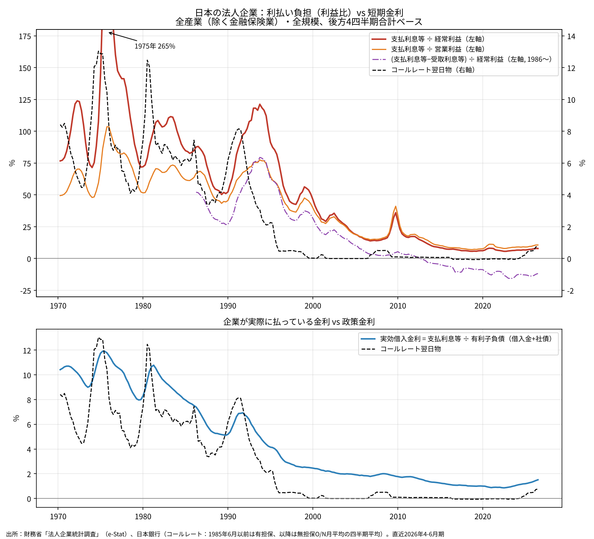
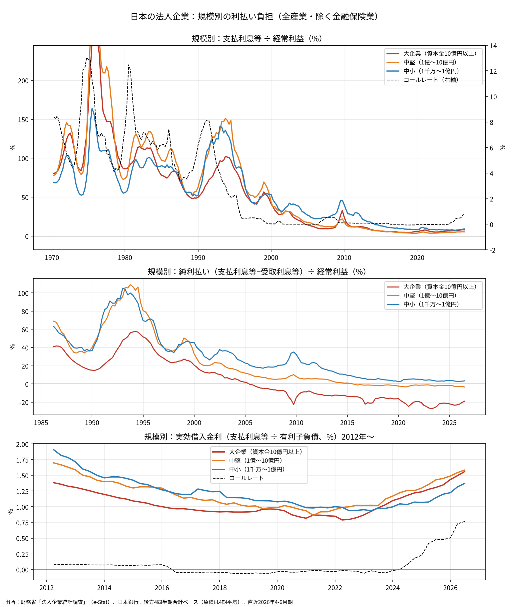
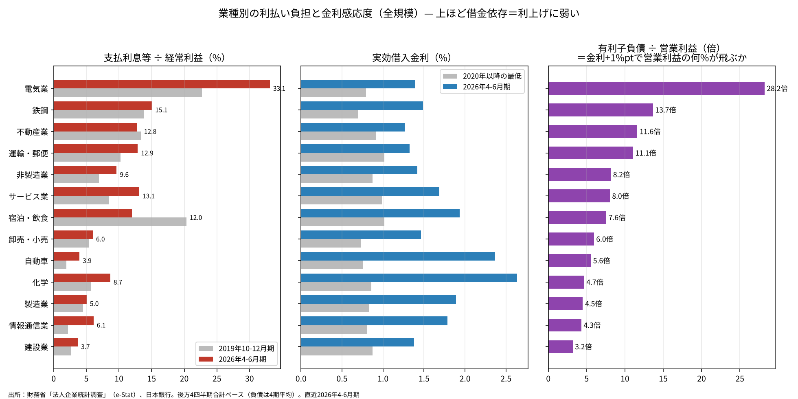

# 利上げは日本企業を引き締めているか──利払い負担は史上最低圏、大企業は「純受取」だが中身は配当

ウェブ版：[https://p72.github.io/note-draft/利上げと企業の利払い/01\_利上げは日本企業を引き締めているか.html](https://p72.github.io/note-draft/%E5%88%A9%E4%B8%8A%E3%81%92%E3%81%A8%E4%BC%81%E6%A5%AD%E3%81%AE%E5%88%A9%E6%89%95%E3%81%84/01_%E5%88%A9%E4%B8%8A%E3%81%92%E3%81%AF%E6%97%A5%E6%9C%AC%E4%BC%81%E6%A5%AD%E3%82%92%E5%BC%95%E3%81%8D%E7%B7%A0%E3%82%81%E3%81%A6%E3%81%84%E3%82%8B%E3%81%8B.html)

GitHub：[https://github.com/p72/note-draft/blob/main/利上げと企業の利払い/01\_利上げは日本企業を引き締めているか.md](https://github.com/p72/note-draft/blob/main/%E5%88%A9%E4%B8%8A%E3%81%92%E3%81%A8%E4%BC%81%E6%A5%AD%E3%81%AE%E5%88%A9%E6%89%95%E3%81%84/01_%E5%88%A9%E4%B8%8A%E3%81%92%E3%81%AF%E6%97%A5%E6%9C%AC%E4%BC%81%E6%A5%AD%E3%82%92%E5%BC%95%E3%81%8D%E7%B7%A0%E3%82%81%E3%81%A6%E3%81%84%E3%82%8B%E3%81%8B.md)

※ この記事は、財務省「法人企業統計調査」（e-Stat API）と日本銀行の時系列統計（API）の公表データを使い、Python で計算している。取得・計算・作図のコードとデータは同じフォルダの `code/` にある。

## 要旨

米国では、2022年からの利上げにもかかわらず、企業の利払い費は利益比で史上最低水準にあり、企業部門は短期金利の上昇に鈍感になったと指摘されている。本稿では同じことを日本の法人企業統計で確かめた。結論は次のとおりである。

- 全産業（除く金融保険業）の支払利息等は、経常利益の7.9％（2026年4-6月期、後方4四半期合計）にすぎない。1975年には265％、1990年代初めでも100％前後だった。底は2022年4-6月期の5.7％で、利上げ後の上昇はわずかである。
- 企業が実際に払っている金利（支払利息等÷有利子負債）は、2022年の0.86％から1.51％に上がった。政策金利（コールレート）の上昇幅とほぼ同じだが、水準はまだ低い。
- 規模で分けると姿が変わる。受取利息等を差し引いた純利払いは、大企業（資本金10億円以上）で経常利益の−19％と大きな受取超過、中堅（1億〜10億円）で−3％、中小（1千万〜1億円）で＋3％と支払超過である。
- ただし大企業の「受取超過」の大半は受取配当金であり、金利とは連動しない。このデータからは「大企業は利上げで儲かる」とまでは言えない。言えるのは、利上げの直接の打撃を受けにくい財務構造になっている、ということまでである。
- 業種では、有利子負債が営業利益の何倍あるかが金利感応度の目安になる。電気業28倍、鉄鋼14倍、不動産12倍、運輸11倍が高く、建設3倍、情報通信・製造業4〜5倍が低い。

## 1. 出発点：米国のチャート

JPモルガン・アセット・マネジメントは、米国の非金融法人の純利払い費（税引後NIPA利益比）とFF金利を重ねたチャートを示している。1970〜2000年代には、利上げのたびに利払い比率が跳ね上がり、景気後退につながった。ところが2022年からの利上げでは、FF金利が5％台まで上がったのに、利払い比率は下がり続けた。

日本でも同じことが起きているのか。法人企業統計の四半期データは1954年まで遡れるので、同じ形のチャートを作ることができる。

## 2. 日本版：利払い負担は50年で10分の1以下

赤線は支払利息等を経常利益で割ったもの、橙線は営業利益で割ったものである。季節性をならすため、いずれも後方4四半期の合計で計算した。黒の点線はコールレート翌日物（1985年6月以前は有担保、以降は無担保）の四半期平均である。

1970〜90年代は、米国と同じく、短期金利の山のあとに利払い比率の山が来ている。1975年には支払利息等が経常利益の2.6倍に達した。1990年代初めのバブル崩壊期にも経常利益とほぼ同額の利息を払っていた。

その後、比率は一貫して下がり、2022年4-6月期に5.7％で底を打った。2024年以降の利上げで上向いたが、2026年4-6月期でも7.9％である。営業利益で割っても10.6％にとどまる。

下段は、支払利息等を有利子負債（金融機関借入金、その他の借入金、社債）の4期平均で割った「実効借入金利」である。2022年の0.86％から2026年4-6月期の1.51％へ、0.65ポイント上がった。同じ期間にコールレートは約0.8ポイント上がっているから、政策金利の上昇はおおむね企業の借入金利に伝わっている。それでも利払い負担がほとんど増えないのは、金利の水準そのものが1％台と低いことと、利益が大きく増えたことによる。

## 3. 規模別：大企業は受取超過、中小は支払超過

上段の支払利息等÷経常利益で見ると、規模による違いは小さい。2026年4-6月期は大企業8.1％、中堅5.5％、中小9.2％である。

違いが出るのは中段の純利払い、つまり支払利息等から受取利息等を差し引いたものである。大企業は2005年ごろに受取超過に転じ、2026年4-6月期は経常利益の−19％である。中堅はほぼゼロ、中小は＋3％で、統計を遡れる1986年以降、一度も受取超過になっていない。

下段の実効借入金利は、2020年以降の底から大企業0.79％→1.56％、中堅0.86％→1.59％、中小0.94％→1.37％と上がった。中小の上がり方が最も小さい。固定金利の借入や、コロナ期の実質無利子・無担保融資の残高が残っているためと考えられる。これらが借り換えられていくにつれて、中小の実効金利は遅れて上がるはずである。

## 4. 大企業の「受取超過」の中身

大企業が受取超過なら、利上げで金利収入が増え、むしろ儲かるのではないか。金額で確かめる。後方4四半期合計で、2022年10-12月期から2026年4-6月期までの変化は次のとおりである。

| 規模 | 支払利息等 | 受取利息等 | 差引 |
|---|---|---|---|
| 大企業（10億円以上） | 3.1兆円→6.8兆円（＋3.7兆円） | 18.3兆円→22.9兆円（＋4.6兆円） | 受取の増加が0.9兆円多い |
| 中堅（1億〜10億円） | 0.6兆円→1.2兆円（＋0.6兆円） | 0.8兆円→2.0兆円（＋1.2兆円） | 受取の増加が0.6兆円多い |
| 中小（1千万〜1億円） | 1.8兆円→2.6兆円（＋0.8兆円） | 0.8兆円→1.6兆円（＋0.8兆円） | ほぼ同じ |

一見すると、大企業と中堅は利上げ局面で受取の増え方が支払を上回っている。しかし、ここには大きな留保がある。

法人企業統計の「受取利息等」には、預金や債券の利息だけでなく、受取配当金が含まれる。大企業の受取利息等22.9兆円の大半は、国内外の子会社や保有株式からの配当である。四半期の動きにもそれが表れている。全規模の受取利息等は、2025年4-6月期に9.9兆円、7-9月期に5.6兆円、10-12月期に4.6兆円、2026年1-3月期に5.5兆円、4-6月期に10.8兆円と、株主総会と配当支払いが集中する4-6月期に毎年跳ね上がる。金利収入ならこのような季節性は生じない。

受取利息等が2019年の10.1兆円から2022年の18.3兆円へほぼ倍増したのは、利上げの前である。円安と海外子会社の利益拡大で配当が増えた影響が大きいとみられる。四半期別調査は利息と配当を分けて公表していないため、利上げ後の受取の増加4.6兆円のうち、金利収入がどれだけかは分からない。

したがって、このデータから言えるのは「大企業は利払い負担が小さく、配当収入が厚いため、利上げの直接の打撃を受けにくい」ということまでである。「利上げで儲かる」ことを示すには、受取利息と受取配当金を分けたデータが必要になる。

## 5. 業種別：借金依存の度合いがそのまま感応度になる

右のパネルの有利子負債÷営業利益は、金利が1ポイント上がったとき営業利益の何％が追加の利払いで消えるかの目安になる。電気業は28倍で、金利1ポイントの上昇が営業利益の28％に相当する。支払利息等はすでに経常利益の33％を占めており、業種のなかで突出している。鉄鋼14倍、不動産12倍、運輸・郵便11倍がこれに続く。

一方、建設3倍、情報通信4倍、製造業5倍は感応度が低い。化学と自動車は実効借入金利が2.4〜2.6％と高く上がっているが、有利子負債が少なく受取配当も大きいため、純利払いは経常利益の−20〜−37％の受取超過である。海外での借入にドル金利がかかっている影響もあると考えられる。

宿泊・飲食サービスは、2019年10-12月期の20％から12％に下がった。コロナ後の利益回復で分母が大きくなったためである。

## 6. MMTとの関係

利上げは民間の利子所得を増やすので、引き締めではなくむしろ刺激になりうる。MMT（現代貨幣理論）の論者の一部は、こうした「利子所得経路」を強調してきた。本稿の結果は、この議論とどう関係するか。

まず、企業部門の一部は確かに利子・配当の純受取側にいる。利上げが企業の利払いを通じて一律に投資を冷やす、という教科書的な経路は、日本の大企業にはほとんど当てはまらない。この点は、利上げの効果を単純に考える見方への反証になる。

しかし、これをもってMMTの主張が裏付けられたとは言えない。理由は3つある。

1. 大企業の受取超過の大半は配当であり、金利とは連動しない。利上げで受取が増えたことは確認できていない。
2. MMTの利子所得経路の本来の論点は、政府の利払い増加が民間の所得になるという部門間の資金の流れである。企業部門の内訳だけでは、家計や政府、金融機関を含めた差し引きは分からない。
3. 利上げの効果は、利払いを通じた経路だけではない。為替、資産価格、銀行の貸出態度、期待を通じた経路があり、本稿はそのどれも見ていない。

言えるのは、「利上げは企業の利払いを通じて景気を強く引き締める」という経路が、いまの日本では弱いということである。その分、利上げの効果は他の経路に頼ることになる。米国のチャートについて言われる「引き締めたいなら、よほど利上げするか、別の手段を使うか」は、日本の大企業にもそのまま当てはまる。一方で、中小企業と、電力・不動産・運輸といった借入依存の高い業種には、借り換えが進むにつれて利払いの経路が効いてくる。

## 7. 留保

- 米国のチャートは「純利払い÷税引後NIPA利益」だが、法人企業統計の四半期データには税引後利益がないため、経常利益と営業利益で代えた。厳密な日米比較ではない。
- 経常利益には受取配当金が含まれるため、配当が増えると分母が膨らみ、利払い比率は下がって見える。営業利益で割った系列を併記したのはこのためである。
- 受取利息等は1985年度以前の四半期データでは0として計上されているため、純利払いは1986年以降のみ示した。
- リース業は、金利の一部を営業費用として処理するため実効借入金利が0.4％と異常に低くなる。業種別の比較から除いた。
- 法人企業統計は標本調査であり、標本の入れ替えにより系列に段差が生じることがある。

## データと方法

- 財務省「法人企業統計調査」時系列データ、金融業、保険業以外の業種（原数値）、四半期。e-Stat API、statsDataId `0003060191`。
  - 項目：営業利益、受取利息等、支払利息等、経常利益、金融機関借入金（短期・長期）、その他の借入金（短期・長期）、社債。
  - 業種：全産業（除く金融保険業）、製造業、非製造業、建設業、電気業、情報通信業、運輸業・郵便業、卸売業・小売業、不動産業、宿泊業・飲食サービス業、サービス業、化学工業、鉄鋼業、自動車・同附属品製造業。
  - 規模：全規模、資本金10億円以上、1億円以上10億円未満、1千万円以上1億円未満。
  - 損益項目は後方4四半期の合計、有利子負債は4四半期の平均で計算した。
- 日本銀行「短期金融市場金利」：有担保コールレート翌日物の月平均（`STRACLCOON`、1985年6月まで）と無担保コールレートO/Nの月平均（`STRACLUCON`、1985年7月から）をつなぎ、四半期平均にした。
- 出典：
  - [https://www.e-stat.go.jp/stat-search/database?statdisp_id=0003060191](https://www.e-stat.go.jp/stat-search/database?statdisp_id=0003060191)
  - [https://www.mof.go.jp/pri/reference/ssc/index.htm](https://www.mof.go.jp/pri/reference/ssc/index.htm)
  - [https://www.stat-search.boj.or.jp/](https://www.stat-search.boj.or.jp/)
- コード：`code/01_fetch.py`（取得）、`code/01_calc_all.py`・`code/01_calc_detail.py`（計算）、`code/01_plot_all.py`・`code/01_plot_detail.py`（作図）。
