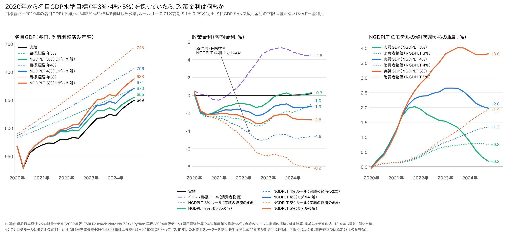
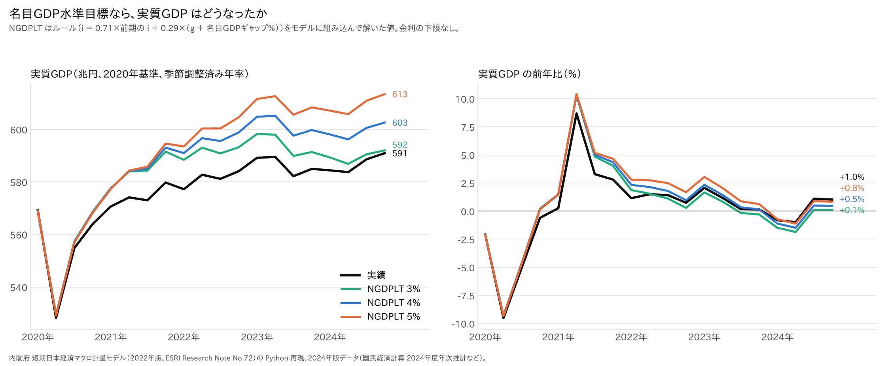
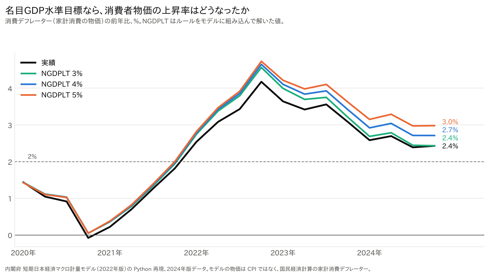

# 名目GDP水準目標なら、日本の政策金利はいくらだったか──2020年から「年3〜5%」を目標にした場合を内閣府モデルで計算した

ウェブ版：[https://p72.github.io/note-draft/名目GDP水準目標/01\_名目GDP水準目標なら日本の政策金利はいくらだったか.html](https://p72.github.io/note-draft/%E5%90%8D%E7%9B%AEGDP%E6%B0%B4%E6%BA%96%E7%9B%AE%E6%A8%99/01_%E5%90%8D%E7%9B%AEGDP%E6%B0%B4%E6%BA%96%E7%9B%AE%E6%A8%99%E3%81%AA%E3%82%89%E6%97%A5%E6%9C%AC%E3%81%AE%E6%94%BF%E7%AD%96%E9%87%91%E5%88%A9%E3%81%AF%E3%81%84%E3%81%8F%E3%82%89%E3%81%A0%E3%81%A3%E3%81%9F%E3%81%8B.html)

GitHub：[https://github.com/p72/note-draft/blob/main/名目GDP水準目標/01\_名目GDP水準目標なら日本の政策金利はいくらだったか.md](https://github.com/p72/note-draft/blob/main/%E5%90%8D%E7%9B%AEGDP%E6%B0%B4%E6%BA%96%E7%9B%AE%E6%A8%99/01_%E5%90%8D%E7%9B%AEGDP%E6%B0%B4%E6%BA%96%E7%9B%AE%E6%A8%99%E3%81%AA%E3%82%89%E6%97%A5%E6%9C%AC%E3%81%AE%E6%94%BF%E7%AD%96%E9%87%91%E5%88%A9%E3%81%AF%E3%81%84%E3%81%8F%E3%82%89%E3%81%A0%E3%81%A3%E3%81%9F%E3%81%8B.md)

※ この記事は、内閣府 経済社会総合研究所（ESRI）の「短期日本経済マクロ計量モデル（2022年版）」を Python で再現したもの（[p72/esri-short-run-macro-model](https://github.com/p72/esri-short-run-macro-model)）と、ESRI の国民経済計算（2024年度年次推計）で計算している。

原油高のような「供給ショック」が来ると、物価が上がる。インフレ目標を採る中央銀行がこれに利上げで応じると、期待インフレは落ち着くかもしれないが、もともと落ち込んでいる実質の産出をさらに犠牲にしてしまう。

この問題への答えとしてよく挙がるのが、**名目GDP水準目標（NGDPLT：Nominal GDP Level Targeting）**である。名目GDP の「水準」を、毎年一定の率で伸びる目標の経路に乗せる。供給ショックで物価が上がっても、実質が同じだけ落ちれば名目GDP は変わらないので、利上げは要らない。

では、日本が2020年から名目GDP を年3%・4%・5%の経路に乗せる NGDPLT を採っていたら、政策金利は何%で推移したのか。内閣府のマクロモデルで計算した。

結果を先に書く。

- **年4%・5%の目標なら、政策金利は2020〜24年を通してマイナスになる**。実際の経済の数字にルールを当てはめると、2024年に年4%目標で−4.7%、年5%目標で−7.9%。
- **年3%の目標なら、マイナス金利が必要なのは主に2020〜22年**である。2023年以降は名目GDP が目標に近づき、モデルの中で解くと政策金利は2023年後半からほぼゼロに戻る。
- **2022〜23年の原油高・円安でも、NGDPLT は利上げしない**。同じ時期、消費者物価に反応するインフレ目標ルールなら4〜5%まで利上げする。
- モデルの中でこのルールを使うと、マイナス金利が名目GDP を押し上げるので、必要な金利は浅くなる（年3%目標で0〜−1.5%、年4%目標で−1〜−2%、年5%目標で−1.5〜−3%）。それでも、年4%・5%の目標では名目GDP は目標の経路に届かない。

## 目標の経路と実績

目標の経路は、2019年の名目GDP（平均約572兆円）から、年3%・4%・5%で伸ばした水準とした。

- 年3%の経路：2024年に約663兆円
- 年4%の経路：2024年に約696兆円
- 年5%の経路：2024年に約730兆円
- 実績：2024年に約637兆円（2019年からの伸びは年約2%）

2024年の実績は、年3%の経路より約4%、年4%の経路より約9%、年5%の経路より約14%低い。2020年のコロナ禍で名目GDP が落ち込み、その後の物価上昇でも取り戻せていない。

## 政策金利のルール

政策金利は次のルールで決まるとした。

- 政策金利 ＝ 0.71 × 前期の政策金利 ＋ 0.29 × （目標の伸び率 ＋ 名目GDP の目標からのずれ（%））

形は、内閣府モデルにもともと入っている政策金利の式（テイラー・ルール型）と同じである。前期の金利に重みを置いて、ゆっくり動く。目標の経路どおりなら、政策金利は目標の伸び率（3%・4%・5%）に落ち着く。

比較として、消費者物価に反応するインフレ目標ルールも計算した。こちらも内閣府モデルの式と同じ形で、物価上昇率が2%を上回るほど、また景気が過熱するほど利上げする。

どちらも金利の下限は置いていない（マイナス金利を含む「シャドー金利」）。

## 結果：年4%・5%なら政策金利はずっとマイナス

中央の図が政策金利である。点線は「実際の経済の数字にルールを当てはめた金利」、実線は「ルールをモデルに組み込んで、経済の反応まで含めて解いた金利」である。

実際の経済の数字にルールを当てはめた場合（年平均）

- 年3%目標：2020年 −1.7%、2021年 −2.5%、2022年 −3.2%、2023年 −2.3%、2024年 −1.5%
- 年4%目標：2020年 −1.6%、2021年 −3.0%、2022年 −4.5%、2023年 −4.6%、2024年 −4.7%
- 年5%目標：2020年 −1.6%、2021年 −3.4%、2022年 −5.9%、2023年 −6.8%、2024年 −7.9%
- 比較：インフレ目標ルール（消費者物価）：2020年 0.0%、2021年 0.1%、2022年 3.1%、2023年 5.2%、2024年 4.6%
- 実績：2024年まで0%（2024年平均0.1%）

名目GDP がずっと目標を下回っているので、NGDPLT は「もっと緩めよ」と言い続ける。ただし年3%目標では、2023年以降の物価上昇で名目GDP が目標に近づき、マイナス幅は縮んでいく。

## 原油高の局面で2つのルールが分かれる

違いがはっきり出るのは、2022〜23年である。原油高と円安で、消費者物価（家計消費デフレーター）の上昇率は3%台になった。

- インフレ目標ルールは、物価の上昇に反応して、2023年には5%台まで利上げする。景気が弱い中での利上げで、実質の産出をさらに冷やすことになる。
- NGDPLT は、物価が上がっても名目GDP が目標を下回っているので、利上げしない。物価の上昇は、その分の実質の落ち込みと相殺されるかぎり、問題にしない。

冒頭の「原油高に利上げすると実質産出が犠牲になる。NGDPLT ならそれを避けられる」という考え方は、このルールの比較でそのまま確認できる。

## モデルの中で NGDPLT を使うと

ルールをモデルに組み込んで解くと、マイナス金利が設備投資などを通じて名目GDP を押し上げる。そのため、必要なマイナス金利は浅くなる。

- 政策金利：年3%目標で−1.5〜+0.1%、年4%目標で−1.3〜−2.0%、年5%目標で−1.4〜−2.9%（年平均）
- 名目GDP（2024年平均）：年3%目標で644兆円（実績より7兆円多い）、年4%目標で658兆円（同22兆円多い）、年5%目標で673兆円（同36兆円多い）
- 実質GDP：実績より、年3%目標で最大2%、年4%・5%目標で2〜4%高い
- 消費者物価：実績より0.8〜1.7%高い（2024年）

年3%目標では、名目GDP は2024年に目標の経路の約3%下まで近づき、政策金利は2023年後半から0〜0.3%に戻る。一方、年4%・5%目標では、名目GDP は目標の経路に届かない（2024年に年4%目標で約5%、年5%目標で約8%下回る）。モデルのルールは前期の金利に重みを置いてゆっくり動くので、名目GDP の大きな不足をすぐには埋められない。

## 実質GDP はどうなるか

同じくモデルの中で NGDPLT を使ったときの実質GDP（2020年基準）の推移である。

実質GDP（年平均）

- 実績：2020年 554兆円、2021年 574兆円、2022年 581兆円、2023年 586兆円、2024年 587兆円
- 年3%目標：556兆円、584兆円、591兆円、594兆円、590兆円
- 年4%目標：556兆円、585兆円、596兆円、602兆円、599兆円
- 年5%目標：556兆円、586兆円、600兆円、610兆円、609兆円

マイナス金利で2021年の回復が大きくなり（前年比で実績の3.8%に対して5.2〜5.4%）、その後も実質GDP は実績より高く推移する。2024年平均の押し上げは、年4%目標で約12兆円（2.1%）、年5%目標で約22兆円（3.8%）である。

一方、年3%目標では、2023年以降に名目GDP が目標に近づいて金利がゼロ近くまで戻るので、押し上げは2024年にほぼ消える（約3兆円、0.5%）。NGDPLT が実質の産出を支えるのは、名目GDP が目標を下回っていて金利を下げている間だけである。

## 消費者物価はどうなるか

モデルの中で NGDPLT を使ったとき、消費者物価の上昇率がどうなるかを、実績と比べた。モデルの物価は CPI ではなく、国民経済計算の家計消費デフレーター（家計の消費全体の物価）である。

消費者物価の前年比（年平均）

- 実績：2020年 0.8%、2021年 1.0%、2022年 3.3%、2023年 3.4%、2024年 2.5%
- 年3%目標：0.9%、1.1%、3.6%、3.7%、2.6%
- 年4%目標：0.9%、1.1%、3.7%、3.8%、2.9%
- 年5%目標：0.9%、1.2%、3.7%、4.0%、3.1%

どの目標でも、形は実績とほぼ同じで、少し上にずれるだけである。上乗せは年3%目標で0.1〜0.3ポイント、年5%目標でも最大0.6ポイントほど。差が開くのは2023〜24年で、利下げの効果が時間をかけて物価に効いてくるためである。2024年末には、実績の2.4%に対して、年4%目標で2.7%、年5%目標で3.0%になる。

物価がそれほど上がらないのは、このモデルでは利下げの効果がまず実質GDP の増加（2〜4%）に出て、物価にはあまり回らないためである。NGDPLT で名目GDP を押し上げても、その多くは実質の産出の増加になる。

## まとめ

- 日本が2020年から名目GDP の年4〜5%の経路を目標にしていたら、政策金利は2020〜24年を通してマイナスで推移した。年3%の経路なら、マイナス金利が必要なのは主にコロナ禍から2022年までで、2023年以降はほぼゼロに戻る。
- 実質GDP は、年4%・5%目標なら2024年に実績より2〜4%高い。年3%目標では、金利がゼロ近くに戻る2024年に押し上げがほぼ消える。
- 消費者物価の上昇率は、実績より0.1〜0.6ポイント高くなるだけで、名目GDP の押し上げの多くは実質の産出の増加になる。
- 2022〜23年の原油高・円安でも、NGDPLT は利上げしない。インフレ目標ルールが4〜5%まで利上げするのと対照的で、供給ショックで実質の産出を犠牲にしない、という NGDPLT の性質が表れる。
- ただし、必要なマイナス金利は年4%目標でも−1〜−5%、年5%目標なら−8%近くになる。目標を高くするほど、金利だけでは名目GDP を目標の経路に戻せない。

## 注意点

- **ここまでのマイナス金利は、現実には難しい**：日本銀行のマイナス金利は−0.1%にとどまった。NGDPLT を実際に行うなら、量的緩和や財政政策と組み合わせる必要がある。
- **長期金利は0%で止まる**：モデルの長期金利は短期金利に連動して下がるが、0%を下限にしている。
- **期待の効果は入っていない**：目標をはっきり約束すれば、人々が先を見越して支出や価格を変える。NGDPLT の強みはこの期待の効果にあるが、このモデルには入っていない。実際の効果は、この計算より大きい可能性がある。
- **起点の取り方**：2019年を起点にしたので、2020年のコロナ禍の落ち込みが、そのまま目標からの大きなずれになっている。
- **モデルの係数はデフレ期の推定**：内閣府モデルの係数は1990年代〜2020年のデータで推定されている。

## データの取り方

- モデル：内閣府 経済社会総合研究所「短期日本経済マクロ計量モデル（2022年版）の構造と乗数分析」ESRI Research Note No.72（2022年12月） https://www.esri.cao.go.jp/jp/esri/archive/e_rnote/e_rnote080/e_rnote072.pdf
- モデルの再現と計算のコード：https://github.com/p72/esri-short-run-macro-model （計算は `src/experiment_ngdplt.py`、図は `src/plot_ngdplt.py`）
- 名目GDP など：内閣府 経済社会総合研究所「国民経済計算」2024年度年次推計・2026年4-6月期2次速報（2020年基準） https://www.esri.cao.go.jp/jp/sna/data/data_list/kakuhou/files/2024/2024_kaku_top.html
- 政策金利・長期金利：日本銀行 時系列統計データ検索サイト
