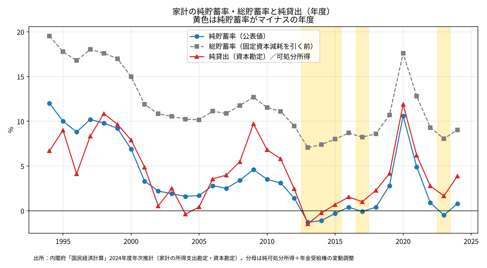
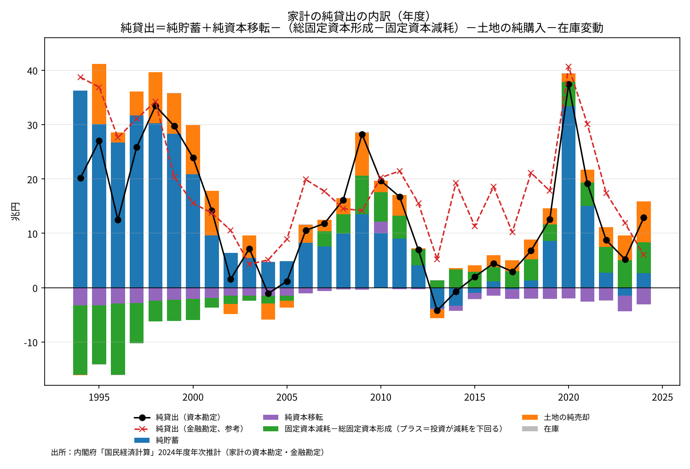

# 日本の家計純貯蓄率はマイナスなのに、家計部門は貯蓄超過とはどういう意味なのか

ウェブ版：[https://p72.github.io/note-draft/家計の貯蓄と純貸出/01\_家計の純貯蓄率がマイナスでも家計は貯蓄超過になる.html](https://p72.github.io/note-draft/%E5%AE%B6%E8%A8%88%E3%81%AE%E8%B2%AF%E8%93%84%E3%81%A8%E7%B4%94%E8%B2%B8%E5%87%BA/01_%E5%AE%B6%E8%A8%88%E3%81%AE%E7%B4%94%E8%B2%AF%E8%93%84%E7%8E%87%E3%81%8C%E3%83%9E%E3%82%A4%E3%83%8A%E3%82%B9%E3%81%A7%E3%82%82%E5%AE%B6%E8%A8%88%E3%81%AF%E8%B2%AF%E8%93%84%E8%B6%85%E9%81%8E%E3%81%AB%E3%81%AA%E3%82%8B.html)

GitHub：[https://github.com/p72/note-draft/blob/main/家計の貯蓄と純貸出/01\_家計の純貯蓄率がマイナスでも家計は貯蓄超過になる.md](https://github.com/p72/note-draft/blob/main/%E5%AE%B6%E8%A8%88%E3%81%AE%E8%B2%AF%E8%93%84%E3%81%A8%E7%B4%94%E8%B2%B8%E5%87%BA/01_%E5%AE%B6%E8%A8%88%E3%81%AE%E7%B4%94%E8%B2%AF%E8%93%84%E7%8E%87%E3%81%8C%E3%83%9E%E3%82%A4%E3%83%8A%E3%82%B9%E3%81%A7%E3%82%82%E5%AE%B6%E8%A8%88%E3%81%AF%E8%B2%AF%E8%93%84%E8%B6%85%E9%81%8E%E3%81%AB%E3%81%AA%E3%82%8B.md)

※ この記事は、内閣府 経済社会総合研究所（ESRI）の国民経済計算（2024年度年次推計）の公表データを使って計算している。

内閣府が公表する家計貯蓄率は、2013・2014・2015・2017・2023年度にマイナスになった。一方で、ISバランス（部門別の貯蓄・投資差額）で見ると、家計部門は「貯蓄超過」の部門として扱われることが多い。貯蓄率がマイナスなのに貯蓄超過というのは、一見すると矛盾している。

結論を先に書くと、次のとおりである。

- **ISバランスでいう家計の「貯蓄超過」は貯蓄そのものではなく、貯蓄から投資を引いた「純貸出」である**。貯蓄がマイナスでも、投資がそれ以上にマイナス側に振れれば、純貸出はプラスになる。
- 家計の場合、それを起こしているのは主に2つである。**住宅などの投資が固定資本減耗（目減り分）を下回っていること**と、**家計が土地を純額で売っていること**である。
- 2023年度は、純貯蓄が▲1.5兆円だったが、純貸出は＋5.2兆円だった。差の大半は、住宅投資の不足分（＋5.0兆円）と土地の純売却（＋4.6兆円）で説明できる。
- 純貸出は総貯蓄で計算しても純貯蓄で計算しても同じ値になる。固定資本減耗が貯蓄側と投資側の両方から引かれて打ち消し合うからである。

## 純貯蓄率と純貸出は何を測っているか

### 純貯蓄率

内閣府の家計貯蓄率は、家計の所得支出勘定から次のように計算される。

- 純貯蓄 ＝ 純可処分所得 ＋ 年金受給権の変動調整 － 最終消費支出
- 純貯蓄率 ＝ 純貯蓄 ÷（純可処分所得 ＋ 年金受給権の変動調整）

「純」とは、固定資本減耗を差し引いたという意味である。固定資本減耗は、家計が持つ住宅（持ち家）や個人企業の設備が1年間に目減りした分を、費用とみなして計上したものである。現金の支出は伴わない。

固定資本減耗を引く前の「総貯蓄」で計算した総貯蓄率は、純貯蓄率より7〜9ポイントほど高い。2023年度は純貯蓄率▲0.5％に対して、総貯蓄率は8.1％だった。

### 純貸出

ISバランスで部門の「貯蓄超過」と呼ばれるのは、資本勘定の最後に出てくる「純貸出（＋）／純借入（－）」である。家計の資本勘定では、次の関係が成り立つ。

- 純貸出 ＝ 純貯蓄 ＋ 純資本移転 －（総固定資本形成 － 固定資本減耗）－ 在庫変動 － 土地の購入（純）

括弧の中の「総固定資本形成 － 固定資本減耗」が純投資である。家計の総固定資本形成は、大部分が住宅投資で、残りは個人企業の設備投資である。

ここで、固定資本減耗は純貯蓄の計算でも引かれ、純投資の計算でも引かれている。式を書き直すと、固定資本減耗は消える。

- 純貸出 ＝ 総貯蓄 ＋ 純資本移転 － 総固定資本形成 － 在庫変動 － 土地の購入（純）

つまり、純貸出は「総」で見ても「純」で見ても同じ値になる。純貯蓄率が固定資本減耗の分だけ低く見えるという議論は、貯蓄率の水準の話であり、ISバランスには影響しない。

### 純貸出は金融資産の純増と対応する

純貸出は、概念上は金融勘定の「資金過不足」（金融資産の純増 － 負債の純増）と一致する。家計が貯蓄超過であるとは、家計が預金や保険・年金などの金融資産を、借入の増加より多く積み増したということである。ISバランスの恒等式で言えば、家計の貯蓄超過は、企業・政府の赤字か、海外に対する黒字（経常収支黒字）と対応している。

## 純貯蓄率がマイナスだった年度の内訳

純貯蓄率がマイナスだった5つの年度について、純貸出の内訳を並べると次のとおりである（兆円）。「土地」は家計による土地の購入（純）で、マイナスは家計が売り越したことを表す。

- 2013年度：純貯蓄率▲1.3％。純貯蓄▲3.7、純資本移転▲0.3、総固定資本形成24.5、固定資本減耗25.8（純投資▲1.4）、土地＋1.6。**純貸出▲4.2**
- 2014年度：純貯蓄率▲1.1％。純貯蓄▲3.3、純資本移転▲1.0、総固定資本形成23.2、固定資本減耗26.5（純投資▲3.3）、土地▲0.3。**純貸出▲0.7**
- 2015年度：純貯蓄率▲0.3％。純貯蓄▲1.0、純資本移転▲1.1、総固定資本形成23.6、固定資本減耗26.5（純投資▲2.9）、土地▲1.2。**純貸出＋2.0**
- 2017年度：純貯蓄率▲0.1％。純貯蓄▲0.3、純資本移転▲1.7、総固定資本形成23.7、固定資本減耗26.7（純投資▲3.0）、土地▲2.0。**純貸出＋3.0**
- 2023年度：純貯蓄率▲0.5％。純貯蓄▲1.5、純資本移転▲2.9、総固定資本形成24.4、固定資本減耗29.4（純投資▲5.0）、土地▲4.6。**純貸出＋5.2**

資本勘定で見ると、2013・2014年度は純貸出もマイナス、つまり家計は本当に投資超過（純借入）だった。純貯蓄率がマイナスで、しかも純貸出がプラスだったのは、2015・2017・2023年度の3つの年度である。

赤線の純貸出（可処分所得に対する比率）は、2000年代前半までは青線の純貯蓄率と上下に入れ替わっていた。2006年度以降は、2013年度を除いて、純貸出が純貯蓄率を上回っている。

## 2023年度の内訳

2023年度を例に、純貯蓄▲1.5兆円から純貸出＋5.2兆円にどう移るかを順に見る。

- 純貯蓄：▲1.5兆円
- 純資本移転：▲2.9兆円。家計が支払う資本移転の大部分は相続税・贈与税（資本税）であり、これは貯蓄超過を減らす方向に働く。
- 純投資：総固定資本形成24.4兆円が固定資本減耗29.4兆円を5.0兆円下回った。式では純投資を引くので、純貸出を＋5.0兆円押し上げる。
- 土地の購入（純）：▲4.6兆円。家計が土地を売り越し、その代金を受け取ったので、純貸出を＋4.6兆円押し上げる。
- 在庫変動：ほぼゼロ。

合計すると、▲1.5 －2.9 ＋5.0 ＋4.6 ≒ ＋5.2兆円になる。

棒グラフは、純貸出を各項目の寄与に分けたものである。緑は「固定資本減耗 － 総固定資本形成」で、プラスなら住宅などへの投資が目減り分を下回っていることを示す。オレンジは土地の純売却である。

1990年代は、緑がマイナス、つまり住宅投資が減耗を大きく上回っていた。家計は純貯蓄の一部を住宅に回しており、そのぶん純貸出は純貯蓄より小さかった。2000年代後半以降は緑がプラスに転じ、住宅投資が減耗を下回るようになった。これに土地の純売却が加わり、純貯蓄が小さくても純貸出が残る形になっている。

## 何を意味するのか

### 貯蓄率が低いことと金融資産が増えることは両立する

純貯蓄率がゼロ近くでも、家計の金融資産は増え続けてきた。それは、家計が貯蓄を住宅などの実物資産に回さなくなり、さらに土地を売って得た資金を金融資産に置き換えてきたからである。家計全体として見ると、資産の中身が実物資産（住宅・土地）から金融資産へと移っている。

ただし、住宅投資が減耗を下回ることは、家計が持つ住宅ストックが実質的に目減りしていることも意味する。純貸出がプラスであることは、家計が豊かになっていることを直接には示さない。

### 「貯蓄超過」と「貯蓄率」を混同しない

「家計は貯蓄超過だから、家計にはお金が余っている」という議論と、「家計貯蓄率はマイナスだから、家計は貯蓄を取り崩している」という議論は、別のものを測っている。前者は純貸出（S－I）で、後者は貯蓄（S）の所得に対する比率である。両者が逆の符号になることは、統計上なんら矛盾しない。

## 注意点

- **資本勘定と金融勘定の不一致**：純貸出は資本勘定からも金融勘定からも計算できるが、国民経済計算の家計部門では両者は一致しない（統計上の不突合）。金融勘定の資金過不足は、2013年度で＋5.2兆円、2015年度で＋11.3兆円、2017年度で＋10.2兆円、2023年度で＋11.9兆円であり、資本勘定の値よりかなり大きい。金融勘定で見ると、2013・2014年度も家計は資金余剰だった。グラフの赤い破線がこれである。
- **日本銀行の資金循環統計とは別の数字**：資金循環統計の家計の資金過不足は、国民経済計算の金融勘定と作り方が近いが、公表時期や改定のタイミングが違うため、数値は一致しない。
- **家計には個人企業が含まれる**：国民経済計算の家計部門には、自営業などの個人企業が含まれる。総固定資本形成には個人企業の設備投資も入っており、住宅投資だけではない。
- **年金受給権の変動調整**：純貯蓄率の分母と分子に入る調整項目で、2009年度以降は毎年度マイナスである。
- **最新は2024年度**：2024年度年次推計が最新の確報であり、2024年度の純貯蓄率は＋0.8％、純貸出は＋12.9兆円だった。2025年度以降は四半期速報（家計可処分所得・家計貯蓄率四半期別速報）で見ることになる。

## データの取り方

- 家計の純貯蓄・総貯蓄・固定資本減耗・可処分所得・年金受給権の変動調整・貯蓄率：内閣府 ESRI「2024年度 国民経済計算年次推計」制度部門別所得支出勘定「家計（個人企業を含む）」（2024i5\_jp.xlsx）の「年度（４）a」シート
- 総固定資本形成・在庫変動・土地の購入（純）・資本移転・純貸出：同「制度部門別資本勘定・金融勘定」家計（2024c4\_jp.xlsx）の「年度（１）資本」シート
- 資金過不足（金融勘定）：同ファイルの「年度（２）金融」シート
- 確報トップページ：[https://www.esri.cao.go.jp/jp/sna/data/data\_list/kakuhou/files/2024/2024\_kaku\_top.html](https://www.esri.cao.go.jp/jp/sna/data/data_list/kakuhou/files/2024/2024_kaku_top.html)
- 総貯蓄率は「総貯蓄 ÷（総可処分所得 ＋ 年金受給権の変動調整）」として自分で計算した。純貸出の内訳と、可処分所得に対する純貸出の比率も、上のデータから計算した。
