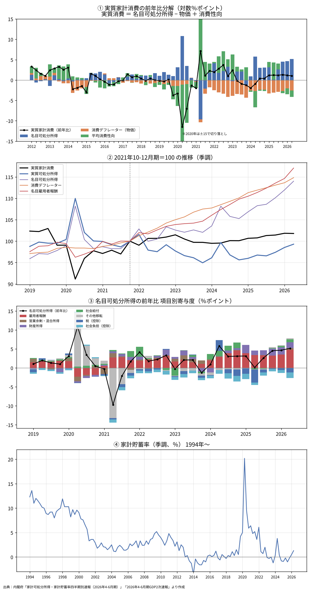
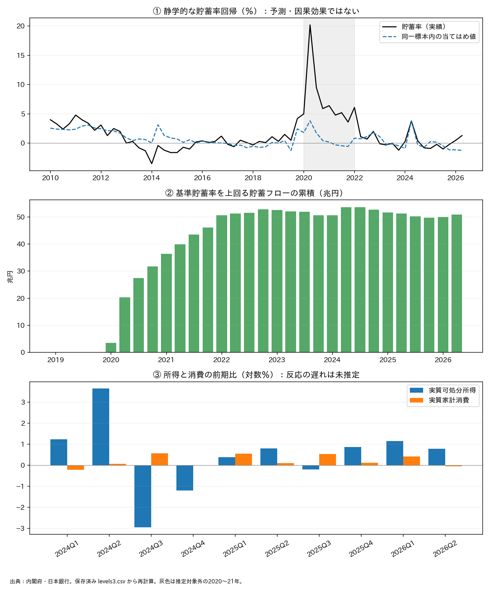
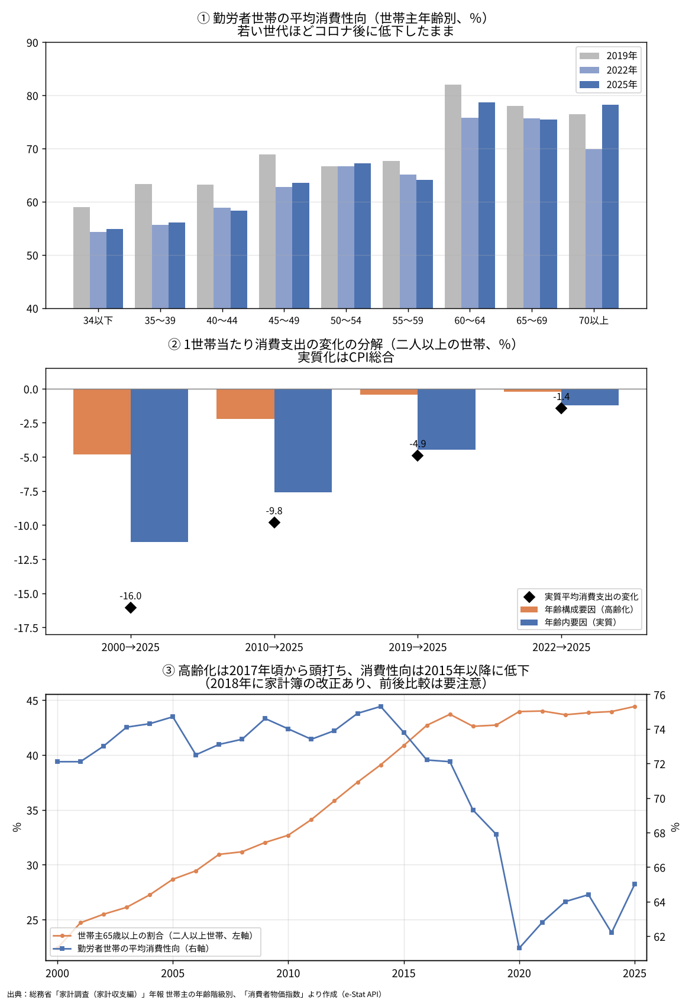
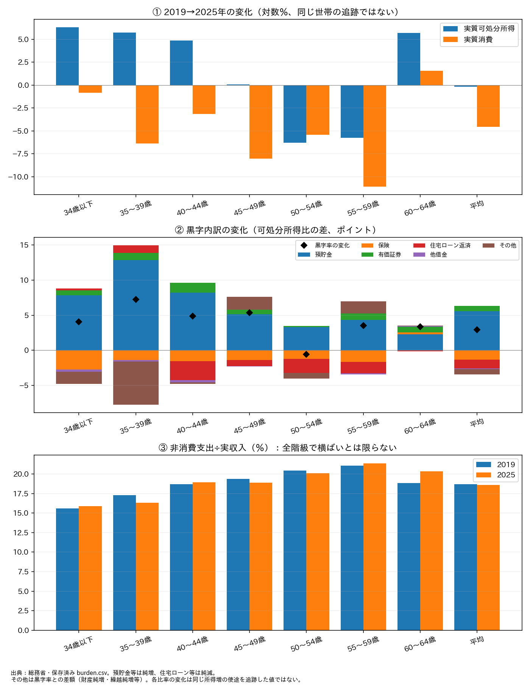
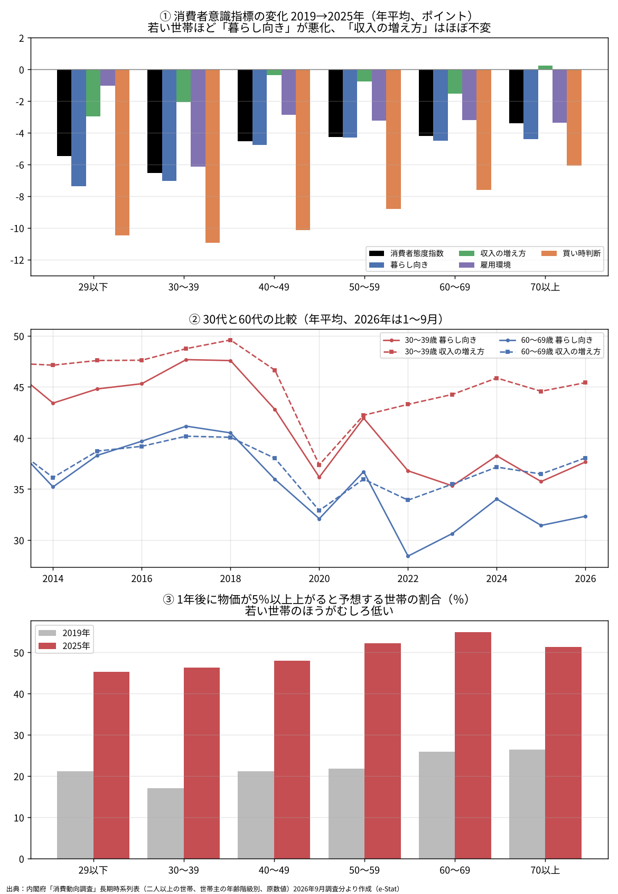

# 家計消費はなぜ伸びないのか──中期の実質所得停滞と、直近の消費性向低下を分けて考える

ウェブ版：[https://p72.github.io/note-draft/家計消費の伸び悩み/01\_家計消費はなぜ伸びないのか.html](https://p72.github.io/note-draft/%E5%AE%B6%E8%A8%88%E6%B6%88%E8%B2%BB%E3%81%AE%E4%BC%B8%E3%81%B3%E6%82%A9%E3%81%BF/01_%E5%AE%B6%E8%A8%88%E6%B6%88%E8%B2%BB%E3%81%AF%E3%81%AA%E3%81%9C%E4%BC%B8%E3%81%B3%E3%81%AA%E3%81%84%E3%81%AE%E3%81%8B.html)

GitHub：[https://github.com/p72/note-draft/blob/main/家計消費の伸び悩み/01\_家計消費はなぜ伸びないのか.md](https://github.com/p72/note-draft/blob/main/%E5%AE%B6%E8%A8%88%E6%B6%88%E8%B2%BB%E3%81%AE%E4%BC%B8%E3%81%B3%E6%82%A9%E3%81%BF/01_%E5%AE%B6%E8%A8%88%E6%B6%88%E8%B2%BB%E3%81%AF%E3%81%AA%E3%81%9C%E4%BC%B8%E3%81%B3%E3%81%AA%E3%81%84%E3%81%AE%E3%81%8B.md)

※ この記事は、内閣府の家計可処分所得・家計貯蓄率四半期別速報、四半期別GDP速報、消費動向調査、日本銀行の資金循環統計（時系列統計データ検索サイトAPI）、総務省の家計調査・消費者物価指数（e-Stat API）を使い、Python で作図・推計している。保存済み加工データと分析コードは同じフォルダの `code/` にある。2026年10月26日にGPTの査読を受けて結論と図を修正した。指摘と対応は [査読メモ](review_2026-10-26.md)、再計算の手順は [code/README.md](code/README.md) に記した。数値の詳細と方法上の留保は末尾の付録にまとめた。

## はじめに

2026年4〜6月期のGDP統計では、実質雇用者報酬が増えた一方で、実質個人消費はほぼ横ばいにとどまった。所得が増えても消費が伸びない。この事実からは、「家計が先行きに備えて消費を控え、貯蓄を増やしている」、つまり消費性向が低下しているという仮説が自然に浮かぶ。

本稿は、供給側の事情には立ち入らず、需要側の公的統計だけでこの仮説を確かめる。答えは、どの期間を見るかで変わる。2022年以降をならして見ると、消費を抑えてきたのは物価に追いつかない実質所得であり、消費性向はむしろ消費を支えていた。ところが、冒頭の2026年4〜6月期だけを見ると、所得が増えたのに消費性向が下がっている。仮説は、直近の動きには当てはまる。

家計を年齢別に分けると、もう一つの姿が見えてくる。若い勤労世帯では、平均で見て実質所得が増え、消費性向が下がり、預貯金の積み増しが増えている。以下、中期の構図、直近の変化、年齢別の姿の順に見ていく。

## 分析の枠組み

消費が伸びない理由は、大きく二つに分けられる。使えるお金そのものが増えないことと、使えるお金のうち消費に回す割合（平均消費性向）が下がることである。前者はさらに、名目所得の伸びと物価の上昇に分けられる。

> 実質消費の伸び ＝ 名目可処分所得の伸び － 消費デフレーターの上昇率 ＋ 平均消費性向の変化

（いずれも対数変化率。平均消費性向は家計最終消費支出÷家計可処分所得）

この式は会計上の恒等式であり、三つの要素を同じ物差しで並べることができる。ただし、どれが原因でどれが結果かまでは教えてくれない。以下では、分解で見えた形を出発点として、ほかの統計で背景を探る。

なお、本文で「手取り」と呼ぶSNAの家計可処分所得には、賃金のほか自営業の所得、利子・配当、年金などの社会給付、持ち家の帰属家賃なども含まれる。給与明細の手取りとは範囲が違う。

## 中期の構図──物価に追いつかない所得を、消費性向が補ってきた

2022年以降、雇用者報酬は名目では大きく伸びた。しかし家計の可処分所得の伸びは、家計消費の物価（消費デフレーター）の上昇にわずかに届かなかった。名目では増えているのに、実質ではほぼ横ばいか、やや減っている。

図1は、実質消費の前年比を三つの要素に分けたものである。2022年以降、名目所得の伸び（青）は大きいが、ほぼ同じ大きさの物価上昇（橙）がそれを打ち消している。この時期に消費を支えたのは、むしろ消費性向の上昇（緑）であった。中期で見る限り、「消費性向が下がったから消費が弱い」とは言えない。

賃金の伸びと可処分所得の伸びの差には、税や社会保険料も関わる。ただし、SNAの社会負担には雇用主負担分が含まれ、同じ額が雇用者報酬の側にも計上される。この差をそのまま家計の負担増と読むことはできない。

*図1　出典：内閣府「家計可処分所得・家計貯蓄率四半期別速報」「GDP速報」より作成*

## 直近の変化──2026年4〜6月期は、消費性向が下がった

ところが、冒頭の問いである2026年4〜6月期に限ると、構図は逆になる。前期と比べて実質可処分所得は増えたが、実質消費はほぼ横ばいで、消費性向は下がった。直近の四半期については、「消費性向が低下した」という仮説は会計上そのまま成り立つ。

問題は、その理由である。消費は所得の変化に遅れて反応しやすいため、所得が急に伸びた局面では消費性向が一時的に下がることがある。一方で、将来への不安から貯蓄を増やしている可能性もある。恒等式はこの二つを区別できず、本稿の分析でもどちらがどれだけ効いているかは推定していない。

貯蓄率の動きも確かめておく。貯蓄率はコロナ期に大きく上昇し、その後、コロナ前に近い低い水準まで下がった。中期の消費性向の上昇は、この動きと対応している。コロナ期の貯蓄の上振れを積み上げた額は、その後も大きくは減っていない。ただし、これは仮定した基準線からの累積差であり、ある世帯の取り崩しと別の世帯の新たな貯蓄が相殺されるため、家計が蓄えを取り崩したかどうかは判定できない。

貯蓄率を、金融資産と所得の比、消費者マインド、物価上昇率で説明する回帰を行うと、資産が所得に比べて大きい時期ほど貯蓄率が低いという関係が見られた。これは相関であって、資産効果の大きさを示すものではない。2026年の貯蓄率はこの回帰の当てはめ値を上回っており、直近の消費性向の低下は、これらの要因だけでは説明しきれない。

*図2　出典：内閣府「家計可処分所得・家計貯蓄率四半期別速報」「GDP速報」「消費動向調査」、日本銀行「資金循環統計」より作成*

## 年齢構成の変化は、近年の主因とは言いにくい

消費の弱さを語るとき、高齢化はしばしば最初に挙げられる。そこで家計調査の二人以上の世帯について、1世帯当たり消費の変化を「世帯主の年齢構成の変化」と「年齢階級の中での変化」に分けた。

年齢構成の変化は、長い目で見れば平均消費を押し下げてきた。しかし2019年以降に限ると、その直接の寄与は小さい。この間の実質消費の減少は、主に年齢階級の中で起きている。名目では各年齢層の支出は増えたが、物価の上昇がそれを上回った。

ただし、この分析は二人以上の世帯に限られ、単身世帯の増加や世帯数・世帯規模の変化は含まない。日本全体として高齢化の影響が小さいと結論できるわけではない。

*図3　出典：総務省「家計調査」「消費者物価指数」。CPI総合による独自の実質化であり、家計調査の公表実質増減率とは異なる。*

## 若い勤労世帯では、所得増と預貯金の積み増しが並んでいる

二人以上の勤労者世帯を世帯主の年齢別に見ると、2019年と2025年の比較で目を引く層がある。34歳以下から40代前半までの世帯は、平均で見て実質可処分所得が増えたのに、実質消費は横ばいか減少し、消費性向が下がった。同じ時期に、可処分所得に占める預貯金の純増は大きく高まった。

一方で、保険の純増はむしろ減り、住宅ローンの返済も大きくは増えていない。税と社会保険料が実収入に占める割合も、30代から40代ではほぼ横ばいであり、負担率の上昇だけでは消費性向の低下を説明しにくい。ただし、60代前半では負担率が上がっており、すべての年齢で横ばいというわけではない。また、消費税はこの負担率に含まれず、物価の側に表れる。

ここで注意したいのは、これが同じ世帯を追跡した結果ではないことである。年齢階級ごとの平均は、共働き世帯の割合などが変わっても動く。「若い世帯が増えた所得を預金に回した」と言い切ることはできず、平均の上で所得増と預貯金の積み増しが並んでいる、というのが正確な言い方である。40代後半では実質所得がほぼ横ばいであり、30〜40代を一括りにもできない。

SNAで見たマクロの消費性向と、家計調査で見た勤労世帯の消費性向は、対象も概念も異なる。両者の動きの違いを、高齢層や資産を持つ層の消費が打ち消した結果と読むには、両統計をつなぐ分析が別に必要である。

*図4　出典：総務省「家計調査（家計収支編）」年報・二人以上の世帯のうち勤労者世帯、「消費者物価指数」より作成*

## 消費者意識は、背景を探る手がかり

なぜ若い世帯は、所得が増えても使う割合を下げたのか。消費動向調査の年齢別データは、その手がかりを与える。ただし原因を確定する証拠ではない。

2019年と比べると、若い世帯ほど「暮らし向き」の見通しが大きく悪化している。一方で「収入の増え方」の見通しは、それほど変わっていない。30代では、この二つの差がコロナ前と比べて大きく開いた。収入はある程度増えると見込みながら、暮らしは楽にならないと感じている姿が浮かぶ。

家計が足元の所得増を一時的なものと受け止めていれば、恒常所得仮説のとおり、消費の反応は小さくなる。家計調査で見た預貯金の積み増しは、この見方と矛盾しない。ただし、「収入の増え方」は今後半年間の方向感を尋ねた指標で、所得の伸びの予想そのものではない。消費動向調査と家計調査では対象世帯も異なり、所得増を一時的と受け止めたことが預貯金を増やした、という因果は今回のデータでは確かめていない。

耐久消費財の「買い時判断」も全年齢で大きく悪化し、若い世帯ほど落ち込みが深い。他方、物価が大きく上がると予想する世帯の割合は、若い世帯のほうがむしろ低い。若い世帯の消費の慎重さは、インフレ予想の高さだけでは説明しにくい。

*図5　出典：内閣府「消費動向調査」長期時系列表（二人以上の世帯、世帯主の年齢階級別、原数値）より作成。参考図（付録B参照）*

## 結論と残された課題

この分析から言えるのは、期間と対象を限った次の三点である。

1. 2022年以降をならして見ると、消費を抑えてきたのは物価に追いつかない実質可処分所得であり、消費性向の上昇がそれを補っていた。
2. 2026年4〜6月期には、所得が増えたのに消費性向が下がった。冒頭の仮説は、直近の動きには当てはまる。その理由が消費の反応の遅れなのか、将来不安なのかは、まだ切り分けられていない。
3. 若い勤労世帯の平均では、実質所得の増加、消費性向の低下、預貯金の積み増しが並んでいる。背景には暮らし向きの見通しの悪化がうかがえるが、同じ世帯の選択やその理由を特定したものではない。

したがって、「消費性向の低下」という仮説を、マクロ全体について退けることはできない。中期の弱さは所得の問題であり、直近の弱さには家計の使い方の変化が加わっている、と整理するのが現時点では妥当である。

次に必要なのは、所得への反応の遅れを組み込んだ動学的な消費関数と、過去のデータだけで推定した予測による検証である。世帯構成の変化を調整した年齢別分析や、単身世帯を含むミクロデータによる検証も課題として残る。四半期の家計可処分所得は参考系列で改定も大きいため、今後の改定にも注意したい。

## 付録A　主な数値

恒等式による分解（単位は対数％、寄与は対数％ポイント）。

| 比較期間・集計方法 | 実質消費 | 名目可処分所得 | 物価 | 実質可処分所得 | 消費性向 |
| --- | ---: | ---: | ---: | ---: | ---: |
| 2022年1〜3月期〜2026年4〜6月期の前年比の平均 | +0.80 | +2.62 | +2.96 | −0.34 | +1.14 |
| 2021年10〜12月期→2026年4〜6月期の累積変化 | +1.77 | +13.11 | +13.82 | −0.71 | +2.48 |
| 2026年1〜3月期→4〜6月期の前期比 | −0.05 | +1.81 | +1.04 | +0.78 | −0.83 |

前年比の平均は累積の増減率ではない。

二人以上の勤労者世帯、2019年→2025年（実質化はCPI総合）。

| 世帯主年齢 | 実質可処分所得の変化（対数％） | 実質消費の変化（対数％） | 消費性向の差（ポイント） | 預貯金純増/可処分所得の差（ポイント） |
| --- | ---: | ---: | ---: | ---: |
| 34歳以下 | +6.31 | −0.81 | −4.06 | +7.85 |
| 35〜39歳 | +5.76 | −6.37 | −7.23 | +12.86 |
| 40〜44歳 | +4.87 | −3.14 | −4.86 | +8.21 |
| 45〜49歳 | +0.07 | −8.02 | −5.35 | +5.14 |

その他の主な数値は次のとおりである。

- 二人以上世帯の1世帯当たり消費（2019→2025年）：名目+7.01％のうち、年齢構成の寄与は−0.43ポイント、年齢内の寄与は+7.44ポイント。CPI比で実質化すると−4.37％。
- 非消費支出÷実収入の変化（2019→2025年）：35〜49歳は約−0.95〜+0.25ポイント、60〜64歳は約+1.51ポイント。
- 貯蓄率回帰：資産/所得比の係数は−3.29（HAC標準誤差0.67、107観測、決定係数0.682）。2026年4〜6月期の貯蓄率は当てはめ値を約2.54ポイント上回る。
- 基準線を上回る貯蓄フローの累積：2021年末の約46.0兆円に対し、2026年4〜6月期は約50.8兆円。

## 付録B　方法と留保

- 恒等式分解は季節調整値の前年同期比（対数差）で行った。同じ系列を使えば計算上の残差は丸め誤差を除きゼロだが、元統計の標本誤差や改定の不確実性は残る。
- 家計貯蓄率の分母には年金受給権の変動調整が入る。貯蓄率を s（小数表示）、可処分所得を Yd、調整を A とすれば、C/Yd ＝ (1−s)(1＋A/Yd) であり、本稿の消費性向は厳密には「1−公表貯蓄率」ではない。
- 図2の回帰は静学的OLS。1997年10〜12月期〜2026年4〜6月期の107観測（2020〜21年を除く）で、定数、純金融資産/年率換算可処分所得、消費者態度指数、消費デフレーターの前年比対数差、政策ダミー（2014Q1=+1/Q2=−1、2019Q3=+1/Q4=−1、2024Q2=+1）を用いた。HACは4ラグ。係数と標準誤差は `code/review_regression.csv` にある。貯蓄率と資産/所得比には所得という共通分母があり、同時性、トレンド、残差の系列相関も残るため、因果推定ではない。2026年も推定標本に含むので、当てはめ値との差は標本外予測の誤差ではない。所得の伸びや消費のラグは含まない。
- 超過貯蓄は、実際の貯蓄と、2015〜19年平均の貯蓄率を「可処分所得＋年金受給権の変動調整」に掛けた基準貯蓄との差である。季調年率の差額を4で割り、2020年1〜3月期から累積した。基準期間の取り方による感応度は確かめていない。住宅投資や金融資産の評価損益とも区別が必要である。
- 年齢別の名目分解は、年齢区分を世帯数分布で統合した中点（両年平均ウェイト）分解である。図3は保存済みの丸め済み分解表を、期末／期首のCPI比で除して実質化し、物価項を別に示した。名目構成寄与を A、年齢内寄与を B、CPI比を r とすれば、実質変化率は A/r ＋ B/r − 100(r−1)/r ＋ 丸め残差である。年齢ごとの実質支出を直接分解した寄与とは異なる。2000年・2010年を起点とする比較は、2018年の家計簿改正をまたぐ。
- 家計調査の実質化はCPI総合による独自計算であり、家計調査の公表実質増減率で用いる「持家の帰属家賃を除く総合」とは異なる。
- 図4の黒字内訳は、預貯金・保険・有価証券の純増と借金の純減を可処分所得で割った比率の変化で、その他を残差として含め、黒字率の変化と一致させた。同じ所得増の行き先を追跡した値ではない。
- 消費動向調査は原数値の暦年平均を用いた（2026年は1〜9月）。年齢別集計は標本が小さく、無職世帯なども含むため、家計調査の勤労者世帯とは一致しない。図5の物価予想の割合は予想物価上昇率の平均ではない。図5は月次原データを収録しておらず、完全な再生成はできていない参考図である。

## データ出典

| データ | 出典 | 用途 |
| --- | --- | --- |
| 家計可処分所得・家計貯蓄率四半期別速報（2026年4-6月期） | 内閣府 | 恒等式分解、貯蓄率、超過貯蓄 |
| 四半期別GDP速報（2026年4-6月期2次速報） | 内閣府 | 実質家計消費、消費デフレーター、雇用者報酬 |
| 資金循環統計 | 日本銀行 | 家計の金融資産・純金融資産 |
| 家計調査（家計収支編）年報・世帯主の年齢階級別 | 総務省 | 年齢別分解、勤労者世帯の負担率と黒字内訳 |
| 消費者物価指数 | 総務省 | 家計調査の実質化 |
| 消費動向調査（世帯主の年齢階級別） | 内閣府 | 年齢別の消費者意識・物価見通し |

出典：

- 内閣府「家計可処分所得・家計貯蓄率四半期別速報」：[https://www.esri.cao.go.jp/jp/sna/sonota/kakei/kakei\_top.html](https://www.esri.cao.go.jp/jp/sna/sonota/kakei/kakei_top.html)
- 内閣府「四半期別GDP速報」：[https://www.esri.cao.go.jp/jp/sna/sokuhou/sokuhou\_top.html](https://www.esri.cao.go.jp/jp/sna/sokuhou/sokuhou_top.html)
- 内閣府「消費動向調査」：[https://www.esri.cao.go.jp/jp/stat/shouhi/menu\_shouhi.html](https://www.esri.cao.go.jp/jp/stat/shouhi/menu_shouhi.html)
- 日本銀行「時系列統計データ検索サイト」：[https://www.stat-search.boj.or.jp/](https://www.stat-search.boj.or.jp/)
- 総務省「家計調査」：[https://www.stat.go.jp/data/kakei/index.html](https://www.stat.go.jp/data/kakei/index.html)
- 総務省「消費者物価指数」：[https://www.stat.go.jp/data/cpi/index.html](https://www.stat.go.jp/data/cpi/index.html)

定義の確認：

- 総務省「家計調査 用語の解説」：[https://www.stat.go.jp/data/kakei/kaisetsu.html](https://www.stat.go.jp/data/kakei/kaisetsu.html)
- 総務省「家計貯蓄率」：[https://www.stat.go.jp/library/faq/faq03/faq03a09.html](https://www.stat.go.jp/library/faq/faq03/faq03a09.html)
- 内閣府「消費動向調査の利用上の注意」：[https://www.esri.cao.go.jp/jp/stat/shouhi/shouhi\_notice.html](https://www.esri.cao.go.jp/jp/stat/shouhi/shouhi_notice.html)
