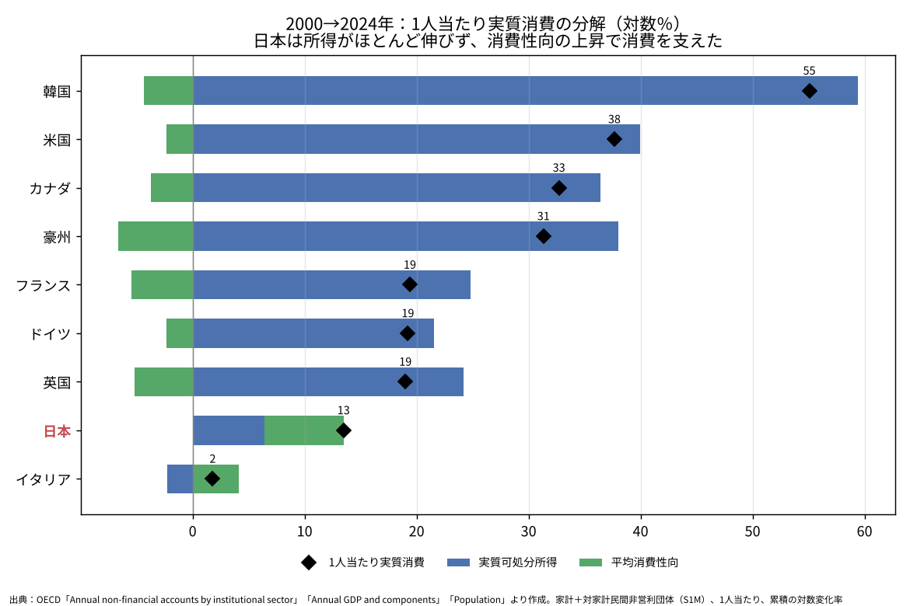
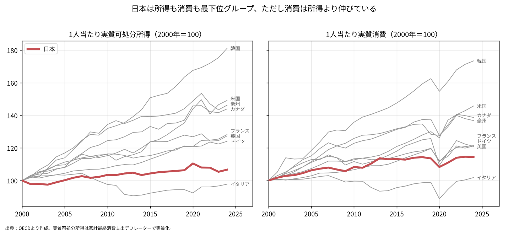
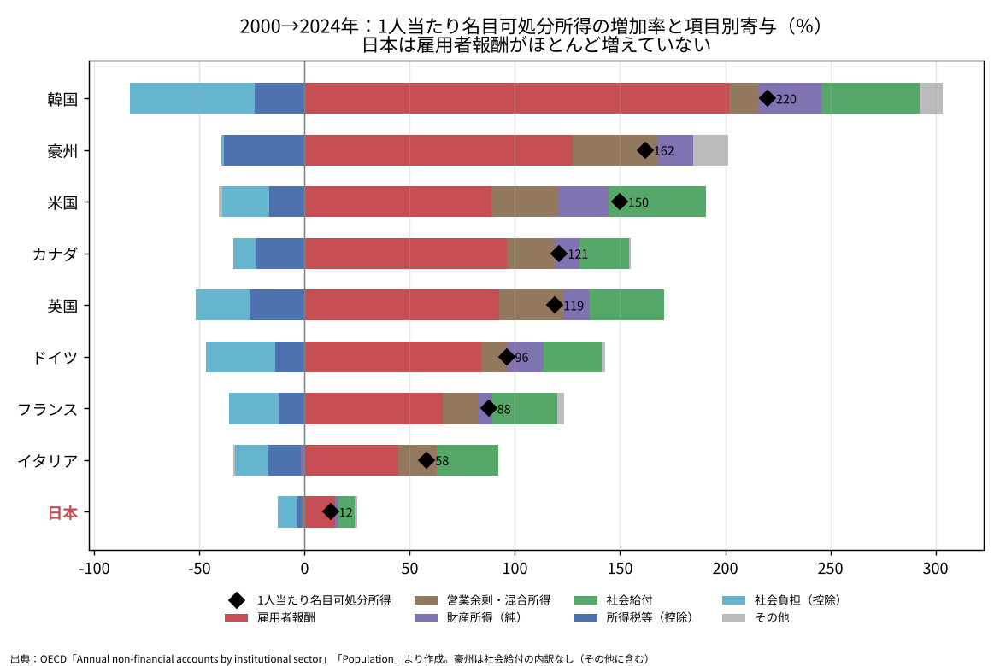
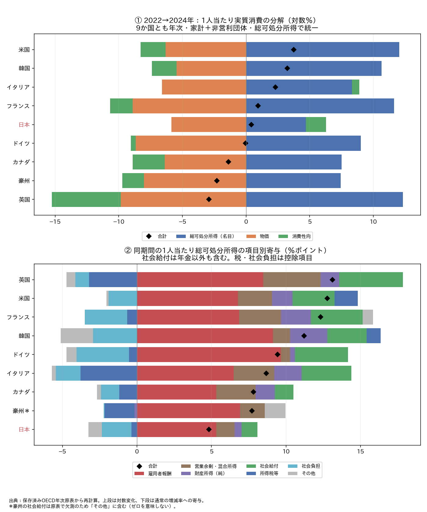
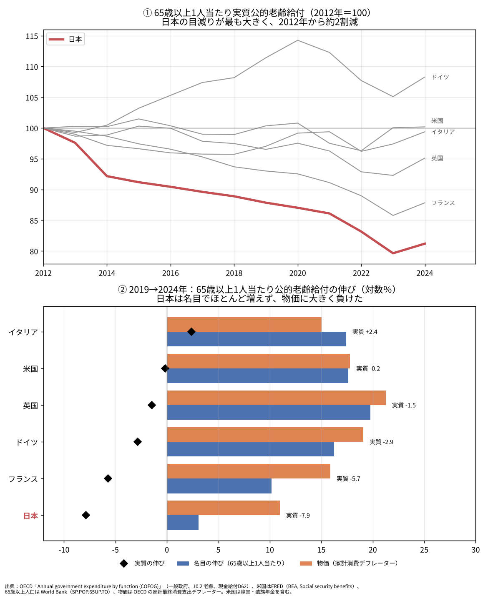
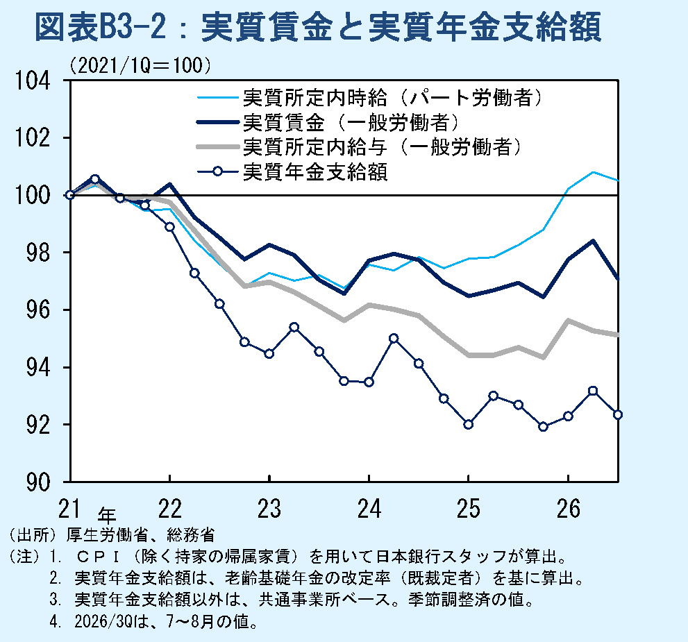
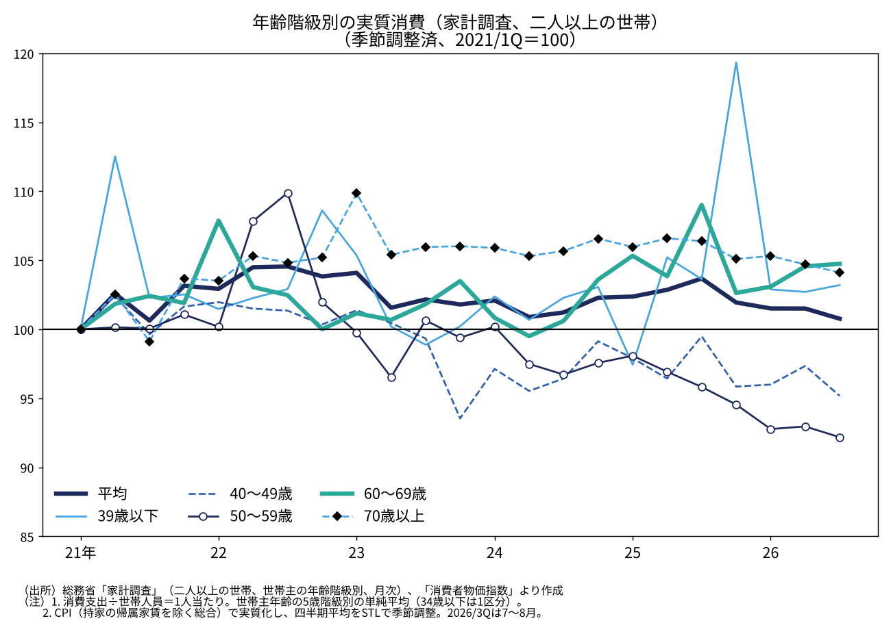

# 国際比較で見る日本の家計消費──所得の伸び悩みから、年金の購買力を考える

ウェブ版：[https://p72.github.io/note-draft/家計消費の伸び悩み/02\_国際比較で見る日本の家計消費.html](https://p72.github.io/note-draft/%E5%AE%B6%E8%A8%88%E6%B6%88%E8%B2%BB%E3%81%AE%E4%BC%B8%E3%81%B3%E6%82%A9%E3%81%BF/02_%E5%9B%BD%E9%9A%9B%E6%AF%94%E8%BC%83%E3%81%A7%E8%A6%8B%E3%82%8B%E6%97%A5%E6%9C%AC%E3%81%AE%E5%AE%B6%E8%A8%88%E6%B6%88%E8%B2%BB.html)

GitHub：[https://github.com/p72/note-draft/blob/main/家計消費の伸び悩み/02\_国際比較で見る日本の家計消費.md](https://github.com/p72/note-draft/blob/main/%E5%AE%B6%E8%A8%88%E6%B6%88%E8%B2%BB%E3%81%AE%E4%BC%B8%E3%81%B3%E6%82%A9%E3%81%BF/02_%E5%9B%BD%E9%9A%9B%E6%AF%94%E8%BC%83%E3%81%A7%E8%A6%8B%E3%82%8B%E6%97%A5%E6%9C%AC%E3%81%AE%E5%AE%B6%E8%A8%88%E6%B6%88%E8%B2%BB.md)

※ この記事は、OECDの国民経済計算（制度部門別勘定、支出側GDP、人口、政府の機能別支出）、World Bankの65歳以上人口、FREDの米国社会保障給付、総務省の家計調査・消費者物価指数（e-Stat API）を用い、Pythonで作図・計算している。制度の確認には厚生労働省の年金額改定資料を用い、日本銀行の展望レポート（2026年10月）の図を出所を明記して引用した。2026年10月26日にGPTの査読を受けて、所得の定義の統一と年金指標の読み方を修正した。指摘と対応は [査読メモ](review_02_2026-10-26.md)、再計算の手順は [code/intl/README.md](code/intl/README.md) にある。数値の詳細と方法上の留保は末尾の付録にまとめた。

## はじめに

前回の「[家計消費はなぜ伸びないのか](01_家計消費はなぜ伸びないのか.md)」では、若い勤労世帯の平均で、消費性向の低下と預貯金の積み増しが並んでいることを確かめた。しかし家計全体について見ると、期間によって答えが変わり、結論ははっきりしなかった。

国内のデータだけでは、何が「普通」で何が「異常」なのか判断しにくい。そこで本稿では、同じ分解をG7と韓国・豪州の9か国に当てはめ、日本の位置を確かめる。

見えてくるのは二つのことである。一つは、日本では長いあいだ家計の実質所得の伸びが他国より小さく、それを消費に回す割合の上昇で補ってきたこと。もう一つは、近年の物価上昇の中で、所得を支えるはずの社会給付の伸びも小さく、とりわけ高齢者が受け取る年金の購買力が他国以上に目減りしていることである。年金の目減りは、日本銀行が示した受給者1人当たりの実質年金でも確かめられる。ただし、それが高齢者の消費をどれだけ押し下げているかは、見るデータによって答えが変わる。

## 分析の枠組み

前回と同じく、1人当たり実質消費の伸びを三つに分ける。

> 1人当たり実質消費の伸び ＝ 1人当たり名目可処分所得の伸び － 消費デフレーターの上昇率 ＋ 平均消費性向の変化

最初の二つを合わせたものが、1人当たり実質可処分所得の伸びである。この式は会計上の恒等式であり、形を描き分けることはできるが、原因までは教えてくれない。

国際比較では、9か国とも同じ定義（家計と対家計民間非営利団体を合わせた部門、固定資本減耗を差し引く前の総可処分所得、暦年）にそろえた。人口の増減の影響を除くため、すべて1人当たりで比べる。

## 長期で見ると、日本では所得の伸びが小さい

図1は、2000年から2024年までの1人当たり実質消費の伸びを、実質可処分所得（青）と消費性向（緑）に分けたものである。

日本の1人当たり実質消費の伸びは、9か国の中でイタリアに次いで低い。ほとんどの国では、所得が大きく伸び、消費性向はむしろ下がっている。所得の一部を貯蓄に回しながらも、消費は所得とともに増えてきた。

日本では、実質可処分所得の伸びが小さく、消費性向が上がることで消費を伸ばしてきた。日本の家計は「使わない」のではなく、所得の伸びが小さい中で、使う割合を高めてきたのである。これは家計全体の平均の話であり、前回見た若い勤労世帯の消費性向の低下とは、対象も期間も異なる。

*図1　出典：OECDの制度部門別勘定・支出側国民経済計算・人口。家計＋非営利団体、総可処分所得。*

図2は同じ期間の推移である。日本は所得も消費も伸びの低いグループにあり、他国との差は年を追って広がってきた。ただし、これは2000年を基準にした伸びの比較であり、生活水準の高さの順位ではない。

*図2　出典：OECD。実質可処分所得は各国の家計最終消費支出デフレーターで実質化。*

## 長期の所得の伸び悩みには、雇用者報酬の伸びの小ささがある

図3は、同じ期間の1人当たり名目可処分所得の増加を、項目別に分けたものである。他国では可処分所得の伸びの大半を雇用者報酬の増加が担っているが、日本ではその寄与が小さい。

ここでの雇用者報酬は、人口1人当たりの総額である。働く人の時間当たりの賃金だけでなく、雇用者数や労働時間、雇い主が負担する社会保険料なども含まれる。長く賃金が伸びなかったことと整合的ではあるが、原因をこの図だけで確定することはできない。

なお、この期間の日本は物価の上昇も小さかった。名目所得は物価を上回って伸び、実質所得もわずかながら増えている。問題は、その増え方が他国に比べて小さいことである。

*図3　出典：OECD。寄与は開始年の総可処分所得に対する変化額の比率。雇主の社会負担は雇用者報酬と社会負担の両側に含まれる。*

## 2020年代：物価高の中で、社会給付の押し上げが小さい

図4は、物価が大きく上がった2022年から2024年までを、同じ定義で比べたものである。

上段を見ると、この期間の日本の1人当たり実質消費は9か国の中ほどにある。ただし支え方は他国と違う。多くの国が消費性向を下げる中で、日本は実質所得が減り、消費性向を上げることで消費をつないでいる。名目所得の伸びは9か国で最も小さかった。

下段の名目所得の内訳を見ると、日本は雇用者報酬の寄与も多くの国より小さく、賃金の問題が解消したとは言えない。そのうえで目を引くのが社会給付である。英国・ドイツ・フランス・米国では、社会給付の増加が所得を大きく押し上げたが、日本ではその寄与が小さい。

社会給付には、年金のほか失業給付や家族関連の給付なども含まれる。そのうち何割が年金によるものかは、この統計だけでは分けられない。そこで次に、年金そのものに焦点を当てる。

*図4　出典：OECD年次原表。上段は対数％、下段は通常の増加率への寄与（％ポイント）。全9か国で同じ期間・総所得・部門を使用。*

## 年金の購買力は、日本で大きく低下している

図5は、政府の機能別支出のうち「老齢」向けの現金給付の総額を65歳以上人口で割り、物価で実質化した指標である。この指標は、受給者1人当たりの年金額そのものではない。65歳以上人口は受給者数と一致せず、給付には65歳未満への支給なども含まれうるからである。

比べた日本・フランス・ドイツ・英国・イタリアの5か国の中で、2019年から2024年までのこの指標の低下は、日本が最も大きかった。他国の給付は名目で大きく伸びたが、日本の伸びは小さく、物価の上昇に追いつかなかった。英国やイタリアでは、2022年以降の給付の伸びが物価を上回っている。

図5の下段は、日本の指標の変化を「給付総額」「65歳以上人口」「物価」に分けたものである。2010年代の低下は、主に65歳以上人口が増えたことによる。支給開始年齢の引き上げなども重なっており、この時期の低下をすべて年金額の抑制とみなすことはできない。これに対して2019年以降の低下は、主に物価の上昇による。人口の伸びは小さくなったが、給付の伸びが物価に追いつかなかった。なお、日本の指標は2024年には前年より上がったが、以前の水準は回復していない。

*図5　出典：OECD COFOG、World Bank、OECD家計消費デフレーター。米国はFREDの社会保障給付による参考系列。下段は日本の給付総額・人口・物価の分解。*

## 年金改定のルールからも、同じことが確かめられる

国際比較の指標は人口の分母に左右されるため、日本の年金額の改定そのものも確かめておく。

日本の年金額は毎年度、前年の物価と賃金の伸びをもとに改定され、さらにマクロ経済スライドによる調整が加わる。物価が賃金より速く上がる局面では賃金の伸びが基準になり、そこからさらに調整が差し引かれる。厚生労働省の資料によれば、2023年度・2024年度とも、年金額の改定率は前年の物価上昇率を下回った。

物価が上がっても、その上昇分がそのまま年金額に反映される仕組みにはなっていない。国際比較で見た日本の年金の購買力の低下は、この制度の性格とも整合的である。

## 日本銀行の分析：受給者1人当たりで見ても、年金の購買力は下がっている

図5の指標は給付の総額を65歳以上人口で割ったもので、受給者1人当たりの年金額ではない、という限界があった。これを補うのが、日本銀行が2026年11月に公表した展望レポート（経済・物価情勢の展望、2026年10月）のBOX3「物価上昇のもとでの個人消費」である。

日本銀行は、老齢基礎年金の改定率（すでに年金を受け取っている人の分）を物価で実質化し、パート労働者や一般労働者の実質賃金と並べている（図6）。2021年初めと比べて、パート労働者の時給は物価の上昇にほぼ追いつき、一般労働者の賃金も賞与を含めればおおむね横ばいである。これに対して、実質の年金支給額だけがはっきりと水準を下げている。日本銀行は次のように書いている。

> 実質ベースでみた年金支給額は、マクロ経済スライドなどの給付抑制の仕組みに沿って、ここ数年大きく水準を切り下げている。
>
> （日本銀行「経済・物価情勢の展望（2026年10月）」BOX3、48ページ）

受給者1人当たりの年金で見ても、物価に対する購買力は下がっている。本稿の国際比較で見た年金の購買力の低下は、日本銀行の分析とも整合的である。

*図6　出所：日本銀行「経済・物価情勢の展望（2026年10月）」（全文、2026年11月2日公表）BOX3・図表B3-2（48ページ）より引用。PDFから図の部分を切り出したもので、内容は加工していない。原典：[https://www.boj.or.jp/mopo/outlook/gor2610b.pdf](https://www.boj.or.jp/mopo/outlook/gor2610b.pdf)*

## 年金の目減りは、高齢者の消費を押し下げているか

日本銀行はさらに、高齢者・年金生活者の間で物価上昇への警戒感から生活防衛意識が強まり、スーパーやコンビニの売上数量を押し下げていると指摘している。根拠の一つは、カード支出データ（JCB消費NOW）による年齢階級別の実質消費で、2021年初めと比べて60歳代と70歳以上が減少する一方、39歳以下は大きく増えている（日本銀行の図表B3-3）。

同じ図を、総務省の家計調査（二人以上の世帯、世帯主の年齢階級別）で作り直したのが図7である。描き方は日本銀行にそろえ、1人当たりの消費支出を物価で実質化した。

結果は日本銀行の図とかなり違う。家計調査では、70歳以上と60歳代の実質消費は2021年初めの水準を上回ったままで、高齢者の消費の弱さははっきりしない。落ち込みが目立つのは50歳代で、40歳代がそれに続く。日本銀行も、賃金カーブのフラット化で賃上げ率が低めの50歳代を、消費の弱い層に挙げている。39歳以下の大きな増加も、家計調査では見られない。

違いの理由として、データの性格の違いが考えられる。カード支出データは、キャッシュレス化の進み具合によって年齢層ごとの伸びが変わりうる。家計調査の二人以上の世帯は単身世帯を含まず、年金への依存が大きいと考えられる高齢の単身世帯が抜け落ちる。また、家計調査の年齢別の数字は標本が小さく、四半期ごとの振れも大きい。なお日本銀行は、高齢者の支出構成に合わせた物価（食料品のウエイトが高い）で実質化すれば、高齢者の実質消費の弱さは一段と明確になるとしている。図7は、日本銀行の図表B3-3と同じく共通の物価で実質化している。

したがって、受給者1人当たりの年金の購買力が下がっていることは確かだが、それが高齢者の消費をどれだけ押し下げているかは、どのデータで見るかによって答えが変わる。少なくとも家計調査の二人以上の世帯では、消費の弱さはむしろ50歳代を中心とする現役世代に表れている。

*図7　出典：総務省「家計調査」（二人以上の世帯、世帯主の年齢階級別、月次）、「消費者物価指数」より作成。日本銀行の図表B3-3（JCB/ナウキャスト「JCB消費NOW」ベース）の作り方にそろえて再現した。*

## 結論

1. 2000年以降、日本の家計の実質所得の伸びは他国より小さく、消費に回す割合を高めることで消費を支えてきた。所得の伸び悩みには、雇用者報酬の伸びの小ささがある。
2. 物価が上がった2022年以降も、日本の実質所得は減り、社会給付による所得の押し上げは他国より小さかった。
3. 高齢者向けの現金給付を65歳以上人口当たりで見ると、2019年以降の購買力の低下は、比べた国の中で日本が最も大きい。日本の年金改定のルールも、物価の上昇分がそのまま年金に反映されない仕組みである。日本銀行の分析によれば、受給者1人当たりで見ても、年金の購買力は2021年以降はっきり下がっている。
4. ただし、それが高齢者の消費を押し下げているかは、データによって見え方が違う。カード支出データでは高齢者の消費が弱いが、家計調査の二人以上の世帯では、弱さはむしろ50歳代を中心とする現役世代に表れている。

前回の記事で見た現役世帯の慎重な支出に加えて、年金を受け取る側の購買力も、日本の家計消費を考えるうえで欠かせない論点である。

ただし、本稿は年金がどれだけ消費を押し下げたか、給付を増やせばどれだけ消費が増えるかを推定したものではない。年金を物価並みに引き上げるには財源が必要であり、その負担が現役世代の所得や将来への不安にどう響くかも合わせて考える必要がある。次に必要なのは、年金収入の変化を受給者数や制度改定に分け、受給世帯の消費とつなぐ分析である。

## 付録A　主な数値

1人当たり実質消費の分解（累積の対数％）。四捨五入のため、表内の足し算が0.1ずれる場合がある。

| 国 | 期間 | 実質消費 | 実質可処分所得 | 消費性向 | 名目総可処分所得 | 物価 |
| --- | --- | ---: | ---: | ---: | ---: | ---: |
| 日本 | 2000→2024 | +13.5 | +6.4 | +7.0 | +11.6 | +5.2 |
| 米国 | 2000→2024 | +37.7 | +40.0 | −2.3 | +91.6 | +51.6 |
| 英国 | 2000→2024 | +19.0 | +24.2 | −5.2 | +78.4 | +54.2 |
| ドイツ | 2000→2024 | +19.2 | +21.6 | −2.3 | +67.3 | +45.7 |
| フランス | 2000→2024 | +19.4 | +24.8 | −5.4 | +62.9 | +38.0 |
| イタリア | 2000→2024 | +1.8 | −2.3 | +4.1 | +45.8 | +48.1 |
| カナダ | 2000→2024 | +32.7 | +36.4 | −3.7 | +79.4 | +42.9 |
| 韓国 | 2000→2024 | +55.1 | +59.4 | −4.3 | +116.4 | +57.0 |
| 豪州 | 2000→2024 | +31.3 | +38.0 | −6.7 | +96.3 | +58.3 |
| 日本 | 2022→2024 | +0.4 | −1.2 | +1.6 | +4.7 | +5.9 |
| 米国 | 2022→2024 | +3.7 | +5.7 | −2.0 | +12.0 | +6.3 |
| 英国 | 2022→2024 | −2.9 | +2.5 | −5.4 | +12.3 | +9.8 |
| ドイツ | 2022→2024 | −0.0 | +0.4 | −0.4 | +9.0 | +8.7 |
| フランス | 2022→2024 | +0.9 | +2.7 | −1.8 | +11.6 | +8.9 |
| イタリア | 2022→2024 | +2.3 | +1.7 | +0.6 | +8.3 | +6.6 |
| カナダ | 2022→2024 | −1.4 | +1.1 | −2.5 | +7.5 | +6.4 |
| 韓国 | 2022→2024 | +3.2 | +5.2 | −1.9 | +10.6 | +5.5 |
| 豪州 | 2022→2024 | −2.3 | −0.6 | −1.7 | +7.4 | +8.0 |

老齢現金給付総額÷65歳以上人口の実質変化（累積の対数％）。米国は範囲が異なる参考値。

| 期間 | 日本 | フランス | ドイツ | 英国 | イタリア | 米国（参考） |
| --- | ---: | ---: | ---: | ---: | ---: | ---: |
| 2012→2019 | −12.9 | −7.3 | +10.8 | −3.5 | −3.0 | +0.3 |
| 2019→2024 | −7.9 | −5.7 | −2.9 | −1.5 | +2.4 | −0.2 |
| 2022→2024 | −2.4 | −1.3 | +0.5 | +2.4 | +3.3 | +3.9 |

日本の老齢給付指標の分解（累積の対数％）。

| 期間 | 名目給付総額 | 65歳以上人口（控除） | 物価（控除） | 実質・65歳以上人口当たり |
| --- | ---: | ---: | ---: | ---: |
| 2012→2019 | +5.9 | −14.7 | −4.2 | −12.9 |
| 2019→2024 | +4.9 | −1.8 | −11.0 | −7.9 |

日本の年金額改定（厚生労働省資料）。

| 改定年度 | 前年の物価変動率 | 名目手取り賃金変動率 | スライド調整等 | 年金額改定率 |
| --- | ---: | ---: | ---: | ---: |
| 2023年度 | +2.5％ | +2.8％ | 当年−0.3％、過年度未調整分−0.3％ | 67歳以下+2.2％、68歳以上+1.9％ |
| 2024年度 | +3.2％ | +3.1％ | −0.4％ | +2.7％ |

2023年度は賃金が物価を上回ったため、67歳以下は賃金、68歳以上は物価を基準にした。2024年度は物価が賃金を上回ったため賃金を基準にした。いつでも単純に「賃金と物価の低い方」を使うわけではない。

その他の主な数値は次のとおりである。

- 2022→2024年の1人当たり名目総可処分所得の増加率に対する寄与（％ポイント）は、日本が雇用者報酬+5.3、社会給付+1.1。社会給付の寄与は英国+4.3、ドイツ+3.6、フランス+3.5、米国+2.8、カナダ+1.2。豪州は社会給付が欠測。
- 日本の老齢給付指標は、2024年に前年比約+2.0％となった。
- 家計の総貯蓄率は、日本で2000年の約16.0％から2024年の約9.5％へ低下した。総貯蓄率の分母は総可処分所得＋年金受給権の変動調整で、平均消費性向の単純な裏返しではない。
- 全9か国の分解・寄与は `code/intl/review_annual_decomp.csv`・`review_annual_income.csv`、年金指標は `review_pension.csv`・`review_pension_index.csv` にある。

## 付録B　方法と留保

- 年次データはOECDの `DSD_NASEC10@DF_TABLE14`、`DSD_NAMAIN10@DF_TABLE1_EXPENDITURE`、`DSD_NAMAIN10@DF_TABLE3_POP_EMPNC`。家計＋対家計民間非営利団体（S1M）、総可処分所得（B6G）、最終消費支出（P3）に統一した。「総」は固定資本減耗を差し引く前という意味で、給与明細の手取りとは異なる。
- 物価は各国の家計最終消費支出の名目値÷連鎖実質値によるデフレーターで、CPIや高齢者向けの物価指数ではない。
- 項目別寄与は、各項目の1人当たり変化額÷開始年の1人当たり総可処分所得。欠測はゼロとせず「その他」に含め、欠測項目名をCSVに残した。
- 初版の2020年代比較（2022年平均→直近4四半期）は、日本が内閣府の純可処分所得（家計部門）、他国がOECDの総可処分所得（S1M）で定義が異なっていたため、本文から外した。作業記録として `decomp_recent_q.csv`・`income_recent_q.csv` を残している。内閣府の家計可処分所得は純ベースで定義されている。
- 年金指標は、一般政府のCOFOG「老齢」（10.2）向け現金社会給付（D62）を、World Bankの65歳以上人口（SP.POP.65UP.TO）で割り、家計消費デフレーターで実質化した。老齢向け給付には早期退職給付や一時金なども含まれうる。介護などの現物給付や民間年金は含まない。受給者数・受給開始年齢・制度の範囲は国によって異なる。
- 米国はFREDの社会保障給付（障害・遺族年金を含む）による参考値。豪州は同じコードの原値があるが、給付内訳の比較可能性を確認できていないため主比較から外した。カナダ・韓国は当該内訳が取得データにない。
- 年金改定は前年のCPIを用いた年度単位の計算で、図5の暦年・消費デフレーターによる実質化とは別の計算である。改定表の差だけで実際の購買力の低下率を求めることはできない。図5の比較は2024年までで、2025年度以降の改定は含まない。
- 本稿の国際比較の数値は、2026年10月26日に取得した保存CSVからの再計算による。OECD・World Bankの全系列の再取得・照合は行っていない。
- 図6は日本銀行の展望レポート全文PDFから図表B3-2の部分を切り出したもので、内容は加工していない（手順は `code/box3/crop_boj.py`）。日本銀行のサイトは、出所を明記した転載・複製を原則として認める一方、画像データなどは事前相談の対象としている。本稿では、論旨を補う資料として出所を明記したうえで引用した。
- 図7は、e-Stat APIで取得した家計調査（月次、二人以上の世帯、世帯主の年齢階級別）の消費支出÷世帯人員を、CPI（持家の帰属家賃を除く総合）で実質化した。年齢グループは世帯主年齢5歳階級（34歳以下は1区分）の単純平均で、四半期平均をSTLで季節調整し、2021年1〜3月期＝100とした。2026年7〜9月期は7〜8月の平均。データ取得日は2026年11月3日（`code/box3/`）。

出典：

- OECD Data Explorer：[https://data-explorer.oecd.org/](https://data-explorer.oecd.org/)
- OECD SDMX REST API：[https://sdmx.oecd.org/public/rest/](https://sdmx.oecd.org/public/rest/)
- World Bank「Population ages 65 and above, total」：[https://data.worldbank.org/indicator/SP.POP.65UP.TO](https://data.worldbank.org/indicator/SP.POP.65UP.TO)
- FRED「Government social benefits to persons: Social security」：[https://fred.stlouisfed.org/series/W823RC1A027NBEA](https://fred.stlouisfed.org/series/W823RC1A027NBEA)
- 内閣府「家計可処分所得・家計貯蓄率四半期別速報」：[https://www.esri.cao.go.jp/jp/sna/sonota/kakei/kakei\_top.html](https://www.esri.cao.go.jp/jp/sna/sonota/kakei/kakei_top.html)
- 内閣府「分配系列の推計方法」：[https://www.esri.cao.go.jp/jp/sna/seibi/kenkyu/pdf/shiryo2\_20140704.pdf](https://www.esri.cao.go.jp/jp/sna/seibi/kenkyu/pdf/shiryo2_20140704.pdf)
- 国連「COFOG 10.2 老齢」：[https://unstats.un.org/unsd/classifications/Econ/Structure/Detail/EN/4/10\_2\_0](https://unstats.un.org/unsd/classifications/Econ/Structure/Detail/EN/4/10_2_0)
- 厚生労働省「2023年度の年金額改定」：[https://www.mhlw.go.jp/content/12600000/001076695.pdf](https://www.mhlw.go.jp/content/12600000/001076695.pdf)
- 厚生労働省「2024年度の年金額改定」：[https://www.mhlw.go.jp/content/12502000/001040881.pdf](https://www.mhlw.go.jp/content/12502000/001040881.pdf)
- 日本銀行「経済・物価情勢の展望（2026年10月）」全文：[https://www.boj.or.jp/mopo/outlook/gor2610b.pdf](https://www.boj.or.jp/mopo/outlook/gor2610b.pdf)
- 日本銀行「著作権について」：[https://www.boj.or.jp/about/copyright.htm](https://www.boj.or.jp/about/copyright.htm)
- 総務省「家計調査」：[https://www.stat.go.jp/data/kakei/index.html](https://www.stat.go.jp/data/kakei/index.html)
