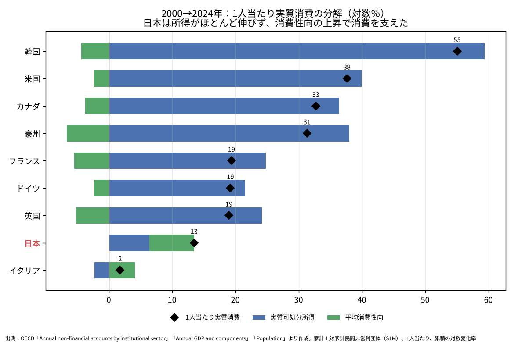
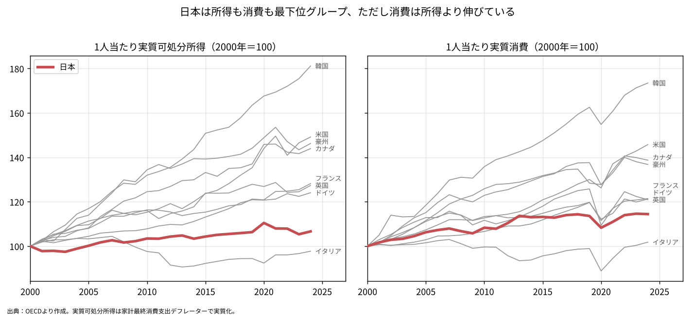
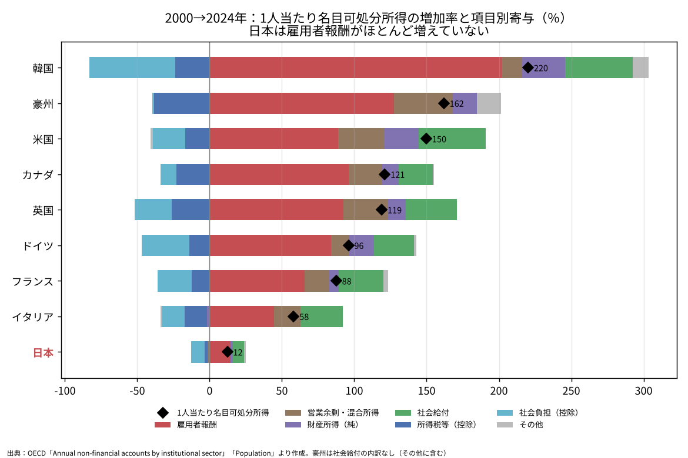
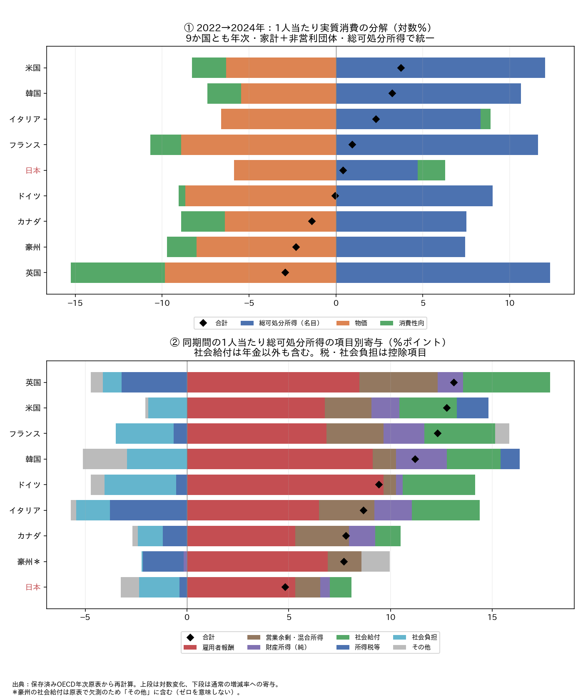
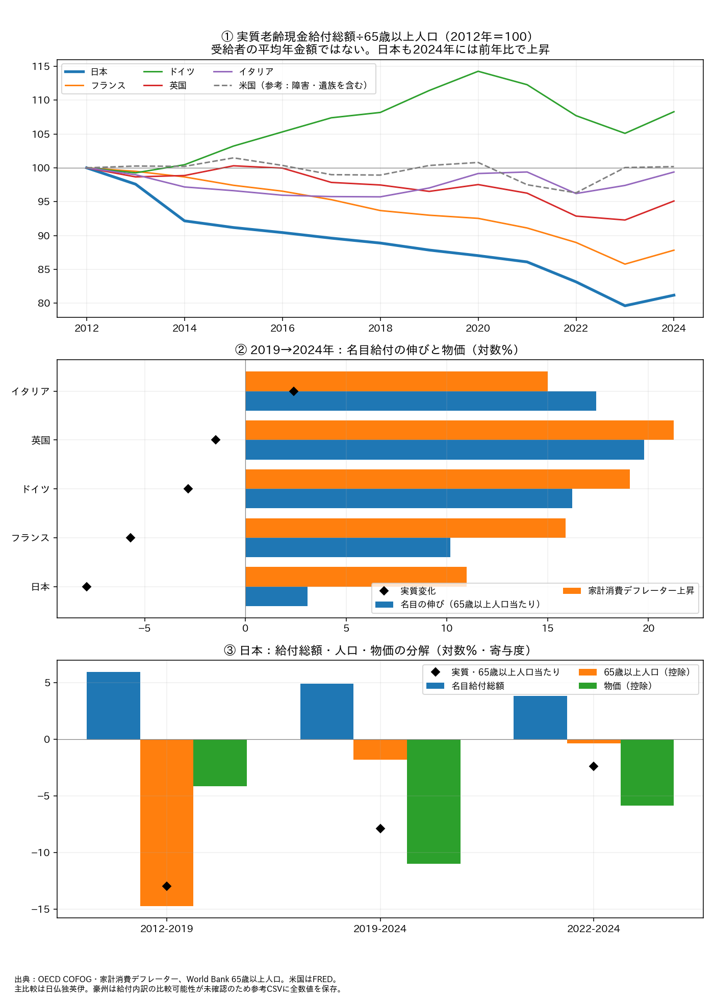

# 国際比較で見る日本の家計消費──所得の伸び悩みから、年金の購買力を考える

ウェブ版：[https://p72.github.io/note-draft/家計消費の伸び悩み/02\_国際比較で見る日本の家計消費.html](https://p72.github.io/note-draft/%E5%AE%B6%E8%A8%88%E6%B6%88%E8%B2%BB%E3%81%AE%E4%BC%B8%E3%81%B3%E6%82%A9%E3%81%BF/02_%E5%9B%BD%E9%9A%9B%E6%AF%94%E8%BC%83%E3%81%A7%E8%A6%8B%E3%82%8B%E6%97%A5%E6%9C%AC%E3%81%AE%E5%AE%B6%E8%A8%88%E6%B6%88%E8%B2%BB.html)

GitHub：[https://github.com/p72/note-draft/blob/main/家計消費の伸び悩み/02\_国際比較で見る日本の家計消費.md](https://github.com/p72/note-draft/blob/main/%E5%AE%B6%E8%A8%88%E6%B6%88%E8%B2%BB%E3%81%AE%E4%BC%B8%E3%81%B3%E6%82%A9%E3%81%BF/02_%E5%9B%BD%E9%9A%9B%E6%AF%94%E8%BC%83%E3%81%A7%E8%A6%8B%E3%82%8B%E6%97%A5%E6%9C%AC%E3%81%AE%E5%AE%B6%E8%A8%88%E6%B6%88%E8%B2%BB.md)

※ OECDの制度部門別勘定・消費支出・人口・政府機能別支出、World Bankの65歳以上人口、FREDの米国社会保障給付を用いた。制度の確認には厚生労働省の年金額改定資料を用いる。保存データからの再計算手順は [code/intl/README.md](code/intl/README.md)、査読記録は [review_02_2026-10-26.md](review_02_2026-10-26.md) にある。

## はじめに

前回の「[家計消費はなぜ伸びないのか](01_家計消費はなぜ伸びないのか.md)」では、若い勤労者世帯の年齢別平均で、消費性向の低下と預貯金純増率の上昇が見られることを確認した。本稿はその結果を踏まえ、家計全体の所得を国際比較し、最後に年金の購買力に焦点を当てる。

G7と韓国・豪州の9か国を比べると、日本では長期の実質可処分所得の伸びが小さい。最近の社会給付の増加による所得の押し上げも小さく、その内側を調べる対象として年金が重要になる。ただし、社会給付全体の弱さのうち何割が年金によるものかは、今回の統計だけでは分離していない。

年金に関する結論は、二つの異なる証拠から組み立てる。一つは**老齢向け現金給付総額を65歳以上人口で割った購買力の指標**、もう一つは**日本の年金額の改定ルールと実際の改定率**である。前者は国際比較、後者は制度の確認に用い、受給者の平均年金額と混同しない。

## 分析の枠組み

前稿と同じく、消費の変化を所得・物価・消費性向に分ける。

> 1人当たり実質消費の伸び ＝ 1人当たり名目可処分所得の伸び − 消費デフレーターの上昇率 ＋ 平均消費性向の変化

各項は対数変化率で、最初の二つを合わせたものが1人当たり実質可処分所得の伸びである。恒等式として整合するが、消費や所得を動かした原因を識別する式ではない。

国際比較の本文・図1〜4では、9か国とも**家計＋対家計民間非営利団体（S1M）、総可処分所得（B6G）、暦年**に統一した。「総」は固定資本減耗を控除する前という意味で、給与明細の手取りとは異なる。所得・消費・雇用者報酬は総人口当たり、年金の図は65歳以上人口当たりである。総貯蓄率と前稿の純貯蓄率も区別する。

## 長期で見ると、日本では所得の伸びが小さい

図1は、2000年から2024年までの1人当たり実質消費の伸びを、実質可処分所得（青）と消費性向（緑）に分けたものである。

日本の1人当たり実質消費の伸びは、9か国の中でイタリアに次いで低い。実質可処分所得は+6.4対数％にとどまり、消費性向の上昇+7.0対数％が加わって、実質消費は+13.5対数％増えた。所得の弱さを消費性向の上昇が補う姿である。なお、消費性向が上がったのは日本だけではなく、イタリアも同様である。

これは家計全体の平均であり、前稿で確認した若年の勤労者世帯の消費性向低下と矛盾しない。集計範囲と期間が異なるからである。

*図1　出典：OECDの制度部門別勘定・支出側国民経済計算・人口。家計＋非営利団体、総可処分所得。*

図2は同じ期間の推移である。日本は所得も消費も伸びの低いグループに位置する。ただし、これは2000年を100とする成長の比較であり、購買力平価で換算した所得・生活水準の順位ではない。

*図2　出典：OECD。実質可処分所得は各国の家計最終消費支出デフレーターで実質化。*

## 長期の所得分解では、雇用者報酬の寄与が小さい

図3は、2000〜2024年の1人当たり名目総可処分所得の増加率を、項目別に分けたものである。日本では、他国に比べて雇用者報酬の増加寄与が小さい。

ただし、ここでの雇用者報酬は**総人口当たりの総額**であり、働く人の時間当たり賃金ではない。賃金水準に加え、雇用者数、労働時間、雇用構成、雇主の社会負担も影響する。長期の賃金の弱さと整合的ではあるが、その原因までこの図で確定することはできない。

また、日本の2000〜2024年の名目可処分所得は+11.6対数％、物価は+5.2対数％だった。したがって、この期間は名目所得が物価を上回り、実質所得も増えている。問題は、実質所得の**増加幅が他国に比べて小さい**ことである。

*図3　出典：OECD。寄与は開始年の総可処分所得に対する変化額の比率。雇主社会負担は雇用者報酬と社会負担の両側に含まれる。*

## 2020年代：同じ期間・所得定義でも、社会給付の寄与は小さい

年金との比較期間もそろえるため、図4は2022年から2024年までの年次データで比較する。元の四半期比較は日本が純可処分所得、他国が総可処分所得であり、国によって終点も異なっていた。本文の比較は同一定義・同一期間に統一した。直近四半期の試算は付録Bで参考資料として位置づける。

日本の1人当たり実質消費は+0.40対数％で、9か国中5番目だった。名目総可処分所得は+4.71対数％、物価は+5.87対数％で、実質所得は−1.16対数％。消費性向の上昇+1.57対数％がこれを補っている。この期間の名目所得の伸びは、9か国の中で最も小さい。

下段の項目別寄与では、日本の雇用者報酬は+5.32ポイント、社会給付は+1.06ポイントだった。社会給付の寄与は英国+4.28、ドイツ+3.56、フランス+3.49、米国+2.83ポイントより小さい。カナダは+1.24ポイントで日本に近い。豪州の社会給付は保存年次原表で欠測のため比較しない。

雇用者報酬の寄与も、同じ期間では日本が多くの国を下回っている。「賃金の問題は解消した」とは言えない。そのうえで本稿では、前稿の若い世帯の支出行動に続く論点として、**給付を受け取る高齢者側の購買力**を掘り下げる。

社会給付D62には、年金に加えて失業給付・家族関連給付なども含まれる。図4の社会給付と、次の図5の一般政府の老齢向け給付は範囲が一致しないため、両者をそのまま同じ系列としてつなぐことはできない。

*図4　出典：OECD年次原表。上段は対数％、下段は通常の増加率への寄与（％ポイント）。全9か国で同じ期間・総所得・部門を使用。*

## 老齢給付の購買力は、日本で大きく低下している

図5は、OECDの政府機能別支出（COFOG）の「老齢」向け現金給付を、65歳以上人口で割り、家計消費デフレーターで実質化した指標である。

老齢向け現金給付には、老齢年金のほか、早期退職に伴う給付や一時金なども含まれうる。また、65歳以上人口は年金受給者数ではなく、給付の分子には65歳未満への支給も含まれうる。そのため、**この指標の低下率を、同じ受給者の年金の減額率とは読めない**。[国連のCOFOG分類](https://unstats.un.org/unsd/classifications/Econ/Structure/Detail/EN/4/10_2_0)にもとづく区別である。

主比較の日・仏・独・英・伊の5か国では、2019〜2024年の指標の低下は日本が最も大きく、−7.9対数％だった。米国は障害・遺族を含む社会保障給付で範囲が異なるため、破線の参考系列とする。豪州も原データを捨てず参考表に残すが、給付内訳の比較可能性を確認できていないため、主比較には含めない。

日本の低下を分解すると、2019〜2024年は名目給付総額+4.92対数％に対し、65歳以上人口+1.82対数％、物価+10.98対数％となる。この期間は人口増加よりも物価上昇の影響が大きく、人口当たりの名目給付の伸びが購買力を維持するには足りなかった。

一方、2012〜2019年は名目給付総額+5.95対数％に対し、65歳以上人口が+14.74対数％増えており、人口分母の変化が大きい。支給開始年齢や受給者構成などを分けずに、この低下をすべて年金改定の抑制効果と解釈することはできない。

また、「2012年から毎年減り続けた」わけではない。日本の指標は2024年には前年比約+2.0％へ反転した。ただし2019年や2022年の水準は回復していない。

*図5　出典：OECD COFOG、World Bank、OECD家計消費デフレーター。米国はFREDの社会保障給付による参考系列。下段は日本の分子・分母・物価の分解。*

## 年金改定ルールからも、購買力の問題を確認する

人口分母に左右される国際比較を補うため、日本の年金額そのものの改定を確認する。厚生労働省の2023・2024年度の公表資料では、次のようになっている。

| 改定年度 | 改定に用いる前年の物価変動率 | 名目手取り賃金変動率 | スライド調整等 | 年金額改定率 |
| --- | ---: | ---: | ---: | ---: |
| 2023年度 | +2.5％ | +2.8％ | 当年−0.3％、過年度未調整分−0.3％ | 67歳以下+2.2％、68歳以上+1.9％ |
| 2024年度 | +3.2％ | +3.1％ | −0.4％ | +2.7％ |

出典：[厚生労働省・2023年度改定](https://www.mhlw.go.jp/content/12600000/001076695.pdf)、[2024年度改定](https://www.mhlw.go.jp/content/12502000/001040881.pdf)。

2023年度は賃金が物価を上回ったため、67歳以下は賃金、68歳以上は物価を基準にし、その後にスライド調整等を行った。2024年度は物価が賃金を上回ったため賃金を基準にし、さらにスライド調整を行った。単純にいつでも「賃金と物価の低い方」を使うわけではない。

両年度とも、年金額の改定率は参考指標となった前年物価の上昇率を下回った。ここから、**物価が上がっても、その上昇分が年金額にすべて反映される仕組みではない**ことを確認できる。ただし、前年のCPIを用いた年度改定と、図5の暦年・消費デフレーターによる実質化は別の計算である。この表の差だけで当年度の実現購買力の低下率を算出することはできない。

## 前回の記事との関係と結論

前稿の若い勤労者世帯の消費性向低下は、本稿でも出発点である。国際比較によってそれを否定するのではなく、家計全体には所得の弱さもあり、高齢者については年金の購買力が別の制約になりうることを加える。

1. 2000〜2024年の日本では、実質可処分所得の伸びが小さく、消費性向の上昇が消費を支えていた。所得分解では総人口当たり雇用者報酬の寄与が小さい。
2. 2022〜2024年を同一定義で比較しても、日本の実質総可処分所得は減少し、社会給付による名目所得の押し上げも小さい。
3. 年金に焦点を移すと、日本の老齢給付総額を65歳以上人口で割った実質指標は、主比較5か国で2019〜2024年の低下が最も大きい。日本の年金改定資料も、物価上昇分が年金額にすべて反映されないことを示している。

**若い世帯の支出行動に加え、年金を受け取る側の購買力も、家計消費を考えるうえで重要である。** ただし、今回の比較は年金による消費押し下げ額や、給付を増やした場合の消費増加額を推定したものではない。

次に必要なのは、年金収入の変化を受給者数・受給者構成・制度改定に分け、受給世帯の所得と消費につなぐ分析である。年金を物価並みに引き上げる政策を評価する際には、受給側の消費増だけでなく、財源を負担する側の所得・消費、将来への期待も合わせて考える必要がある。本稿の年金への焦点は、若年と高齢のどちらがより消費するかという政策順位を確定するものではない。

## 付録A　主な数値

1人当たり実質消費の分解。累積の対数％であり、通常の増減率とは異なる（通常の％は `100×(exp(対数％/100)−1)`）。四捨五入により表内の足し算が0.1ずれる場合がある。

| 国 | 期間 | 実質消費 | 実質可処分所得 | 消費性向 | 名目総可処分所得 | 物価 |
| --- | --- | ---: | ---: | ---: | ---: | ---: |
| 日本 | 2000→2024 | +13.5 | +6.4 | +7.0 | +11.6 | +5.2 |
| 米国 | 2000→2024 | +37.7 | +40.0 | -2.3 | +91.6 | +51.6 |
| 英国 | 2000→2024 | +19.0 | +24.2 | -5.2 | +78.4 | +54.2 |
| ドイツ | 2000→2024 | +19.2 | +21.6 | -2.3 | +67.3 | +45.7 |
| フランス | 2000→2024 | +19.4 | +24.8 | -5.4 | +62.9 | +38.0 |
| イタリア | 2000→2024 | +1.8 | -2.3 | +4.1 | +45.8 | +48.1 |
| カナダ | 2000→2024 | +32.7 | +36.4 | -3.7 | +79.4 | +42.9 |
| 韓国 | 2000→2024 | +55.1 | +59.4 | -4.3 | +116.4 | +57.0 |
| 豪州 | 2000→2024 | +31.3 | +38.0 | -6.7 | +96.3 | +58.3 |
| 日本 | 2022→2024 | +0.4 | -1.2 | +1.6 | +4.7 | +5.9 |
| 米国 | 2022→2024 | +3.7 | +5.7 | -2.0 | +12.0 | +6.3 |
| 英国 | 2022→2024 | -2.9 | +2.5 | -5.4 | +12.3 | +9.8 |
| ドイツ | 2022→2024 | -0.0 | +0.4 | -0.4 | +9.0 | +8.7 |
| フランス | 2022→2024 | +0.9 | +2.7 | -1.8 | +11.6 | +8.9 |
| イタリア | 2022→2024 | +2.3 | +1.7 | +0.6 | +8.3 | +6.6 |
| カナダ | 2022→2024 | -1.4 | +1.1 | -2.5 | +7.5 | +6.4 |
| 韓国 | 2022→2024 | +3.2 | +5.2 | -1.9 | +10.6 | +5.5 |
| 豪州 | 2022→2024 | -2.3 | -0.6 | -1.7 | +7.4 | +8.0 |

老齢現金給付総額÷65歳以上人口の実質変化（累積の対数％）。米国は範囲が異なる参考値。

| 期間 | 日本 | フランス | ドイツ | 英国 | イタリア | 米国（参考） |
| --- | ---: | ---: | ---: | ---: | ---: | ---: |
| 2012→2019 | -12.9 | -7.3 | +10.8 | -3.5 | -3.0 | +0.3 |
| 2019→2024 | -7.9 | -5.7 | -2.9 | -1.5 | +2.4 | -0.2 |
| 2022→2024 | -2.4 | -1.3 | +0.5 | +2.4 | +3.3 | +3.9 |

- 2000〜2024年の名目総可処分所得は、日本+11.6対数％（通常の増加率では約12％）。図3の項目別寄与は通常の増加率に対するポイントであり、対数％ではない。
- 家計の総貯蓄率は日本で2000年約16.0％から2024年約9.5％へ低下した。総貯蓄率の分母は総可処分所得＋年金受給権の変動調整で、平均消費性向の単純な裏返しではない。
- 全9か国の分解・寄与は `review_annual_decomp.csv`・`review_annual_income.csv`。年金指標は豪州・米国の参考値を含め `review_pension.csv`、年別指数は `review_pension_index.csv` に収録した。

## 付録B　方法と留保

- 年次はOECDの `DSD_NASEC10@DF_TABLE14`、`DSD_NAMAIN10@DF_TABLE1_EXPENDITURE`、`DSD_NAMAIN10@DF_TABLE3_POP_EMPNC` を使用。家計＋対家計民間非営利団体（S1M）、総可処分所得（B6G）、最終消費支出（P3）に統一。金額は各国通貨の百万単位、人口は千人単位で、増減率では定数倍は相殺される。水準の国際比較は行わない。
- 物価は各国の家計最終消費支出の名目値÷連鎖実質値によるデフレーター。高齢者専用の物価指数ではなく、医療等の現物社会移転も家計最終消費支出とは別扱いである。
- 項目別寄与は各項目の1人当たり変化額÷開始年の1人当たり総可処分所得。欠測はゼロとせず「その他」に含め、欠測項目名をCSVに残す。その他は経常移転等と未収録項目の残差である。
- 元稿の `decomp_recent_q.csv`・`income_recent_q.csv` は更新せず作業記録として残す。日本はESRIの家計部門・純可処分所得、他国はOECDのS1M・総可処分所得で、固定資本減耗の扱いが異なる。フランスの終点は1四半期早く、韓国は2025年の年次。元コードは欠測を除いた平均や人口の前方補完を許すため、最新四半期の厳密な比較には追加点検が必要であり、本文の国別順位や寄与比較には使わない。
- 2019〜2024年の日本についてOECDとESRIの増減率が近いことは、総・純や部門範囲が同じことを意味しない。内閣府の[分配系列の推計方法](https://www.esri.cao.go.jp/jp/sna/seibi/kenkyu/pdf/shiryo2_20140704.pdf)も、家計可処分所得を純ベースで定義している。
- 年金指標は一般政府（S13）のCOFOG「老齢」GF1002・現金社会給付D62をWorld Bankの65歳以上人口（SP.POP.65UP.TO）で除し、家計消費デフレーターで実質化。介護等の現物給付全体や民間年金全体は含まない。受給者数・受給開始年齢・支給期間・国ごとの制度範囲は一致しない。
- 米国はFRED `W823RC1A027NBEA`（10億ドル、年次）を百万ドルに換算した参考値。主比較5か国と範囲が異なる。豪州も同じCOFOGコードの原値は存在するが、伸びの大きさだけで誤りとは判断せず、内訳確認前の参考値として保存する。カナダ・韓国の当該内訳は本稿の取得データにない。
- 図5の比較は2024年までで、2025年度以降の改定は含まない。国際比較の低下率をすべてマクロ経済スライドの効果とみなすことも、2024年までの結果で2026年の消費を説明しきることもできない。
- 本稿の再計算は2026-10-26取得と記録された保存CSVに基づく。OECD・World Bank全系列の再取得照合は行っていない。制度説明は同日閲覧した公的資料による。再現スクリプトの検算内容と残る課題はREADMEと査読メモに記載した。

出典：

- [OECD Data Explorer](https://data-explorer.oecd.org/)
- [OECD SDMX REST API](https://sdmx.oecd.org/public/rest/)
- [World Bank：65歳以上人口](https://data.worldbank.org/indicator/SP.POP.65UP.TO)
- [FRED：米国社会保障給付](https://fred.stlouisfed.org/series/W823RC1A027NBEA)
- [内閣府：家計可処分所得・家計貯蓄率四半期別速報](https://www.esri.cao.go.jp/jp/sna/sonota/kakei/kakei_top.html)
- [国連：COFOG 10.2.0「老齢」の定義](https://unstats.un.org/unsd/classifications/Econ/Structure/Detail/EN/4/10_2_0)
- [厚生労働省：2023年度年金額改定](https://www.mhlw.go.jp/content/12600000/001076695.pdf)
- [厚生労働省：2024年度年金額改定](https://www.mhlw.go.jp/content/12502000/001040881.pdf)
