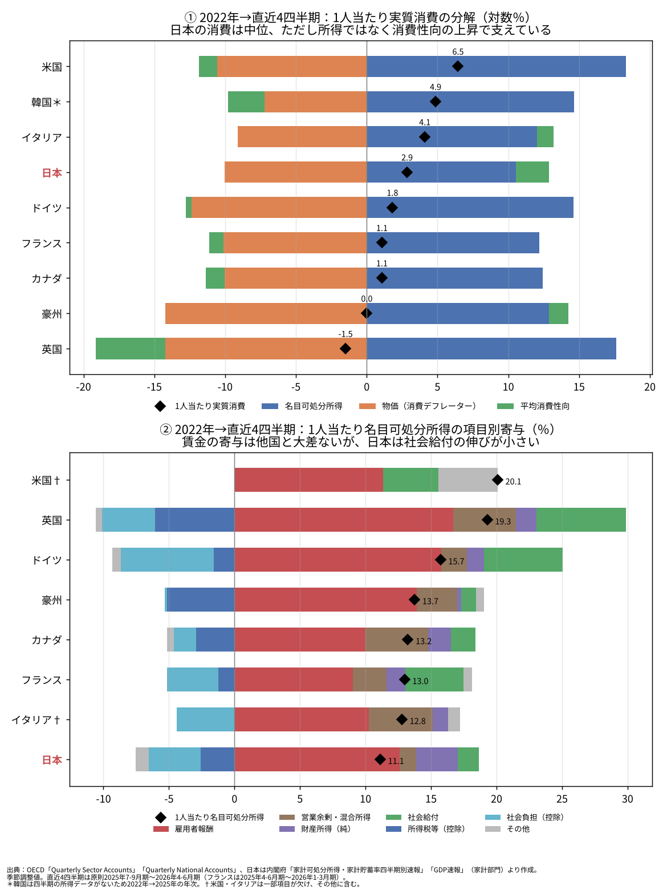

# 国際比較で見る日本の家計消費──所得が伸びない国、そして2020年代は年金が物価に追いつかない

ウェブ版：[https://p72.github.io/note-draft/家計消費の伸び悩み/02\_国際比較で見る日本の家計消費.html](https://p72.github.io/note-draft/%E5%AE%B6%E8%A8%88%E6%B6%88%E8%B2%BB%E3%81%AE%E4%BC%B8%E3%81%B3%E6%82%A9%E3%81%BF/02_%E5%9B%BD%E9%9A%9B%E6%AF%94%E8%BC%83%E3%81%A7%E8%A6%8B%E3%82%8B%E6%97%A5%E6%9C%AC%E3%81%AE%E5%AE%B6%E8%A8%88%E6%B6%88%E8%B2%BB.html)

GitHub：[https://github.com/p72/note-draft/blob/main/家計消費の伸び悩み/02\_国際比較で見る日本の家計消費.md](https://github.com/p72/note-draft/blob/main/%E5%AE%B6%E8%A8%88%E6%B6%88%E8%B2%BB%E3%81%AE%E4%BC%B8%E3%81%B3%E6%82%A9%E3%81%BF/02_%E5%9B%BD%E9%9A%9B%E6%AF%94%E8%BC%83%E3%81%A7%E8%A6%8B%E3%82%8B%E6%97%A5%E6%9C%AC%E3%81%AE%E5%AE%B6%E8%A8%88%E6%B6%88%E8%B2%BB.md)

※ この記事は、OECD の国民経済計算（制度部門別勘定、四半期国民経済計算、政府の機能別支出）を SDMX API で、65歳以上人口を World Bank の API で、米国の社会保障給付を FRED で取得し、日本の四半期データには内閣府の家計可処分所得・家計貯蓄率四半期別速報を用いて、Python で作図・計算している。コードとデータは同じフォルダの `code/intl/` にある。前回の記事「[家計消費はなぜ伸びないのか](01_家計消費はなぜ伸びないのか.md)」の続編である。数値の詳細と方法上の留保は末尾の付録にまとめた。

## はじめに

前回の記事では、日本の家計消費の弱さを、所得・物価・消費性向に分けて調べた。しかし、期間によって答えが変わり、結論ははっきりしなかった。中期で見れば所得の問題に見え、直近の四半期では消費性向の低下が目立った。

国内のデータだけでは、何が「普通」で何が「異常」なのか判断しにくい。そこで本稿では、同じ分解をG7と韓国・豪州の9か国に当てはめ、日本の位置を確かめる。

結論は二段になる。まず長期で見ると、日本の家計消費が伸びない理由は、家計がお金を使わないからではない。可処分所得がほとんど増えず、その根に賃金の停滞がある。日本の家計はむしろ、所得のうち消費に回す割合を高めてきた。

次に2020年代に入ると、景色が少し変わる。日本の賃金は名目で1割余り伸び、他国から大きく取り残される状況ではなくなった。それでも手取りが伸びない理由の一つは、年金を中心とする社会給付が物価に追いついていないことである。年金の目減りは、比べた国の中で日本が最も大きい。

## 分析の枠組み

前回と同じく、1人当たり実質消費の伸びを三つに分ける。

> 1人当たり実質消費の伸び ＝ 1人当たり名目可処分所得の伸び － 消費デフレーターの上昇率 ＋ 平均消費性向の変化

最初の二つを合わせたものが、1人当たり実質可処分所得の伸びである。各国の統計は国際基準（2008SNA）でそろえられており、家計と対家計民間非営利団体を合わせた部門を用いる。人口の増減の影響を除くため、すべて1人当たりで比べる。

## 長期で見ると、日本の弱さは所得の弱さである

図1は、2000年から2024年までの1人当たり実質消費の伸びを、実質可処分所得（青）と消費性向（緑）に分けたものである。

日本の1人当たり実質消費の伸びは、9か国の中でイタリアに次いで低い。しかし中身は他国とまったく違う。ほとんどの国では、所得が大きく伸び、消費性向はむしろ下がっている。所得の一部を貯蓄に回しながらも、消費は所得とともに増えてきた。

日本はその逆である。実質可処分所得はわずかしか伸びておらず、消費性向が上がることで、どうにか消費を伸ばしてきた。日本の家計の貯蓄率は、この間に大きく下がっている。日本の家計は「使わない」のではなく、所得の伸びがない中で、使う割合を高めてきたのである。

*図1　出典：OECD「Annual non-financial accounts by institutional sector」「Annual GDP and components」「Population」より作成*

図2は、同じ期間の1人当たり実質可処分所得と実質消費の推移を示している。日本（赤）は、所得では一貫して最下位グループにある。消費は所得より伸びているが、それでも他国との差は年を追って広がってきた。

*図2　出典：OECDより作成。実質可処分所得は家計最終消費支出デフレーターで実質化*

## 長期の所得停滞の根は、賃金の停滞にある

では、なぜ日本の可処分所得は伸びなかったのか。図3は、2000年から2024年までの1人当たり名目可処分所得の増加を、項目別に分けたものである。

違いは一目瞭然である。他国では、可処分所得の伸びの大半を雇用者報酬の増加が担っている。日本では、その雇用者報酬がほとんど増えていない。社会給付の増加は所得を支えているが、社会保険料の負担増がそれと同程度に所得を削っている。

物価が上がらなかったから名目所得も伸びなかった、という説明は十分ではない。日本の物価上昇は確かに小さかったが、名目所得の伸びはそれ以上に小さく、実質でも所得はほとんど増えなかった。

*図3　出典：OECD「Annual non-financial accounts by institutional sector」「Population」より作成*

## 2020年代：賃金は伸びたが、手取りは伸びない

コロナ禍とその後の物価上昇で、各国の家計は同じように揺さぶられた。図4は、四半期データを使い、2022年の平均から直近の4四半期（原則2025年7〜9月期〜2026年4〜6月期）までの変化を比べたものである。

上段の1人当たり実質消費を見ると、日本は9か国の中ほどにあり、ドイツや英国などより伸びている。2020年代に限れば、日本の消費だけが際立って弱いわけではない。ただし、その支え方が違う。多くの国は所得の伸びの一部を貯蓄に回し、消費性向を下げている。日本は逆に、消費性向を上げることで消費をつないでいる。実質可処分所得はほぼ横ばいで、名目可処分所得の伸びは9か国で最も小さい。

下段の名目可処分所得の内訳を見ると、長期とは違う姿が浮かぶ。日本の1人当たり雇用者報酬は名目で1割余り伸び、フランスやカナダを上回った。英国・ドイツ・米国には及ばないが、可処分所得を押し上げる力としては他国と大きな差がない。長期の「賃金だけが伸びない日本」は、2020年代にはそのままは当てはまらない。

それでも手取りが伸びない理由の一つは、社会給付である。英国・ドイツ・米国・フランスでは、社会給付の増加が可処分所得を大きく押し上げているが、日本ではその寄与が小さい。税と社会保険料による差し引きは日本でも効いているが、英国やドイツのほうが大きく、日本だけが特に重いとは言えない。

*図4　出典：OECD「Quarterly Sector Accounts」「Quarterly National Accounts」、日本は内閣府「家計可処分所得・家計貯蓄率四半期別速報」「GDP速報」より作成*

## 年金は、物価に追いついていない

社会給付の中心は年金である。図5は、政府の機能別支出のうち「老齢」向けの現金給付を65歳以上人口で割り、物価で実質化して比べたものである。

日本の65歳以上1人当たりの実質年金は、2012年から一貫して減り続け、比べた6か国の中で目減りが最も大きい。物価がほとんど上がらなかった2010年代には、名目でも減っていた。年金財政を保つための給付抑制が、着実に効いてきた結果である。

2019年以降、他国の年金は名目で大きく伸びたが、日本はわずかしか増えず、物価に大きく負けた。英国・米国・イタリアでは、2022年以降の年金の伸びが物価を上回っている。物価に連動する仕組みが働いているためである。日本とフランスは追いついていない。

日本の年金改定は、物価と賃金の伸びのうち低い方を基準にする場面が多く、さらにマクロ経済スライドによる調整がかかる。物価が賃金より速く上がる局面では、年金は物価に追いつきにくい仕組みになっている。

*図5　出典：OECD「Annual government expenditure by function (COFOG)」、米国は FRED（BEA, Social security benefits）、65歳以上人口は World Bank より作成*

## 前回の記事との関係

前回の記事では、2026年4〜6月期に消費性向が下がったこと、若い勤労世帯の平均で消費性向の低下と預貯金の積み増しが並んでいることを示した。これらは事実として残る。

ただし、国際比較の物差しで見ると、日本の家計消費の弱さの大部分は、所得が伸びないことで説明できる。そして所得が伸びない理由は、長期では賃金、2020年代では年金を中心とする給付の側にある。消費性向の低下は、その上に乗った直近の、あるいは一部の世帯の動きと位置づけるのが妥当である。

## 結論

1. 2000年以降、日本の1人当たり実質消費の伸びは9か国でイタリアに次いで低い。原因は消費性向ではなく、実質可処分所得の伸びの小ささにある。日本の消費性向は、他国と逆に上昇してきた。
2. 長期の所得停滞の根は、1人当たり雇用者報酬の停滞にある。
3. 2020年代に入ると、日本の賃金は他国から大きく取り残される状況ではなくなった。それでも実質の手取りが増えない理由の一つは、社会給付の伸びが小さいことである。
4. 65歳以上1人当たりの実質年金は、比べた国の中で日本の目減りが最も大きい。2020年代も、日本の年金は物価に追いついていない。

日本の家計消費の弱さは、「家計が使わない」問題ではなく、「家計に入るお金が物価ほど増えない」問題である。かつてはそれが賃金の問題であり、いまは年金の問題でもある。ただし、年金を物価並みに引き上げれば、その財源を誰が負担するかという世代間の配分の問題が生じる。現役世代の負担や将来への不安が強まれば、前回見た若い世帯の予備的な貯蓄をさらに強めるおそれもある。どの手段が消費全体を最も押し上げるかは、本稿の会計的な比較だけでは決められない。

## 付録A　主な数値

1人当たり実質消費の分解（累積の対数％）。

| 国 | 期間 | 実質消費 | 実質可処分所得 | 消費性向 | 名目可処分所得 | 物価 |
| --- | --- | ---: | ---: | ---: | ---: | ---: |
| 日本 | 2000→2024 | +13.5 | +6.4 | +7.0 | +11.6 | +5.2 |
| 米国 | 2000→2024 | +37.7 | +40.0 | −2.3 | +91.6 | +51.6 |
| ドイツ | 2000→2024 | +19.2 | +21.6 | −2.3 | +67.3 | +45.7 |
| 韓国 | 2000→2024 | +55.1 | +59.4 | −4.3 | +116.4 | +57.0 |
| イタリア | 2000→2024 | +1.8 | −2.3 | +4.1 | +45.8 | +48.1 |
| 日本 | 2022→直近 | +2.9 | +0.5 | +2.3 | +10.5 | +10.0 |
| 米国 | 2022→直近 | +6.5 | +7.7 | −1.3 | +18.3 | +10.5 |
| ドイツ | 2022→直近 | +1.8 | +2.2 | −0.4 | +14.6 | +12.4 |
| 英国 | 2022→直近 | −1.5 | +3.4 | −4.9 | +17.6 | +14.2 |

2022→直近は2022年平均から直近4四半期平均への変化。韓国は年次（2022→2025年）。全9か国・全期間の数値は `code/intl/decomp_intl.csv`・`decomp_recent_q.csv` にある。

65歳以上1人当たりの公的老齢給付（実質、累積の対数％）。

| 期間 | 日本 | フランス | ドイツ | 英国 | 米国 | イタリア |
| --- | ---: | ---: | ---: | ---: | ---: | ---: |
| 2012→2019 | −12.9 | −7.3 | +10.8 | −3.5 | +0.3 | −3.0 |
| 2019→2024 | −7.9 | −5.7 | −2.9 | −1.5 | −0.2 | +2.4 |
| 2022→2024 | −2.4 | −1.3 | +0.5 | +2.4 | +3.9 | +3.3 |

その他の主な数値は次のとおりである。

- 2000→2024年の1人当たり名目可処分所得の増加率は、日本が約12％、他の8か国は約58〜220％。このうち雇用者報酬の寄与は、日本が約15ポイント、他国は約45〜200ポイント。
- 2022年→直近の1人当たり名目可処分所得の増加率に対する寄与は、日本が雇用者報酬+12.6ポイント、社会給付+1.6ポイント。ドイツ・英国では社会給付の寄与が約6〜7ポイントある。
- 2019→2024年の65歳以上1人当たり公的老齢給付の名目の伸びは、日本が約3％、他の5か国は約10〜20％。
- 家計の総貯蓄率（固定資本減耗を含む）は、日本が2000年の約16％から2024年の約9.5％へ低下した。同じ期間に、米国・ドイツ・フランス・韓国・豪州などは上昇している。

## 付録B　方法と留保

- 年次の分解は OECD の「Annual non-financial accounts by institutional sector」（DSD\_NASEC10@DF\_TABLE14）、「Annual GDP and components – expenditure approach」（DSD\_NAMAIN10@DF\_TABLE1\_EXPENDITURE）、「Annual population and employment」（DSD\_NAMAIN10@DF\_TABLE3\_POP\_EMPNC）による。所得データは日本・米国・フランス・豪州が2024年までのため、終点を2024年にそろえた。
- 2020年代の比較は、OECD の「Quarterly Sector Accounts」（DSD\_NASEC1@DF\_QSA）と「Quarterly National Accounts」（DSD\_NAMAIN1@DF\_QNA）の季節調整値による。直近4四半期は原則2025年7〜9月期〜2026年4〜6月期で、フランスは2025年4〜6月期〜2026年1〜3月期。OECD に日本の四半期の家計部門データがないため、日本は内閣府の家計可処分所得・家計貯蓄率四半期別速報（家計部門、対家計民間非営利団体を含まない）を用いた。韓国は四半期の所得データがないため、2022→2025年の年次で比べた。米国・イタリアは所得の内訳が一部欠けており、その部分は「その他」に含まれる。直近の値は速報で、改定されうる。
- 部門は原則として家計と対家計民間非営利団体の合計で、日本の内閣府の家計部門とは範囲が少し異なる。2019→2024年の日本の名目可処分所得と実質消費の変化は、内閣府データとOECDデータでおおむね一致する（差は1ポイント未満）。
- 年金は、OECD の政府の機能別支出（DSD\_NASEC10@DF\_TABLE11、一般政府、10.2「老齢」、現金社会給付D62）を、World Bank の65歳以上人口（SP.POP.65UP.TO）で割り、各国の家計最終消費支出デフレーターで実質化した。米国はこの内訳がないため、FRED の社会保障給付（W823RC1A027NBEA）を用いた。米国は障害・遺族年金を含むため、他国より範囲が広い。豪州は系列の動きが不自然なため、カナダ・韓国は内訳がないため除いた。
- 日本は年金の支給開始年齢を60歳から65歳へ段階的に引き上げてきた。そのため60〜64歳への給付が減っており、65歳以上人口で割ると、65歳以上の受給者1人当たりの目減りより大きく見える面がある。2025年度以降の年金改定は含まない。
- 消費デフレーターは各国の家計最終消費支出の名目値÷実質値で、CPIではない。消費性向は家計最終消費支出÷総可処分所得である。
- 1人当たりの雇用者報酬は就業率の変化も含む。日本では女性や高齢者の就業が増えたため、就業者1人当たりで見た賃金の伸びは、この数字とは異なる。
- 寄与は会計上の分解であり、因果関係を示すものではない。消費性向の上昇には、高齢化に伴う貯蓄の取り崩しなど構造的な要因も含まれうる。賃金が長く伸びなかった理由や、年金改定の制度の詳細は本稿では扱っていない。

出典：

- OECD Data Explorer：[https://data-explorer.oecd.org/](https://data-explorer.oecd.org/)
- OECD SDMX REST API：[https://sdmx.oecd.org/public/rest/](https://sdmx.oecd.org/public/rest/)
- World Bank「Population ages 65 and above, total」：[https://data.worldbank.org/indicator/SP.POP.65UP.TO](https://data.worldbank.org/indicator/SP.POP.65UP.TO)
- FRED「Government social benefits to persons: Social security」：[https://fred.stlouisfed.org/series/W823RC1A027NBEA](https://fred.stlouisfed.org/series/W823RC1A027NBEA)
- 内閣府「家計可処分所得・家計貯蓄率四半期別速報」：[https://www.esri.cao.go.jp/jp/sna/sonota/kakei/kakei\_top.html](https://www.esri.cao.go.jp/jp/sna/sonota/kakei/kakei_top.html)
