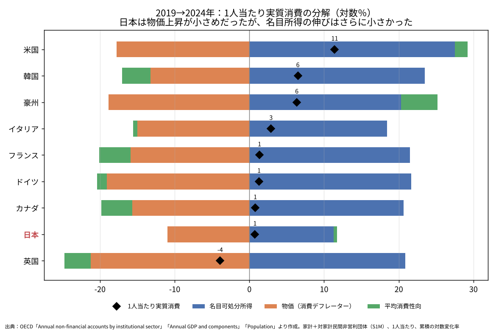

# 国際比較で見る日本の家計消費──弱さの原因は「使わない」ことではなく、所得が伸びないことである

ウェブ版：[https://p72.github.io/note-draft/家計消費の伸び悩み/02\_国際比較で見る日本の家計消費.html](https://p72.github.io/note-draft/%E5%AE%B6%E8%A8%88%E6%B6%88%E8%B2%BB%E3%81%AE%E4%BC%B8%E3%81%B3%E6%82%A9%E3%81%BF/02_%E5%9B%BD%E9%9A%9B%E6%AF%94%E8%BC%83%E3%81%A7%E8%A6%8B%E3%82%8B%E6%97%A5%E6%9C%AC%E3%81%AE%E5%AE%B6%E8%A8%88%E6%B6%88%E8%B2%BB.html)

GitHub：[https://github.com/p72/note-draft/blob/main/家計消費の伸び悩み/02\_国際比較で見る日本の家計消費.md](https://github.com/p72/note-draft/blob/main/%E5%AE%B6%E8%A8%88%E6%B6%88%E8%B2%BB%E3%81%AE%E4%BC%B8%E3%81%B3%E6%82%A9%E3%81%BF/02_%E5%9B%BD%E9%9A%9B%E6%AF%94%E8%BC%83%E3%81%A7%E8%A6%8B%E3%82%8B%E6%97%A5%E6%9C%AC%E3%81%AE%E5%AE%B6%E8%A8%88%E6%B6%88%E8%B2%BB.md)

※ この記事は、OECD の国民経済計算（制度部門別所得支出勘定、支出側GDP、人口）を SDMX API で取得し、Python で作図・計算している。コードとデータは同じフォルダの `code/intl/` にある。前回の記事「[家計消費はなぜ伸びないのか](01_家計消費はなぜ伸びないのか.md)」の続編である。数値の詳細と方法上の留保は末尾の付録にまとめた。

## はじめに

前回の記事では、日本の家計消費の弱さを、所得・物価・消費性向に分けて調べた。しかし、期間によって答えが変わり、結論ははっきりしなかった。中期で見れば所得の問題に見え、直近の四半期では消費性向の低下が目立った。

国内のデータだけでは、何が「普通」で何が「異常」なのか判断しにくい。そこで本稿では、同じ分解をG7と韓国・豪州の9か国に当てはめ、日本の位置を確かめる。

結論ははっきりしている。日本の家計消費が他国より伸びない理由は、家計がお金を使わないからではない。むしろ日本の家計は、他国よりも所得のうち多くを消費に回すようになった。消費が伸びないのは、使えるお金、つまり可処分所得そのものがほとんど増えていないからである。そして、その根には賃金（雇用者報酬）の停滞がある。

## 分析の枠組み

前回と同じく、1人当たり実質消費の伸びを三つに分ける。

> 1人当たり実質消費の伸び ＝ 1人当たり名目可処分所得の伸び － 消費デフレーターの上昇率 ＋ 平均消費性向の変化

最初の二つを合わせたものが、1人当たり実質可処分所得の伸びである。各国の統計は国際基準（2008SNA）でそろえられており、家計と対家計民間非営利団体を合わせた部門を用いる。人口の増減の影響を除くため、すべて1人当たりで比べる。

## 長期で見ると、日本の弱さは所得の弱さである

図1は、2000年から2024年までの1人当たり実質消費の伸びを、実質可処分所得（青）と消費性向（緑）に分けたものである。

日本の1人当たり実質消費の伸びは、9か国の中でイタリアに次いで低い。しかし中身は他国とまったく違う。ほとんどの国では、所得が大きく伸び、消費性向はむしろ下がっている。所得の一部を貯蓄に回しながらも、消費は所得とともに増えてきた。

日本はその逆である。実質可処分所得はわずかしか伸びておらず、消費性向が上がることで、どうにか消費を伸ばしてきた。日本の家計の貯蓄率は、この間に大きく下がっている。日本の家計は「使わない」のではなく、所得の伸びがない中で、使う割合を高めてきたのである。

*図1　出典：OECD「Annual non-financial accounts by institutional sector」「Annual GDP and components」「Population」より作成*

図2は、同じ期間の1人当たり実質可処分所得と実質消費の推移を示している。日本（赤）は、所得では一貫して最下位グループにある。消費は所得より伸びているが、それでも他国との差は年を追って広がってきた。

*図2　出典：OECDより作成。実質可処分所得は家計最終消費支出デフレーターで実質化*

## 所得が伸びない根は、賃金の停滞にある

では、なぜ日本の可処分所得は伸びないのか。図3は、2000年から2024年までの1人当たり名目可処分所得の増加を、項目別に分けたものである。

違いは一目瞭然である。他国では、可処分所得の伸びの大半を雇用者報酬の増加が担っている。日本では、その雇用者報酬がほとんど増えていない。社会給付の増加は他国と同じように所得を支えているが、社会保険料の負担増がそれと同程度に所得を削っている。

物価が上がらなかったから名目所得も伸びなかった、という説明は十分ではない。日本の物価上昇は確かに小さかったが、名目所得の伸びはそれ以上に小さく、実質でも所得はほとんど増えなかった。日本の消費の弱さを解く鍵は、家計の行動よりも、所得、とりわけ賃金の側にある。

*図3　出典：OECD「Annual non-financial accounts by institutional sector」「Population」より作成*

## 2019年以降も、構図は変わっていない

コロナ禍とその後の物価上昇は、各国の家計を同じように揺さぶった。図4は、2019年から2024年までの1人当たり実質消費を、名目所得（青）・物価（橙）・消費性向（緑）の三つに分けたものである。

この間、どの国でも物価は大きく上がった。日本の物価上昇はむしろ小さめだった。それでも日本の実質所得が伸びなかったのは、名目所得の伸びが9か国で最も小さかったからである。英国を除く他国では名目所得が物価を上回って伸び、多くの国は所得の増加分の一部を貯蓄に回しながら、消費も増やした。

日本の消費性向は、この間ほとんど変わっていない。物価高の局面で日本の家計だけが極端に財布の紐を締めた、という姿は国際比較からは見えない。長期と同じく、問題は所得の伸びの小ささである。

*図4　出典：OECD「Annual non-financial accounts by institutional sector」「Annual GDP and components」「Population」より作成*

## 前回の記事との関係

前回の記事では、2026年4〜6月期に消費性向が下がったこと、若い勤労世帯の平均で消費性向の低下と預貯金の積み増しが並んでいることを示した。これらは事実として残る。

ただし、国際比較の物差しで見ると、それは長期の構図を覆すほどの変化ではない。日本の家計消費の弱さの大部分は、所得が伸びないことで説明できる。消費性向の低下は、その上に乗った直近の、あるいは一部の世帯の動きと位置づけるのが妥当である。

## 結論

1. 2000年以降、日本の1人当たり実質消費の伸びは9か国でイタリアに次いで低い。その原因は消費性向ではなく、実質可処分所得の伸びの小ささにある。
2. 日本の消費性向は、他国と逆に上昇してきた。日本の家計は所得の伸びがない中で、使う割合を高めて消費を支えてきた。
3. 可処分所得が伸びない根は、1人当たり雇用者報酬の停滞にある。社会保険料の負担増も、社会給付の増加を打ち消す形で効いている。
4. 2019年以降の物価上昇局面でも、日本の物価上昇は小さめだったが、名目所得の伸びはそれ以上に小さかった。

日本の家計消費を立て直す政策を考えるなら、家計に「もっと使わせる」ことよりも、賃金を中心とした所得そのものが持続的に伸びるかどうかが本筋になる、というのがこの国際比較の示すところである。

## 付録A　主な数値

1人当たり実質消費の分解（累積の対数％）。

| 国 | 期間 | 実質消費 | 実質可処分所得 | 消費性向 | 名目可処分所得 | 物価 |
| --- | --- | ---: | ---: | ---: | ---: | ---: |
| 日本 | 2000→2024 | +13.5 | +6.4 | +7.0 | +11.6 | +5.2 |
| 米国 | 2000→2024 | +37.7 | +40.0 | −2.3 | +91.6 | +51.6 |
| ドイツ | 2000→2024 | +19.2 | +21.6 | −2.3 | +67.3 | +45.7 |
| 韓国 | 2000→2024 | +55.1 | +59.4 | −4.3 | +116.4 | +57.0 |
| イタリア | 2000→2024 | +1.8 | −2.3 | +4.1 | +45.8 | +48.1 |
| 日本 | 2019→2024 | +0.7 | +0.3 | +0.4 | +11.3 | +11.0 |
| 米国 | 2019→2024 | +11.4 | +9.7 | +1.7 | +27.5 | +17.8 |
| ドイツ | 2019→2024 | +1.3 | +2.6 | −1.3 | +21.7 | +19.1 |
| 英国 | 2019→2024 | −3.9 | −0.4 | −3.5 | +20.9 | +21.3 |

全9か国・全期間の数値は `code/intl/decomp_intl.csv`、名目可処分所得の項目別寄与は `code/intl/income_decomp.csv` にある。

- 2000→2024年の1人当たり名目可処分所得の増加率は、日本が約12％、他の8か国は約58〜220％。このうち雇用者報酬の寄与は、日本が約15ポイント、他国は約45〜200ポイントである。
- 家計の総貯蓄率（固定資本減耗を含む）は、日本が2000年の約16％から2024年の約9.5％へ低下した。同じ期間に、米国・ドイツ・フランス・韓国・豪州などは上昇している。

## 付録B　方法と留保

- データは OECD の SDMX API から取得した（2026年10月26日）。家計可処分所得（B6G）・総貯蓄（B8G）・所得項目は「Annual non-financial accounts by institutional sector」（DSD\_NASEC10@DF\_TABLE14）、家計最終消費支出の名目値と実質値（連鎖価格）は「Annual GDP and components – expenditure approach」（DSD\_NAMAIN10@DF\_TABLE1\_EXPENDITURE）、人口は「Annual population and employment」（DSD\_NAMAIN10@DF\_TABLE3\_POP\_EMPNC）。
- 部門は家計と対家計民間非営利団体の合計（S1M）。日本の内閣府が公表する家計部門（S14）とは範囲が少し異なる。2019→2024年の日本の名目可処分所得と実質消費の変化は、内閣府の四半期データの暦年平均とおおむね一致することを確認した（差は1ポイント未満）。
- 所得データは、日本・米国・フランス・豪州が2024年までのため、比較の終点を2024年にそろえた。2025年以降の動き、前回の記事で扱った2026年4〜6月期の変化は含まない。
- 消費デフレーターは各国の家計最終消費支出の名目値÷実質値で、CPIではない。消費性向は家計最終消費支出÷総可処分所得で、年金受給権の変動調整（D8）を含めた公表貯蓄率とは厳密には一致しない。総貯蓄率は B8G÷(B6G＋D8) で計算した。
- 1人当たりの雇用者報酬は、就業率の変化も含む。日本では女性や高齢者の就業が増えたため、就業者1人当たりで見た賃金の停滞は、この数字以上に大きい可能性がある。
- 寄与は会計上の分解であり、因果関係を示すものではない。消費性向の上昇には、高齢化に伴う貯蓄の取り崩しなど、構造的な要因も含まれうる。賃金が伸びない理由（生産性、交易条件、労働分配率など）は本稿では扱っていない。
- 豪州は社会給付（D62）の内訳がないため、「その他」に含めた。

出典：

- OECD Data Explorer：[https://data-explorer.oecd.org/](https://data-explorer.oecd.org/)
- OECD SDMX REST API：[https://sdmx.oecd.org/public/rest/](https://sdmx.oecd.org/public/rest/)
