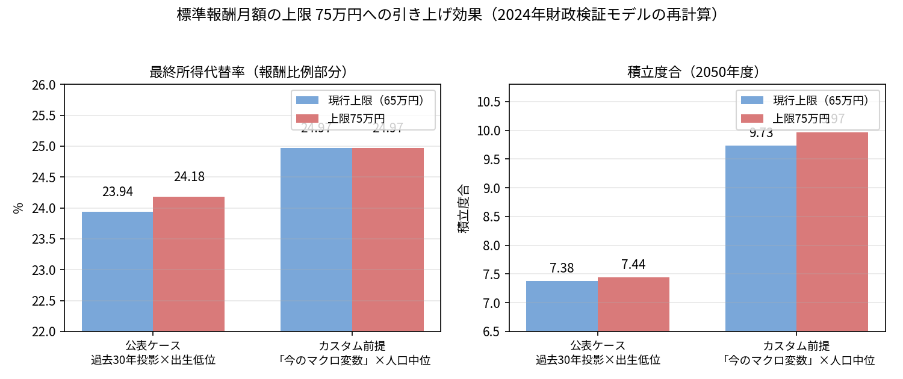

# 標準報酬月額の上限75万円に効果はあるか

ウェブ版：[https://p72.github.io/note-draft/年金財政検証/01\_標準報酬月額の上限75万円に効果はあるか.html](https://p72.github.io/note-draft/%E5%B9%B4%E9%87%91%E8%B2%A1%E6%94%BF%E6%A4%9C%E8%A8%BC/01_%E6%A8%99%E6%BA%96%E5%A0%B1%E9%85%AC%E6%9C%88%E9%A1%8D%E3%81%AE%E4%B8%8A%E9%99%9075%E4%B8%87%E5%86%86%E3%81%AB%E5%8A%B9%E6%9E%9C%E3%81%AF%E3%81%82%E3%82%8B%E3%81%8B.html)
GitHub：[https://github.com/p72/note-draft/blob/main/年金財政検証/01\_標準報酬月額の上限75万円に効果はあるか.md](https://github.com/p72/note-draft/blob/main/%E5%B9%B4%E9%87%91%E8%B2%A1%E6%94%BF%E6%A4%9C%E8%A8%BC/01_%E6%A8%99%E6%BA%96%E5%A0%B1%E9%85%AC%E6%9C%88%E9%A1%8D%E3%81%AE%E4%B8%8A%E9%99%9075%E4%B8%87%E5%86%86%E3%81%AB%E5%8A%B9%E6%9E%9C%E3%81%AF%E3%81%82%E3%82%8B%E3%81%8B.md)

## 問い

厚生年金の保険料と給付の算定基礎となる標準報酬月額には上限があり、現在は月額65万円である。2024年の財政検証では、この上限を75万円に引き上げるオプション試算（オプション試算No.26）が示された。公表値では、厳しい経済前提のもとで所得代替率がわずかに改善するとされている。

では、この引き上げは「いまの」マクロ経済環境のもとでも効くのであろうか。本稿では、厚生労働省が公表した財政検証プログラムそのものを使い、足元の物価・賃金動向を反映した経済前提で再計算した。結論を先に述べる。現在のマクロ前提に近いケースでは、所得代替率への効果は完全にゼロであった。動いたのは積立金だけである。

## 計算方法と前提

計算には、厚生労働省が2024年財政検証のために公表した年金数理プログラムを使用した。プログラムの再現性は、公表されているオプション試算No.26（過去30年投影ケース・出生低位）を再実行し、最終所得代替率47.0318％が公表値と一致することを確認したうえで担保している。再現手順とプログラムは [p72/nenkin-zaisei-kensyo-2024](https://github.com/p72/nenkin-zaisei-kensyo-2024) に置いた。

経済前提は、公式の「成長型経済移行・継続ケース」を土台に、移行期の数年間だけ足元の実績に寄せた独自ケース（ケース3901）を用いた。長期の定常状態は公式ケースと同じく、物価上昇率2.0％、実質賃金上昇率1.5％、実質運用利回り3.2％（対賃金スプレッド＋1.7％ポイント）である。移行期は次のとおりである。

| 年度 | 物価上昇率 | 実質賃金上昇率 | 実質運用利回り |
|---|---:|---:|---:|
| 2025 | 3.0％ | 0.6％ | 3.6％ |
| 2026 | 2.7％ | 0.9％ | 3.6％ |
| 2027 | 2.4％ | 1.1％ | 3.4％ |
| 2028 | 2.2％ | 1.3％ | 3.4％ |
| 2029以降 | 2.0％ | 1.5％ | 3.2％ |

人口前提は中位推計（出生中位・死亡中位、入国超過数16万人）、労働参加は「漸進シナリオ」である。なお、公式の見出し値（成長型経済移行・継続ケースで57.6％）は労働参加がより進む前提で計算されており、本稿の数値とは労働参加シナリオの違いだけが異なる。オプションの適用方法は公式のオプション試算に倣い、基礎年金の財政は基本ケースに固定し、厚生年金側のみ上限引き上げを適用した。

## 結果

### 現在のマクロ前提に近いケースでは、代替率は1ポイントも動かない

| ケース3901 | 所得代替率（計） | 基礎部分 | 比例部分 | 調整終了年度（比例／基礎） |
|---|---:|---:|---:|---|
| 基本ケース | 55.60％ | 30.63％ | 24.97％ | 2024年度／2042年度 |
| 上限75万円 | 55.60％ | 30.63％ | 24.97％ | 2024年度／2042年度 |

上限を引き上げても、所得代替率は小数点以下の桁まで完全に同一であった。一方で財政指標は動いている。2050年度の積立度合は9.73から9.97へ上昇し、積立金の実額は約676兆円から約694兆円へ、約18兆円増えた。給付費の対GDP比（2050年度）は7.29％から7.30％へわずかに上昇した。つまり、このケースで上限引き上げがもたらすのは、給付水準の改善ではなく、将来に向けた積立金の上乗せだけである。

### 厳しいケースでは、公表どおり+0.24ポイントの効果がある

対照として、公式のオプション試算と同じ条件（過去30年投影ケース・出生低位）でも計算した。

| 過去30年投影・出生低位 | 所得代替率（計） | 基礎部分 | 比例部分 | 調整終了年度（比例／基礎） |
|---|---:|---:|---:|---|
| 基本ケース | 46.79％ | 22.85％ | 23.94％ | 2031年度／2065年度 |
| 上限75万円 | 47.03％ | 22.85％ | 24.18％ | 2030年度／2065年度 |

この条件では、所得代替率は+0.24ポイント改善し、その全量が比例部分に現れた。比例部分のマクロスライド調整の終了が2031年度から2030年度へ1年前倒しになった効果である。なお公式公表値では、上限83万円で47.15％、98万円で47.32％と、上限を上げるほど効果は大きくなるが、その勾配は緩やかである。

## なぜ代替率は動かないのか

仕組みは単純である。

第一に、所得代替率はモデル世帯（平均的な賃金で40年間働いた夫と専業主婦の妻）で測る指標である。モデル世帯の報酬は上限の65万円に届かない。したがって上限を引き上げても、モデル世帯自身の年金額は1円も増えない。上限引き上げで増えるのは、上限を超える報酬を得る層からの保険料収入だけである。

第二に、その保険料収入の増加が所得代替率に跳ね返る経路は、マクロスライド調整の期間短縮しかない。財政が厳しく、比例部分に調整が必要な世界では、財政改善が調整終了の前倒しを通じて代替率を押し上げる。過去30年投影ケースで+0.24ポイントの効果が出たのはこの経路である。

第三に、成長ケースでは比例部分の調整はもともと不要である（調整終了年度が2024年度、すなわち調整なし）。跳ね返る先がないため、増えた保険料収入は代替率に変換されず、積立金に積み上がるだけとなる。これがケース3901で代替率が完全に不変だった理由である。

## 結論

標準報酬月額の上限引き上げは、給付改善策ではなく財政の裏付け策である。現在のマクロ経済前提のもとでは所得代替率への効果はゼロであり、効果が現れるのは財政が厳しく比例部分の調整が残る前提のときに限られ、その場合でも+0.24ポイントにとどまる。この施策を評価する物差しは所得代替率ではなく、積立度合や制度の持続可能性であるべきだということになる。

## 注記

- 計算は2026年11月5日に実行した。使用プログラムは厚生労働省の2024年財政検証プログラム（公表資料）であり、再現コードと手順は [p72/nenkin-zaisei-kensyo-2024](https://github.com/p72/nenkin-zaisei-kensyo-2024) にある。
- 経済前提のうち移行期（2025〜2028年度）の物価・実質賃金・運用利回りは、足元の公表統計の水準をもとに筆者が設定したものであり、厚生労働省の公式前提ではない。
- 人口前提・労働参加シナリオの違いにより、本稿の基本ケースの所得代替率は公式の見出し値とは一致しない。オプションの有無による差分（効果の有無と大きさ）が本稿の主張の対象である。
