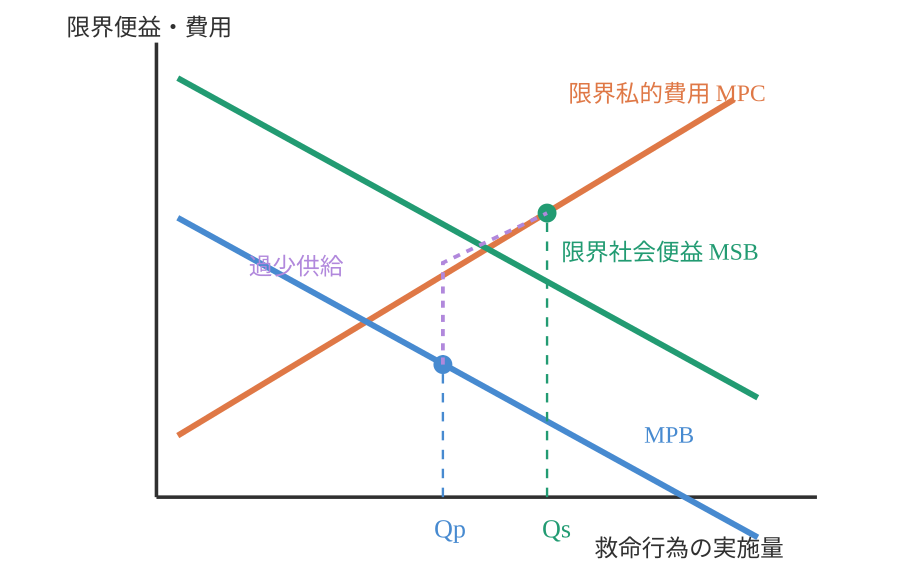

# 女性へのAED使用はなぜ過少になるのか──救命行為をミクロ経済学で考える

ウェブ版：[https://p72.github.io/note-draft/%E6%95%91%E5%91%BD%E8%A1%8C%E7%82%BA%E3%81%AE%E7%B5%8C%E6%B8%88%E5%AD%A6/01\_%E5%A5%B3%E6%80%A7%E3%81%B8%E3%81%AEAED%E4%BD%BF%E7%94%A8%E3%81%AF%E3%81%AA%E3%81%9C%E9%81%8E%E5%B0%91%E3%81%AB%E3%81%AA%E3%82%8B%E3%81%AE%E3%81%8B.html](https://p72.github.io/note-draft/%E6%95%91%E5%91%BD%E8%A1%8C%E7%82%BA%E3%81%AE%E7%B5%8C%E6%B8%88%E5%AD%A6/01_%E5%A5%B3%E6%80%A7%E3%81%B8%E3%81%AEAED%E4%BD%BF%E7%94%A8%E3%81%AF%E3%81%AA%E3%81%9C%E9%81%8E%E5%B0%91%E3%81%AB%E3%81%AA%E3%82%8B%E3%81%AE%E3%81%8B.html)

GitHub：[https://github.com/p72/note-draft/blob/main/%E6%95%91%E5%91%BD%E8%A1%8C%E7%82%BA%E3%81%AE%E7%B5%8C%E6%B8%88%E5%AD%A6/01\_%E5%A5%B3%E6%80%A7%E3%81%B8%E3%81%AEAED%E4%BD%BF%E7%94%A8%E3%81%AF%E3%81%AA%E3%81%9C%E9%81%8E%E5%B0%91%E3%81%AB%E3%81%AA%E3%82%8B%E3%81%AE%E3%81%8B.md](https://github.com/p72/note-draft/blob/main/%E6%95%91%E5%91%BD%E8%A1%8C%E7%82%BA%E3%81%AE%E7%B5%8C%E6%B8%88%E5%AD%A6/01_%E5%A5%B3%E6%80%A7%E3%81%B8%E3%81%AEAED%E4%BD%BF%E7%94%A8%E3%81%AF%E3%81%AA%E3%81%9C%E9%81%8E%E5%B0%91%E3%81%AB%E3%81%AA%E3%82%8B%E3%81%AE%E3%81%8B.md)

女性傷病者へのAED使用が少ないという問題は、ミクロ経済学の観点から興味深い題材である。

結論から言えば、「**正の外部性による市場の失敗**」「**私的費用と社会的費用の乖離**」「**不確実性下の意思決定**」の3つを組み合わせることで説明できる。

特に重要なのは、**救助者が法的リスクを負う一方で、救命による便益の大部分は救助される人が享受するという非対称性**である。

## 1. 正の外部性によるAED救命行為の過少供給

AEDによる救命行為を、無償で提供される一種のサービスと考える。

救助者がAEDを使うと、社会全体には大きな便益が生じる。しかし、その便益が救助者自身にすべて還元されるわけではない。

| | 救助者（私人） | 社会全体 |
|---|---|---|
| 便益 | 道徳的満足、達成感 | 救命、生存率改善、人的損失の回避 |
| 費用 | 時間、労力、心理的負担 | 救助に要する資源や時間 |
| 法的リスク | 訴訟不安、評判への悪影響 | 救命をためらうことによる損失 |

救助者が行動する条件を次のように表せる。

**Bₚ > Cₚ + πL**

- `Bₚ`：救助者自身が得る私的便益
- `Cₚ`：救助の時間的・心理的費用
- `π`：法的問題が生じると救助者が主観的に考える確率
- `L`：法的問題が生じた場合に想定する損失

一方、社会的に救助が望ましい条件は、

**Bₚ + Bₑ > Cₚ + Cₑ**

ここで `Bₑ` は救命による外部便益、`Cₑ` はその他の社会的費用や損失である。

したがって、

**Bₚ < Cₚ + πL**

で救助者が行動しない場合でも、

**Bₚ + Bₑ > Cₚ + Cₑ**

なら、**社会的には実施すべき救命行為が、個人の合理的判断では実施されない**ことになる。

これがAED使用の過少供給を説明する基本的な仕組みである。

## 2. グラフで示す

**AED救命行為の私的均衡と社会的最適（概念図）**

Qp＝私的均衡（MPB＝MPC）、Qs＝社会的最適（MSB＝MPC）。限界社会便益（MSB）が限界私的便益（MPB）を外部便益の分だけ上回るため、私的均衡の実施量は社会的最適より少なくなり、三角形Aの厚生損失が生じる。模式図であり、実測データではない。

さらに、傷病者が女性の場合、わいせつ行為と誤解されることへの懸念が加わり、救助者の期待私的費用が上昇する（MPC→MPC′）。その結果、私的均衡はQp′まで低下し、AED使用量はさらに減少する。なお、ここでの懸念は主として主観的なリスク認識であり、社会全体にとっての実質的な費用ではないため、社会的最適Qsは変わらないものとして描いている。

ここで重要なのは、実際の法的責任の大きさではなく、**救助者が認識しているリスク**が行動を決めるという点である。

## 3. 期待効用理論：わずかなリスクでも救助をためらう理由

ここで、もう一つ重要な問題がある。仮に訴えられる確率が極めて小さくても、損失が大きいと認識されれば、救助を控えることは私的に合理的になり得る。

例えば、次のような仮想的なケースを考える。

| 項目 | 仮定 |
|---|---:|
| 救助による心理的便益 | 10万円相当 |
| 救助に伴う時間・心理的費用 | 1万円相当 |
| 法的問題による想定損失 | 1,000万円 |
| 法的問題が起こると考える確率 | 1% |

この場合、救助者が認識する期待損失は、

**0.01 × 1,000万円 = 10万円**

したがって私的純便益は、

**10万円 − 1万円 − 10万円 = −1万円**

となり、救助しない選択が私的には合理的になる。

もちろん、これは実際の訴訟確率や損害額を示したものではない。

さらに、救助者がリスク回避的であれば、期待損失が小さくても、まれに発生する大きな損失を期待値以上に重く評価する。このため、期待値の計算上は救助が割に合う場合でも、救助を控えることがあり得る。

これは**期待効用理論とリスクプレミアム**で説明できる。

## 4. 実証研究でも心理的障壁が確認されている

旭化成ゾールメディカルが2025年に実施した意識調査（20歳以上の男女471人、インターネット調査）では、女性への救命処置について「抵抗がある」「できない、したくない」「わからない」と回答した人のうち、42%がセクシュアルハラスメントで訴えられることへの心配を理由に挙げている（複数回答、前回調査は34%）。

また、日本蘇生協議会の『JRC蘇生ガイドライン2025』も、不適切な身体接触や性的暴行と誤解される懸念が、女性に対する救命処置の実施率の低さに関係している可能性を指摘している。

ただし、これは**救助者が法的リスクを認識している証拠であって、適切な救命行為が実際にわいせつ罪として処罰されやすいという証拠ではない**ことに注意が必要である。

実際、日本では善意の救助について、民法698条の緊急事務管理（悪意または重大な過失がなければ損害賠償責任を負わない）や刑法37条の緊急避難が関係し、法的に保護されると考えられている。

## 5. ミクロ経済学から導かれる政策的含意

重要なのは、社会的に望ましいAED使用を実現するには、機器の設置台数を増やすだけでは不十分だという点である。

救助者の期待私的費用を下げる政策も必要になる。

- **法的保護の周知・明確化**：救助者が認識する法的リスク `πL` を低下させる。
- **適切なAED使用方法の普及**：誤解される不安と実際の救助手技への不安を軽減する。
- **救命講習・啓発活動**：救助者の心理的負担を引き下げ、私的便益を高める。

女性の場合でも、パッドを素肌に正しく貼れればブラジャーを完全に外す必要はなく、プライバシーに配慮しながら救命を優先できる。

## 6. さらに厳密に言うなら「制度が作り出す負のインセンティブ」

この問題は、単なる正の外部性にとどまらない。

**実際の法制度にかかわらず、法的保護が十分に認識されていなければ、人々は救命行為を過少に供給する**という問題でもある。

そして、リスクを負担する救助者と、救命便益を得る傷病者の間には、緊急時に対価や補償について契約する仕組みがない。

つまり、コースの定理が想定するような当事者間の交渉によって外部性を内部化することも、現実には困難である。

経済学的に要約すると、

> AED救命行為には正の外部性が存在する一方、救助者は法的・社会的リスクを私的に負担する。この非対称性により、私的均衡における救命行為の実施量は社会的最適水準を下回る。さらに、法的リスクに関する情報の不完全性とリスク回避的行動が、過少供給を増幅する。

ということになる。

これは**善意の不足ではなく、個人の合理的意思決定が社会的に非効率な結果を生む例**として、ミクロ経済学的に説明できる。

---

参照：

- [JRC蘇生ガイドライン2025](https://www.jrc-cpr.org/wp-content/uploads/2025/10/BLS2025_PC_ver1.pdf)
- [【2025年度版】一次救命処置およびAED使用に関する意識調査（旭化成ゾールメディカル）](https://www.ak-zoll.com/aed/column/aedcolumn032.html)
- [鎌倉市・応急手当と法的責任](https://www.city.kamakura.kanagawa.jp/qq-kyumei/kyumei20250226.html)
