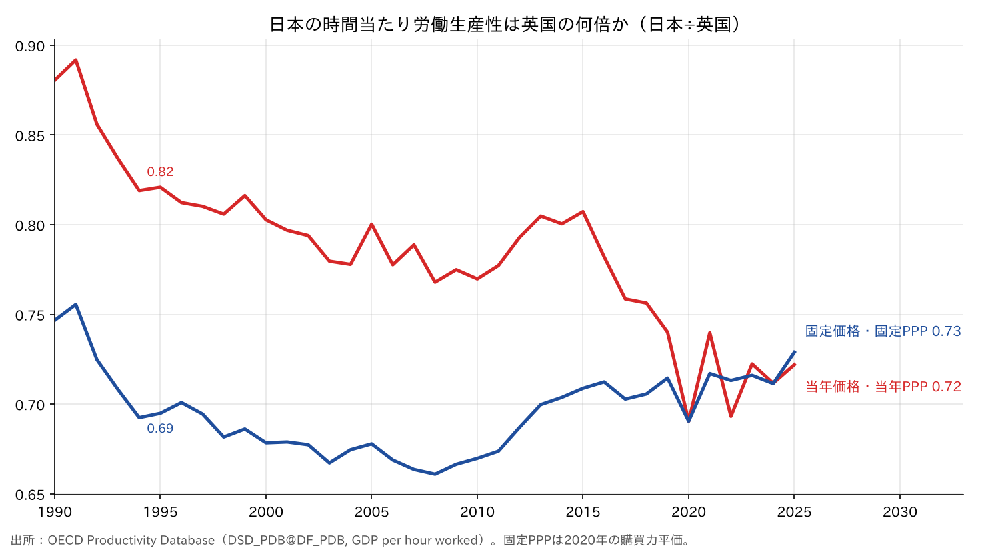
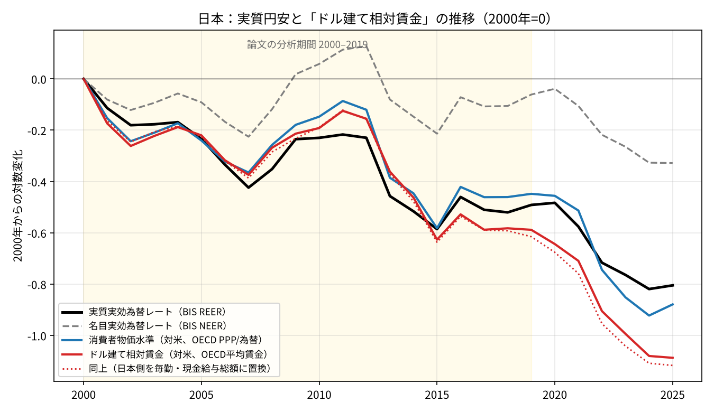
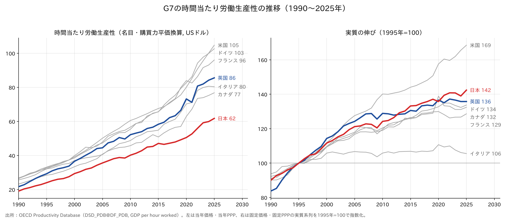
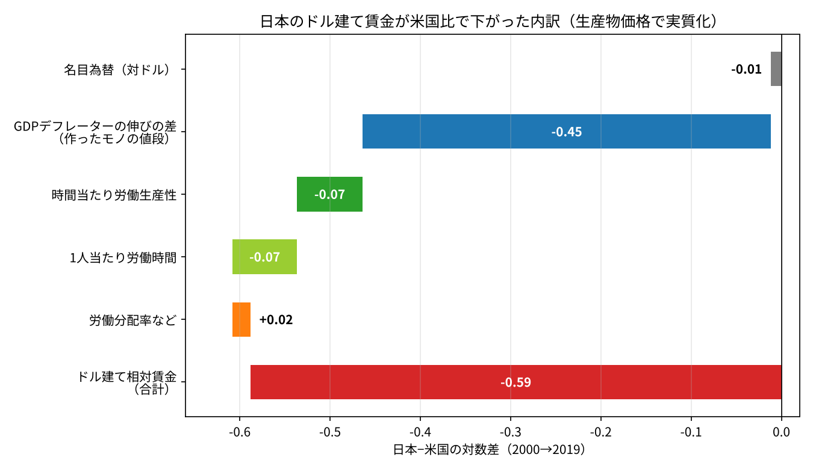

# 労働生産性・単位労働コスト・実質為替レートの関係──日本の実質円安はどの項で生じたか

## 要旨

本稿は、労働生産性、単位労働コスト（ULC）、GDPデフレーター、実質為替レートを一続きの恒等式で結び、2000〜2019年の日本の実質円安がどの項で生じたかを整理する。新たな推計は行わず、OECD、BIS、労働政策研究・研修機構（JILPT）の公表データと先行研究の数値を用いる。結論は次の4点である。

- 実質為替レートの変化は、名目為替レートの変化と内外の物価上昇率の差に分解できる。2000〜2019年の日本の実質円安（対数で−0.49）の9割は物価上昇率の差による。
- GDPデフレーターは、ULC（時間当たり名目賃金÷時間当たり実質労働生産性）を労働分配率で割ったものに等しい。日本の実質労働生産性の伸びはG7で米国に次ぐため、物価上昇率の差は主に名目賃金の伸びの差に対応する。
- バラッサ＝サミュエルソン効果は、生産性の伸びが賃金の上昇を通じて物価と実質為替レートを押し上げるとする。日本では生産性から賃金への段階が働かず、生産性の伸びは物価を下げる方向に作用した。
- 用いる式の多くは恒等式であり、賃金と物価のどちらが原因かは式からは決まらない。

## 1. 問題の所在

時間当たり労働生産性の日英比（日本÷英国）は、系列によって逆方向に動く。OECD Productivity Database によれば、当年価格・当年PPPでは1995年の0.82から2025年の0.72に低下し、固定価格・固定PPP（2020年基準）では0.69から0.73に上昇した。同じ期間に、日本の実質実効為替レートは大きく低下した。いずれの現象にも、物価（GDPデフレーター）、購買力平価、市場の為替レートの関係が関わる。本稿は、これらを労働生産性から順に式で結び、日本の実質円安を各項に対応させる。

図1　時間当たり労働生産性の日英比（日本÷英国）。出所：OECD Productivity Database。

## 2. 労働生産性の定義と測定

### 2.1 定義

労働生産性は付加価値（国全体ではGDP）を労働投入量で割ったものであり、労働投入量の取り方で2種類に分かれる。短時間労働者の割合は国によって異なるため、国際比較には時間当たりが適する。

| 種類 | 式 |
|---|---|
| 1人当たり労働生産性 | GDP ÷ 就業者数 |
| 時間当たり労働生産性 | GDP ÷（就業者数 × 1人当たり年間労働時間） |

1人当たりGDPは次のように分解できる。日本では短時間労働者の増加で1人当たり労働時間が減少しており、時間当たりと1人当たりで生産性の評価が変わる。

**1人当たりGDP ＝ 時間当たり労働生産性 ×（就業者数÷人口）×（総労働時間÷就業者数）** …(1)

### 2.2 労働時間のデータ

OECD Productivity Database は、「就業者1人当たり平均年間実労働時間」と同系統の労働時間を分母に用いる。JILPT「データブック国際労働比較2026」が引用する2024年の日本の値は、就業者全体で1,617時間、雇用者で1,636時間である。このデータは元統計と推計方法が国ごとに異なり、特定年の水準の国際比較には適さないと注記されている。時系列の変化を見るためのデータとして扱う。

### 2.3 当年PPP系列と固定PPP系列

国際比較の物価調整には、国どうしの方向（購買力平価が担う）と時間の方向（デフレーターが担う）がある。OECDの二つの系列は、この調整の範囲が異なる。

| 系列 | 算式 | 調整される方向 | 用途 |
|---|---|---|---|
| 当年価格・当年PPP | （名目GDP÷当年のPPP）÷総労働時間 | 国どうしのみ | 同一年の水準の比較 |
| 固定価格・固定PPP | （実質GDP÷基準年のPPP）÷総労働時間 | 国どうしと時間 | 実質の伸びの比較 |

当年価格・当年PPPの系列は「その年の米ドル」で表示された名目値であり、米国の物価上昇を含む。

購買力平価は各国の物価の比であるから、理論上はその変化が各国のデフレーター上昇率の差に一致し、二つの系列の国間比は同じ動きをする。実際には、購買力平価は国際比較プログラム（ICP）の価格調査で数年ごとに改定され、デフレーターで延長した値と乖離する。日英比が系列によって逆方向に動いたのは、この乖離による。これは、3節以降で扱う市場の為替レートとの乖離とは別の問題である。

| 乖離 | 何と何の乖離か | 表れる場所 |
|---|---|---|
| ① | デフレーターと購買力平価 | 当年PPPと固定PPPの生産性比の違い |
| ② | デフレーター・ULCと市場の為替レート | 実質円安、ドル建て名目GDPの順位 |

### 2.4 指標の位置づけ

時間当たり労働生産性が測るのは労働の効率であり、経済の規模や生活水準ではない。国力そのものではなく、その一要素である経済の効率を表す指標である。

| 指標 | 測るもの |
|---|---|
| 購買力平価換算のGDP総額 | 経済の規模 |
| 購買力平価換算の1人当たりGDP | 生活水準 |
| 時間当たり労働生産性 | 労働の効率 |

## 3. 単位労働コストとGDPデフレーター

記号を次のとおり定める。

| 記号 | 意味 |
|---|---|
| W | 名目雇用者報酬 |
| Y | 実質GDP |
| H | 総労働時間 |
| w ＝ W／H | 時間当たり名目賃金 |
| A ＝ Y／H | 時間当たり実質労働生産性 |
| P | GDPデフレーター |
| s ＝ W／(P×Y) | 労働分配率 |

ULCは実質生産物1単位当たりの人件費であり、時間当たり名目賃金を時間当たり実質労働生産性で割ったものに等しい。

**ULC ＝ W÷Y ＝（W／H）÷（Y／H）＝ w÷A** …(2)

**ULCの伸び ＝ 名目賃金の伸び − 実質労働生産性の伸び** …(3)

伸びは対数差である。実務では、雇用者報酬が自営業者の所得を含まないことを補正するため、分子を雇用者の総労働時間、分母を就業者の総労働時間で割ることが多い。自営業者が雇用者と同じ賃金を得ていると仮定することにあたる。

労働分配率の定義を書き換えると、GDPデフレーターはULCと労働分配率で表せる。

**P ＝ ULC÷s ＝ w÷（A×s）** …(4)

**デフレーターの伸び ＝ 名目賃金の伸び − 実質労働生産性の伸び − 労働分配率の伸び** …(5)

労働分配率が長期的にほぼ一定であれば、デフレーターはULCに沿って動く。名目賃金が伸びないまま生産性だけが伸びれば、ULCとデフレーターは低下する。なお、ULCをデフレーターで割った実質ULCは労働分配率そのものである。

## 4. 実質為替レートの分解

実質為替レートは、内外の物価を同じ通貨に換算して比べたものである。貿易額で加重平均したものが実質実効為替レート（REER）である。名目実効為替レートを e（上昇が自国通貨高）とすると、次のとおりである。

**REER ＝ e × 自国の物価 ÷ 外国の物価** …(6)

**REERの伸び ＝ 名目為替の伸び ＋ 自国の物価の伸び − 外国の物価の伸び** …(7)

物価としてULCを用い、(3)式を代入する。

**REERの伸び ＝ 名目為替の伸び ＋（自国の名目賃金の伸び − 自国の実質労働生産性の伸び）−（外国の名目賃金の伸び − 外国の実質労働生産性の伸び）** …(8)

(8)式で、自国の実質労働生産性の伸びには負の符号が付く。賃金が一定のまま生産性だけが伸びれば、ULCが下がり、実質為替レートは低下する。

相対的購買力平価が成り立てば、名目為替レートは長期的に物価上昇率の差を相殺し、実質為替レートは一定に保たれる。物価が上がらない国の通貨は名目で増価するはずである。日本では、物価上昇率が貿易相手国より低かったが、それを相殺するだけの名目の円高は生じず、実質為替レートが低下した。

## 5. バラッサ＝サミュエルソン効果

バラッサ＝サミュエルソン効果は、生産性の伸びが速い国ほど実質為替レートが上昇するとする。経路は次のとおりである。

1. 貿易財部門（製造業など）の生産性が上がる。
2. 貿易財部門の賃金が上がる。
3. 労働者が部門間を移動できるため、非貿易財部門（サービス業など）の賃金も上がる。
4. 非貿易財部門の生産性はあまり伸びないため、サービス価格が上がる。
5. 国全体の物価が上がり、実質為替レートが上がる。

この効果は、国全体の生産性ではなく、貿易財部門と非貿易財部門の生産性の差によって働く。

(8)式が示すとおり、生産性の伸びが実質為替レートに作用する向きは賃金の動きで決まる。段階2〜3が働かなければ、生産性の伸びはULCと物価を下げ、実質為替レートを下げる。

| 経路 | 賃金 | 物価 | 実質為替レート |
|---|---|---|---|
| バラッサ＝サミュエルソン効果 | 生産性に合わせて上昇 | 上昇 | 上昇 |
| ULCの経路 | 横ばい | 低下 | 低下 |

## 6. 日本への適用

### 6.1 実質円安の9割は物価上昇率の差

BISの実効為替レート（広義、年平均）で2000〜2019年の日本を(7)式に当てはめると、実質円安の9割は名目為替ではなく物価上昇率の差による。

| 項目 | 対数変化（2000〜2019年） |
|---|---|
| 実質実効為替レート | −0.49 |
| 名目実効為替レート | −0.06 |
| 差（日本と貿易相手国の物価上昇率の差） | −0.43 |

図2は、実質・名目の実効為替レートに、米国比の消費者物価水準（OECDの購買力平価÷為替レート）とドル建て相対賃金を重ねたものである。2000〜2019年は、実質実効為替レート、物価水準、ドル建て相対賃金がほぼ重なって動く。

図2　日本の実質実効為替レート、物価水準、ドル建て相対賃金（2000年＝0、対数変化）。出所：BIS、OECD、厚生労働省「毎月勤労統計調査」。図中の「論文」は菊池（2026）を指す。

### 6.2 実質労働生産性の伸びは見劣りしない

OECDの固定価格・固定PPP系列による時間当たり実質労働生産性の伸びは、1995〜2025年の年率で日本1.18％、英国1.02％である。1995年＝100とした2025年の水準は米国169、日本142、英国136で、日本はG7で米国に次ぐ（図3右）。当年価格・当年PPPの水準では日本はG7で最も低く（図3左）、水準と伸びで評価が分かれる。

図3　G7の時間当たり労働生産性。左は当年価格・当年PPP、右は固定価格・固定PPPの実質系列（1995年＝100）。出所：OECD Productivity Database。

(8)式で内外の実質労働生産性の伸びに大差がなければ、物価上昇率の差は主に名目賃金の伸びの差に対応する。

### 6.3 物価の差は賃金の差に対応する

2000〜2019年に、日本のドル建て賃金は米国比で対数0.59低下した。OECDの国民経済計算と労働時間のデータによる内訳を図4に示す。約4分の3（−0.45）はGDPデフレーターが上がらなかった名目の部分であり、生産性と労働時間の実質の部分（計−0.14）は約5分の1にとどまる。

図4　日本のドル建て賃金が米国比で低下した内訳（2000〜2019年、対数差）。出所：OECD 年次国民経済計算ほか。

日本の実質円安は、(8)式の「自国の名目賃金の伸び」の項が小さかったことに対応する。

### 6.4 バラッサ＝サミュエルソン効果が働かなかった段階

菊池（2026）は、バラッサ＝サミュエルソン効果が実証的に確認できる一方、部門別生産性の推移だけを多国間貿易モデルに与えても日本の実質円安は再現できず、モデルは逆に実質円高を予測することを示した。実際の名目賃金を与えると、データの経路がほぼ再現された。5節の整理に照らせば、日本では生産性の伸びが賃金の上昇につながる段階が働かず、生産性の伸びはULCと物価の低下に回り、実質為替レートを下げる方向に作用した。

### 6.5 円高と製造業の海外移転（仮説）

貿易財部門の賃金が上がらなかった背景として、円高期の製造業の海外移転が考えられる。生産拠点が海外に移れば国内の貿易財部門の比重が下がり、バラッサ＝サミュエルソン効果の起点となる国内貿易財部門の生産性と賃金の上昇が弱まる。ただし、2008〜2012年の円高は名目で見たものであり、物価が上がらなかった分、実質実効為替レートで見た円高は名目ほど大きくない。海外移転と賃金の伸びの低さとの関係は本稿では検証しておらず、今後の課題である。

## 7. 結論

- 当年価格・当年PPPの系列は同一年の水準の比較に、固定価格・固定PPPの系列は実質の伸びの比較に用いる。両者の国間比の違いは、デフレーターと購買力平価の乖離から生じる。
- ULCは時間当たり名目賃金を時間当たり実質労働生産性で割ったものであり、GDPデフレーターはULCを労働分配率で割ったものである。
- 実質為替レートの変化は、名目為替、内外の名目賃金、内外の実質労働生産性に分解できる。賃金が伸びなければ、生産性の伸びは実質為替レートを下げる。
- 2000〜2019年の日本の実質円安は9割が物価上昇率の差による。日本の実質労働生産性の伸びは他の先進国に見劣りしないため、この差は主に名目賃金の伸びの差に対応する。
- バラッサ＝サミュエルソン効果と実際の為替の動きとの乖離は、生産性から賃金への段階が働かなかったことに対応する。

## 8. 留意点

- **恒等式と因果**：(2)〜(8)式は定義から成り立つ恒等式である。賃金が上がらなかったから物価が上がらなかったのか、その逆かは式からは決まらない。菊池（2026）も、賃金は経済の中で決まる結果であり原因とまでは言えないとしている。
- **期間**：実質円安の9割が物価の差によるという結果は2000〜2019年のものである。2020年以降は名目の円安が大きく、内訳は変わる。
- **実質実効為替レートの種類**：BISの実質実効為替レートは消費者物価で実質化されており、ULCで実質化したものとは一致しない。消費者物価とGDPデフレーターの差には交易条件の変化が含まれる。
- **バラッサ＝サミュエルソン効果の対象**：国全体の労働生産性の伸びだけでは、効果の大きさは判断できない。
- **固定PPPの基準年**：基準年を変えると水準の国間比は変わるが、各国の実質の伸び率は変わらない。
- **労働時間の統計**：作成方法が国ごとに異なり、水準の国際比較には適さない。

## データと参考文献

- OECD「Productivity Database」（就業1時間当たりGDP。当年価格・当年PPP、固定価格・固定PPP〈2020年基準〉）。年率の伸びは対数差を年数で割って求めた。[https://data-explorer.oecd.org](https://data-explorer.oecd.org)
- BIS「Effective exchange rate indices」広義、年平均（FRED系列 RBJPBIS、NBJPBIS）。[https://fred.stlouisfed.org/series/RBJPBIS](https://fred.stlouisfed.org/series/RBJPBIS)
- OECD 年次国民経済計算、「Average annual wages」、「Average annual hours actually worked per worker」（6.3節の日米賃金差の分解。2000年と2019年の年次値の対数差）。[https://data-explorer.oecd.org](https://data-explorer.oecd.org)
- 厚生労働省「毎月勤労統計調査」現金給与総額指数（図2の点線）。[https://www.e-stat.go.jp/statistics/00450071](https://www.e-stat.go.jp/statistics/00450071)
- 労働政策研究・研修機構「データブック国際労働比較2026」第6-1表。[https://www.jil.go.jp/kokunai/statistics/databook/2026/06/d2026_6T-01.pdf](https://www.jil.go.jp/kokunai/statistics/databook/2026/06/d2026_6T-01.pdf)
- 日本生産性本部「労働生産性の国際比較 2025」（2025年12月）。[https://www.jpc-net.jp/research/detail/007846.html](https://www.jpc-net.jp/research/detail/007846.html)
- Kikuchi, Shinnosuke (2026) "Balassa–Samuelson in the Long Run: Qualitative success, quantitative limits," RIETI Discussion Paper 26-E-012.
