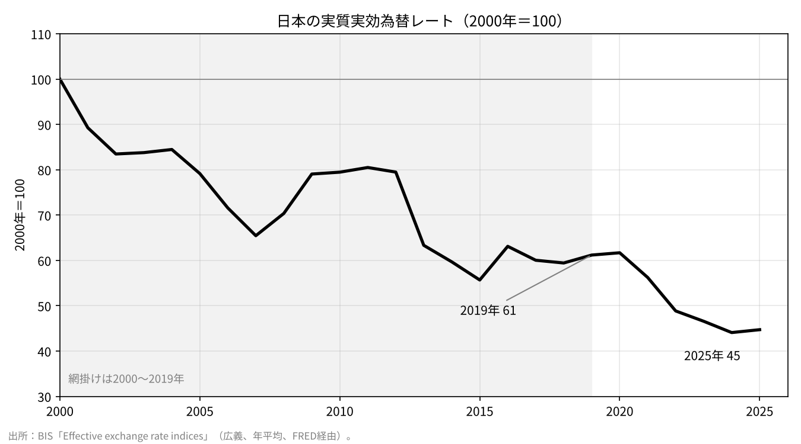
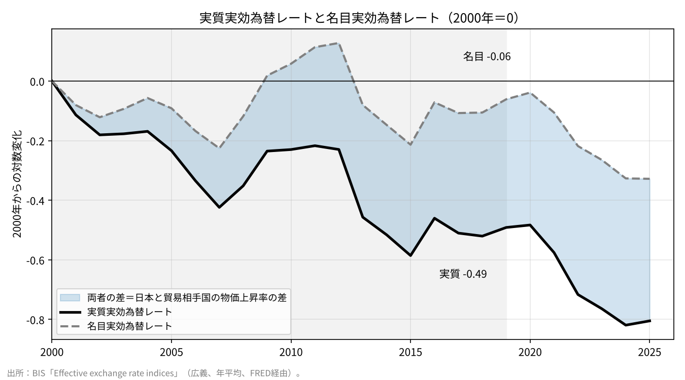

# 円の「実力」は、本当に落ちたのか

ウェブ版：[https://p72.github.io/note-draft/日英のGDPと労働生産性/03\_円の実力は本当に落ちたのか\_読み物版.html](https://p72.github.io/note-draft/%E6%97%A5%E8%8B%B1%E3%81%AEGDP%E3%81%A8%E5%8A%B4%E5%83%8D%E7%94%9F%E7%94%A3%E6%80%A7/03_%E5%86%86%E3%81%AE%E5%AE%9F%E5%8A%9B%E3%81%AF%E6%9C%AC%E5%BD%93%E3%81%AB%E8%90%BD%E3%81%A1%E3%81%9F%E3%81%AE%E3%81%8B_%E8%AA%AD%E3%81%BF%E7%89%A9%E7%89%88.html)

GitHub：[https://github.com/p72/note-draft/blob/main/日英のGDPと労働生産性/03\_円の実力は本当に落ちたのか\_読み物版.md](https://github.com/p72/note-draft/blob/main/%E6%97%A5%E8%8B%B1%E3%81%AEGDP%E3%81%A8%E5%8A%B4%E5%83%8D%E7%94%9F%E7%94%A3%E6%80%A7/03_%E5%86%86%E3%81%AE%E5%AE%9F%E5%8A%9B%E3%81%AF%E6%9C%AC%E5%BD%93%E3%81%AB%E8%90%BD%E3%81%A1%E3%81%9F%E3%81%AE%E3%81%8B_%E8%AA%AD%E3%81%BF%E7%89%A9%E7%89%88.md)

### 実質円安をたどると、賃金と価格が見えてくる

円の実力は、かつての半分以下になった。

日本の実質実効為替レートのグラフを見ると、そう言いたくなる。2000年を100とした指数は、2019年に61、2025年には45まで下がった。右肩下がりの線は、日本経済が力を失ってきた姿のようにも見える。

このグラフは、日本の生産性が伸びなかった結果として説明されることがある。しかし、実質実効為替レートは、生産性そのものを測る指標ではない。では、下がったのは何なのだろうか。

それを知るために、まずは2000年から2019年までの動きをたどってみたい。近年の急激な円安が始まる前に、すでに指数は4割近く下がっていた。この期間に何が起きたのかを見ると、「円の実力」という言葉では見えにくかったものが浮かんでくる。

実質実効為替レートは、円の名目の為替レートに、日本と貿易相手国の物価の違いを織り込んだ指標である。円相場が変わらなくても、海外の物価が上がり、日本の物価が上がらなければ、この指数は下がる。

実際、2000〜2019年の低下を分けると、名目為替の変化が占めるのは1割ほどで、残る9割は物価上昇率の差だった。対数変化で表すと、実質の低下−0.49に対し、名目為替は−0.06、物価の差は−0.43である。

つまり、この時期の実質円安は、主として日本の物価が海外ほど上がらなかったことを映している。

物価の上がらない国の通貨は、長期的には名目で値上がりし、物価の差を埋める。相対的購買力平価は、そう考える。だが、この期間の円には、その差を埋めるだけの名目の円高が起きなかった。海外との物価の開きが、実質実効為替レートの低下として残ったのである。

では、日本の物価が海外ほど上がらなかったことは、私たちの暮らしのどこに表れていたのだろうか。

手がかりになるのが、賃金である。

日本の賃金をドルに換算して米国と比べると、2000〜2019年に大きく低下している。その動きは、日本の米国に対する消費者物価水準や、実質実効為替レートの低下とよく似ている。

これは、日本だけに見られる関係ではない。29か国のデータを使った比較では、先進国の賃金の変化と物価水準の変化には強い対応があり、決定係数は0.77だった。日本を除く先進国の関係式から日本の物価水準の変化を予測すると−0.36となり、実際の−0.38にかなり近い。

日本の動きは、この国際的な関係から外れていない。相対的に賃金が伸びなかった国では、物価水準も相対的に下がっている。

ドル換算の賃金と聞けば、円安の影響ではないかと思うかもしれない。ところが、2000年と2019年の円ドルレートは、年平均で見るとほぼ同じだった。この二つの年を比べる限り、賃金差の拡大に為替が寄与した部分はごく小さい。

違いを生んだのは、それぞれの国で受け取る名目賃金だった。米国の名目賃金が約7割上がる間、日本の名目賃金はほとんど上がらず、むしろ少し下がった。ドルで比べた日本の賃金が低くなったのは、この積み重ねによる。

ここまで来ると、最初の疑問が別の形で戻ってくる。

日本の賃金が上がらなかったのは、やはり生産性が伸びなかったからではないか。

賃金と生産性には関係がある。ただし、生産性が伸びた分だけ、名目賃金が自動的に上がるわけではない。作ったものがいくらで売れるか、そこで生まれた所得がどれだけ労働に分配されるかも関わる。

時間当たり名目賃金は、時間当たり実質労働生産性、GDPデフレーター、労働分配率の積に分けられる。GDPデフレーターは、国内で生み出された財やサービスの価格の動きを表す指標である。さらに1人当たり賃金を比べるなら、労働時間の変化も加わる。

この関係を使って日米の賃金の伸びの差を分解すると、最も大きいのは生産性の差ではなかった。GDPデフレーターの伸びの差だった。

賃金差のうち、GDPデフレーターの寄与は−0.45で、全体の約4分の3を占める。時間当たり労働生産性の寄与は−0.07で、1割強だった。労働時間の寄与も−0.07で、名目為替や労働分配率などの寄与は小さい。

日本でも、生産性は伸びていた。2000〜2019年の時間当たり実質労働生産性の伸びは、対数変化で0.21だった。期間を1995〜2025年に広げると、その伸びはG7で米国に次ぐ。これは生産性の「水準」の順位とは異なるが、日本の生産性が長い間まったく伸びなかったという見方には合わない。

同じ時間で生み出せるものは増えた。それでも、名目賃金は伸びず、生産物の価格は海外に比べて上がらなかった。この三つを、同時に見る必要がある。

生産性と物価、為替をつなぐ経済学の考え方に、「バラッサ＝サミュエルソン効果」がある。

たとえば、海外に製品を売る産業で生産性が上がり、賃金が上がったとする。すると、国内のサービス業も、人を確保するために賃金を上げる必要が出てくる。サービス業の生産性が同じようには伸びなければ、その賃上げはサービス価格に反映される。こうして国全体の物価が上がり、実質為替レートも上がる、という道筋である。

この話では、生産性の上昇が賃金に伝わることが重要になる。

もし生産性が上がっても賃金が上がらなければ、一単位の生産にかかる労働コストは下がる。その場合、生産性の上昇は、価格を押し下げる方向にも働きうる。生産性が伸びたという事実だけでは、物価や実質為替レートがどちらに動くかは決まらない。

菊池信之輔氏の論文も、この点を考える手がかりになる。同論文では、部門別の生産性を多国間貿易モデルに与えると、日本では実質円高が予測される。一方、実際の名目賃金を与えると、観測された実質為替レートの動きがほぼ再現されるという。

生産性だけを見ても、実際の日本の経路にはたどり着かない。賃金の動きを入れることで、初めて見えてくるものがある。

ただし、ここから「賃金が上がらなかったことが、すべての原因だ」と結論することはできない。これまで見てきた分解は、数字のつながりを示すものであり、因果関係を決めるものではない。賃金が上がらないから価格が上がらないのか、価格を上げられないから賃金が上がらないのか。その問いは残っている。

また、バラッサ＝サミュエルソン効果で重要なのは、貿易財と非貿易財の部門間の生産性の差である。国全体の生産性が伸びたという事実だけで、この効果がどの程度働いたかを判断することもできない。

それでも、最初のグラフの読み方は変わるはずだ。

実質実効為替レートの低下を、そのまま日本の生産性の低迷と読み替えることはできない。少なくとも2000〜2019年に大きかったのは、海外との物価上昇率の差であり、それに対応する賃金の伸びの差だった。さらに賃金差の内訳を見ると、生産性よりも、生産物の価格の違いが大きな部分を占めていた。

「円の実力が落ちた」という一言の奥には、生産性が伸びても名目の賃金と価格が上がらず、為替もその差を埋めなかったという、具体的な経済の姿がある。

なぜ、生産性の伸びが賃金や価格の上昇と結びつかなかったのか。右肩下がりのグラフを出発点に考えたいのは、その問いである。

---

※ 数値は断りのない限り2000〜2019年の対数変化。対数変化の数値は、通常の増減率とは異なる。

※ 2020年以降は名目円安の寄与が大きくなる。2000〜2025年全体では、名目為替の変化が−0.33、物価上昇率の差が−0.48であり、「9割が物価の差」という説明は2000〜2019年についてのものである。

※ BISの実質実効為替レートは消費者物価に基づく。消費者物価とGDPデフレーターは対象が異なり、両者の動きの違いには交易条件の変化なども含まれる。

出所：BIS「Effective exchange rate indices」、OECDの賃金・国民経済計算・生産性データ、厚生労働省「毎月勤労統計調査」。参考文献：Kikuchi, Shinnosuke（2026）“Balassa–Samuelson in the Long Run: Qualitative success, quantitative limits,” RIETI Discussion Paper 26-E-012。
