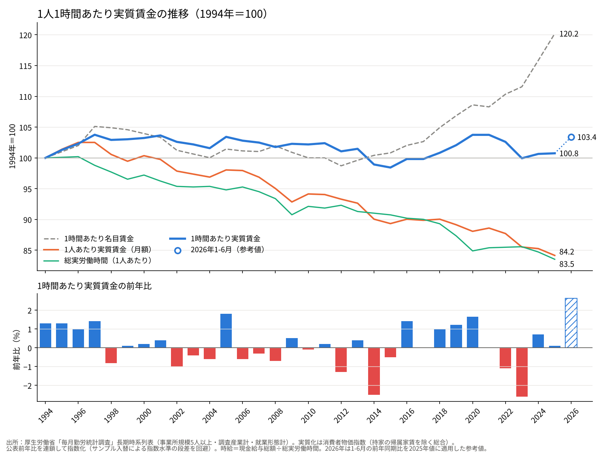
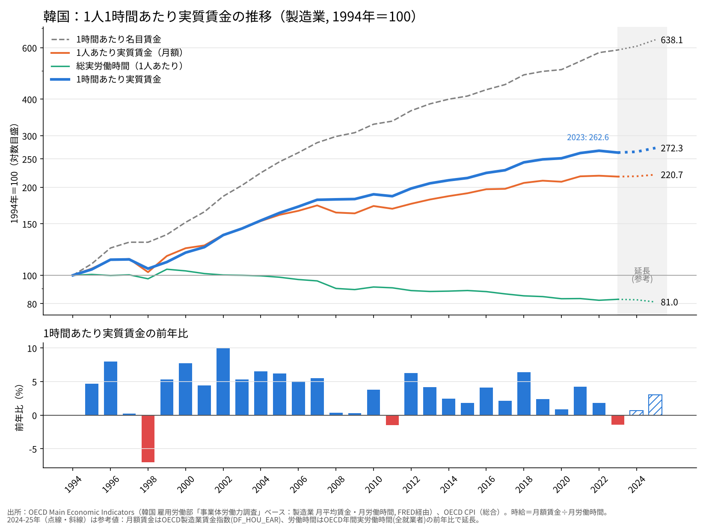
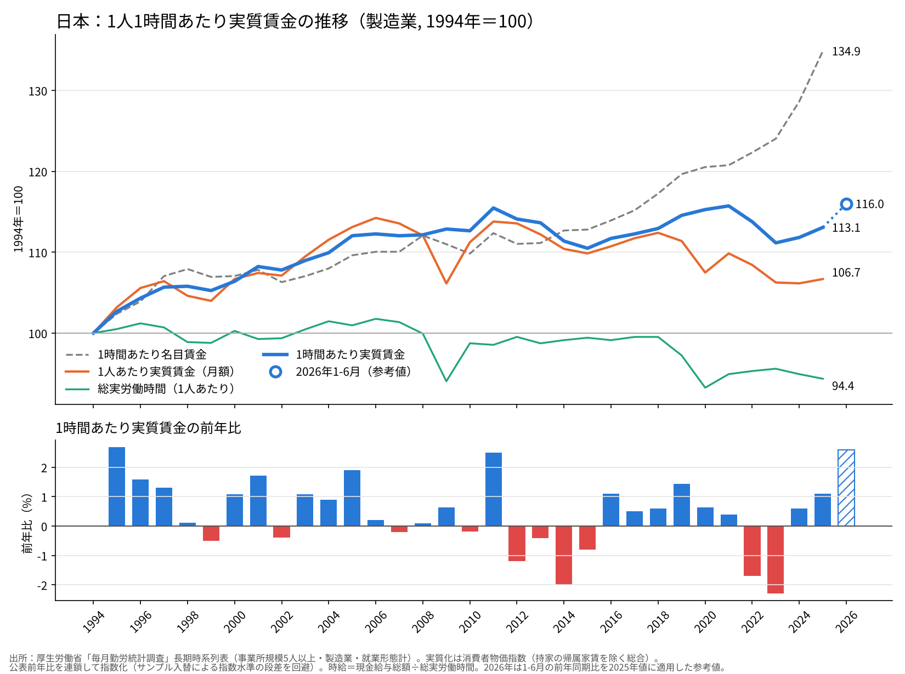
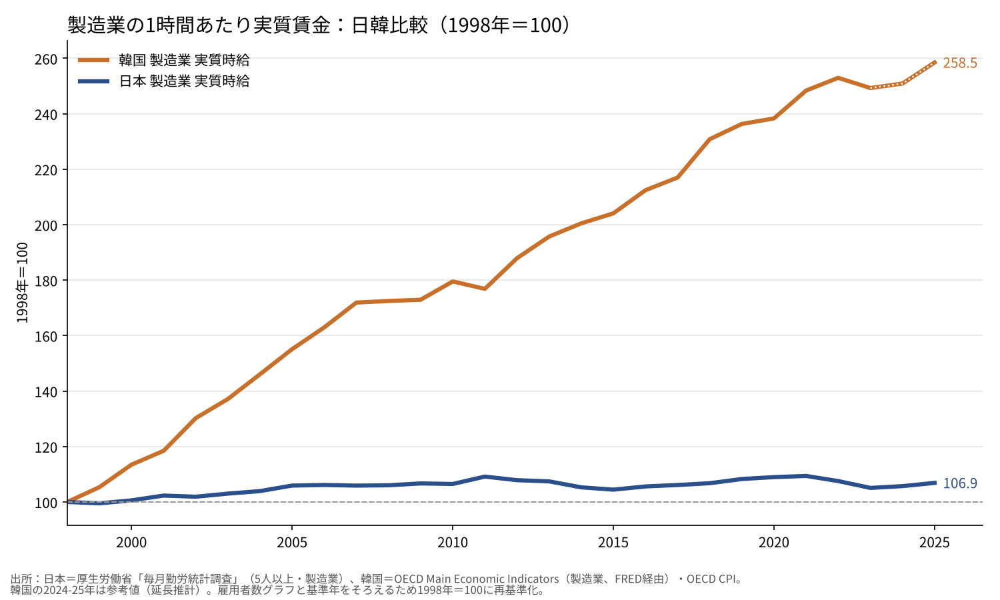
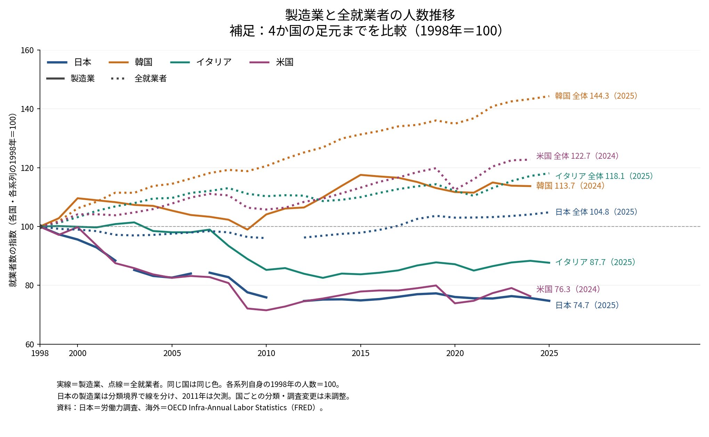

# 日韓の実質賃金を分けたのは製造業の労働需要だった──賃金と雇用者数を同じ物差しで並べる

ウェブ版：[https://p72.github.io/note-draft/時間あたり実質賃金/02\_日韓の実質賃金を分けたのは製造業の労働需要だった.html](https://p72.github.io/note-draft/%E6%99%82%E9%96%93%E3%81%82%E3%81%9F%E3%82%8A%E5%AE%9F%E8%B3%AA%E8%B3%83%E9%87%91/02_%E6%97%A5%E9%9F%93%E3%81%AE%E5%AE%9F%E8%B3%AA%E8%B3%83%E9%87%91%E3%82%92%E5%88%86%E3%81%91%E3%81%9F%E3%81%AE%E3%81%AF%E8%A3%BD%E9%80%A0%E6%A5%AD%E3%81%AE%E5%8A%B4%E5%83%8D%E9%9C%80%E8%A6%81%E3%81%A0%E3%81%A3%E3%81%9F.html)

GitHub：[https://github.com/p72/note-draft/blob/main/時間あたり実質賃金/02\_日韓の実質賃金を分けたのは製造業の労働需要だった.md](https://github.com/p72/note-draft/blob/main/%E6%99%82%E9%96%93%E3%81%82%E3%81%9F%E3%82%8A%E5%AE%9F%E8%B3%AA%E8%B3%83%E9%87%91/02_%E6%97%A5%E9%9F%93%E3%81%AE%E5%AE%9F%E8%B3%AA%E8%B3%83%E9%87%91%E3%82%92%E5%88%86%E3%81%91%E3%81%9F%E3%81%AE%E3%81%AF%E8%A3%BD%E9%80%A0%E6%A5%AD%E3%81%AE%E5%8A%B4%E5%83%8D%E9%9C%80%E8%A6%81%E3%81%A0%E3%81%A3%E3%81%9F.md)

※ この記事は「[1時間あたり実質賃金は1994年からほぼ横ばいだった](https://p72.github.io/note-draft/%E6%99%82%E9%96%93%E3%81%82%E3%81%9F%E3%82%8A%E5%AE%9F%E8%B3%AA%E8%B3%83%E9%87%91/01_1%E6%99%82%E9%96%93%E3%81%82%E3%81%9F%E3%82%8A%E5%AE%9F%E8%B3%AA%E8%B3%83%E9%87%91%E3%81%AF1994%E5%B9%B4%E3%81%8B%E3%82%89%E3%81%BB%E3%81%BC%E6%A8%AA%E3%81%B0%E3%81%84%E3%81%A0%E3%81%A3%E3%81%9F.html)」の続編である。雇用者数のグラフは「[製造業で働く人の割合は1973年がピークだった](https://p72.github.io/note-draft/%E8%A3%BD%E9%80%A0%E6%A5%AD%E3%81%AE%E5%B0%B1%E6%A5%AD%E8%80%85%E3%82%B7%E3%82%A7%E3%82%A2/01_%E8%A3%BD%E9%80%A0%E6%A5%AD%E3%81%A7%E5%83%8D%E3%81%8F%E4%BA%BA%E3%81%AE%E5%89%B2%E5%90%88%E3%81%AF1973%E5%B9%B4%E3%81%8C%E3%83%94%E3%83%BC%E3%82%AF%E3%81%A0%E3%81%A3%E3%81%9F.html)」の作業で作った国際比較を使っている。

日本の1時間あたり実質賃金は、30年かけてほぼ元の水準に戻っただけである。同じ期間に、韓国の製造業の実質時給は2.7倍になった。この差はどこから来たのか。本稿では、賃金と雇用者数を同じ物差しで並べ、日韓の差の多くが製造業の雇用の動きと重なっていることを示す。ただし結論を先に言えば、効いているのは「労働供給」ではなく、製造業の**労働需要**の側である。

## 1. 出発点：日本の時給は30年で横ばい

毎月勤労統計調査（5人以上・調査産業計）で見ると、1994年を100とした1時間あたり実質賃金は2025年に100.8である。名目の時給は120.2まで上がったが、物価上昇がそれをほぼ相殺した。

1人あたり実質月給は84.2まで下がっているが、これは主に労働時間が83.5まで短くなったことによる。パートタイム労働者の比率が上がると、1人あたりの労働時間と月給は平均として押し下げられる。時給で見れば下がってはいない。しかし、上がってもいない。

## 2. 韓国の製造業：時給は2.7倍

韓国については、1994年まで遡れる全産業の労働時間を取得できなかったため、製造業で作った。韓国雇用労働部の事業体調査をもとにしたOECD Main Economic Indicatorsの月平均賃金と月間労働時間から時給を計算し、消費者物価で実質化している。

2025年の1時間あたり実質賃金は272.3、1人あたり実質月給は220.7である。労働時間は81.0まで短くなったが、月給はそれを大きく上回って伸びた。実質時給が前年を下回ったのは、通貨危機の1998年、2011年、物価が急騰した2023年の3回しかない。

なお、OECDのデータベースで韓国の製造業「時間当たり賃金」とされている系列は、中身を確かめると月額賃金の指数とほぼ一致していた。本稿の時給は、月額賃金を月間労働時間で割って作り直したものである。

## 3. 物差しをそろえる：日本の製造業

韓国が製造業だけである以上、日本も製造業でそろえなければ比較にならない。

日本の製造業の実質時給は2025年に113.1で、全産業（100.8）よりは高い。実質月給も106.7と、1994年の水準をかろうじて上回っている。全産業との差の大部分は労働時間にある。製造業の労働時間は94.4までしか下がっておらず、パートタイム比率の上昇という構成変化の影響が小さいためである。

それでも、韓国の製造業と並べると差は歴然としている。

雇用者数のグラフと基準年をそろえて1998年を100とすると、2025年の値は日本106.9、韓国258.5である。韓国の実質時給は通貨危機の底から27年で2.6倍になり、日本は7%しか伸びていない。

## 4. 製造業の雇用者数：日本は4分の3、韓国は1割増

雇用者数を見ると、日韓の違いはさらにはっきりする。1998年を100として、日本の製造業就業者は2025年に74.7まで減った。4人に1人の職場が消えた計算である。一方、韓国の製造業就業者は2024年に113.7と、ほぼ一貫して1998年の水準を上回っている。

全就業者で見ても、日本の104.8に対し韓国は144.3である。韓国では、就業者全体が大きく増えるなかで、製造業も人数を維持し、むしろ増やした。

## 5. 賃金と人数が同じ向きに動いた意味

ここで、賃金（価格）と雇用者数（数量）の動きを並べてみる。

1998年を100として、日本・製造業と韓国・製造業の値は次のとおりである。

- 1時間あたり実質賃金（2024年）：日本105.7、韓国250.9
- 1人あたり実質月給（2024年）：日本101.5、韓国212.7
- 製造業の就業者数（日本は2025年、韓国は2024年）：日本74.7、韓国113.7
- 全就業者数（2025年）：日本104.8、韓国144.3

韓国では賃金も人数も増えた。日本では人数が大きく減り、賃金は伸びなかった。価格と数量が**同じ向き**に動いている。

これは労働供給の変化では説明しにくい。もし働き手が足りなくなる（供給が縮む）なら、人数は減るが、賃金は上がるはずである。働き手が増える（供給が膨らむ）なら、人数は増えるが、賃金は下がるはずである。価格と数量が逆向きに動くのが、供給側の変化の特徴である。

韓国では就業者全体が44%も増えた。労働供給はむしろ大きく増えている。それでも製造業の賃金が2.6倍になったのは、それを上回る勢いで企業が働き手を求めたからである。日本では、製造業が人を減らすなかで賃金も伸びなかった。工場の海外移転や国内生産の縮小によって、製造業の労働需要そのものが細ったと考えるのが自然である。

つまり、日韓の差を分けたのは、製造業が「雇用の受け皿」として拡大し続けたか、縮小したかという**労働需要の差**である。

生産性の高い製造業で雇用が維持されれば、賃金の高い職場に人が残り、その職場の賃上げが経済全体の賃金を引っ張る。日本ではその職場が4分の1減り、押し出された人の多くは賃金水準の低いサービス業に移った。全産業の時給が製造業よりさらに伸びなかったことは、この見方と矛盾しない。

## 6. 留保：この比較で言えないこと

ただし、この比較だけで日韓の差をすべて説明できるわけではない。少なくとも次の点は割り引いて見る必要がある。

- **出発点の違い。** 1990年代半ばの韓国の賃金水準は日本よりかなり低かった。低い水準から先進国に追いつく過程では、生産性も賃金も速く伸びやすい。韓国の伸びの一部はキャッチアップである。
- **米国の例。** 米国の製造業就業者も76.3まで減り、日本とほぼ同じ形をしている。製造業の雇用が縮んでも、他の産業が高い賃金の雇用を生めば経済全体の賃金は伸びうる。製造業の雇用だけが唯一の経路ではない。
- **統計の違い。** 日本は毎月勤労統計調査（5人以上）、韓国はOECD経由の事業体調査で、対象となる事業所の規模や労働者の範囲が完全には一致しない。韓国の2024〜25年は、別の系列の伸びで延長した参考値である。
- **企業規模の二重構造。** 韓国では大企業と中小企業の賃金格差が大きい。製造業の平均が伸びていても、すべての働き手の賃金が同じように伸びたわけではない。
- **為替と交易条件。** 本稿の実質賃金は自国の消費者物価で実質化したもので、為替や輸入物価の影響を国際的に比べたものではない。

## 7. まとめ

日本の実質時給が30年間ほぼ横ばいだったのに対し、韓国の製造業の実質時給は2.6〜2.7倍になった。物差しを製造業にそろえても、差は縮まらない。

その差と重なるのが、製造業の雇用者数の動きである。韓国では製造業の人数が維持・拡大し、賃金も上がった。日本では人数が4分の3に減り、賃金は伸びなかった。価格と数量が同じ向きに動いている以上、効いているのは労働供給ではなく、製造業の労働需要の差である。

日本の賃金停滞を考えるとき、「人手が足りないのになぜ賃金が上がらないのか」という問いの立て方だけでは足りない。高い賃金を払える職場が国内でどれだけ維持されてきたか、という需要の側の問いが欠かせない。

---

### データと作成方法

取得・作図コードは `code/02_japan_mfg.py`、`code/02_korea_mfg.py`、計算結果は `code/02_japan_mfg.csv`、`code/02_korea_mfg.csv` に置いた。

- **日本（全産業・製造業）**：厚生労働省「毎月勤労統計調査」長期時系列表（事業所規模5人以上・就業形態計）。現金給与総額、総実労働時間、実質賃金（消費者物価指数〈持家の帰属家賃を除く総合〉で実質化）の公表前年比を連鎖して指数化。時給＝現金給与総額÷総実労働時間。2026年は1〜6月の前年同期比を用いた参考値。e-Stat APIのデータカタログから取得。[https://www.e-stat.go.jp/stat-search/files?toukei=00450071](https://www.e-stat.go.jp/stat-search/files?toukei=00450071)
- **韓国（製造業）**：OECD Main Economic Indicators の製造業月平均賃金指数・月間労働時間指数（FRED経由、1993〜2023年第3四半期、2023年は1〜9月の前年同期比で算出）。2024〜25年は、月額賃金をOECD製造業賃金指数（DF_HOU_EAR）、労働時間をOECD年間実労働時間（全就業者）の前年比で延長した参考値。消費者物価はOECD CPI（総合）。[https://data-explorer.oecd.org](https://data-explorer.oecd.org)、[https://fred.stlouisfed.org](https://fred.stlouisfed.org)
- **雇用者数**：日本は総務省「労働力調査」、海外はOECD Infra-Annual Labor Statistics（FRED経由）。各系列の1998年＝100。国ごとの分類・調査変更は未調整。
