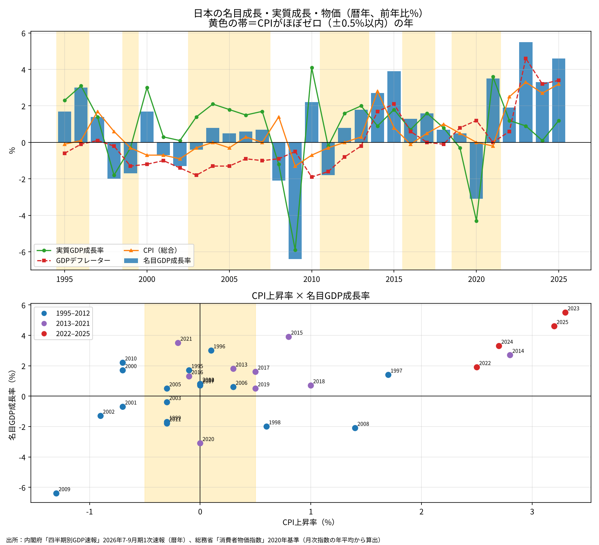

# 日本の最適な物価上昇率は2％である──「インフレ」と騒ぐのは、それを大きく超えたときでよい

ウェブ版：[https://p72.github.io/note-draft/最適な物価上昇率/01\_日本の最適な物価上昇率は2％である.html](https://p72.github.io/note-draft/%E6%9C%80%E9%81%A9%E3%81%AA%E7%89%A9%E4%BE%A1%E4%B8%8A%E6%98%87%E7%8E%87/01_%E6%97%A5%E6%9C%AC%E3%81%AE%E6%9C%80%E9%81%A9%E3%81%AA%E7%89%A9%E4%BE%A1%E4%B8%8A%E6%98%87%E7%8E%87%E3%81%AF2%EF%BC%85%E3%81%A7%E3%81%82%E3%82%8B.html)

GitHub：[https://github.com/p72/note-draft/blob/main/最適な物価上昇率/01\_日本の最適な物価上昇率は2％である.md](https://github.com/p72/note-draft/blob/main/%E6%9C%80%E9%81%A9%E3%81%AA%E7%89%A9%E4%BE%A1%E4%B8%8A%E6%98%87%E7%8E%87/01_%E6%97%A5%E6%9C%AC%E3%81%AE%E6%9C%80%E9%81%A9%E3%81%AA%E7%89%A9%E4%BE%A1%E4%B8%8A%E6%98%87%E7%8E%87%E3%81%AF2%EF%BC%85%E3%81%A7%E3%81%82%E3%82%8B.md)

※ この記事は**筆者のオピニオン（意見）**である。データは内閣府 経済社会総合研究所（ESRI）「四半期別GDP速報」（2026年7-9月期1次速報、暦年）と、総務省「消費者物価指数」（2020年基準、e-Stat API）を使っている。

物価が前年比で2％を少し超えただけで、「インフレ」「物価高」と大きく報じられる。だが、日本経済にとって望ましい物価上昇率はゼロではない。筆者は、**日本の最適な物価上昇率は消費者物価（CPI）で年2％前後であり、「インフレ」として警戒すべきなのは、それを大きく、かつ持続的に超えたときである**と考える。

主張を先に書く。

- **人も企業も「名目」で暮らしている。** 賃金・売上・借金はすべて名目の金額で決まる。明日の名目所得が右肩上がりであることが、家計と企業にとって最も暮らしやすい状態である。
- **日本の実績では、CPIがほぼゼロの年に名目GDPはほとんど伸びなかった。** CPIが±0.5％以内だった16年間の名目GDP成長率は平均0.6％にとどまった。CPIがゼロでも、GDPデフレーターはマイナスだったからである。
- **名目成長がはっきりプラスになったのは、CPIが2％を超えた年である。** 2022〜25年の名目GDP成長率は平均3.8％だった。実質成長率は、デフレ期もインフレ期もおおむね年1％前後で変わらない。
- **2％は「上限」ではなく「目標」である。** 2％前後の物価上昇は日本経済が健全に回っている状態であり、騒ぐべき「インフレ」ではない。

## 名目成長率は「実質成長率＋物価上昇率」である

名目GDP成長率は、おおむね実質GDP成長率とGDPデフレーター上昇率の和になる。

- 名目成長率 ≒ 実質成長率 ＋ 物価上昇率（GDPデフレーター）

物価上昇率がゼロなら、名目成長率は実質成長率と同じになる。理屈の上では、ゼロ物価でも実質成長がプラスなら名目成長もプラスになる。

問題は、日本の実質成長率がそもそも年1％前後しかないことである。物価がゼロなら、名目の所得も売上も年1％前後しか伸びない。しかも、後で見るように、日本ではCPIがゼロのときGDPデフレーターはマイナスになりやすい。その結果、名目成長率は実質成長率よりもさらに低くなる。

## 日本の実績：CPIがゼロでも名目GDPは伸びなかった

上の図は、1995〜2025年の名目GDP成長率、実質GDP成長率、GDPデフレーター上昇率、CPI上昇率（いずれも暦年、前年比）である。黄色の帯は、CPI上昇率が±0.5％以内だった年を示す。

時期ごとの平均をまとめると、次のようになる。

- **CPIがほぼゼロ（±0.5％以内）の16年**：名目GDP ＋0.6％、実質GDP ＋1.1％、GDPデフレーター −0.5％、CPI 0.0％
- **1995〜2012年（デフレ期）**：名目GDP −0.2％、実質GDP ＋0.8％、GDPデフレーター −1.0％、CPI −0.1％
- **CPIが2％以上の5年（2014年、2022〜25年）**：名目GDP ＋3.6％、実質GDP ＋0.9％、GDPデフレーター ＋2.7％、CPI ＋2.9％
- **2022〜25年**：名目GDP ＋3.8％、実質GDP ＋0.9％、GDPデフレーター ＋3.0％、CPI ＋2.9％

ここから読み取れることは3つある。

第一に、**実質成長率は時期によってそれほど変わらない**。デフレ期も、CPIがゼロの年も、インフレ期も、平均はおおむね年1％前後である。名目成長率の差を生んでいるのは、ほぼ物価（GDPデフレーター）の差である。

第二に、**CPIがゼロでもGDPデフレーターはマイナスだった**。CPIがほぼゼロの16年でも、GDPデフレーターは平均で−0.5％だった。そのため名目成長率（0.6％）は実質成長率（1.1％）を下回る「名実逆転」になった。CPIは輸入品の価格を含むが、GDPデフレーターは国内で生み出した付加価値の価格であり、輸入価格の上昇はGDPデフレーターを押し下げる。CPIでゼロは、GDPの物差しで見ればデフレだったのである。

第三に、**名目GDPがはっきり右肩上がりになったのは、CPIが2％を超えた年である**。図の下段の散布図を見ると、CPIが2％を超える右側の点（2014年、2022〜25年）はいずれも名目成長率がプラスで、2023年と2025年は4〜5％台に達している。なお、2014年のCPIには消費税率の引き上げ（5％→8％）による押し上げが含まれる。

## なぜ0％ではなく2％なのか

日本の実績に加えて、物価上昇率をゼロではなく2％前後に置くべき理由は、少なくとも4つある。

### 1. CPIは物価上昇を高めに測る

CPIは、品質向上や新商品の登場、消費者が安い品物に買い替える動きを十分に反映できず、実際の生計費の上昇を高めに測る傾向があると指摘されてきた。CPIで0％は、実際には緩やかな物価下落かもしれない。目標をCPIで0％に置くと、実際にはデフレを目指すことになりかねない。

### 2. 名目賃金は下げにくい

名目賃金は下げにくい。物価がゼロの経済では、ある産業や企業の実質賃金を下げて調整しようとすると、名目賃金を実際に引き下げるしかない。それが難しければ、調整は雇用の削減や採用の抑制、非正規化に回る。物価が2％上がる経済なら、名目賃金を据え置くだけで実質賃金を下げられる。アカロフ、ディケンズ、ペリー（1996年）は、この名目賃金の下方硬直性を理由に、低すぎるインフレ率は失業を高めると論じた。日本の1990年代末から2000年代の雇用調整は、この議論と整合的である。

### 3. 金利の「のりしろ」がなくなる

名目金利は、おおむね実質金利と期待インフレ率の和である。物価上昇率がゼロなら、平時の名目金利も低くなる。そうなると、景気が悪化したときに中央銀行が利下げできる幅が小さくなり、すぐにゼロ金利に張り付く。日本は1999年のゼロ金利政策以降、まさにこの状態が長く続いた。2％の物価上昇は、金融政策が景気に対応するための「のりしろ」でもある。

### 4. 借金の実質負担が軽くならない

住宅ローンも企業の借入も、名目の金額で決まっている。物価と名目所得が伸びれば、借金の返済負担は年々軽くなる。物価がゼロで名目所得も伸びなければ、借金の重さは変わらない。家計も企業も借りて投資することをためらい、経済全体が縮こまる。

### 国際的にも2％が標準である

日本銀行は2012年2月に「中長期的な物価安定の目途」として当面1％を掲げ、2013年1月に消費者物価の前年比上昇率2％を「物価安定の目標」とした。米連邦準備制度理事会（FRB）は2012年に2％を長期的な目標として明示し、欧州中央銀行（ECB）も2021年に「2％を下回るが近い水準」から「対称的な2％」へ目標を改めた。主要な中央銀行は、そろって2％を目標にしている。

為替の面でも意味がある。日本だけが0％を目指し、海外が2％なら、長い目で見て円は名目で上がり続ける圧力を受ける。円高は輸出企業の採算を悪化させ、デフレ圧力を強める。

## 「インフレ」と騒ぐべきなのはいつか

2％が最適なら、2％前後の物価上昇は**目標どおりの望ましい状態**である。2％を少し上回ったからといって、「インフレだ」「物価高だ」と騒ぐのは筋が違う。

では、どこから警戒すべきか。筆者は、**水準そのものより、2％からのずれの大きさと持続性で判断すべき**だと考える。目安としては次のとおりである。

- **1％台後半〜2％台半ば**：目標の範囲内。騒ぐ必要はない。
- **3％台**：注視は必要。ただし、輸入物価の一時的な上昇によるものか、賃金と期待インフレの上振れを伴うものかを見分けるべきである。
- **4％を超え、それが1年以上続き、期待インフレや賃金がそれに追随して上がり続けるとき**：本当の意味で「インフレ」と呼び、金融政策で抑えるべき局面である。

ここで重要なのは、**物価上昇の中身**である。2022〜23年のように、原油や食料の輸入価格の上昇で物価が上がる場合、それは交易条件の悪化であり、日本全体が海外に所得を払っている状態である。この場合に困るのは「物価が上がること」そのものより、「賃金が物価に追いつかないこと」である。必要なのは、物価を無理に0％に押し戻すことではなく、名目賃金が2％の物価上昇と生産性の伸びの分だけ上がる経済にすることである。

## 反対の意見について

この主張には反対の意見もある。公平のために、主なものを挙げておく。

- **実質賃金が下がっている家計には、2％でも痛い。** 2022年以降、名目賃金の伸びは物価に追いつかず、実質賃金は下がってきた。物価が2％でも、賃金がそれ以上に上がらなければ生活は苦しくなる。
- **2％という数字に強い根拠はない。** 2％は各国の慣行として定着した数字であり、日本の経済構造に照らして最適だと厳密に示されたものではない。日本銀行自身も、2013年から10年近く2％を達成できなかった。
- **日本は1％程度で十分だという議論もある。** 実際、日本銀行は2012年に当面1％を「目途」としていた。
- **輸入物価による物価上昇は、目標の2％と同じではない。** 交易条件の悪化による物価上昇は国民を貧しくするので、「2％を達成した」と喜ぶべきものではない。

これらの指摘はもっともである。ただし筆者は、いずれも「2％は不適切だ」という結論にはならないと考える。実質賃金の問題は、物価を0％に戻すことではなく、名目賃金を引き上げることで解決すべきである。日本が0〜1％で過ごした30年間、名目所得はほとんど伸びなかった。輸入物価の問題は、目標の数字ではなく、物価上昇の中身を見分けることで対処すべきである。

## まとめ

- 人も企業も名目で暮らしている。明日の名目所得が右肩上がりであることが望ましい。
- 日本の実績では、CPIがほぼゼロの年の名目成長率は平均0.6％にとどまり、名目成長がはっきりプラスになったのはCPIが2％を超えた年だった。
- CPIの上方バイアス、名目賃金の下方硬直性、金利の「のりしろ」、借金の実質負担を考えれば、最適な物価上昇率は0％ではなく2％前後である。
- 2％前後の物価上昇は目標どおりの状態であり、「インフレ」と騒ぐべきなのは、それを大きく、かつ持続的に超えたときである。

## 関連記事

- [交易条件とデフレ/02\_CPIとGDPデフレーターの差と実質賃金](https://p72.github.io/note-draft/%E4%BA%A4%E6%98%93%E6%9D%A1%E4%BB%B6%E3%81%A8%E3%83%87%E3%83%95%E3%83%AC/02_CPI%E3%81%A8GDP%E3%83%87%E3%83%95%E3%83%AC%E3%83%BC%E3%82%BF%E3%83%BC%E3%81%AE%E5%B7%AE%E3%81%A8%E5%AE%9F%E8%B3%AA%E8%B3%83%E9%87%91.html)
- [賃金3％と物価2％/01\_毎勤の賃金3％は物価2％と整合的か](https://p72.github.io/note-draft/%E8%B3%83%E9%87%913%EF%BC%85%E3%81%A8%E7%89%A9%E4%BE%A12%EF%BC%85/01_%E6%AF%8E%E5%8B%A4%E3%81%AE%E8%B3%83%E9%87%913%EF%BC%85%E3%81%AF%E7%89%A9%E4%BE%A12%EF%BC%85%E3%81%A8%E6%95%B4%E5%90%88%E7%9A%84%E3%81%8B.html)

## データの出所

- 名目GDP成長率・実質GDP成長率・GDPデフレーター上昇率：内閣府 経済社会総合研究所「四半期別GDP速報」2026年7-9月期1次速報、暦年系列（ritu-mcy、ritu-jcy、rdef-cy）。[https://www.esri.cao.go.jp/jp/sna/sokuhou/sokuhou\_top.html](https://www.esri.cao.go.jp/jp/sna/sokuhou/sokuhou_top.html)
- CPI上昇率：総務省「消費者物価指数」2020年基準、全国、総合（e-Stat API、統計表ID 0003427113）。月次の指数を暦年で平均し、前年比を計算した。[https://www.e-stat.go.jp/](https://www.e-stat.go.jp/)
- 数値：`01_data.csv`、コード：`code/`
- 参考文献：Akerlof, G. A., Dickens, W. T., & Perry, G. L. (1996). The Macroeconomics of Low Inflation. *Brookings Papers on Economic Activity*, 1996(1).
