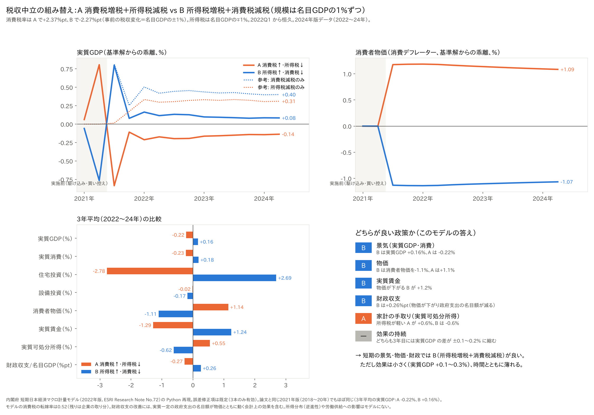

# 消費税と所得税を入れ替えると、景気はどうなるか──税収を変えずに「名目GDPの1%」を組み替えた2つの案を内閣府モデルで比べた

ウェブ版：[https://p72.github.io/note-draft/消費税と所得税の組み替え/01\_消費税と所得税を入れ替えると景気はどうなるか.html](https://p72.github.io/note-draft/%E6%B6%88%E8%B2%BB%E7%A8%8E%E3%81%A8%E6%89%80%E5%BE%97%E7%A8%8E%E3%81%AE%E7%B5%84%E3%81%BF%E6%9B%BF%E3%81%88/01_%E6%B6%88%E8%B2%BB%E7%A8%8E%E3%81%A8%E6%89%80%E5%BE%97%E7%A8%8E%E3%82%92%E5%85%A5%E3%82%8C%E6%9B%BF%E3%81%88%E3%82%8B%E3%81%A8%E6%99%AF%E6%B0%97%E3%81%AF%E3%81%A9%E3%81%86%E3%81%AA%E3%82%8B%E3%81%8B.html)

GitHub：[https://github.com/p72/note-draft/blob/main/消費税と所得税の組み替え/01\_消費税と所得税を入れ替えると景気はどうなるか.md](https://github.com/p72/note-draft/blob/main/%E6%B6%88%E8%B2%BB%E7%A8%8E%E3%81%A8%E6%89%80%E5%BE%97%E7%A8%8E%E3%81%AE%E7%B5%84%E3%81%BF%E6%9B%BF%E3%81%88/01_%E6%B6%88%E8%B2%BB%E7%A8%8E%E3%81%A8%E6%89%80%E5%BE%97%E7%A8%8E%E3%82%92%E5%85%A5%E3%82%8C%E6%9B%BF%E3%81%88%E3%82%8B%E3%81%A8%E6%99%AF%E6%B0%97%E3%81%AF%E3%81%A9%E3%81%86%E3%81%AA%E3%82%8B%E3%81%8B.md)

※ この記事は、内閣府 経済社会総合研究所（ESRI）の「短期日本経済マクロ計量モデル（2022年版）」を Python で再現したもの（[p72/esri-short-run-macro-model](https://github.com/p72/esri-short-run-macro-model)）と、ESRI の国民経済計算（2024年度年次推計）で計算している。

減税の議論では「消費税を下げるか、所得税を下げるか」がよく対立する。ただ、減税だけを比べると、財源の話が抜け落ちる。そこで、税収の合計を変えずに、2つの税の負担を入れ替えたらどうなるかを考える。

- **A 消費税増税＋所得税減税**：消費税で名目GDPの1%を増税し、同じ額だけ所得税を減税する
- **B 所得税増税＋消費税減税**：所得税で名目GDPの1%を増税し、同じ額だけ消費税を減税する

どちらも事前の税収は増えも減りもしない。この2つを内閣府のマクロモデルで解き、どちらが良い政策かを比べた。

結果を先に書く。

- **景気・物価・実質賃金・財政収支では B が良い**。3年平均で、実質GDP は B が+0.16%、A が−0.22%。消費者物価は B が−1.1%、A が+1.1%。
- **家計の実質可処分所得（手取り）では A が良い**。A は+0.55%、B は−0.62%。
- **ただし差は小さく、時間とともに縮む**。実質GDP の差は1年目が最も大きく（B +0.29%、A −0.33%）、3年目には B +0.08%、A −0.14% になる。
- B の景気の押し上げの多くは、消費税率に直接反応する住宅投資と消費から来ている。

## 計算の設定

- **消費税**：標準税率を変える。初年の税収ベースで、事前の消費税収の変化が名目GDP の1%になる幅にした。A は税率+2.37ポイント、B は税率−2.27ポイント（増税と減税で幅がわずかに違うのは、税率が上がると課税ベースが少し縮むため）。
- **所得税**：個人所得税に名目GDP の1%の増減を与えた（論文の所得税減税シナリオと同じ方法）。
- **時期**：2022年1〜3月期から恒久的に実施し、2024年10〜12月期まで解いた（2024年版データ）。論文と同じ2021年版データ（2018〜20年に実施）でも同じ計算をした。
- **比べ方**：税を変えなかった場合（標準解）からの乖離で見る。
- **金融政策**：モデルの金融政策ルールのまま変えていない。
- **誤差修正項**：既定の設定（消費・個人企業所得・消費デフレーターの3本だけ有効、他は標準解の値で固定）。

## 結果：3年平均（2022〜24年）

標準解からの乖離である。

- 実質GDP：A −0.22%、B +0.16%
- 実質消費：A −0.23%、B +0.18%
- 住宅投資：A −2.78%、B +2.69%
- 設備投資：A −0.02%、B −0.17%
- 消費者物価（消費デフレーター）：A +1.14%、B −1.11%
- 実質賃金：A −1.29%、B +1.24%
- 実質可処分所得：A +0.55%、B −0.62%
- 財政収支（名目GDP 比）：A −0.27ポイント、B +0.26ポイント

2021年版データ（2018〜20年）でもほぼ同じで、3年平均の実質GDP は A が−0.22%、B が+0.16% である。

## 実質GDP の年ごとの推移

- B：1年目+0.29%、2年目+0.11%、3年目+0.08%
- A：1年目−0.33%、2年目−0.18%、3年目−0.14%

消費税率の変更は事前に分かるので、実施前の2四半期に、A では駆け込み需要、B では買い控えが出る。実施の直前の四半期には、実質GDP が A で+0.8%、B で−0.8%近く動く。図の灰色の部分がこれにあたる。実施した後は、その反動が出る。

## なぜ B のほうが景気に良いのか

このモデルでは、**同じ額なら、消費税減税のほうが所得税減税より景気を押し上げる**。それぞれ単独で減税した場合の実質GDP は次のとおりである。

- 消費税減税だけ（名目GDP の1%）：1年目+0.50%、2年目+0.44%、3年目+0.41%
- 所得税減税だけ（名目GDP の1%）：1年目+0.20%、2年目+0.32%、3年目+0.32%

B は「消費税減税＋所得税増税」なので、おおよそ前者から後者を引いた値になる（1年目 0.50−0.20 ≒ +0.30%、3年目 0.41−0.32 ≒ +0.09%）。A はその逆である。

消費税減税が効く理由は2つある。

- **物価が下がる**：消費税率が下がると消費者物価が直接下がり、名目賃金が変わらなくても実質賃金が上がる。
- **消費と住宅投資が税率に直接反応する**：モデルの消費と住宅投資の式には、消費税率の変化そのものが入っている。税率の変更を見越した駆け込みや買い控えに加えて、住宅投資は実施後の水準がずれたまま戻らない（このモデルの既定の設定では住宅投資の誤差修正項を固定しているので、元の水準に戻す力が働かない）。

3年平均の実質GDP の差（B +0.16%）のうち、約3分の2は住宅投資（+2.7%、GDP の約4%）からの寄与である。B の優位は、住宅投資の式の性質にかなり頼っている点に注意したい。

一方、所得税減税の効果は時間とともに大きくなり、消費税減税の効果は少しずつ小さくなる。このため、A と B の差は年を追って縮む。

## 手取りは A のほうが増える

B は景気には良いが、家計の実質可処分所得は減る（−0.62%）。所得税の増税額（名目GDP の1%）は可処分所得の約2%にあたり、物価の下落（−1.1%）だけでは埋め合わせられないからである。A はその逆で、所得税減税が物価の上昇を上回り、手取りは増える（+0.55%）。

それでも B の消費が増えるのは、モデルの消費が、可処分所得の水準にはゆっくりとしか反応せず（誤差修正の速さは四半期に約4%）、消費税率と物価の変化に短期で強く反応するからである。

物価が税率の変化ほど動かないことにも注意したい。モデルでは、消費税率の変化のうち価格に転嫁されるのは約52%で、残りは企業の取り分になる。消費税を減税すると企業の利益が増え、増税すると減る。

## 財政収支は B が改善する

事前の税収は中立だが、計算の結果、財政収支は B で名目GDP 比+0.26ポイント改善し、A で−0.27ポイント悪化する。B では物価が下がるので、実質で一定にしている政府支出の名目額が減る。これは会計上の効果で、景気が良くなって税収が増える効果だけではない。

## まとめ

- 税収を変えずに消費税と所得税を名目GDP の1%ずつ入れ替えると、短期の景気・物価・実質賃金・財政収支では、**B（所得税増税＋消費税減税）のほうが良い**。
- 家計の手取り（実質可処分所得）は、**A（消費税増税＋所得税減税）のほうが増える**。
- どちらの差も小さく（実質GDP で±0.1〜0.3%）、時間とともに縮む。
- B の景気の押し上げの約3分の2は住宅投資から来ており、モデルの住宅投資の式の性質に頼っている。

## 注意点

- **所得の分布は入っていない**：消費税は所得の低い世帯ほど負担が重い（逆進的）。マクロモデルには世帯の違いがないので、この点は評価できない。
- **働く量への影響もない**：所得税の増税で働く意欲や労働供給が変わる効果は、このモデルには入っていない。長い目で見ると、所得税の引き上げは成長を下げる、という議論もある。
- **3年間の短期の計算**：モデルは短期の景気の動きを見るためのもので、長期の成長や資本の蓄積は十分に扱えない。
- **住宅投資の式**：既定の設定では住宅投資の誤差修正項を固定しているので、税率の変更で生じたずれが戻らない。誤差修正項を有効にすれば、住宅投資の差は時間とともに縮む可能性がある。
- **モデルの係数はデフレ期の推定**：内閣府モデルの係数は1990年代〜2020年のデータで推定されている。

## データの取り方

- モデル：内閣府 経済社会総合研究所「短期日本経済マクロ計量モデル（2022年版）の構造と乗数分析」ESRI Research Note No.72（2022年12月） https://www.esri.cao.go.jp/jp/esri/archive/e_rnote/e_rnote080/e_rnote072.pdf
- モデルの再現と計算のコード：https://github.com/p72/esri-short-run-macro-model （計算は `src/experiment_tax_swap.py`、図は `src/plot_tax_swap.py`）
- 名目GDP など：内閣府 経済社会総合研究所「国民経済計算」2024年度年次推計（2020年基準） https://www.esri.cao.go.jp/jp/sna/data/data_list/kakuhou/files/2024/2024_kaku_top.html
