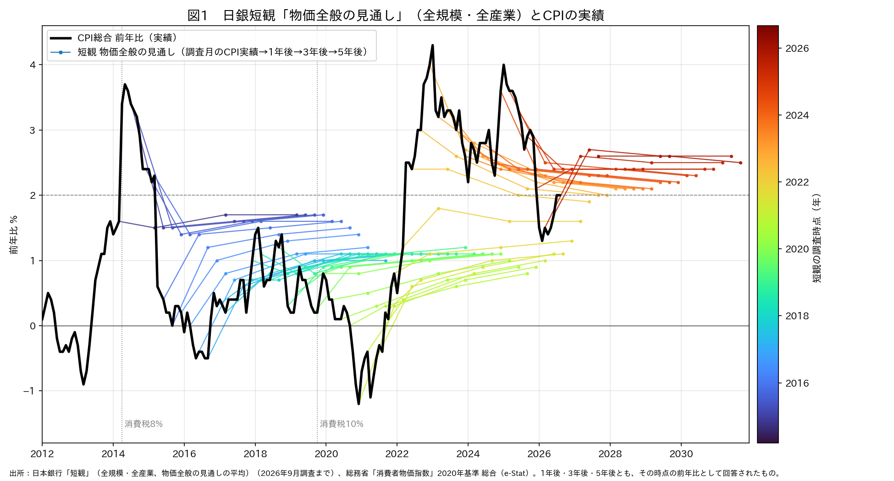
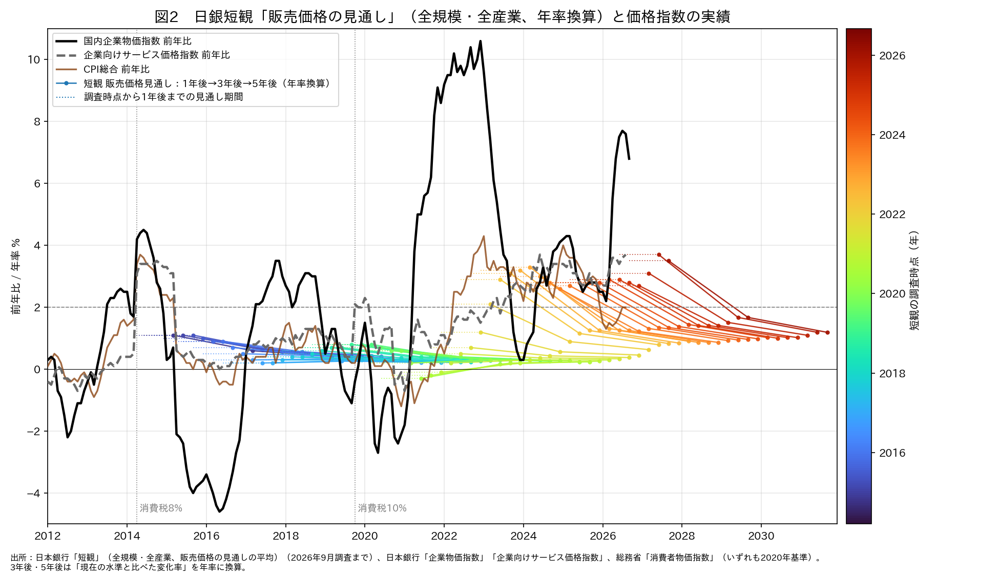
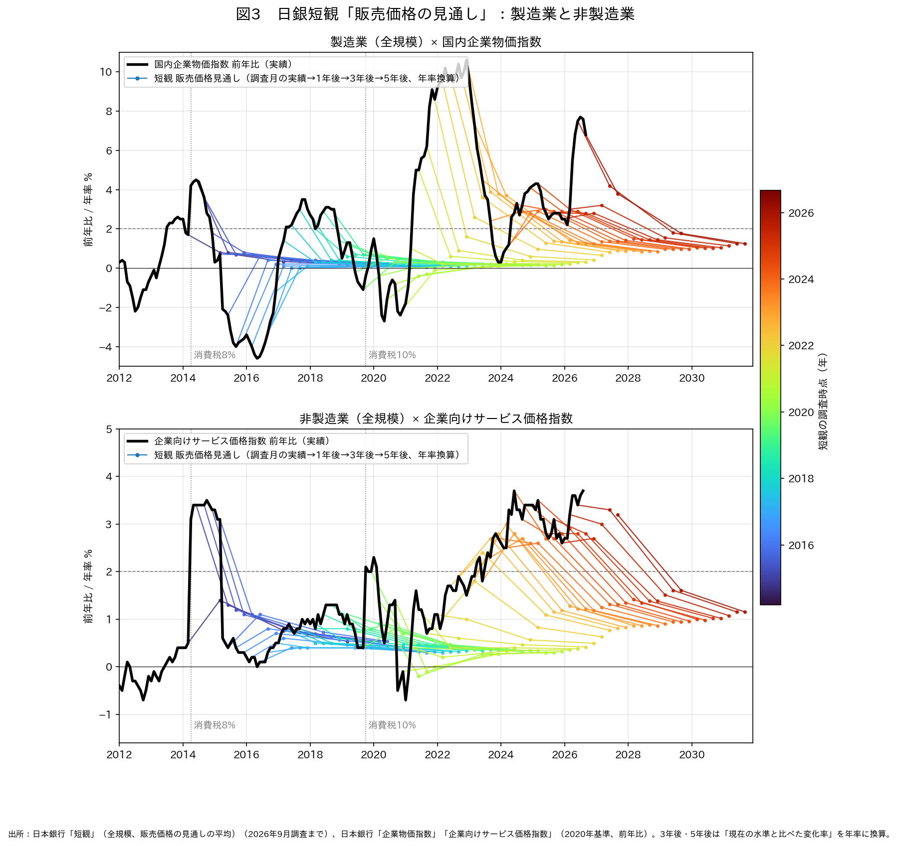

# 日銀短観の販売価格見通し「5年後6.1％」は年率1.2％にすぎない──ヘアリーチャートで読み直す企業の物価見通し

ウェブ版：[https://p72.github.io/note-draft/短観の物価見通し/01\_販売価格見通しの5年後6.1％は年率1.2％にすぎない.html](https://p72.github.io/note-draft/%E7%9F%AD%E8%A6%B3%E3%81%AE%E7%89%A9%E4%BE%A1%E8%A6%8B%E9%80%9A%E3%81%97/01_%E8%B2%A9%E5%A3%B2%E4%BE%A1%E6%A0%BC%E8%A6%8B%E9%80%9A%E3%81%97%E3%81%AE5%E5%B9%B4%E5%BE%8C6.1%EF%BC%85%E3%81%AF%E5%B9%B4%E7%8E%871.2%EF%BC%85%E3%81%AB%E3%81%99%E3%81%8E%E3%81%AA%E3%81%84.html)

GitHub：[https://github.com/p72/note-draft/blob/main/短観の物価見通し/01\_販売価格見通しの5年後6.1％は年率1.2％にすぎない.md](https://github.com/p72/note-draft/blob/main/%E7%9F%AD%E8%A6%B3%E3%81%AE%E7%89%A9%E4%BE%A1%E8%A6%8B%E9%80%9A%E3%81%97/01_%E8%B2%A9%E5%A3%B2%E4%BE%A1%E6%A0%BC%E8%A6%8B%E9%80%9A%E3%81%97%E3%81%AE5%E5%B9%B4%E5%BE%8C6.1%EF%BC%85%E3%81%AF%E5%B9%B4%E7%8E%871.2%EF%BC%85%E3%81%AB%E3%81%99%E3%81%8E%E3%81%AA%E3%81%84.md)

※ この記事は、日本銀行「短観」の企業の物価見通し、日本銀行の企業物価指数・企業向けサービス価格指数（時系列統計データ検索サイトAPI）、総務省の消費者物価指数（e-Stat API）の公表データを使い、Python で作図している。作図コードは同じフォルダの `01_plot.py` である。

## はじめに

日銀短観の企業の物価見通しは、次のように「物価全般の見通し」と「販売価格の見通し」を、1年後・3年後・5年後の3本ずつ並べた図で紹介されることが多い。

[https://x.com/seiichiro_matsu/status/2105660208773296132](https://x.com/seiichiro_matsu/status/2105660208773296132)

投稿の指摘どおり、販売価格の見通しは調査開始以来の最高水準にある。ただ、右の図で5年後の線が6.1％と、左の物価全般（2.5％前後）を大きく上回って見えるのは、両者の単位が違うからである。左は各時点の前年比、右は現在の水準と比べた累積の変化率であり、右の5年後6.1％は年率に直すと約1.2％になる。

## 要旨

2026年9月調査（全規模・全産業）の販売価格の見通しは、1年先3.5％、3年先5.1％、5年先6.1％である。3本を並べると5年先の線が一番上に来て、企業が長い先ほど強い値上げを見込んでいるように見える。

しかし、この3本は単位がそろっていない。販売価格の見通しは「現在の水準と比べて何％変わるか」という累積の変化率で聞いている。5年先の6.1％は5年間の合計であり、年率に直すと約1.2％、3年先の5.1％は年率約1.7％にすぎない。1年先の3.5％がいちばん高い。

この記事では、見通しを調査時点から先に伸ばし、実績と重ねる「ヘアリーチャート」を3枚作り、短観の物価見通しを読み直した。わかったことは次の通りである。

- 販売価格の見通しは、どの時期の調査でも「最初の1年で上がり、その後は平らになる」形をしている。2026年9月調査から逆算した値上げのペースは、1年目3.5％、2〜3年目は年0.8％、4〜5年目は年0.5％である。
- 同じ短観の「物価全般の見通し」は、3年後・5年後も「その時点の前年比」で聞いている。日本銀行も、両者のベースは異なると注意している。5年後の物価全般2.5％と販売価格6.1％を並べて比べることはできない。
- ベースをそろえると、企業は「5年後も消費者物価は前年比2.5％で上がる」と見る一方、「自社の販売価格は4〜5年目には年0.5％しか上がらない」と見ている。
- それでも方向は変わっている。販売価格の5年先を年率に直した値は、2014〜2021年の0.2〜0.5％から、2026年6月・9月調査の1.2％まで上がり、調査開始以来最も高い。

## 1. よく見るグラフと、その単位

短観の「企業の物価見通し」は2014年3月調査から始まった調査項目で、次の2つを1年後・3年後・5年後について聞いている。

- 販売価格の見通し：自社の主要な製品・サービスの販売価格が、現在の水準と比べて何％程度変動するか
- 物価全般の見通し：物価全般（消費者物価指数をイメージ）の前年比が、それぞれ何％になるか

日本銀行は「短観」のFAQで、この2つについて「『販売価格の見通し』では現在の水準と比べた変化率をご回答頂いている一方、『物価全般の見通し』では各時点の前年比をご回答頂いており、両者のベースは異なりますのでご留意ください」と書いている。

つまり、販売価格の「5年先6.1％」は、今の値段を100とすると5年後に106.1になるという意味である。前年比で6.1％ずつ上がるという意味ではない。一方、物価全般の「5年後2.5％」は、5年後の時点で消費者物価が前年比2.5％上がっているという意味である。

販売価格の1年先・3年先・5年先を、調査時点を横軸に3本並べたグラフでは、期間が長いほど数字が積み上がるので、5年先の線は必ず上に来る。線の上下の順番は、見通しの強さではなく期間の長さを表しているにすぎない。

年率に直すと、順番は逆になる。2026年9月調査の全規模・全産業では次のようになる。

- 1年先：3.5％（そのまま）
- 3年先：累積5.1％ → 年率約1.7％
- 5年先：累積6.1％ → 年率約1.2％

さらに、累積の差から期間ごとのペースを逆算できる。1年先から3年先までの2年間で、105.1÷103.5＝1.0155なので年0.8％、3年先から5年先までの2年間で、106.1÷105.1＝1.0095なので年0.5％である。企業の見通しは「最初の1年でまとめて値上げし、その後はほとんど上げない」という、前半に偏った形をしている。

## 2. ヘアリーチャートとは

ヘアリーチャートは、ある時点で出された見通しを、その時点から先へ線で伸ばし、実際にたどった実績の線と重ねるグラフである。米国の政策金利で、市場が織り込んだ将来の金利の経路を毎回の時点から伸ばして描く例がよく知られている。見通しの線が実績から毛のように生えるので、この名前がある。

このグラフでは、次の2つが一目でわかる。

- 見通しが当たったか外れたか（毛の先が、その後の実績に重なるか）
- 見通しがどんな形をしているか（毛が上を向くか、下を向くか、平らになるか）

以下の3枚では、短観の調査月を3月・6月・9月・12月とみなし、そこから1年後・3年後・5年後の位置に見通しの点を置いた。線の色は調査の時期を表し、青が古く、赤が新しい。販売価格の3年後・5年後は、年率に換算した値を置いている。

## 3. 物価全般の見通しとCPI

まず、ベースが前年比で、そのまま実績と比べられる物価全般の見通しを見る。黒い太線はCPI総合の前年比である。各調査月のCPIの実績から、1年後・3年後・5年後の見通しへ線を伸ばした。

読み取れることは3つある。

- 2014〜2021年の毛は、実績がゼロ近辺にあっても、いつも「1％前後に戻る」方向に上を向いていた。実績はその水準に届かず、企業の物価見通しは高すぎた。
- 2022年以降は逆である。実績が3〜4％の時期でも、毛は「2％台前半に下がる」方向に下を向いていた。
- 2026年の調査では、CPIが一時前年比1％台まで下がったにもかかわらず、毛は2.5％前後に向かって上を向いている。企業が見込む消費者物価の上昇率は、2％を少し上回る水準で固まりつつある。

## 4. 販売価格の見通し（全規模・全産業）

次に、販売価格の見通しである。全産業の販売価格にぴったり対応する物価指数はないので、国内企業物価指数（黒）、企業向けサービス価格指数（灰色の破線）、CPI総合（茶色）の3本を参考として重ねた。見通しの線は実績にはつながず、調査時点から1年後までを点線で示し、1年後・3年後・5年後（年率）を実線で結んだ。

年率に直すと、よく見るグラフとはまったく違う姿になる。

- 2014〜2021年の毛は、年率0〜1％でほぼ平らに寝ている。企業は自社の値段をほとんど上げられないと見ていた。
- 2022年以降、1年後の点は2〜3％台に上がった。しかし3年後・5年後に向かって毛は下を向き、年率1％前後に落ちていく。値上げは当面続くが、長くは続かないという見方である。
- 2026年6月・9月調査では、1年後が3.5〜3.7％と高く、5年後（年率）も1.2％と、調査開始以来最も高い。企業物価が前年比7％前後まで再び上がった時期であり、仕入れコストの上昇を販売価格に転嫁する動きが強まっていることは読み取れる。

1年後の点は、企業物価の大きな上下はほとんど追わず、サービス価格やCPIに近い水準にある。

## 5. 製造業と非製造業

最後に、販売価格の見通しを製造業と非製造業に分け、それぞれ国内企業物価指数と企業向けサービス価格指数の実績を起点に毛を伸ばした。

- 製造業：企業物価の実績はマイナス4％台からプラス10％台まで大きく振れたが、販売価格の見通しは1年後でもおおむね0〜4％の範囲に収まり、3年後・5年後は年率1％前後以下に平らになる。2022年の資源高のとき、実績の上昇は毛の想定を大きく上回った。2026年9月調査の製造業は1年先3.8％、5年先は累積6.4％（年率約1.25％）である。
- 非製造業：2014〜2021年の毛は年率0.5％前後で平らだったが、2023年以降は3年後が年率1.2〜1.6％、5年後が年率0.9〜1.2％に向かう形に変わった。サービス価格の実績は前年比3％台が続き、見通しの毛より上にある。2026年9月調査の非製造業は1年先3.2％、5年先は累積5.9％（年率約1.15％）である。

## まとめ

日銀短観の販売価格見通しを、1年先・3年先・5年先の3本で並べたグラフは、期間が長いほど数字が積み上がる累積の変化率を、そのまま並べたものである。5年先の線が一番上にあるのは当然であり、「企業は長い先ほど強い値上げを見込んでいる」という印象は誤りである。

2026年9月調査の5年先6.1％は年率1.2％であり、期間ごとに分けると、値上げの大半は最初の1年に集中している。物価全般の見通し（5年後に前年比2.5％）と同じ物差しにそろえると、企業は「世の中の物価ほど自社の値段は上げられない」と見ていることになる。

ただし、方向そのものは本物である。年率に直した販売価格の5年先は、2014〜2021年の0.2〜0.5％から1.2％へ上がっており、企業の価格設定行動が変わってきたことは、年率でも確認できる。変わったのは事実だが、その大きさは累積のグラフが与える印象よりずっと小さい。

### 注意点

- 「見通しの平均」は、選択肢ごとの社数構成比で加重した平均である。販売価格の選択肢は5％刻み（＋20％程度以上〜−20％程度以下）なので、「0％程度」と「＋5％程度」を選ぶ企業の割合が少し動くだけで平均が変わる。年率1％前後という水準は、この刻みの粗さの影響も受けている。
- 物価全般の選択肢は1％刻み（＋6％程度以上〜−3％程度以下）である。
- 調査表には「消費税など制度の変更の影響を除いて」回答するよう明記されている。一方、比べている実績（CPI・企業物価・サービス価格）は消費税を含むので、2014年4月と2019年10月の税率引き上げの時期は実績が押し上げられている。
- ヘアリーチャートで点と点を結ぶ線は、見やすくするためのつなぎである。企業は1年後・3年後・5年後の3点だけに回答しており、その間の年の見通しを答えているわけではない。
- 物価全般の見通しは「消費者物価指数をイメージ」して回答するもので、生鮮食品を含む総合か、除く指数かは指定されていない。図1ではCPI総合と比べている。
- 実際の回答期間は調査月の前月下旬からなので、調査月を3月・6月・9月・12月とみなす置き方には少しずれがある。

## データの取り方

- 日本銀行 時系列統計データ検索サイトAPI
  - 短観（DB=CO）：販売価格の見通し（全規模・全産業）TK99F0000201〜203HCQ00000、物価全般の見通し（全規模・全産業）TK99F0000204〜206HCQ00000、販売価格の見通し（全規模・製造業）TK99F1000201〜203HCQ00000、（全規模・非製造業）TK99F2000201〜203HCQ00000。いずれも「企業の物価見通しの平均」。2014年3月調査〜2026年9月調査
  - 国内企業物価指数 総平均 前年比（DB=PR01）：PRCG20\_2200000000%（2020年基準、2026年9月まで）
  - 企業向けサービス価格指数 総平均 前年比（DB=PR02）：PRCS20\_5200000000%（2020年基準、2026年8月まで）
- 総務省「消費者物価指数」e-Stat API：statsDataId=0003427113、総合・全国・前年同月比（2020年基準、2026年8月まで）
- 年率換算：販売価格の3年後は（1＋累積変化率）の3乗根−1、5年後は5乗根−1
- 取得したデータ：`boj.json`、`cpi_yoy.csv`
- 作図コード：`01_plot.py`

## 参考文献

- 日本銀行「『短観』（全国企業短期経済観測調査）のFAQ」4. 「物価見通し」に関するQ&A
  [https://www.boj.or.jp/statistics/outline/exp/tk/faqtk04.htm](https://www.boj.or.jp/statistics/outline/exp/tk/faqtk04.htm)
- 日本銀行調査統計局「短観（全国企業短期経済観測調査）解説」2023年2月
  [https://www.boj.or.jp/statistics/outline/exp/tk/data/extk05a.pdf](https://www.boj.or.jp/statistics/outline/exp/tk/data/extk05a.pdf)
- 日本銀行「短観（要旨）（2026年9月）」
  [https://www.boj.or.jp/statistics/tk/yoshi/tk2609.htm](https://www.boj.or.jp/statistics/tk/yoshi/tk2609.htm)
