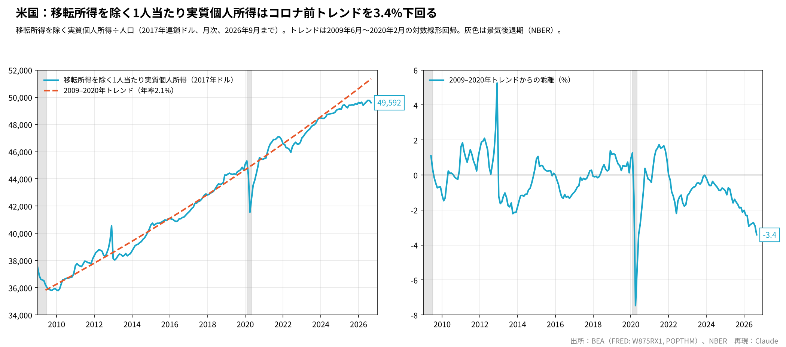
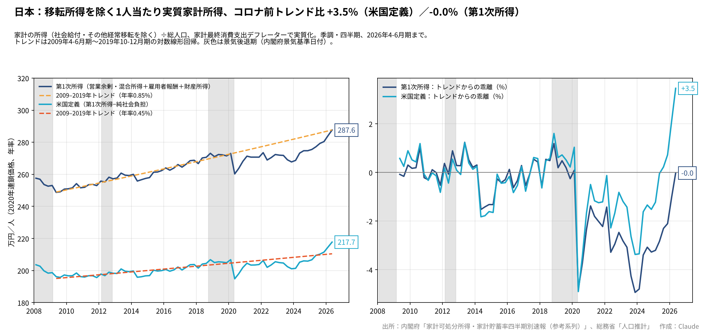

# 移転所得を除く1人当たり実質所得──米国はコロナ前トレンドを3.4%下回り、日本はトレンドに戻った

ウェブ版：[https://p72.github.io/note-draft/移転所得を除く実質所得/01\_コロナ前トレンドとの差を日米で比べる.html](https://p72.github.io/note-draft/%E7%A7%BB%E8%BB%A2%E6%89%80%E5%BE%97%E3%82%92%E9%99%A4%E3%81%8F%E5%AE%9F%E8%B3%AA%E6%89%80%E5%BE%97/01_%E3%82%B3%E3%83%AD%E3%83%8A%E5%89%8D%E3%83%88%E3%83%AC%E3%83%B3%E3%83%89%E3%81%A8%E3%81%AE%E5%B7%AE%E3%82%92%E6%97%A5%E7%B1%B3%E3%81%A7%E6%AF%94%E3%81%B9%E3%82%8B.html)

GitHub：[https://github.com/p72/note-draft/blob/main/移転所得を除く実質所得/01\_コロナ前トレンドとの差を日米で比べる.md](https://github.com/p72/note-draft/blob/main/%E7%A7%BB%E8%BB%A2%E6%89%80%E5%BE%97%E3%82%92%E9%99%A4%E3%81%8F%E5%AE%9F%E8%B3%AA%E6%89%80%E5%BE%97/01_%E3%82%B3%E3%83%AD%E3%83%8A%E5%89%8D%E3%83%88%E3%83%AC%E3%83%B3%E3%83%89%E3%81%A8%E3%81%AE%E5%B7%AE%E3%82%92%E6%97%A5%E7%B1%B3%E3%81%A7%E6%AF%94%E3%81%B9%E3%82%8B.md)

※ この記事は、米国経済分析局（BEA）の個人所得統計と人口（FRED API）、内閣府「家計可処分所得・家計貯蓄率四半期別速報（参考系列）」、総務省「人口推計」（e-Stat API）を使い、Python で作図・推計している。コードとデータは同じフォルダの `code/` にある。

## はじめに

米国の調査会社 EPB Research が、2026年10月に「移転所得を除く1人当たり実質個人所得は、コロナ前のトレンドを3.4%下回っている」という図を示した。政府からの給付を除いた、働いて稼いだ所得や資産からの所得が、2009〜2020年の伸びのペースに比べてどれだけ足りないかを測ったものである。

本稿では、まずこの図を公表データから再現し、次に同じ考え方で日本の図を作って比べる。

## 要旨

- 米国の数字は、BEA の公表データで再現できる。2026年9月の1人当たり実質所得（移転所得を除く、2017年連鎖ドル）は49,592ドル、2009年6月〜2020年2月の対数線形トレンド（年率2.1%）を3.4%下回る。乖離は2021年に一時プラスになった後、2023年末にほぼゼロに戻り、2024年以降は一貫して広がっている。
- 日本には米国の月次個人所得に当たる統計がないため、内閣府の家計可処分所得の四半期速報から、営業余剰・混合所得、雇用者報酬、財産所得を足し、社会給付などの移転を除いた所得を作った。
- 日本の1人当たり実質所得は、2023年10-12月期にトレンドを約5%下回っていたが、2026年4-6月期にはトレンドとほぼ同じ水準に戻った。社会保険料を差し引く米国と同じ定義では、トレンドを3.5%上回る。
- ただし、日本のトレンドは年0.85%（社会保険料控除後は0.45%）と低く、米国の年2.1%とは「戻るべき線」の高さがまるで違う。2019年10-12月期からの増加のおよそ半分は財産所得（配当・利子など）によるもので、人口減少も1人当たりの値を押し上げている。日本の回復を「家計の稼ぐ力が米国より強い」と読むのは早計である。

## 1. 米国の図の再現

使ったのは次の2系列である。

- 分子：移転所得を除く実質個人所得（FRED の系列 W875RX1、十億ドル、2017年連鎖価格、季節調整済み年率）
- 分母：月次の総人口（FRED の系列 POPTHM、千人）

米国の個人所得は、雇用者報酬、自営業者所得、賃貸所得、利子・配当、移転所得を足し、そこから政府の社会保険料を差し引いたものである。W875RX1 はこのうち移転所得を除いた系列で、実質化には個人消費支出（PCE）のデフレーターが使われている。

トレンドは、2009年6月から2020年2月までの1人当たり所得の対数値を時間に回帰して引いた。始点と終点を直線で結ぶ方法では乖離が−4.7%になり、EPB の値と合わない。回帰で引くと、最新値49,592ドル、トレンド成長率年2.1%、乖離−3.4%となり、EPB の図の数字とすべて一致する。

図1の右側が乖離である。2012年末の山は、増税を控えた配当やボーナスの前倒し、2020年春の谷はコロナによる所得の急減である。2021年には一時トレンドを1.7%上回ったが、物価の上昇で実質所得が目減りし、2022年には再び下回った。その後2023年末にトレンドに追いついたものの、2024年以降は所得の伸びがトレンドの年2.1%に届かず、乖離は2026年9月に−3.4%まで広がった。

## 2. 日本版の作り方

日本の国民経済計算には、米国の個人所得に当たる月次の統計はない。いちばん近いのは、内閣府が参考系列として公表している「家計可処分所得・家計貯蓄率四半期別速報」である。季節調整済みの四半期値（年率）で、可処分所得の内訳が載っている。

ここから、次の2つの定義で「移転所得を除く所得」を作った。

- 第1次所得：営業余剰・混合所得＋雇用者報酬（受取）＋財産所得（純）
- 米国定義：第1次所得−純社会負担（支払）

米国の個人所得は社会保険料を差し引いた値なので、米国の図に合わせるなら後者になる。ただし、日本の純社会負担には企業年金などへの拠出も含まれ、米国の「政府の社会保険料」とは範囲が完全には一致しない。所得税などの経常税は、米国の個人所得と同じく差し引いていない。社会給付とその他の経常移転は、どちらの定義でも含めていない。

実質化には、家計最終消費支出デフレーター（同じ表の名目可処分所得÷実質可処分所得）を使った。人口は総務省「人口推計」の月次の総人口（各月1日現在）を四半期平均した。トレンドは、米国の2009年6月〜2020年2月に合わせ、2009年4-6月期〜2019年10-12月期の対数線形回帰で引いた。

## 3. 日本の姿

図2の左側は1人当たりの実質所得の水準（2020年連鎖価格、年率、万円）、右側はトレンドからの乖離である。

コロナの後、日本の乖離は米国より長く深いマイナスが続いた。第1次所得では、2023年10-12月期に−4.9%まで沈んだ。2022年以降の物価上昇に名目所得が追いつかなかったためである。

流れが変わったのは2024年以降である。賃上げと配当・利子の増加で実質所得が持ち直し、2026年4-6月期の第1次所得は1人当たり287.6万円、トレンドとの乖離はほぼゼロになった。米国定義（社会保険料控除後）では217.7万円で、トレンドを3.5%上回る。

## 4. 日本の回復をどう読むか

米国が下回り、日本が戻った。この対比はわかりやすいが、そのまま「日本の家計所得の方が好調」と読むことはできない。理由は3つある。

第一に、トレンドの高さが違う。米国のトレンドは年2.1%だが、日本は第1次所得で年0.85%、米国定義では年0.45%にすぎない。日本の「トレンド回帰」は、低い線に戻ったということである。

第二に、米国定義の日本のトレンドが特に低いのは、2009〜2017年に厚生年金の保険料率が段階的に引き上げられ、控除後の所得の伸びが抑えられていたからである。引き上げが止まった後は、同じ賃金の伸びでも控除後の所得が伸びやすくなった。米国定義で日本がトレンドを3.5%上回るのは、この制度要因の影響が大きい。2つの定義で乖離がこれほど違うのも、そのためである。

第三に、回復の中身である。2019年10-12月期から2026年4-6月期まで、1人当たり実質の第1次所得は約16万円増えた。このうち雇用者報酬が約8万円、財産所得が約8万円で、財産所得の寄与が賃金とほぼ同じ大きさである。配当や利子は金融資産を多く持つ家計に偏るので、平均の回復がそのまま多くの家計の実感になるとは限らない。また、総人口は同じ期間に約1億2,655万人から約1億2,283万人へ3%近く減っており、これも1人当たりの値を押し上げている。

## 5. まとめ

EPB Research の米国の図は、BEA の公表データと対数線形トレンドで正確に再現できる。米国の移転所得を除く1人当たり実質所得は、2024年以降トレンドから離れ続け、2026年9月に3.4%下回っている。

同じ考え方で作った日本の図では、2023年末に約5%下回っていた所得が、2026年4-6月期にはトレンド並みに戻った。しかし、日本のトレンドは米国よりはるかに低く、社会保険料の制度変更や財産所得の増加、人口減少の影響も大きい。日米の乖離の符号の違いは、両国の家計の稼ぐ力の差ではなく、それぞれの「物差し」の違いを含んだものとして読む必要がある。

## 付録：データと方法

- 米国：W875RX1（移転所得を除く実質個人所得）÷ POPTHM（月次人口）。2026年9月まで。FRED API で取得
- 日本：内閣府「家計可処分所得・家計貯蓄率四半期別速報（参考系列）」2026年4-6月期（計数表 `kakei_26q2.xlsx`、季節調整系列）。季節調整系列は毎回1994年1-3月期まで遡って改定されるため、数値は公表回によって変わる
- 日本の人口：総務省「人口推計」月次総人口（e-Stat、statsDataId 0004029362・0003446819・0003443840・0003443838 を接続）。接続月の値は一致している（補間補正済み）。概算値は万人単位のため千人単位に換算した
- 実質化：日本は家計最終消費支出デフレーター（名目可処分所得÷実質可処分所得）
- トレンド：米国は2009年6月〜2020年2月、日本は2009年4-6月期〜2019年10-12月期の1人当たり実質所得の対数値を時間に回帰。日本の推計期間を変えた場合の2026年4-6月期の乖離は次の通り
  - 2009年4-6月期〜2020年1-3月期：第1次所得−0.0%、米国定義+3.3%
  - 2012年10-12月期〜2019年10-12月期：第1次所得−0.6%、米国定義+2.1%
  - 2013年1-3月期〜2018年7-9月期：第1次所得−0.3%、米国定義+2.8%
- 景気後退期の網掛け：米国は NBER、日本は内閣府の景気基準日付
- コード：`code/`（米国は `us_calc.py`・`us_plot.py`、日本は人口の取得 `pop.py`、計算 `jp.py`、作図 `jpplot.py`、内訳と頑健性 `stats.py`）。データ取得には筆者の作成した FRED・ESRI・e-Stat 取得用の補助モジュールを使っている

## 参考文献

- EPB Research（チャートの出典。購読者向けレポートの図で、BEA・NBER のデータを使用）
- FRED「Real personal income excluding current transfer receipts（W875RX1）」
  [https://fred.stlouisfed.org/series/W875RX1](https://fred.stlouisfed.org/series/W875RX1)
- FRED「Population（POPTHM）」
  [https://fred.stlouisfed.org/series/POPTHM](https://fred.stlouisfed.org/series/POPTHM)
- 内閣府 経済社会総合研究所「家計可処分所得・家計貯蓄率四半期別速報（参考系列）」
  [https://www.esri.cao.go.jp/jp/sna/sonota/kakei/kakei\_top.html](https://www.esri.cao.go.jp/jp/sna/sonota/kakei/kakei_top.html)
- 総務省統計局「人口推計」（e-Stat）
  [https://www.e-stat.go.jp/stat-search/files?toukei=00200524](https://www.e-stat.go.jp/stat-search/files?toukei=00200524)
- 内閣府「景気基準日付」
  [https://www.esri.cao.go.jp/jp/stat/di/hiduke.html](https://www.esri.cao.go.jp/jp/stat/di/hiduke.html)
- NBER「US Business Cycle Expansions and Contractions」
  [https://www.nber.org/research/data/us-business-cycle-expansions-and-contractions](https://www.nber.org/research/data/us-business-cycle-expansions-and-contractions)
