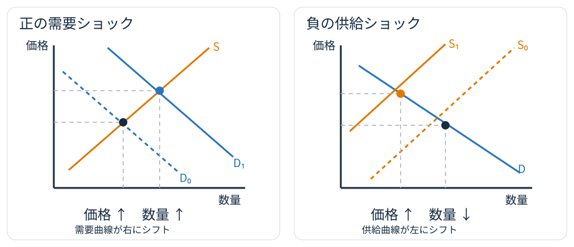
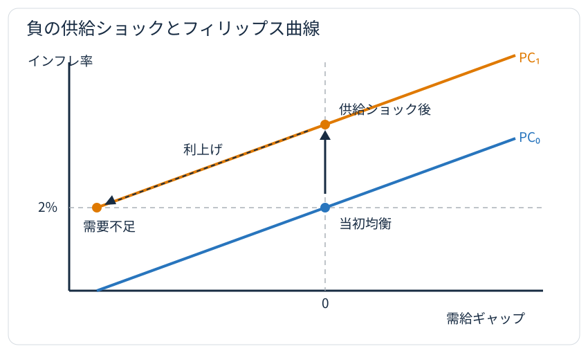

# 米国のインフレは需要要因から供給要因へ──セントルイス連銀のPCEインフレ分解

ウェブ版：[記事を読む](https://p72.github.io/note-draft/%E7%B1%B3%E5%9B%BD%E3%81%AE%E3%82%A4%E3%83%B3%E3%83%95%E3%83%AC%E8%A6%81%E5%9B%A0%E5%88%86%E8%A7%A3/01_%E9%9C%80%E8%A6%81%E3%82%B7%E3%83%A7%E3%83%83%E3%82%AF%E3%81%8B%E3%82%89%E4%BE%9B%E7%B5%A6%E3%82%B7%E3%83%A7%E3%83%83%E3%82%AF%E3%81%B8.html)

GitHub：[原稿](https://github.com/p72/note-draft/blob/main/%E7%B1%B3%E5%9B%BD%E3%81%AE%E3%82%A4%E3%83%B3%E3%83%95%E3%83%AC%E8%A6%81%E5%9B%A0%E5%88%86%E8%A7%A3/01_%E9%9C%80%E8%A6%81%E3%82%B7%E3%83%A7%E3%83%83%E3%82%AF%E3%81%8B%E3%82%89%E4%BE%9B%E7%B5%A6%E3%82%B7%E3%83%A7%E3%83%83%E3%82%AF%E3%81%B8.md)

2026年11月25日、セントルイス連銀は[PCE Inflation Drivers](https://www.stlouisfed.org/research/pce-inflation-drivers)を更新した。米国のインフレ率は再び上昇しているが、その内訳を見ると、需要ショックの寄与はむしろ縮小している。本稿では公表内容を整理したうえで、同じ考え方を日本のCPIと家計調査に当てはめた試算も示す。

**2026年10月のトレンドを上回るインフレのうち、総合PCEでは88％、コアPCEでは73％が供給要因と推計されている。** この数字はインフレ率全体に占める割合ではない。

## 1. 公表内容の要約訳

パンデミック期の需要ショックの残存効果に代わり、現在は供給制約が基調を超える物価上昇の中心となっている。2025年半ばから供給要因の重要性が増した時期は、エネルギー価格の上昇や新たな関税の導入と重なる。需要と供給で適切な政策対応が異なるならば、この分解には政策上の意味がある。

## 2. インフレ率の上昇を何が説明するのか

単位：前年比％、寄与度は％ポイント。

| 項目 | 総合 2025年10月 | 総合 2026年10月 | コア 2025年10月 | コア 2026年10月 |
|---|---:|---:|---:|---:|
| インフレ率 | 2.66 | 3.84 | 2.70 | 3.26 |
| トレンド | 1.94 | 1.96 | 1.91 | 1.91 |
| 需要ショック計 | 0.49 | 0.22 | 0.76 | 0.37 |
| 当期の需要ショック | -0.18 | 0.34 | 0.04 | 0.29 |
| 過去の需要ショック | 0.67 | -0.12 | 0.72 | 0.07 |
| 供給ショック計 | 0.23 | 1.67 | 0.03 | 0.98 |
| 当期の供給ショック | 0.21 | 1.15 | 0.11 | 0.62 |
| 過去の供給ショック | 0.02 | 0.52 | -0.08 | 0.36 |

出所：セントルイス連銀、米国BEA。丸めのため合計が一致しない場合がある。

総合PCEでは需要要因が0.49から0.22ポイントに縮小する一方、供給要因は0.23から1.67ポイントへ拡大した。コアでも同じ方向の変化が観察される。なお、トレンドには1990～99年および2022～23年の平均インフレ率に加えて、公式集計値との小さな調整差が含まれる。

## 3. 需要ショックと供給ショックの識別

ミクロ経済学の需要・供給曲線を考える。需要曲線が右にシフトすれば価格と数量はともに上がる。一方、供給曲線が左にシフトすれば価格は上がるが数量は減る。

| 価格の予想外の変化 | 実質消費の予想外の変化 | 分類 |
|---|---|---|
| 上昇 | 増加 | 正の需要ショック |
| 下落 | 減少 | 負の需要ショック |
| 上昇 | 減少 | 負の供給ショック |
| 下落 | 増加 | 正の供給ショック |

単純な前年比の符号ではなく、予測される変動からの乖離を使う点が重要である。概念的には、価格と実質消費の予測誤差をそれぞれ eP、eQ とすると、eP × eQ が正なら需要型、負なら供給型と分類する。

Adam Shapiroの手法を発展させたBill DuporとMarie Hoganは、52の消費カテゴリーを対象に、時変の支出シェアで寄与度を集計する。さらに、過去のショックが残す影響を区別する。

インフレ率 ＝ トレンド ＋ 当期需要 ＋ 過去需要 ＋ 当期供給 ＋ 過去供給

ここでいう当期・過去は月次モデルにおける区別である。前年比の寄与度はその集計であり、当期の欄が10月単月だけの寄与を意味するわけではない。

## 4. 金融政策への含意

ニューケインジアン・フィリップス曲線を簡略化すると、

$$
\pi_t-\pi^*=\beta E_t(\pi_{t+1}-\pi^*)+\kappa x_t+u_t
$$

となる。x は需給ギャップ、u はコストプッシュショック、π* は物価目標である。

需要超過によって物価が上昇している場合、金融引き締めは需要とインフレの双方を安定化する方向に作用する。これに対して負の供給ショックの場合、フィリップス曲線が上方にシフトするため、インフレ率を短期で目標に戻そうとすると、負の需給ギャップを生む可能性がある。

期待インフレが目標に固定されていると仮定すれば、物価目標を即座に達成するために必要な需給ギャップは概念的に x = −u/κ となる。

ただし、供給ショックなら利上げが常に不要という意味ではない。期待インフレのアンカーが外れるリスク、二次的な賃金・価格波及、ショックの持続性なども考慮する必要がある。また、この分解で推定される供給寄与度は、フィリップス曲線の u と同一ではない。

## 5. 名目GDP水準目標との関係

名目GDPの成長率は、実質GDP成長率とGDPデフレーター上昇率の和に近似できる。

$$
g_{NGDP}\simeq g_{RGDP}+\pi_{GDP}
$$

負の供給ショックによって実質成長率が2％から0％に低下したと仮定する。

| 項目 | 平常時 | 物価2％の場合 | 名目GDP4％の場合 |
|---|---:|---:|---:|
| 実質GDP成長率 | 2% | 0% | 0% |
| GDPデフレーター上昇率 | 2% | 2% | 4% |
| 名目GDP成長率（近似） | 4% | 2% | 4% |

名目GDP水準目標（NGDPLT）では、名目支出を所定の経路に維持しつつ、供給制約による一時的な物価上昇を許容する余地がある。水準目標は過去の目標経路からの乖離も考慮するため、単なる4％成長率目標とは異なる。

上表は会計恒等式を用いた説明例であり、政策反応や実質GDPの内生的な変化を推計したものではない。PCE物価指数とGDPデフレーターも異なる。本研究はNGDPLTの優位性を直接検証したものではないが、物価上昇率のみに基づく政策判断の限界を考える材料になる。

## 6. 識別上の限界

- 需要と供給のショックが同時に発生すれば、符号分類で両者を完全に分離することはできない。
- 価格・数量の変動からの分類は、個別の構造ショックや関税の因果効果を直接特定するものではない。
- トレンドや予測モデルの設定によって結果が変わり得る。
- 供給要因の割合から最適な政策金利を直接導くことはできない。

## 7. 日本への応用：CPIと家計調査による試算

### 7.1 データの選択

当初は国民経済計算（SNA）の目的別家計最終消費支出を使う方法を考えた。しかし、四半期速報（QE）で公表される家計消費の内訳は形態別（耐久財・半耐久財・非耐久財・サービス）の4区分にとどまり、目的別分類は年次推計に限られる。4区分では品目間で逆向きに動くショックが相殺され、年次では2022年以降の観測点が少なすぎる。Shapiro方式の要点は品目ごとに異なるショックを分類することにあるため、SNAは推計の軸ではなく事後的な照合に用いるのが適当である。

そこで本稿では、月次で品目の対応がとれる次の組み合わせで試算した。

- 価格：総務省「消費者物価指数」（2020年基準）の中分類指数
- 数量：総務省「家計調査」（二人以上の世帯）の中分類支出を、対応するCPIで実質化したもの
- 対象：CPIの45中分類。家計調査の47分類を対応づけ、「他の被服」と「医薬品・健康保持用摂取品」については家計調査の2分類ずつ（生地・糸類と他の被服、医薬品と健康保持用摂取品）を統合した。家賃は家計調査に持家の帰属家賃が含まれないため、CPIの「持家の帰属家賃を除く家賃」と対応させた
- 推計：中分類ごとに、価格と実質支出の月次変化率を被説明変数とするVAR（ラグ12か月、月ダミーと消費税ダミー付き）を過去120か月で推計し、当月の予測誤差を求める。推計期間を1か月ずつずらすため、各月の分類はその時点までのデータだけに基づく
- 分類：予測誤差の符号が同じなら需要要因、逆なら供給要因とし、前月までの12か月平均の支出シェアで加重して集計する
- 消費税率引上げ月（2014年3・4月、2019年9・10月）は分類の対象外とした

この方法は大和総研がコアCPIについて行った需給要因分解と同じ系統にある。セントルイス連銀版との違いは、トレンドを分離していない点、過去のショックの残存効果を分けていない点である。したがって以下の数字はインフレ率全体の分解であり、第2節の「トレンドを上回るインフレ」の分解とは直接比較できない。

### 7.2 結果

各品目の寄与を合計した値は、CPI「持家の帰属家賃を除く総合」の前年比と相関係数0.995で連動する。2015年以降の水準は平均0.17ポイント低いが、動きはほぼ一致する。

単位：12か月累積寄与、％ポイント。

| 時点 | 需要要因 | 供給要因 | 合計 | 需要要因の割合 |
|---|---:|---:|---:|---:|
| 2022年12月 | 1.52 | 3.06 | 4.58 | 33% |
| 2023年4月 | 1.96 | 1.87 | 3.84 | 51% |
| 2024年6月 | 2.07 | 1.02 | 3.09 | 67% |
| 2025年1月 | 2.13 | 2.14 | 4.27 | 50% |
| 2025年9月 | 2.00 | 1.02 | 3.02 | 66% |
| 2026年9月 | 0.69 | 1.47 | 2.16 | 32% |

出所：総務省「消費者物価指数」「家計調査」より筆者推計。

この表だけを見ると、2022年は供給要因が中心、2023年から2025年にかけて需要要因の比重が上昇、2026年は再び供給要因が中心という三つの局面に分けられるように見える。しかし、推計の仕様を変えると局面の判定は安定しない。

同じデータを使い、係数を全期間で一度だけ推計した場合（ラグ12、月ダミー付き）や、第8節のDupor・Hogan型でラグを6とした場合と比べると、次のようになる。

単位：12か月累積寄与（需要要因／供給要因）、％ポイント。

| 時点 | 上表（120か月ローリング） | 全期間推計のShapiro型 | Dupor・Hogan型（ラグ6） |
|---|---:|---:|---:|
| 2022年12月 | 1.52／3.06 | 2.38／2.25 | 2.01／1.99 |
| 2024年6月 | 2.07／1.02 | 1.04／2.02 | － |
| 2025年9月 | 2.00／1.02 | 2.00／0.77 | 2.05／0.08 |
| 2026年9月 | 0.69／1.47 | 0.44／1.59 | 0.42／0.89 |

出所：総務省「消費者物価指数」「家計調査」より筆者推計。Dupor・Hogan型はドリフトを除いた需要計・供給計。全期間推計の2列は消費税増税月を除外していない。

2022年12月は、ローリング推計では供給要因が3分の2を占めるが、全期間推計では需要と供給がほぼ拮抗する。2024年6月は、ローリング推計では需要要因が優位だが、全期間推計では供給要因が優位となり、順位が逆転する。したがって、2022年が供給主導であったこと、2024年に需要主導へ移ったことは、この試算からは確定できない。大和総研は2023年4月のコアCPIについて需要要因の寄与率を63％程度と推計しているが、本稿の結果がこれと整合するかどうかも仕様に依存する。

仕様を変えても変わらないのは、2025年9月から2026年9月にかけて需要要因の寄与が大きく低下したことである。第8節のDupor・Hogan型でも、安定性条件を満たす11仕様のすべてで同じ方向が確認された。米国でも需要寄与の縮小と供給寄与の拡大が起きているが、前述のとおり分解の対象が異なるため、割合を並べて比較することはできない。

制度変更の影響も確認できる。2021年4月の携帯電話通信料の引下げは、大きな負の供給要因として現れている。

### 7.3 試算の限界

- 家計調査は約8,000世帯の標本調査であり、品目別の数量は振れが大きい。予測誤差がゼロに近い品目を「判別不能」とすると、合計のうち判別不能に分類される部分は、少ない時期で1～2割、多い時期で4～5割に達する。需要と供給の比率には相応の幅がある。
- 消費税以外の制度要因（携帯電話通信料、Go To トラベル、電気・ガス料金の負担軽減策、教育の無償化など）は、需要要因または供給要因のいずれかに分類されている。
- 自動車等関係費にはガソリンと自動車購入が含まれ、自動車購入は月々の振れが大きい。
- 持家の帰属家賃を含まないため、CPI総合ではなく帰属家賃を除く総合に近い指標である。
- トレンドの分離と、Dupor・Hogan型の当期・過去ショックの区別は行っていない。
- 係数の推計期間（ローリングか全期間か）やラグ数によって、需要と供給の順位が入れ替わる時期がある。本節で確定的に述べられるのは2026年の需要寄与の低下のみである。

日本の金融政策を評価する材料とするには、制度要因の品目・月を別枠に分離すること、トレンドを分離して過去のショックの残存効果を推計すること、供給要因を輸入投入比率で輸入由来と国内由来に按分することが次の課題となる。また、ここでの需要要因は品目ごとの相対的な需要の変化であり、マクロの総需要と同一ではない。品目に共通する成分を取り出すか、需給ギャップや賃金との関係を確認する作業も必要である。

## 8. セントルイス連銀方式への拡張：日本版の実装

### 8.1 原著の分解式

Dupor・Hogan (2025) の第2節、式(1)・(2)に沿って、品目別の月次対数価格変化率と実質支出変化率を固定サンプルのVAR(12)で推計する。第7節のローリング推計とは異なり、同一の係数を全期間のショック伝播に使う。

$$
Y_{i,t}=c_i+\sum_{j=1}^{12}A_{i,j}Y_{i,t-j}+e_{i,t}
$$

残差ベクトル全体を価格・数量残差の積が負なら供給型、それ以外なら需要型として分類する。現在の寄与は価格残差そのものであり、実際の価格変化率全体を分類する第7節とは異なる。

$$
Y_{i,t}=\mu_{i,t}+e^D_{i,t}+e^S_{i,t}
+\sum_{h=1}^{t-t_0}\Psi_{i,h}(e^D_{i,t-h}+e^S_{i,t-h})
$$

移動平均係数は \(\Psi_{i,0}=I\)、\(\Psi_{i,h}=\sum_{j=1}^{\min(h,12)}A_{i,j}\Psi_{i,h-j}\) である。実装では同値なVAR再帰を用いて、当期需要・当期供給・過去需要・過去供給を計算する。ドリフトには定数項、季節ダミー、初期条件の効果が含まれる。したがって純粋な長期インフレ期待ではない。

集計ウェイトは原著と同じく、当月と前月の名目支出シェアの幾何平均とする（公式CPIの固定ウェイトではない）。各月の寄与度を12か月合計し、前年比に対応する対数変化率を求める。公式CPIとの差はドリフトに混ぜない。

### 8.2 日本版の実装仕様

- 入力：第7節と同じ家計調査47分類、CPI45中分類、2000年1月～2026年9月。
- 基本仕様：固定サンプル、階差VAR(12)、月ダミー付き。季節調整済み米国PCEを使う原著に対する日本向けの変更である。
- 感度分析：ラグ3・6、月ダミーなし、既存の12か月平均ウェイト、2019年までの推計係数による期間外分解、判別不能閾値、直近5・10・15年固定窓。診断用スクリプトで計18仕様を検証。
- 消費税など制度要因はこの実装の基本仕様では分離しない。第7節と処理が異なるため、比較時には注意する。
- 加法整合性、VARの安定性、欠損・重複を検査する。安定条件に違反した場合は結果を確定しない。
- 固定サンプル全期間推計は事後的な歴史分解であり、リアルタイム予測ではない。

コード：[02_dupor_hogan_jp.py](02_dupor_hogan_jp.py)

実行には Python、numpy、pandas、requests、matplotlib が必要である。環境変数 ESTAT_APP_ID に自身のe-Stat APIキーを設定して実行する。既存の入力pickleがある場合は、信頼できるファイルに限り --input-dir で指定できる。

2026年11月26日追記：クラウド環境で実データを取得し、18仕様の推計・比較を実施した。[実データ分析結果](02_results.md)に指定6時点と感度分析を掲載した。ただし基準VAR(12)は2分類で不安定であり、以下の未完了という位置づけは維持する。2026年9月の需要寄与低下は安定な11仕様で確認できた一方、2022年12月の供給優位は仕様依存だった。

再現手順：[02_REPRODUCE.md](02_REPRODUCE.md)。原著との仕様照合・数値検算・未解決事項：[02_review.md](02_review.md)。2026年11月26日、合成データによるMA表現との独立照合を実行し、8ケースで一致を確認した。これは実測結果の検証ではない。

### 8.3 実測結果の検証状況

**実データの診断推計を実施済み、確定推計は未完了。** e-Statの原データと加工パネルを保存し、加法整合性・安定性・既存Shapiro版の再現・公式CPIとの比較を検証した。基準VAR(12)の不安定性、直接数量や制度要因の検証などが残る。

2022年12月、2023年4月、2024年6月、2025年1月、2025年9月、2026年9月の5成分と、第7節の需要・供給寄与との比較は[実データ分析結果](02_results.md)に診断値として掲載した。比較では総インフレに占める割合とドリフトを除いた超過インフレに占める割合を区別し、同一入力・同一係数・同一ウェイトで割当対象のみを変えた比較も掲載した。

なお、本実装は原著の動学分解の日本向け移植であり、米国の現行ダッシュボードが採用する特定期間平均のトレンド・公式指数への調整をそのまま再現したものではない。

## 参考文献・データ

- [Federal Reserve Bank of St. Louis, PCE Inflation Drivers](https://www.stlouisfed.org/research/pce-inflation-drivers)（2026年11月25日更新）
- [Dupor and Hogan, Supply, Demand and the Post-Lockdown Inflation Surge](https://www.stlouisfed.org/on-the-economy/2025/apr/supply-demand-post-lockdown-inflation-surge)
- [Was the Post-Lockdown Inflation Surge Mainly Supply Driven?](https://doi.org/10.20955/wp.2025.007)
- [Shapiro, Decomposing Supply and Demand Driven Inflation](https://www.frbsf.org/research-and-insights/publications/working-papers/2022/10/decomposing-supply-and-demand-driven-inflation/)（サンフランシスコ連銀ワーキングペーパー 2022-18）
- [大和総研「需給要因分解と流通過程別の動向から見るインフレの特徴と金融政策への示唆」](https://www.dir.co.jp/report/research/economics/japan/20230616_023854.html)（2023年6月）
- [上野・北口「オルタナティブデータの景気判断への活用可能性～POSデータによる物価変動要因の分析～」](https://www.esri.cao.go.jp/jp/esri/archive/bun/bun208/bun208j.pdf)（『経済分析』第208号、2023年）

データ取得方法：

- 第1～2節：セントルイス連銀の2026年11月25日更新の公表表から前年比寄与度を転記した。米国分の独自のモデル再推定は行っていない。原文の逐語訳ではなく要約と経済学的解説である。
- 第7節：e-Stat APIで取得した。CPIは統計表ID 0003427113（2020年基準、全国、中分類指数、2026年10月まで）、家計調査は統計表ID 0004023601（品目分類 2025年改定・金額、二人以上の世帯、全国、2000年1月～2026年9月）。最初の10年は推計に用いるため、分類結果は2011年以降である。推計スクリプトは[01\_shapiro\_jp.py](01_shapiro_jp.py)、2020年以降の12か月累積寄与は[01\_jp\_decomp\_12m.csv](01_jp_decomp_12m.csv)に置いた。なお、2026年11月26日にe-Statからデータを再取得してスクリプトを再実行し、公表CSVの全期間（2020年1月～2026年9月）と一致することを確認した。再現の過程で、対象品目数の表記を実際の推計に合わせて45中分類に修正した。
