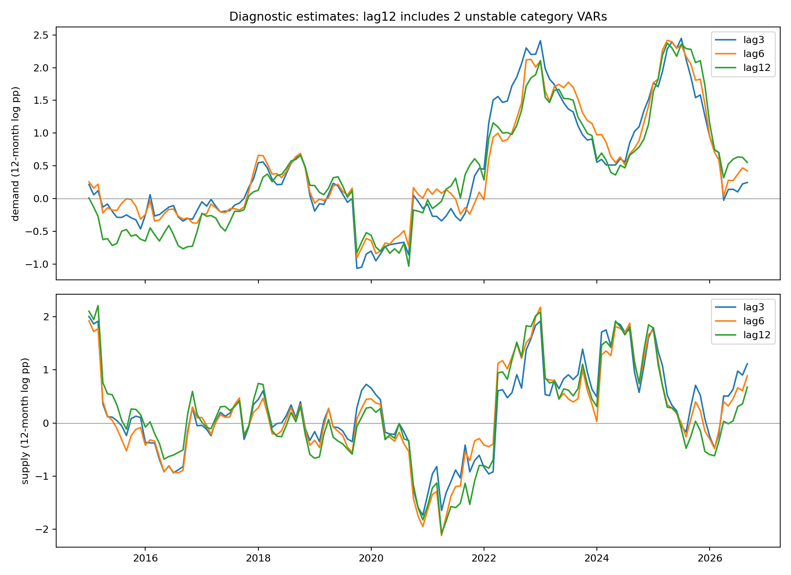

# 日本版Dupor・Hogan：実データによる推計・比較

更新日：2026-11-26。作業開始点：main `2144eefe92df66b875c64c42c8ee020ea3181605`。

## 結論と位置づけ

実データを取得し、2000年1月～2026年9月の321か月・家計47分類→CPI45分類の完全パネルを確認した。補間・ゼロ埋め・品目の事後除外は行っていない。

**2026年9月の需要寄与低下（2025年9月比）は、安定性条件を満たす11仕様すべてで確認できた。一方、2022年12月の「供給優位」はラグ数・推計期間に依存する。** これらは統計的な符号分類による記述であり、財政・金融政策や輸入価格の因果的寄与を識別したものではない。

原著に合わせた全期間VAR(12)は、洋服（0085、最大固有値絶対値1.000566）とシャツ・セーター類（0090、1.001762）で不安定だった。以下の基準仕様の数値は有限標本の診断値であり、公開用の確定推計には採用しない。元の本体スクリプトは引き続き不安定性を検出すると停止する。診断用スクリプトは不安定な仕様もフラグ付きで保存する。安定性はモデルの経済学的正しさを保証しない。

## データと取得監査

- e-Stat APIにクラウドから接続し、認証付きの実データ取得が成功。APP IDは保存しない。
- 家計調査 `0004023601`：全国・二人以上の世帯（03）、金額（円）、品目分類2025年改定。47分類×321か月＝15,087観測。
- CPI `0003427113`：全国・指数（1）、**取得時の正式名称は2020年基準消費者物価指数**、末月は2026年10月。家計との共通末月2026年9月で切る。前回レビューの「2026年に2025年基準へ改定済み」は、この表のメタデータと整合しないため訂正した。
- CPI応答には年平均・年度平均が混在する。時間コードの部分文字列から月を推測する処理を、メタデータの `YYYY年M月` ラベルによる選択に修正。年度平均の10月誤認も防ぐ。
- 全APIページの統計本体、分類名・単位、取得条件、UTC取得時刻、SHA-256を `02_data/raw`、比較系列を `official`・`coverage` に保存。ページ連続性とハッシュ、正規化CSVと原JSONの一致を確認。
- 分類名付き対応表は `02_data/processed/mapping.csv`。家計の生地・糸類＋他の被服、医薬品＋健康保持用摂取品をそれぞれ統合。名称対応を確認したが、異なる統計の品目範囲の完全一致を保証しない。
- 採用品目支出／家計調査消費支出総額は平均89.14%、最小81.08%、最大94.80%。これは**家計支出の被覆率**であり、公式CPIウェイトの被覆率ではない。対象内シェアを再正規化している。

## 指定6時点：基準仕様の5成分（診断値）

単位は各月の加重対数差を12か月合計した％ポイント。ドリフトは定数・月ダミー・初期履歴からの無ショック経路であり、純粋な長期期待ではない。「当期」は各月の新規残差寄与を12か月合計したもの。丸め前の加法誤差は全18仕様で最大1.5e-14ポイント程度。

| 時点 | ドリフト | 当期需要 | 当期供給 | 過去需要 | 過去供給 | 合計 |
| --- | --- | --- | --- | --- | --- | --- |
| 2022-12 | 0.728 | 1.349 | 1.511 | 0.542 | 0.507 | 4.637 |
| 2023-04 | 0.724 | 1.151 | 0.009 | 0.502 | 0.766 | 3.153 |
| 2024-06 | 0.741 | 0.081 | 1.895 | 0.427 | -0.084 | 3.062 |
| 2025-01 | 0.769 | 0.965 | 1.964 | 0.670 | -0.177 | 4.191 |
| 2025-09 | 0.740 | 1.319 | 0.201 | 0.961 | -0.447 | 2.775 |
| 2026-09 | 0.805 | 0.128 | 0.183 | 0.423 | 0.493 | 2.031 |

## 感度分析

全期間仕様は2000年1月～2026年9月。`pre2020_fit` は2019年12月までで係数を固定し、以後は観測済みラグを用いる1期先予測誤差。`last_5y/10y/15y` は2026年9月末の固定窓で、差分用の先頭1か月を追加する。各時点で再推計するローリングとは異なる。窓開始前のショック履歴は初期条件に入るため、期間比較は係数とドリフト規約の両方が変わる。

判別不能は、価格・数量残差の少なくとも一方の絶対値が推計期間内の残差標準偏差×閾値（0.1、0.15、0.3）以下のときと定義した。需要・供給のどちらにも寄せず、当期と過去の2成分を追加し7成分で加法整合性を保つ。この閾値定義は日本版の感度分析上の選択である。

| 仕様 | 不安定な分類数 | 最大固有値絶対値 |
| --- | --- | --- |
| lag3 | 0 | 0.797 |
| lag6 | 0 | 0.961 |
| lag12 | 2 | 1.002 |
| no_seasonal | 1 | 1.000 |
| lagged_weights | 2 | 1.002 |
| pre2020_fit | 0 | 0.998 |
| lag3_unclear_0.1 | 0 | 0.797 |
| lag6_unclear_0.1 | 0 | 0.961 |
| lag12_unclear_0.1 | 2 | 1.002 |
| lag3_unclear_0.15 | 0 | 0.797 |
| lag6_unclear_0.15 | 0 | 0.961 |
| lag12_unclear_0.15 | 2 | 1.002 |
| lag3_unclear_0.3 | 0 | 0.797 |
| lag6_unclear_0.3 | 0 | 0.961 |
| lag12_unclear_0.3 | 2 | 1.002 |
| last_5y | 35 | 1.160 |
| last_10y | 0 | 0.994 |
| last_15y | 0 | 0.998 |

安定な全期間ラグ3・6では、2022年12月は需要が供給を上回る。ラグ6の差はわずか約0.02ポイントで、順位を強調すべきではない。最近10・15年窓では供給優位となる。5年窓は45分類中35分類が不安定で採用できない。

| 仕様 | 時点 | 需要計 | 供給計 |
| --- | --- | --- | --- |
| lag3 | 2022-12 | 2.205 | 1.839 |
| lag3 | 2025-09 | 1.857 | 0.318 |
| lag3 | 2026-09 | 0.245 | 1.115 |
| lag6 | 2022-12 | 2.008 | 1.989 |
| lag6 | 2025-09 | 2.053 | 0.076 |
| lag6 | 2026-09 | 0.423 | 0.890 |
| lag12 | 2022-12 | 1.891 | 2.018 |
| lag12 | 2025-09 | 2.280 | -0.245 |
| lag12 | 2026-09 | 0.551 | 0.675 |
| pre2020_fit | 2022-12 | 2.430 | 1.970 |
| pre2020_fit | 2025-09 | 2.111 | 0.426 |
| pre2020_fit | 2026-09 | 0.556 | 1.192 |
| last_10y | 2022-12 | 0.403 | 2.629 |
| last_10y | 2025-09 | 1.131 | -0.003 |
| last_10y | 2026-09 | -0.314 | 0.562 |
| last_15y | 2022-12 | 0.692 | 2.551 |
| last_15y | 2025-09 | 1.215 | 0.127 |
| last_15y | 2026-09 | 0.019 | 0.476 |

ラグ3・6で閾値を変えても2026年9月の需要寄与低下は維持される。ただし寄与の水準・符号は固定窓や閾値で変わり、「需要が何ポイント」という単一の確定値は提示しない。差分VARの18仕様だけで、全ての仕様不確実性を網羅したとはいえない。

## Shapiro方式との比較

元の `01_shapiro_jp.py` を変更せず、今回取得したデータから一時pickleを生成して再実行した。公表CSVの2020年1月～2026年9月、全4列との差は最大0.0004984ポイントで、小数第3位への丸め幅内。既存の数値は再現できた。

一方、同じ45分類・価格・実質支出・全期間VAR(12)・月ダミー・幾何平均ウェイト・残差分類を使い、**割当対象だけ**を変更した比較を以下に示す。Shapiro型は当月の価格変化全体を残差符号で振り分け、Dupor・Hogan型は残差と過去の動学効果を振り分けてドリフトを別枠にする。新しいShapiro型比較には旧版の税月除外・120か月ローリングを入れない。基準VARが不安定である点は両列共通である。

| 時点 | DH需要 | DH供給 | DHドリフト | 同条件Shapiro需要 | 同条件Shapiro供給 |
| --- | --- | --- | --- | --- | --- |
| 2022-12 | 1.891 | 2.018 | 0.728 | 2.384 | 2.253 |
| 2023-04 | 1.654 | 0.775 | 0.724 | 2.629 | 0.524 |
| 2024-06 | 0.509 | 1.812 | 0.741 | 1.039 | 2.022 |
| 2025-01 | 1.635 | 1.788 | 0.769 | 1.832 | 2.359 |
| 2025-09 | 2.280 | -0.245 | 0.740 | 2.002 | 0.772 |
| 2026-09 | 0.551 | 0.675 | 0.805 | 0.442 | 1.590 |

元記事との違いは手法だけでなく、係数推計期間とウェイトにも由来する。例えば2026年9月の集計合計は幾何平均ウェイトで2.0315、旧版の前月まで12か月平均ウェイトで2.1559ポイント。同条件の表と旧版公表表を混同しない。

## 公式指数・予測精度の照合

2015年1月～2026年9月に、品目合計の12か月対数変化と公式CPIの12か月対数変化を比較した。

| 公式系列 | 相関 | 平均差（推計−公式、ポイント） | RMSE（ポイント） |
| --- | --- | --- | --- |
| 総合 | 0.9854 | −0.0486 | 0.2704 |
| 持家の帰属家賃を除く総合 | 0.9876 | −0.2731 | 0.3801 |

公式の通常の前年比（百分率変化）もCSVに保存し、対数変化との違いを分離した。指数算式・ウェイト・対象世帯・範囲が違うため一致は期待できない。差をドリフトに混ぜて公式指数へ強制一致させていない。旧記事の相関0.995とはウェイト等の仕様が違う。

2019年末までの係数で2020年1月～2026年9月を1期先予測すると、品目別RMSEの中央値は価格0.7413、実質支出9.3451（月次対数差のポイント）。前年同月の月次変化を予測値にする季節ナイーブ予測ではそれぞれ0.7876、11.0310。VARのRMSEが低いのは価格31/45、実質支出41/45分類。統計的有意差を検定した結果ではなく、多期先の動学予測でもない。

残差の1・12か月自己相関と24か月までのportmanteau統計量を分類別に保存した。基準仕様では絶対値0.2超の12か月自己相関は価格・実質支出とも0分類。ただしこれを白色雑音性の証明としない。VAR係数推定を考慮した検定・多重検定補正は未実施。

## 日米比較

[セントルイス連銀の公表ページ](https://www.stlouisfed.org/research/pce-inflation-drivers)を再取得し、2026年11月25日更新・2026年10月の公表表をHTMLとCSVで保存した（`02_data/us`）。米国の独自再推計はしていない。

| 系列 | 比較時点 | 需要寄与の前年同月からの変化 | 供給寄与の前年同月からの変化 |
| --- | --- | --- | --- |
| 米国・総合PCE（公表値） | 2025年10月→2026年10月 | 0.49→0.22 | 0.23→1.67 |
| 米国・コアPCE（公表値） | 同上 | 0.76→0.37 | 0.03→0.98 |
| 日本・ラグ3（本試算） | 2025年9月→2026年9月 | 1.857→0.245 | 0.318→1.115 |
| 日本・ラグ6（本試算） | 同上 | 2.053→0.423 | 0.076→0.890 |

需要寄与縮小・供給寄与拡大という方向は一致する。ただし日本は二人以上世帯の家計調査支出とCPIによる部分バスケット、米国はPCEであり、終期も1か月違う。米国のトレンドには期間平均と公式指数への調整差が含まれ、日本のドリフトとは異なる。米国の「超過インフレの88%」と日本の比率を横並びの順位比較には使わない。

## 残る課題

- 基準VAR(12)の不安定性への対処、係数・分類・寄与の推定不確実性、ブートストラップ等。
- 各時点で再推計するローリングのDH分解、水準VAR、外部の季節調整法との比較。今回の短い固定窓や月ダミー除外で代用したとは扱わない。
- 直接数量統計による価格デフレート由来の測定誤差の検証、公式CPIウェイト被覆率。
- 消費税・補助金等の制度効果をその後の伝播も含めて別成分化。
- 2022年ショック群の時点別追跡、輸入物価など外部指標との照合、因果的妥当性。
- 米国著者コード・現行ダッシュボード調整方法の完全再現、日本語の最終公開図表、公開先画像の表示確認。

数値・図は研究用の中間成果であり、元記事の実測数値を新方式の確定結果として置き換えていない。
