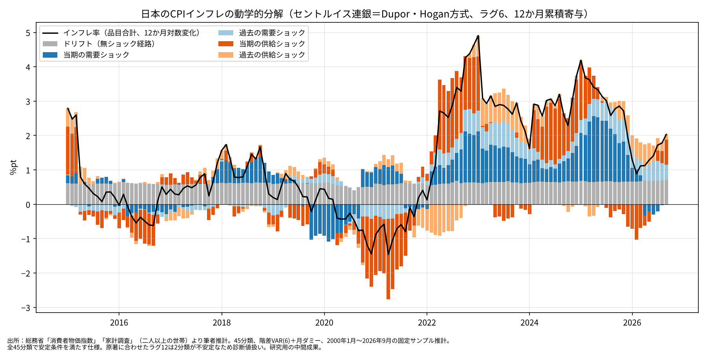

# 日本の物価を押し上げる新たな需要が消えた──セントルイス連銀方式で見た2026年9月

ウェブ版：[https://p72.github.io/note-draft/米国のインフレ要因分解/03\_日本の当期需要ショックがゼロになった.html](https://p72.github.io/note-draft/%E7%B1%B3%E5%9B%BD%E3%81%AE%E3%82%A4%E3%83%B3%E3%83%95%E3%83%AC%E8%A6%81%E5%9B%A0%E5%88%86%E8%A7%A3/03_%E6%97%A5%E6%9C%AC%E3%81%AE%E5%BD%93%E6%9C%9F%E9%9C%80%E8%A6%81%E3%82%B7%E3%83%A7%E3%83%83%E3%82%AF%E3%81%8C%E3%82%BC%E3%83%AD%E3%81%AB%E3%81%AA%E3%81%A3%E3%81%9F.html)

GitHub：[https://github.com/p72/note-draft/blob/main/米国のインフレ要因分解/03\_日本の当期需要ショックがゼロになった.md](https://github.com/p72/note-draft/blob/main/%E7%B1%B3%E5%9B%BD%E3%81%AE%E3%82%A4%E3%83%B3%E3%83%95%E3%83%AC%E8%A6%81%E5%9B%A0%E5%88%86%E8%A7%A3/03_%E6%97%A5%E6%9C%AC%E3%81%AE%E5%BD%93%E6%9C%9F%E9%9C%80%E8%A6%81%E3%82%B7%E3%83%A7%E3%83%83%E3%82%AF%E3%81%8C%E3%82%BC%E3%83%AD%E3%81%AB%E3%81%AA%E3%81%A3%E3%81%9F.md)

セントルイス連銀がPCEインフレの分解に用いている方式（Dupor・Hogan方式）を、日本の消費者物価指数（CPI）と家計調査に当てはめた。本稿では、その結果を示すグラフ1枚の読み方に絞って解説する。

**2026年9月、当期の需要ショックの寄与はほぼゼロになった。** 1年前の2025年9月には、新たに発生した需要ショックが物価を1.39ポイント押し上げていた。それが−0.01ポイントまで縮小した。現在のインフレ率2.0％を支えているのは、ドリフト、過去の需要ショックの残存効果、そして当期の供給ショックである。

ただし、この「ゼロ」のうち約0.4ポイント分は、2026年4月の私立高校授業料の実質無償化という制度変更による。これを除いても、当期の需要ショックは1.35ポイントから0.38ポイントへ7割縮小しており、需要の押し上げが大きく弱まったという結論は変わらない。

## 1. グラフの見方

黒線は、家計調査の支出ウェイトで集計した45分類の物価上昇率（12か月の対数変化）である。棒はそれを5つの成分に分けたもので、合計は黒線に一致する。

| 成分 | 意味 |
|---|---|
| ドリフト（灰） | ショックがなかった場合に物価がたどる経路。定数項・季節性・初期値から生じる |
| 当期の需要ショック（濃い青） | その月に新たに発生した、価格と数量が同じ方向に動く予想外の変化 |
| 過去の需要ショック（薄い青） | それ以前に発生した需要ショックが、ラグを通じて残している影響 |
| 当期の供給ショック（濃い橙） | その月に新たに発生した、価格と数量が逆方向に動く予想外の変化 |
| 過去の供給ショック（薄い橙） | それ以前に発生した供給ショックの残存効果 |

需要ショックと供給ショックの区別は、品目ごとに価格と実質支出の予測誤差の符号を比べて行う。価格が予想以上に上がり、数量も予想以上に増えれば需要ショック、価格が上がって数量が減れば供給ショックである。「当期」と「過去」の区別は月次モデルの中のもので、各棒は12か月分の寄与を合計している。

「当期の需要ショックがゼロ」とは、過去12か月の間に新たに生じた需要の押し上げと押し下げが、差し引きでほぼ相殺されたことを意味する。

## 2. 2026年9月の姿

単位：12か月累積寄与、％ポイント。

| 時点 | ドリフト | 当期需要 | 過去需要 | 当期供給 | 過去供給 | 合計 |
|---|---:|---:|---:|---:|---:|---:|
| 2022年12月 | 0.64 | 1.37 | 0.63 | 1.63 | 0.36 | 4.64 |
| 2024年6月 | 0.65 | 0.44 | 0.20 | 1.67 | 0.11 | 3.06 |
| 2025年9月 | 0.65 | 1.39 | 0.66 | −0.20 | 0.28 | 2.77 |
| 2026年9月 | 0.72 | −0.01 | 0.43 | 0.72 | 0.17 | 2.03 |

出所：総務省「消費者物価指数」「家計調査」より筆者推計（ラグ6）。

2025年9月と2026年9月を比べると、インフレ率は2.77％から2.03％へ0.74ポイント低下した。内訳では当期の需要ショックが1.40ポイント減り、当期の供給ショックが0.92ポイント増えた。需要の縮小を供給が一部埋め合わせた形である。

## 3. 1年間の推移

単位：12か月累積寄与、％ポイント。

| 時点 | 当期需要 | 過去需要 | 当期供給 | 過去供給 | 合計 |
|---|---:|---:|---:|---:|---:|
| 2025年9月 | 1.39 | 0.66 | −0.20 | 0.28 | 2.77 |
| 2025年12月 | 0.78 | 0.66 | −0.65 | 0.49 | 1.94 |
| 2026年2月 | 0.35 | 0.36 | −1.03 | 0.55 | 0.89 |
| 2026年4月 | −0.34 | 0.37 | −0.28 | 0.68 | 1.12 |
| 2026年6月 | −0.30 | 0.57 | 0.01 | 0.45 | 1.41 |
| 2026年9月 | −0.01 | 0.43 | 0.72 | 0.17 | 2.03 |

出所：同上。ドリフトは0.65～0.72で推移したため省略した。

当期の需要ショックは2025年秋から一貫して縮小し、2026年4月にはマイナスに転じた。その後はゼロ近傍で推移している。

一方、当期の供給ショックは2026年2月の−1.03ポイントを底に急拡大し、9月には0.72ポイントとなった。インフレ率が2026年2月の0.89％から9月の2.03％へ持ち直したのは、需要ではなく供給要因による。この時期は中東情勢の緊迫化とエネルギー価格の上昇に重なり、政府は2026年3月にガソリン等の燃料油に対する緊急的な補助を決めている。ただし、本稿の分解は供給ショックの原因を特定するものではない。

## 4. 結果は仕様に依存しないか

この分解は、ラグ数や推計期間によって結果が変わり得る。原著に合わせたラグ12は、洋服とシャツ・セーター類の2分類でVARが不安定となるため、本稿では全45分類で安定なラグ6を用いた。

そこで、18通りの仕様で2026年9月の当期需要ショックを比べた。直近5年窓の仕様は45分類中35分類が不安定であるため除く。残る17仕様では、2026年9月の当期需要ショックは−0.27～0.22ポイントの範囲に収まった。2025年9月には0.57～1.45ポイントであったから、どの仕様でも大きく縮小し、ゼロ近傍に達している。

単位：12か月累積寄与、％ポイント。

| 仕様 | 2025年9月 | 2026年9月 |
|---|---:|---:|
| ラグ3 | 1.14 | 0.10 |
| ラグ6（本稿） | 1.39 | −0.01 |
| ラグ12（2分類不安定） | 1.32 | 0.13 |
| 月ダミーなし | 0.81 | −0.13 |
| 2019年までの係数で固定 | 1.45 | 0.22 |
| 直近10年窓 | 0.58 | −0.27 |
| 直近15年窓 | 0.57 | −0.10 |

出所：同上。判別不能の閾値を変えた9仕様と、ウェイトを変えた1仕様も同じ範囲に収まる。

第1稿の第7節で見たとおり、2022年や2024年の需要と供給の順位は仕様によって入れ替わる。それに対して、2026年の当期需要ショックの縮小は、この分析の中で最も頑健な結果である。

## 5. 何が当期の需要ショックを消したのか

品目別に、2025年9月から2026年9月にかけて当期需要ショックの寄与が大きく減った分類を見る（ラグ6）。

単位：12か月累積寄与、％ポイント。

| 分類 | 2025年9月 | 2026年9月 | 変化 |
|---|---:|---:|---:|
| 授業料等 | 0.04 | −0.39 | −0.43 |
| 自動車等関係費 | 0.27 | −0.09 | −0.35 |
| 電気代 | 0.11 | −0.08 | −0.19 |
| 菓子類 | 0.08 | −0.04 | −0.12 |
| 穀類 | 0.04 | −0.08 | −0.12 |
| 野菜・海藻 | 0.26 | 0.14 | −0.12 |
| 教養娯楽サービス | 0.03 | −0.08 | −0.11 |
| 45分類計 | 1.39 | −0.01 | −1.40 |

出所：同上。

最も大きいのは授業料等である。2026年4月から私立高校授業料の就学支援金の所得制限が撤廃され、CPIの授業料等は2026年4月に約10％下落した。授業料が下がり、家計の授業料支出も減ったため、価格と数量が同じ方向に動いたとみなされ、負の需要ショックに分類された。しかしこれは家計の需要が弱まったことを示すものではなく、制度変更による機械的な動きである。

授業料等を除いて集計すると、当期の需要ショックは2025年9月の1.35ポイントから2026年9月の0.38ポイントへ縮小する。授業料等に加えて、電気・ガス料金支援の影響を受ける電気代・ガス代を除いても、1.27ポイントから0.41ポイントへの縮小となる。制度要因を除けば「ゼロ」ではないが、7割程度縮小したことに変わりはない。

自動車等関係費の寄与も大きく変化した。ただし、この分類には振れの大きい自動車購入が含まれ、家計調査ではその実質支出が前年比で±40％近く動く月もある。この分類の変化は割り引いて見る必要がある。

## 6. 米国との比較

セントルイス連銀の2026年11月25日更新の公表値では、米国の総合PCEの需要ショック寄与は2025年10月の0.49ポイントから2026年10月の0.22ポイントへ縮小し、供給ショック寄与は0.23ポイントから1.67ポイントへ拡大した。

日本でも、需要寄与の縮小と供給寄与の拡大という同じ方向の変化が起きている。ただし、日本の試算は家計調査とCPIによる部分的なバスケットであり、米国はPCEである。ドリフトと米国のトレンドも定義が異なる。両国の割合を並べて大小を比較することはできない。

## 7. 金融政策への含意

需要の新たな押し上げが消え、インフレ率の持ち直しが供給要因によるものであれば、金融引締めで抑えるべき需要超過は、少なくとも消費の品目レベルでは見当たらないことになる。一方、過去の需要ショックの残存効果は0.43ポイント残っており、ドリフトも0.72ポイントある。供給ショックが期待インフレや賃金に波及すれば、物価上昇が持続する可能性もある。

ここでの需要ショックは品目ごとの相対的な需要の変化であり、マクロの総需要や需給ギャップと同じではない。本稿の結果は、金融政策の判断材料の一つにとどまる。

## 8. 注意点

- 数量は家計調査（二人以上の世帯、約8,000世帯の標本）の支出をCPIで割って求めており、振れが大きい。
- 消費税以外の制度要因は、需要または供給のいずれかに分類されている。第5節で示したとおり、授業料等の無償化はその典型である。
- ドリフトは純粋な期待インフレではなく、ショックがない場合のモデル上の経路である。
- 係数は2000年1月～2026年9月の全期間で一度だけ推計しており、各時点で利用可能だったデータによるリアルタイムの推計ではない。
- ラグ6は安定性の観点から選んだもので、原著の基準仕様（ラグ12）ではない。

## データ・参考文献

- [第1稿：米国のインフレは需要要因から供給要因へ](01_需要ショックから供給ショックへ.md)（手法と米国の公表値）
- [実データ分析結果](02_results.md)（18仕様の感度分析）
- [Federal Reserve Bank of St. Louis, PCE Inflation Drivers](https://www.stlouisfed.org/research/pce-inflation-drivers)（2026年11月25日更新）
- [Dupor and Hogan, Was the Post-Lockdown Inflation Surge Mainly Supply Driven?](https://doi.org/10.20955/wp.2025.007)
- [文部科学省「三党合意に基づく令和8年度以降の高校教育等の振興方策について」](https://www.mext.go.jp/content/20260126-mxt_syoto02-000046862_02.pdf)（2026年1月26日）
- [資源エネルギー庁「電気・ガス料金支援」](https://www.enecho.meti.go.jp/category/gekihen_lp/)

データ取得方法：e-Stat APIで取得した。CPIは統計表ID 0003427113（2020年基準、全国、中分類指数）、家計調査は統計表ID 0004023601（品目分類 2025年改定・金額、二人以上の世帯、全国）。期間は2000年1月～2026年9月。推計は `02_empirical_analysis.py`、グラフは `02_plot_dh.py` による。品目別の寄与は `02_empirical_analysis.py` の `estimate` 関数をラグ6で実行して算出した。
