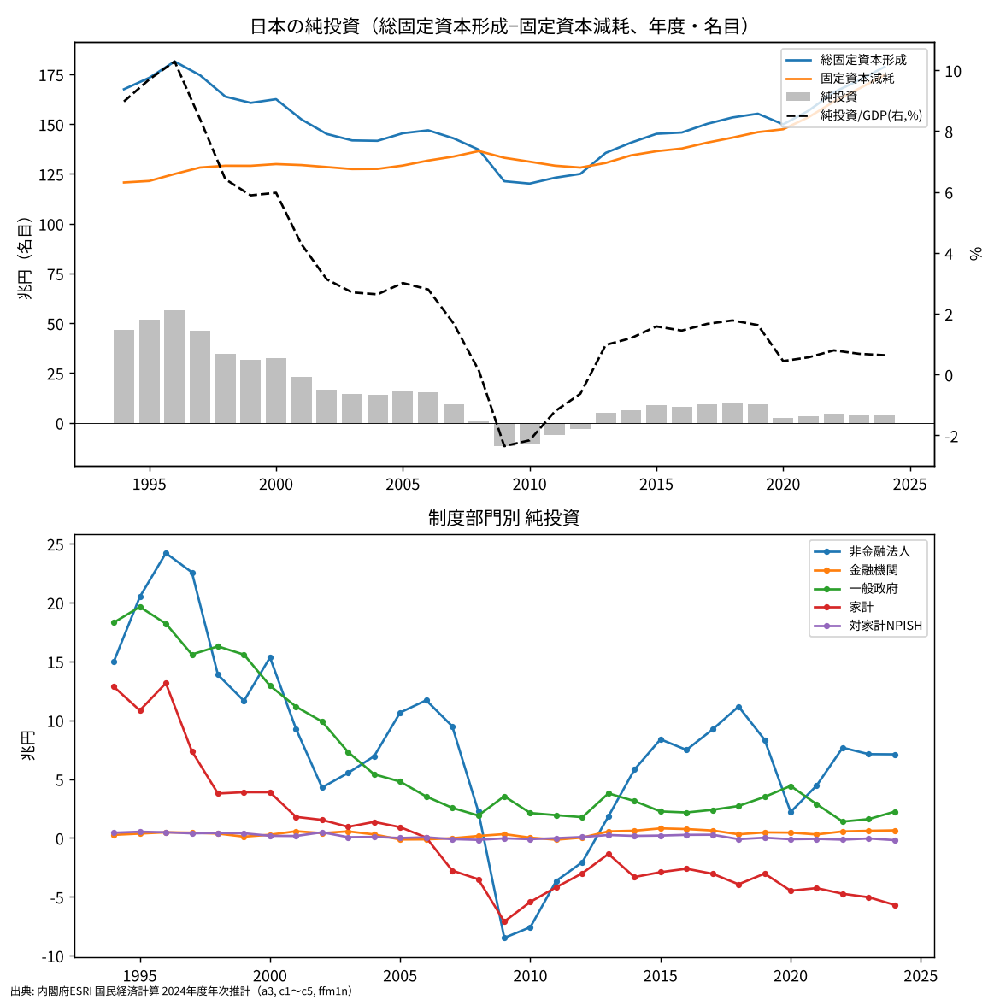
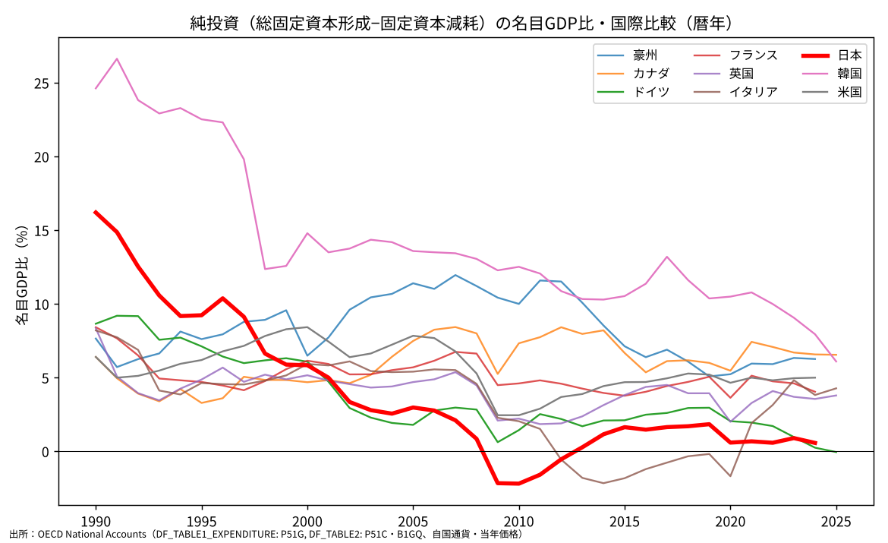

# 日本の純投資がほぼゼロであることは何を意味するのか

ウェブ版：[https://p72.github.io/note-draft/純投資/01\_純投資がほぼゼロとはどういうことか.html](https://p72.github.io/note-draft/%E7%B4%94%E6%8A%95%E8%B3%87/01_%E7%B4%94%E6%8A%95%E8%B3%87%E3%81%8C%E3%81%BB%E3%81%BC%E3%82%BC%E3%83%AD%E3%81%A8%E3%81%AF%E3%81%A9%E3%81%86%E3%81%84%E3%81%86%E3%81%93%E3%81%A8%E3%81%8B.html)

GitHub：[https://github.com/p72/note-draft/blob/main/純投資/01\_純投資がほぼゼロとはどういうことか.md](https://github.com/p72/note-draft/blob/main/%E7%B4%94%E6%8A%95%E8%B3%87/01_%E7%B4%94%E6%8A%95%E8%B3%87%E3%81%8C%E3%81%BB%E3%81%BC%E3%82%BC%E3%83%AD%E3%81%A8%E3%81%AF%E3%81%A9%E3%81%86%E3%81%84%E3%81%86%E3%81%93%E3%81%A8%E3%81%8B.md)

※ この記事は、内閣府 経済社会総合研究所（ESRI）の国民経済計算（2024年度年次推計）と、OECD の年次国民経済計算（SDMX API）の公表データを使って計算している。

日本の投資は少ないとよく言われる。しかし、GDPに占める総固定資本形成の比率で見ると、日本は主要国の中でむしろ高い部類に入る。それでも「投資が足りない」と言われるのはなぜか。その答えは、総投資から固定資本減耗を引いた「純投資」にある。この記事では、数字を細かく追うことより、純投資が小さいということが経済にとって何を意味するのかを整理する。

結論を先に書くと、次のとおりである。

- **純投資は、一国が持つ資本（建物・設備・インフラ・ソフトウェアなど）がどれだけ増えたかを表す**。純投資がほぼゼロということは、日本の投資のほとんどが、古くなった資本の置き換えに使われ、上乗せになっていないということである。
- **日本は総投資が多いのに、目減り分も同じくらい大きい**。過去に積み上げた資本が大きいため、それを維持するだけで多くの投資が必要になる。日本の問題は投資の「量」より、維持更新を超える部分が残らないことにある。
- **部門ごとに意味が違う**。企業は資本を少しずつ増やしているが、家計（住宅）は2000年代後半から資本を減らし続けている。政府は1990年代の大規模な公共投資から、維持更新中心へと性格が変わった。
- **純投資が小さいことが、そのまま悪いとは言い切れない**。働く人が減る社会では、資本が横ばいでも1人当たりの資本は増えうる。また、固定資本減耗は推計値であり、その大きさは評価方法に左右される。

## 純投資とは何か

総固定資本形成（総投資）は、1年間に新しく作られた建物・設備・インフラ・ソフトウェアなどの合計である。一方、固定資本減耗は、すでにある資本が1年間に使われて古くなり、価値が目減りした分を推計したものである。

- 純投資 ＝ 総固定資本形成 － 固定資本減耗

総投資には2つの役割が混ざっている。1つは、古くなった資本の置き換え（更新）である。もう1つは、資本そのものを増やすこと（上乗せ）である。純投資は、このうち上乗せの部分だけを取り出したものと考えてよい。

身近な例で言えば、住宅の屋根を葺き替えたり、壊れた給湯器を交換したりするのは更新である。家計の支出としては大きくても、家の価値が新築時より上がるわけではない。増築や新しい家の購入が、上乗せにあたる。

したがって、純投資がプラスであれば一国の資本は増えており、ゼロであれば横ばい、マイナスであれば減っている。総投資の大きさだけを見ても、資本が増えているのかどうかは分からない。

## 日本の純投資の推移

1990年代半ばの日本では、純投資は名目GDPの9〜10％あった。総投資のうちかなりの部分が、資本を増やすことに使われていた。

その後、総投資が減る一方で、固定資本減耗はほとんど減らなかった。目減りは過去に積み上げた資本の大きさで決まるので、新しい投資を減らしても急には小さくならない。その結果、純投資は2000年代に2〜3％まで縮み、リーマン・ショック後の2009〜2012年度にはマイナスになった。この4年間、日本の資本は全体として減っていたことになる。

2013年度以降は総投資が回復し、純投資もプラスに戻った。しかし、総投資の増加とほぼ同じペースで固定資本減耗も増えており、2020年代の純投資は名目GDPの1％に満たない。

近年の総投資の増加は、資本の上乗せにはあまり回っていない。総投資が増えたのに純投資が増えないのは、過去の資本を維持するコストが同時に上がっているからである。固定資本減耗は時価（いま作り直したらいくらかかるか）で評価されるため、建設費や設備の価格が上がると、目減りの額も大きくなる。物価が上がる局面では、名目の総投資が伸びても、そのかなりの部分が維持更新のコスト上昇に吸収される。

## 部門ごとに見ると意味が違う

純投資の合計はほぼゼロでも、その中身は部門によって正反対である。

### 企業：少しずつ資本を増やしている

非金融法人企業の純投資はプラスで、近年は日本全体の純投資のほとんどを占めている。企業は、景気後退期を除けば、更新を上回る投資を続けてきた。ただし1990年代半ばの水準と比べると小さく、企業の資本の増え方は緩やかになっている。

### 家計：住宅の資本を減らし続けている

家計の純投資は2000年代後半からずっとマイナスである。家計の投資の中心は住宅なので、これは日本の住宅ストック全体が、価値の面で目減りしていることを意味する。新しく建てられる住宅より、古くなっていく住宅の方が多い。人口と世帯の伸びが止まり、空き家が増えている社会では、自然に起こることである。

これは家計の貯蓄・投資のバランスにも影響している。住宅投資が目減り分を下回っている分だけ、家計は資金を使わずに余らせることになり、ISバランスでは家計の「貯蓄超過」として表れる。

### 政府：公共投資は維持更新中心になった

一般政府の純投資は、1990年代には名目GDPの3〜4％あったが、現在は0.5％を下回る。道路・橋・上下水道などの公共資本を新しく作る時代から、すでに作ったものを維持・更新する時代に移ったということである。高度成長期から1990年代までに整備されたインフラが一斉に更新時期を迎えるため、公共投資の多くは今後も維持更新に向かうと考えられる。

## 国際比較で見ると

OECD の国民経済計算で主要国と比べると、日本の特徴はよりはっきりする。

1990年の日本は、純投資の比率が韓国に次いで高い国だった。それが2010年代以降は、イタリア・ドイツと並んで最も低いグループにいる。

注目すべきは、総投資の比率で見ると日本は今でも主要国の上位にいることである。日本が他国と違うのは、総投資と同じくらい固定資本減耗の比率が大きい点である。主要国の多くでは、目減りの比率は名目GDPの15〜22％程度であるのに対して、日本はそれを大きく上回る。

これは、日本がGDPの大きさに比べて多くの資本を抱えている国だということを表している。高度成長期から1990年代にかけて大量の投資をした結果、資本ストックが大きくなり、それを維持するだけで多くの投資が必要になった。たとえて言えば、大きな家に住んでいる家計は、修繕費だけで家計の多くを使ってしまい、新しいものを買う余裕が残らない。日本の投資の問題は、この「維持費の重さ」として理解した方が実態に近い。

## 純投資が小さいことは悪いことか

純投資が小さいことは、経済にとって望ましくないと言われることが多い。資本が増えなければ、働く人1人当たりの設備は増えにくく、労働生産性も上がりにくいからである。

ただし、純投資の小ささをそのまま「投資不足」と読むには、少なくとも3つの留保が必要である。

### 1. 働く人が減れば、資本が横ばいでも1人当たりの資本は増える

生産性にとって重要なのは、資本の総額より、働く人1人当たり（あるいは労働時間当たり）の資本である。人口減少と高齢化で労働投入が減っていく社会では、資本が横ばいでも1人当たりの資本は増えうる。人口が増えている国と同じ純投資の比率を目標にする必要は、必ずしもない。

### 2. 更新投資でも、中身は新しくなる

固定資本減耗と同じ額の更新投資であっても、古い設備を新しい設備に置き換えれば、性能は上がることが多い。名目の金額で見た純投資がゼロでも、資本の質は向上しているかもしれない。純投資の数字は、この質の変化を十分にはとらえていない。

### 3. 固定資本減耗は推計値である

固定資本減耗は、実際に支払われた金額ではなく、資本の耐用年数や目減りのパターンを仮定して計算した推計値である。耐用年数を短く仮定すれば、目減りは大きく、純投資は小さく出る。国によって推計方法が違うため、純投資の水準を国どうしで比べるときには注意が必要である。国際比較では、水準の差よりも、それぞれの国の中での推移を見る方が確かである。

## まとめ

日本の純投資がほぼゼロであるということは、日本の投資が「資本を増やす投資」ではなく「資本を保つ投資」になっているということである。その背景には、過去に積み上げた大きな資本の維持費の重さがあり、部門で見ると、企業はわずかに資本を増やし、家計の住宅は目減りし、政府は維持更新に専念している。

この状態をどう評価するかは、何を目指すかによる。人口が減る社会で資本を横ばいに保つことは、1人当たりで見れば必ずしも後退ではない。一方で、維持費に追われて新しい分野への投資が細れば、生産性を高める余地は狭まる。総投資の大きさではなく、そのうちどれだけが「上乗せ」として残っているかを見ることが、日本の投資を考える出発点になる。

## データと計算方法

- 日本の純投資（年度）：内閣府 経済社会総合研究所「国民経済計算 2024年度年次推計」の統合勘定・資本勘定（a3）、制度部門別資本勘定（c1〜c5）、主要系列表（ffm1n：名目GDP）。純投資 ＝ 総固定資本形成 － 固定資本減耗（名目）。
  - [https://www.esri.cao.go.jp/jp/sna/data/data\_list/kakuhou/files/2024/2024\_kaku\_top.html](https://www.esri.cao.go.jp/jp/sna/data/data_list/kakuhou/files/2024/2024_kaku_top.html)
- 国際比較（暦年）：OECD 年次国民経済計算。総固定資本形成は DF\_TABLE1\_EXPENDITURE（P51G）、固定資本減耗と名目GDPは DF\_TABLE2（P51C、B1GQ）。いずれも自国通貨・当年価格。日本・米国・フランス・オーストラリアは2024年まで。
  - [https://data-explorer.oecd.org](https://data-explorer.oecd.org)
- 日本の数値は、ESRI（年度）と OECD（暦年）で期間の区切りと公表時点が違うため、少しずれる。
