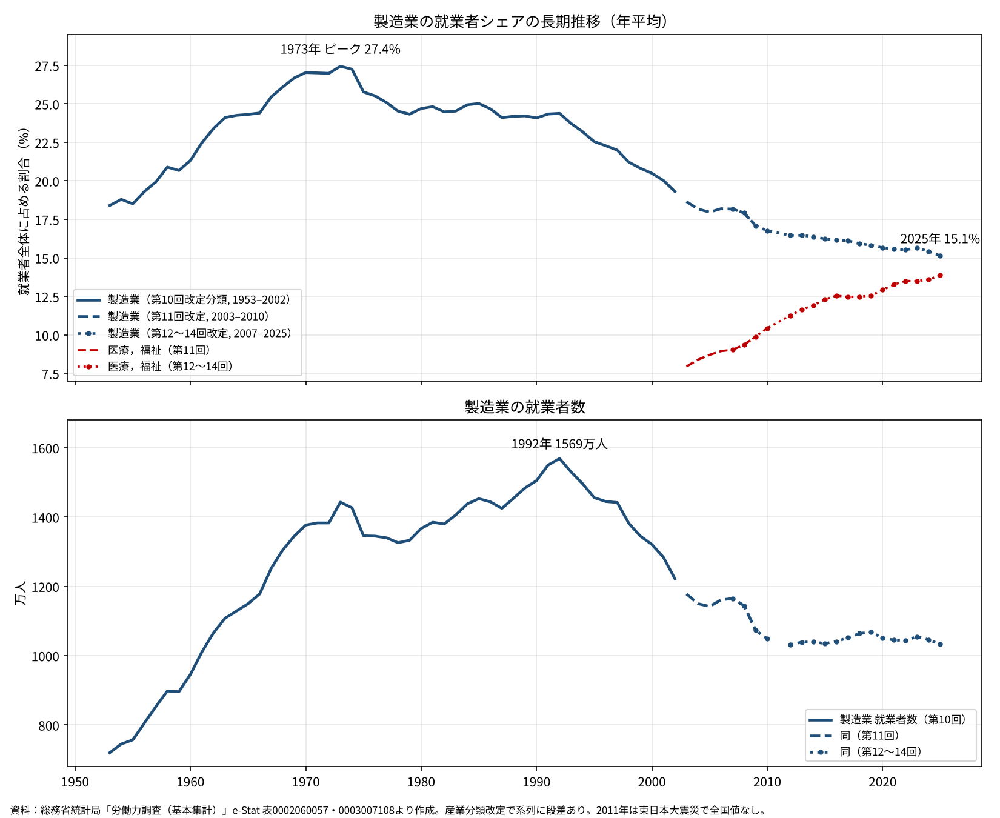
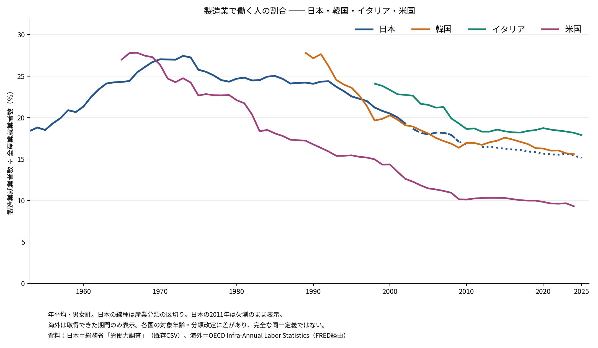
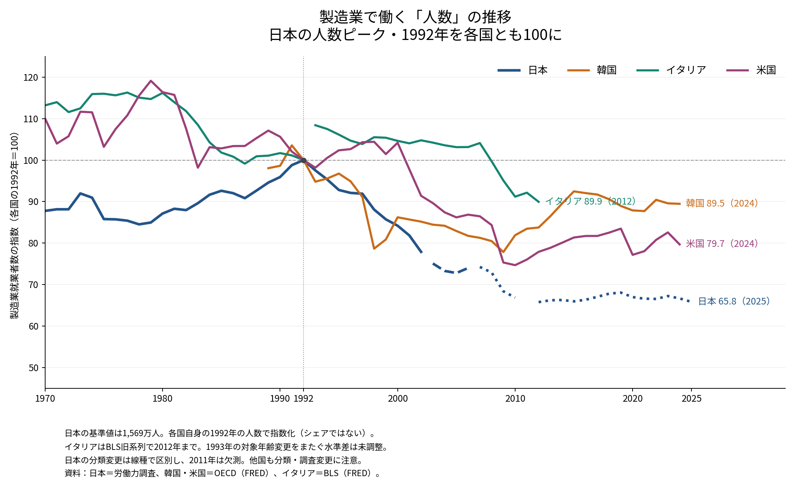
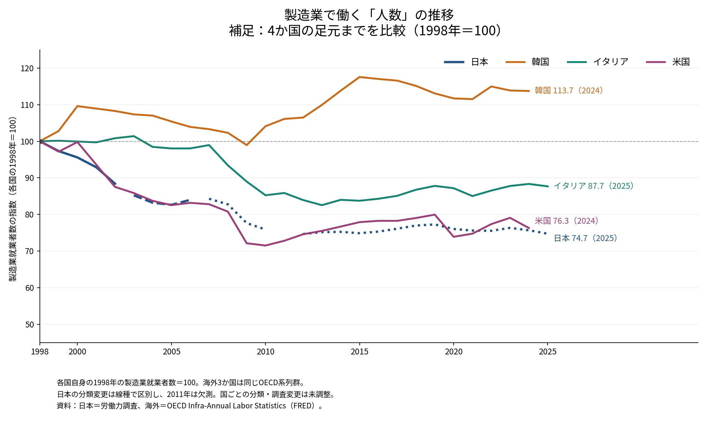

# 製造業で働く人の割合は1973年がピークだった──労働力調査で見る70年の推移

ウェブ版：[https://p72.github.io/note-draft/製造業の就業者シェア/01\_製造業で働く人の割合は1973年がピークだった.html](https://p72.github.io/note-draft/%E8%A3%BD%E9%80%A0%E6%A5%AD%E3%81%AE%E5%B0%B1%E6%A5%AD%E8%80%85%E3%82%B7%E3%82%A7%E3%82%A2/01_%E8%A3%BD%E9%80%A0%E6%A5%AD%E3%81%A7%E5%83%8D%E3%81%8F%E4%BA%BA%E3%81%AE%E5%89%B2%E5%90%88%E3%81%AF1973%E5%B9%B4%E3%81%8C%E3%83%94%E3%83%BC%E3%82%AF%E3%81%A0%E3%81%A3%E3%81%9F.html)

GitHub：[https://github.com/p72/note-draft/blob/main/製造業の就業者シェア/01\_製造業で働く人の割合は1973年がピークだった.md](https://github.com/p72/note-draft/blob/main/%E8%A3%BD%E9%80%A0%E6%A5%AD%E3%81%AE%E5%B0%B1%E6%A5%AD%E8%80%85%E3%82%B7%E3%82%A7%E3%82%A2/01_%E8%A3%BD%E9%80%A0%E6%A5%AD%E3%81%A7%E5%83%8D%E3%81%8F%E4%BA%BA%E3%81%AE%E5%89%B2%E5%90%88%E3%81%AF1973%E5%B9%B4%E3%81%8C%E3%83%94%E3%83%BC%E3%82%AF%E3%81%A0%E3%81%A3%E3%81%9F.md)

※ この記事は、総務省統計局「労働力調査（基本集計）」の年平均結果を e-Stat API で取得して作成した。

## 出発点：2025年の産業別就業者数

労働政策研究・研修機構（JILPT）の「早わかり グラフでみる労働の今」に、2025年平均の産業別就業者数のグラフがある（2026年2月16日更新）。就業者総数6,828万人のうち、最も多いのは製造業の1,033万人（15.1％）で、卸売業，小売業の1,029万人（15.1％）、医療，福祉の947万人（13.9％）が続く。

- 出典は総務省統計局「労働力調査（基本集計）」である。
- 「第一次産業」は「農業，林業」「漁業」「鉱業，採石業，砂利採取業」の合計である。
- 括弧内の数字は、就業者総数に占める各産業の割合である。
- 「就業者」には自営業主と家族従業者も含まれる。雇用者だけを見る場合は、同じ JILPT の「産業別雇用者数」を使う。

JILPT のページ：[https://www.jil.go.jp/kokunai/statistics/chart/html/g0004.html](https://www.jil.go.jp/kokunai/statistics/chart/html/g0004.html)

このグラフは、就業者の数で見た「わが国の労働における製造業のシェア」を示している。今は15％だが、昔はどうだったのか。労働力調査の元データまでさかのぼり、1953年からの推移を描いた。

## グラフで見る1953〜2025年

上段は就業者全体に占める製造業の割合、下段は製造業の就業者数である。上段の赤線は、比較のために医療，福祉の割合を重ねたものである。線の種類（実線・破線・点線）は、産業分類の改定による系列の区切りを表す。

## 韓国・イタリア・米国を重ねるとどう見えるか

日本の長期系列に、OECDの製造業就業者数を全就業者数で割った韓国・イタリア・米国の系列を重ねた。海外はFREDで取得できた年次・季節調整なし・男女計の系列を用いた。取得期間は韓国1989〜2024年、イタリア1998〜2025年、米国1965〜2024年である。開始年より前や最終年より後は補間・延長していない。

4か国を比較できる直近の年は2024年である。

| 国 | 2024年の製造業就業者シェア |
|---|---:|
| イタリア | 18.2％ |
| 韓国 | 15.6％ |
| 日本 | 15.4％ |
| 米国 | 9.3％ |

日本と韓国は足元で近い水準にあり、イタリアはそれより高く、米国は低い。取得できた期間では、いずれも製造業の就業者シェアは長期的に低下している。ただし、各国で系列の開始年が異なるため、この図だけで4か国の歴史的なピーク年を比較することはできない。また、シェアの低下だけから、生産量の減少や特定の為替政策の影響を識別することもできない。

**比較上の注意：** 海外の分子はOECDの製造業就業者数（ACTIVITY=C）、分母は全就業者数であり、非農業部門の雇用者数を分母にした指標ではない。FREDの年齢メタデータは分子が `_T`、分母が `Y_GE15`。各国の調査対象や産業分類改定による違いは残るため、厳密に同一定義へ調整した比較ではない。海外系列内の分類・調査変更による断層も未調整であり、段差をそのまま実際の雇用変化と解釈しない。日本は元の分類別系列を維持し、2011年の欠測を線で結んでいない。

### 国際比較の取得方法と再現

海外データは2026年10月18日にFREDのCSV配信から取得した。出典は OECD (2026), Infra-Annual Labor Statistics / Main Economic Indicators, [OECD Data Explorer](https://data-explorer.oecd.org/)（FRED経由）。使用系列は次のとおり。

| 国 | 製造業就業者数 | 全就業者数 |
|---|---|---|
| 韓国 | [LFEAMNTTKRA647N](https://fred.stlouisfed.org/series/LFEAMNTTKRA647N) | [LFEMTTTTKRA647N](https://fred.stlouisfed.org/series/LFEMTTTTKRA647N) |
| イタリア | [LFEAMNTTITA647N](https://fred.stlouisfed.org/series/LFEAMNTTITA647N) | [LFEMTTTTITA647N](https://fred.stlouisfed.org/series/LFEMTTTTITA647N) |
| 米国 | [LFEAMNTTUSA647N](https://fred.stlouisfed.org/series/LFEAMNTTUSA647N) | [LFEMTTTTUSA647N](https://fred.stlouisfed.org/series/LFEMTTTTUSA647N) |

- 計算式：同一年の製造業就業者数 ÷ 全就業者数 × 100。人数単位はすべて「人」。
- 日本は既存の `code/01_mfg_share.csv` を使用した。日本のシェアは同ファイルの小数第2位までの値。
- 取得時の海外CSV：`code/international_raw/`、集計CSV：`code/02_international_share.csv`。
- 再作図：`python code/02_international.py`。依存ライブラリは pandas、matplotlib。日本語フォントが必要（必要なら環境変数 `JAPANESE_FONT` にフォントファイルを指定）。
- 海外データを再取得する場合は `python code/02_international.py --refresh`。再取得により過去年の値が改定される場合がある。図の表示期間は元記事に合わせて2025年までとした。

## 人数のトレンド：日本のピーク年・1992年を100にそろえる

日本の製造業就業者数がピークだった1992年を共通の基準年にして、各国の人数を指数化した。計算式は「各年の製造業就業者数 ÷ **その国自身の1992年の製造業就業者数** × 100」である。各国それぞれのピーク年を100にする計算でも、日本の人数を分母にする計算でもない。

| 国 | 1992年の人数（基準値） | 直近の指数 | 対象年 |
|---|---:|---:|---:|
| 日本 | 1,569万人 | 65.8 | 2025 |
| 韓国 | 約498.0万人 | 89.5 | 2024 |
| 米国 | 約1,885.5万人 | 79.7 | 2024 |
| イタリア（BLS旧系列） | 467.6万人 | 89.9 | 2012 |

この基準では、日本の人数は1992年から2025年までに約34％減少し、韓国は2024年までに約11％、米国は約20％減少している。日本は1990年代から2000年代の減少が大きく、2010年代以降は低い水準でほぼ横ばい。韓国には2000年代後半から2010年代半ばの回復が見られる。ただし、分類・調査変更を含む公表系列の単純比であり、厳密に定義を一定にした雇用減少率ではない。

**イタリアには制約がある。** 前のシェア図で用いたOECD系列は1998年からしかないため、この1992年基準図では米国労働統計局（BLS）の旧国際比較系列 [ITAEMFGNA](https://fred.stlouisfed.org/series/ITAEMFGNA) を使った。年次・千人単位の製造業就業者数で、1970〜2012年を収録しているが、統計事業の終了により2012年で止まっている。OECD系列への接続や外挿は行っていない。また、[BLSの技術注記](https://www.bls.gov/fls/flscomparelf/technical_notes.pdf)ではイタリアの対象年齢が1992年まで14歳以上、1993年以降15歳以上となる。図はこの境界を線で結ばず、基準年をまたぐ定義差は未調整とした。1993年の段差を実際の雇用増とみなしたり、2012年の値を他国の2024〜25年と同時点の比較に使ったりしない。

日本は元データの分類別の人数を同じ1992年の1,569万人で割った。分類境界で接続補正はせず、線種を変えて表示した。第11回分類は重複を避け2003〜2006年、第12〜14回分類は2007年以降を表示し、2011年は欠測のままとした。

### 補足：4か国を足元まで比べる1998年基準

1998年を100にすれば、海外3か国とも前のシェア図と同じOECDの人数系列で比較できる。直近は韓国113.7（2024年）、イタリア87.7（2025年）、米国76.3（2024年）、日本74.7（2025年）。韓国は1998年の人数が落ち込んでいるため、1992年基準とは見え方が変わる。基準年は比較の結論を左右するので、主図の1992年基準と併せて読む。

取得・再現方法：日本と韓国・米国、および補足図のイタリアは既存の保存CSVを使用。イタリア旧系列のみ2026年10月18日に `https://fred.stlouisfed.org/graph/fredgraph.csv?id=ITAEMFGNA` から取得し、`code/international_raw/ITAEMFGNA.csv` に保存した。旧系列の千人単位を人単位に変換してから指数化。再作図コードは `code/03_employment_index.py`、人数と指数の一覧は `code/03_employment_index.csv`。pandas、matplotlib、日本語フォントが必要で、フォントを指定する場合は `JAPANESE_FONT=/path/to/font.otf python code/03_employment_index.py` を実行する。

## データから見えること

### シェアのピークは1973年、人数のピークは1992年

- 製造業の就業者シェアは、1953年の18.4％から高度成長期に上がり続け、1973年に27.4％でピークをつけた。働く人の4人に1人以上が製造業にいたことになる。
- 第1次石油危機のあと、シェアは25％前後まで下がり、1980年代はおおむね24〜25％で横ばいとなった。
- 一方、製造業の就業者数は1980年代も増え続け、1992年の1,569万人がピークである。シェアの山と人数の山は、約20年ずれている。
- 1980年代は、就業者全体も増えていたため、製造業の人数が増えてもシェアは上がらなかった。

### 1990年代から2000年代にかけての大きな減少

- 1992年の1,569万人から2002年の1,222万人まで、10年間で約350万人減った。シェアは24.4％から19.3％に下がった。
- この時期は、円高の進行と生産拠点の海外移転が進んだ時期と重なる。
- 2008〜09年のリーマン・ショックの前後でも、2007年の1,165万人から2010年の1,049万人まで、約120万人減った。

### 2010年代以降は人数が横ばいでシェアだけが下がる

- 2012年以降の製造業の就業者数は、1,030万〜1,070万人の範囲でほぼ横ばいである。2025年は1,033万人であった。
- それでもシェアは16.5％（2012年）から15.1％（2025年）へ下がり続けている。女性や高齢者の就業が増え、就業者全体が6,270万人から6,828万人に増えたためである。
- 人数の減少はおおむね止まったが、新たに増えた就業者は製造業以外に向かっている。

### 医療，福祉が製造業に迫る

- 医療，福祉の就業者シェアは、2003年の8.0％から2025年の13.9％まで上がり続けている。
- 製造業との差は、2003年の約11％ポイントから、2025年には約1％ポイントまで縮まった。
- この流れが続けば、就業者の数で見た最大の産業は、近いうちに製造業から医療，福祉か卸売業，小売業に移ることになる。

## 見るときの注意

### 産業分類の改定による段差がある

- 労働力調査の産業分類は、日本標準産業分類の改定に合わせて変わっている。この記事では、1953〜2002年を第10回改定分類、2003〜2010年を第11回改定分類、2007年以降を第12〜14回改定分類で描き、系列をつないでいない。
- 2002年（第10回分類で1,222万人）から2003年（第11回分類で1,178万人）への落差の一部は、新聞業や出版業などが製造業から情報通信業へ移った分類の変更によるものであり、すべてが実際の減少ではない。
- 2007〜09年は第11回分類と第12回分類の両方で数字があり、製造業の就業者数は一致している。この改定による製造業への影響はほとんどない。

### 2011年の全国値はない

- 2011年は、東日本大震災の影響で岩手県・宮城県・福島県の調査が一時できなくなり、全国の年平均値が公表されていない。グラフでは2010年と2012年の間が空いている。

### 就業者のシェアと付加価値のシェアは別物である

- この記事のシェアは、働く人の数で見た割合である。製造業が国内総生産（GDP）に占める割合とは一致しない。
- 製造業は1人当たりの付加価値が比較的高いため、GDPで見たシェアは就業者で見たシェアより高めに出ると考えられる。両者の比較は次の課題とする。

## データと方法

- 資料：総務省統計局「労働力調査（基本集計）」年平均結果。e-Stat API（getStatsData）で取得した。
- 統計表：
  - 0002060057「年齢階級，産業別就業者数（1953年～2009年）第10・11回改定産業分類による」：全産業、製造業（第10回分類：1953〜2002年、第11回分類：2003〜2009年）、医療，福祉（第11回分類）
  - 0003007108「年齢階級，産業別就業者数（2007年～）第12・13回改定産業分類による」：全産業、製造業、医療，福祉
- いずれも男女計・15歳以上・全国の値である。
- シェアは「製造業の就業者数÷全産業の就業者数×100」で、同じ分類の中で計算した。分類をまたいだ接続の補正はしていない。
- 取得コード：`code/01_fetch.py`、集計・作図コード：`code/01_plot.py`、集計結果：`code/01_mfg_share.csv`

労働力調査：[https://www.stat.go.jp/data/roudou/index.html](https://www.stat.go.jp/data/roudou/index.html)
