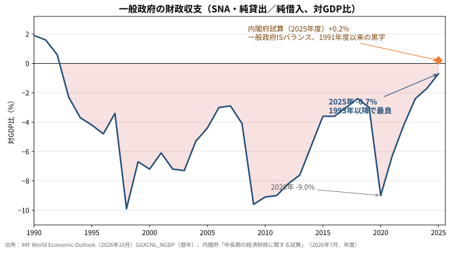
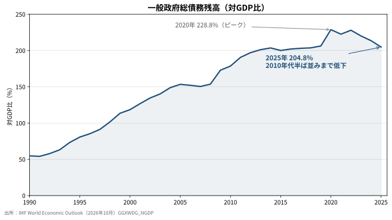
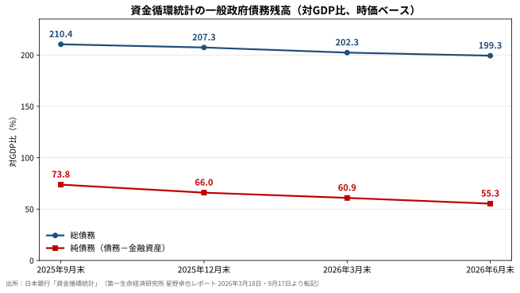

# 財政は過去30年で最もいい──一般政府で見れば、財政収支はほぼ均衡し、債務比率は下がり続けている

ウェブ版：[https://p72.github.io/note-draft/財政収支の推計/02\_財政は過去30年で最もいい.html](https://p72.github.io/note-draft/%E8%B2%A1%E6%94%BF%E5%8F%8E%E6%94%AF%E3%81%AE%E6%8E%A8%E8%A8%88/02_%E8%B2%A1%E6%94%BF%E3%81%AF%E9%81%8E%E5%8E%BB30%E5%B9%B4%E3%81%A7%E6%9C%80%E3%82%82%E3%81%84%E3%81%84.html)
GitHub：[https://github.com/p72/note-draft/blob/main/財政収支の推計/02\_財政は過去30年で最もいい.md](https://github.com/p72/note-draft/blob/main/%E8%B2%A1%E6%94%BF%E5%8F%8E%E6%94%AF%E3%81%AE%E6%8E%A8%E8%A8%88/02_%E8%B2%A1%E6%94%BF%E3%81%AF%E9%81%8E%E5%8E%BB30%E5%B9%B4%E3%81%A7%E6%9C%80%E3%82%82%E3%81%84%E3%81%84.md)

※ この記事は**筆者のオピニオン（意見）**である。データは、IMF「World Economic Outlook」（2026年10月、一般政府の財政収支・総債務の対GDP比）、日本銀行「資金循環統計」、内閣府「中長期の経済財政に関する試算」（2025年8月・2026年1月・2026年7月）を使っている。エコノミストの永濱利廣氏（第一生命経済研究所）も「日本の財政収支は過去30年で最も改善している」と繰り返し指摘している。本稿はその主張を、公表統計でそのまま支持するものである。

「日本の財政は危機的だ」という言葉を、もう何十年も聞かされてきた。だが、統計を一般政府ベースで見れば、現在の日本の財政は**過去30年で最もいい**。財政収支の赤字はほぼ消え、債務残高の対GDP比は下がり続けている。財政危機論は、デフレ時代の数字をいまだに引きずった、古い物語である。

主張を先に書く。

- **フローはほぼ均衡した。** SNA（国民経済計算）ベースの一般政府の財政収支は、2025年にGDP比でマイナス0.7％まで赤字が縮小した。1993年以降で最も小さい赤字である。内閣府の試算では、2025年度の一般政府の収支（ISバランス）はGDP比プラス0.2％の黒字であり、実現すれば1991年度以来34年ぶりの黒字になる。
- **ストックも改善が続いている。** 一般政府の総債務残高は、2020年のGDP比228.8％をピークに2025年には204.8％まで低下した。資金循環統計（時価ベース）では、2026年6月末に総債務が199.3％と200％を割り、政府の金融資産を差し引いた純債務は55.3％まで下がっている。
- **政府自身の見通しも同じ方向を向いている。** 内閣府の中長期試算では、国・地方のプライマリーバランス（PB）は2026年度に「PB目標を掲げた2001年度以降で最も改善した形」となり、公債等残高の対GDP比は試算期間を通じて低下する。毎年度実質10兆円の追加歳出を織り込んだ2026年7月の試算でも、成長ケースではPB黒字が続く。
- **改善のエンジンは名目成長である。** デフレが財政を悪化させ、インフレへの転換が財政を直した。名目GDPが伸びれば税収はそれ以上に伸び、分母の拡大が債務比率を押し下げる。財政再建の主役は増税でも歳出削減でもなく、名目成長そのものである。

## 財政は「一般政府」で見る

財政を論じるときの国際標準は、国の一般会計ではない。一般政府、すなわち中央政府・地方政府・社会保障基金を統合した部門である。

一般会計だけを見れば、国債費には元本の償還費までが含まれ、借換えのたびに「支出」が膨らんで見える。だが、世界標準の財政統計で国債費に数えるのは利払い費だけである。税と社会保障を一体で考えるなら、保険料も含めた一般政府全体で見るのが正しい。格付け会社も、IMFも、各国の財政をこの物差しで比べている。

その物差しで測れば、日本の財政の姿は、一般会計の「危機」のイメージとはまったく違うものになる。

## フロー：財政赤字はほぼ消えた

まずフローである。SNAベースの一般政府の財政収支（純貸出／純借入）の対GDP比は、バブル崩壊後の1990年代に大きく悪化し、1998年にはマイナス9.9％、リーマン・ショック後の2009年にもマイナス9.6％、コロナ禍の2020年にもマイナス9.0％を記録した。赤字幅がGDPの1割に届くのが、この30年の「平常」だった。

それが、2021年のマイナス6.3％、2022年のマイナス4.2％、2023年のマイナス2.4％、2024年のマイナス1.7％と毎年縮み、2025年にはマイナス0.7％になった。1993年以降で最も小さい赤字である。一般政府が最後に黒字だったのは1992年であり、日本の財政は33年ぶりに、均衡の目前まで戻ってきた。

四半期で見られる資金循環統計では、改善はさらに進んで見える。一般政府の資金過不足は、2025年1〜3月期に季節調整値でマイナス0.1兆円とほぼゼロになり、2026年1〜3月期にはプラス1.7兆円の資金余剰を記録した。政府部門が資金の取り手ではなく出し手になる局面が、現実に現れている。

そして内閣府が2026年7月に公表した中長期試算では、2025年度の一般政府のISバランスはGDP比プラス0.2％の黒字とされた。国の決算で税収が大きく上振れたことを織り込み、国・地方のPBも、1月試算のマイナス7.0兆円からマイナス0.2兆円へ、ほぼ均衡まで上方修正された。一般政府の黒字が確定すれば、1991年度以来34年ぶりである。

## ストック：債務比率はピークから下がり続けている

次にストックである。一般政府の総債務残高の対GDP比は、デフレの30年で一貫して上がり続け、コロナ禍の2020年に228.8％でピークを付けた。財政悪化の象徴だったこの比率は、その後5年連続で低下し、2025年には204.8％になった。2010年代半ば並みの水準である。「債務比率は上がる一方」という常識は、すでに過去のものになっている。

資金循環統計の時価ベースでは、低下の勢いは直近でも衰えていない。総債務の対GDP比は、2025年9月末の210.4％から、12月末に207.3％、2026年3月末に202.3％、6月末に199.3％と、3四半期で11ポイント下がった。政府が保有する金融資産を差し引いた純債務は、同じ期間に73.8％から55.3％へ、18.5ポイントも低下している。企業の財務を純債務で見るのと同じ物差しを政府に当てれば、日本の政府の実質的な借金は、GDPの半分強にまで圧縮されたことになる。

## 内閣府の中長期試算も、改善を前提にしている

この改善は、一時的な統計の姿ではない。政府自身の公式見通しである内閣府「中長期の経済財政に関する試算」が、同じ方向を描いている。

2026年1月の試算では、国・地方のPBは2026年度に歳入と歳出が概ねバランスした姿となり、「PB目標を掲げた2001年度以降で最も改善した形」とされた。国の一般会計では28年ぶりにPB黒字化を達成する。国・地方の公債等残高の対GDP比は、2025年度の192.8％から2026年度に186.6％へ下がり、成長移行ケースでは試算期間を通じて着実に低下して、2035年度には162.6％まで下がる。

2026年7月の試算は、ここに毎年度実質10兆円の追加歳出を将来にわたって上乗せした。それでも、成長戦略を実現するケースではPBの黒字が期間を通じて続き、債務残高の対GDP比は下がり続ける。10兆円の追加支出をしてもなお財政が回るのは、足元の収支がそれだけ改善したからである。

永濱利廣氏は、2025年8月試算の成長移行ケースをもとに、公債残高の対GDP比を上げない範囲で毎年10兆円を大きく上回る財政余力があると計算している。内閣府の試算が置く税収弾性値は1.1程度と低めであり、近年の実績は2を超えている。政府の公式試算ですら、税収の上振れを控えめに見積もった上で、債務比率の低下を描いているのである。

## なぜ改善したのか：デフレが財政を壊し、名目成長が直した

理由は単純である。名目GDPが伸び始めたからである。

債務残高の対GDP比の動きは、おおむね「実効金利マイナス名目成長率」に債務比率を掛けたものと、PBで決まる。デフレの時代、日本の名目成長率はほぼゼロであり、金利がどれだけ低くても分母が伸びず、債務比率は上がり続けた。財政が悪化したのは、支出が放漫だったからではない。名目成長がなかったからである。

インフレへの転換で、この歯車が逆に回り始めた。名目GDPが年3％を超えて伸びる中で、税収は名目成長を上回る弾性値で増え続けた。一方、政府の実効金利は、既発債が低金利のまま残るため、市場金利の上昇に遅れてしか上がらない。名目成長率が実効金利を大きく上回る状態、すなわちドーマー条件の好転が、PBの改善と重なって、債務比率を毎年数ポイントずつ押し下げている。

消費者物価と政府債務残高の対GDP比を重ねれば、物価が下がる局面で債務比率が上がり、物価が上がり始めた局面で債務比率が改善するという関係は、誰の目にも明らかである。日本の財政問題とは、つまるところデフレ問題だったのである。

## 結論：財政危機論は終わった

一般政府の財政収支はほぼ均衡し、内閣府の試算では34年ぶりの黒字が見えている。総債務の対GDP比はピークから下がり続け、資金循環統計では200％を割り、純債務は55％まで下がった。政府の公式見通しは、追加の財政支出を織り込んでもなお、債務比率の低下とPB黒字の継続を描いている。

財政は過去30年で最もいい。これは願望ではなく、SNA、資金循環統計、内閣府試算という、公表された統計がそろって示している事実である。

この事実が意味するのは、財政政策の課題が「どう絞るか」から「伸びた名目成長をどう続けるか」へ移ったということである。せっかく回り始めた名目成長の歯車を、緊縮で止めることこそが、財政にとって最大のリスクである。2％の物価安定目標を確実に達成し、名目成長を続けること。それがそのまま、最も確実な財政再建の道である。

## データと参考資料

- IMF「World Economic Outlook Database」（2026年10月、DataMapper API）：一般政府 純貸出／純借入（GGXCNL_NGDP）、一般政府 総債務（GGXWDG_NGDP）、いずれも対GDP比、暦年
- 日本銀行「資金循環統計」：一般政府の資金過不足、債務残高（時価ベース）。数値は第一生命経済研究所 星野卓也「資金循環統計（2025年10-12月期）」（2026年3月18日）、同「資金循環統計（2026年4-6月期）」（2026年9月17日）、藤代宏一レポート（2025年7月3日）より転記
- 内閣府「中長期の経済財政に関する試算」（2025年8月、2026年1月、2026年7月）：国・地方のPB、公債等残高対GDP比、一般政府ISバランス。2026年7月試算の読み解きは第一生命経済研究所 星野卓也「政府・中長期財政試算を読み解く」（2026年8月4日）による
- 永濱利廣「日本の財政状況と財政余力」（第一生命経済研究所、2025年）：財政収支は過去30年で最も改善しているとの指摘、成長移行ケースに基づく財政余力の計算
- グラフ：`02_chart_sna_balance.svg`、`02_chart_gross_debt.svg`、`02_chart_fof_debt.svg`、データ：`02_data.csv`、作図コード：`code/02_graph.py`
