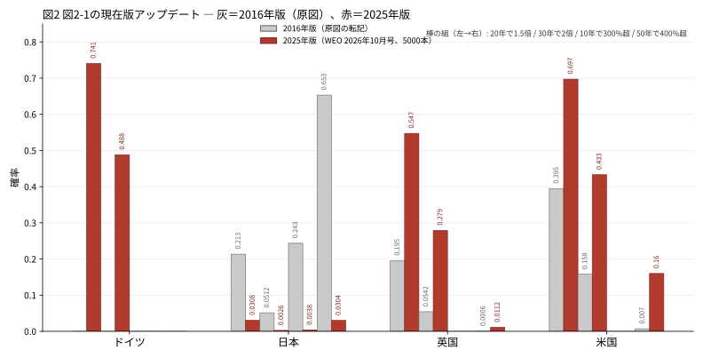

# 「財政ギャンブル」の失敗確率はどう変わったか──小黒一正ほか『財政破綻後』図2-1の近似再現と2025年版への更新

ウェブ版：[https://p72.github.io/note-draft/財政収支の推計/03\_財政ギャンブル失敗確率の近似再現と更新.html](https://p72.github.io/note-draft/%E8%B2%A1%E6%94%BF%E5%8F%8E%E6%94%AF%E3%81%AE%E6%8E%A8%E8%A8%88/03_%E8%B2%A1%E6%94%BF%E3%82%AE%E3%83%A3%E3%83%B3%E3%83%96%E3%83%AB%E5%A4%B1%E6%95%97%E7%A2%BA%E7%8E%87%E3%81%AE%E8%BF%91%E4%BC%BC%E5%86%8D%E7%8F%BE%E3%81%A8%E6%9B%B4%E6%96%B0.html)
GitHub：[https://github.com/p72/note-draft/blob/main/財政収支の推計/03\_財政ギャンブル失敗確率の近似再現と更新.md](https://github.com/p72/note-draft/blob/main/%E8%B2%A1%E6%94%BF%E5%8F%8E%E6%94%AF%E3%81%AE%E6%8E%A8%E8%A8%88/03_%E8%B2%A1%E6%94%BF%E3%82%AE%E3%83%A3%E3%83%B3%E3%83%96%E3%83%AB%E5%A4%B1%E6%95%97%E7%A2%BA%E7%8E%87%E3%81%AE%E8%BF%91%E4%BC%BC%E5%86%8D%E7%8F%BE%E3%81%A8%E6%9B%B4%E6%96%B0.md)

小黒一正ほか『財政破綻後 危機のシナリオ分析』（日本経済新聞出版社）の図2-1「財政ギャンブル失敗の確率」は、日本の債務残高が50年でGDP比400％を超える確率を65.30％と示し、日本の突出した危険を印象づけてきた。本稿は、この図を公表情報の範囲で近似再現し、そのうえで初期条件を2025年の値に更新して、同じ物差しで測り直す。作業は2026年11月20日に行った。本稿は、AI査読（CodexおよびClaude Code）の指摘を受けて改稿した第2版である。

結論を先に述べる。再現については、原図の公表値に較正した4か国共通の金利・成長率過程の下で、初期債務と基礎的収支の国別値から、原図の16指標を平均0.61％ポイントの絶対誤差で近似できた。国別の金利・成長率過程を持ち込まなくても、初期条件の差だけで原図の国間差は説明できる。更新については、物差しによって順位が逆になる。相対指標（20年で1.5倍、30年で2倍）では、2016年に米国・日本が高かった順位が反転し、2025年はドイツが最も高く日本が最も低い。絶対指標（10年で300％超、50年で400％超）ではドイツは依然ゼロであり、日本は50年指標で4か国中2番目に残る。駆動要因は各国の基礎的収支の変化であり、ドイツは黒字から赤字へ、日本は赤字の大幅縮小、米国は赤字の拡大である。

## 1 原図とモデル

図2-1の原典は、小黒一正（2009）「ギャンブルとしての財政赤字に関する一考察」であり、手法は Ball, Elmendorf and Mankiw（1998）"The Deficit Gamble" に倣う。本稿の照合対象は、小黒のアゴラ記事（2018年1月7日）に掲載された図表2と図表3であり、これは書籍の図2-1に対応するものとして著者自身が公表した図である。書籍そのものとの照合は行っていない。同記事によれば、IMFの世界経済見通し（WEO）のデータ（1960～2016年）を用い、5,000本のモンテカルロ経路で確率を計算している。

モデルの骨格は次のとおりである。債務残高比率 b は

> b_t ＝ X_t ・ b_{t－1} － pb、　X_t ＝（1＋r_t）／（1＋g_t）

で遷移する。r は金利（本稿の歴史データ構築では長期金利で近似する）、g は名目GDP成長率、pb は基礎的財政収支（対GDP比）であり、債務比率の初期値 b0 と pb の対GDP比は期間を通じて一定とされる。X は対数でAR(1)過程に従い、正規ショックを受ける。この骨格は、吉岡真史のサーベイ（長崎大学リポジトリ収録）および神戸大学経済経営研究所ディスカッションペーパーNo.1716に記された定式化に基づく。

「失敗」は4つの指標で測る。(1) 20年後に債務比率が初期値の1.5倍以上、(2) 30年後に初期値の2倍以上、(3) 10年後に300％以上、(4) 50年後に400％以上、である。いずれも「所定の年における債務比率が閾値以上である経路の割合（頻度）」であり、途中で一度でも閾値に達する確率ではない。判定は「以上」で行う。原図の表記は「超」であるが、連続分布の下では差は無視できる。原図の値と2016年の初期条件は次のとおりである。なお、アゴラ記事の本文には日本の30年・2倍を「50.12％」とする箇所があるが、図の値0.0512（5.12％）が正しい。本文の記述は誤植と判断した。

**表1 原図（2016年）の初期条件と失敗確率**

| 国 | 初期債務（％） | 基礎的収支（％） | 20年で1.5倍 | 30年で2倍 | 10年で300％超 | 50年で400％超 |
|---|---|---|---|---|---|---|
| ドイツ | 68 | ＋1.8 | 0.0000 | 0.0000 | 0.0000 | 0.0000 |
| 日本 | 240 | －3.9 | 0.2132 | 0.0512 | 0.2434 | 0.6530 |
| 英国 | 90 | －1.3 | 0.1954 | 0.0542 | 0.0000 | 0.0006 |
| 米国 | 107 | －2.3 | 0.3946 | 0.1578 | 0.0000 | 0.0070 |

原図の確率はすべて1/5000の整数倍であり、5,000本の経路で数えた頻度であることが裏側からも確認できる。一致度の評価にはモンテカルロ誤差が伴う。単一の頻度推計の標準誤差は最大で約0.7％ポイント（0.00707）であり、独立な2つの5,000本推計の差であれば最大で約1.0％ポイントになる。小数第4位までの一致に意味はない。

## 2 近似再現

再現の障害は、X過程のパラメータ（r の定義、推計期間、AR(1)の平均・自己相関・ショックの標準偏差）が公表情報だけでは特定できないことにある。そこで、長期金利（FRED経由のOECD長期金利、年平均）と名目GDP（世界銀行、各国通貨建て）から1960～2016年の X を実際に構築し、仕様を比較した。日本のOECDベンチマーク金利は1989年開始であるため、日本の標本は28年分しかない。なお、原論文は2009年のものであり、その推計に使われた標本は2008年頃までのはずである。本稿の1960～2016年の構築とは期間が異なる点に留意されたい。歴史 X のデータは [`03_x_history.csv`](03_x_history.csv)、仕様比較のコードは [`code/03_history_specs.py`](code/03_history_specs.py) に置く。

**表2 歴史データから作った X の要約（1960～2016年）**

|  | X の平均 | X の標準偏差 | 標本数 |
|---|---|---|---|
| ドイツ | 1.0070 | 0.0271 | 56 |
| 日本 | 1.0117 | 0.0239 | 28 |
| 英国 | 0.9966 | 0.0282 | 56 |
| 米国 | 0.9975 | 0.0250 | 56 |

結果は次のとおりである（誤差はいずれも原図16指標との平均絶対誤差）。

- **国別の歴史過程では再現できない。** 国別に推計した過程を使う仕様（logX のAR(1)、X の正規iid、歴史 X のブートストラップ）では、誤差は0.133～0.152にとどまる。とりわけ日本は、1989年以降の標本では平均して r＞g であったため、確率が全面的に過大になる（例：50年で400％超が原図0.6530に対して0.9976～1.0000）。
- **プールした歴史値でも届かない。** 4か国プールの logX（平均＋0.0013、標準偏差0.0278）から組んだAR(1)過程（平均0.0013、自己相関0.588、イノベーション標準偏差0.0225）では、誤差0.041、系統的に過大である。
- **較正した共通過程は近似できる。** logX の平均0、自己相関0.3、イノベーション標準偏差0.03（定常標準偏差は約0.031）の4か国共通の過程を置くと、誤差0.0061、最大誤差0.035まで近づく。

**表3 原図と近似再現の比較（共通過程、5,000本）**

| 国 | 区分 | 20年で1.5倍 | 30年で2倍 | 10年で300％超 | 50年で400％超 |
|---|---|---|---|---|---|
| ドイツ | 原図／再現 | 0.0000／0.0000 | 0.0000／0.0000 | 0.0000／0.0000 | 0.0000／0.0000 |
| 日本 | 原図／再現 | 0.2132／0.2350 | 0.0512／0.0686 | 0.2434／0.2780 | 0.6530／0.6476 |
| 英国 | 原図／再現 | 0.1954／0.1910 | 0.0542／0.0486 | 0.0000／0.0000 | 0.0006／0.0000 |
| 米国 | 原図／再現 | 0.3946／0.3912 | 0.1578／0.1600 | 0.0000／0.0000 | 0.0070／0.0056 |


較正の手続きと限界を明示する。パラメータは、16指標との平均絶対誤差を評価指標として格子探索と手調整で選んだ。乱数シード（777）は全か国・全ケースで共通とし（共通乱数）、logX の初期値は平均に置いた。採用値の近傍では、イノベーション標準偏差0.025で誤差0.0136、0.035で0.0203、自己相関0.1で0.0188、0.5で0.0367、平均±0.002で0.0268～0.0367と、いずれも採用値より悪化する。一方、自己相関0・イノベーション標準偏差0.04の組み合わせでも誤差0.0080まで近づくなど、近い当てはまりの組み合わせは複数存在する。シードを変えた5,000本では誤差0.0055、経路数を20万本に増やすと誤差0.0065（最大0.030）であり、結論は乱数の当たり外れに依存しない。

誤差の内訳にも注意が要る。16指標のうち6つ（ドイツの4つと英米の10年・300％超）は原図・再現ともゼロであり、ほぼ自明に一致する。非自明な10指標に限ると誤差は0.0097である。さらに日本の短期指標の残差（20年で＋0.0218、10年で＋0.0346）は、2つの独立推計の差の標準誤差（約0.008～0.009）を大きく超えており、モンテカルロ誤差ではなく系統的なずれである。50年指標がほぼ合う（－0.0054）ことと合わせると、原論文の X 過程は、本稿の較正とは分散の時間構造（短期の振れと持続性の配分）が異なることが示唆される。

したがって、本稿が示したのは「原図の国間差は、国別の X 過程を持ち込まなくても初期条件の差だけで説明できる」という十分性の事実までであり、原論文が実際に共通過程を用いたことの証明ではない。本稿のパラメータは原図の数値からの逆算を含んでおり、小黒（2009）のパラメータ表そのものによる確認はできていない。

## 3 現在版への更新（2025年）

次に、X過程は再現で較正した共通過程に固定し、初期条件だけを現在に差し替える。出典はIMF WEO 2026年10月号（2026年10月13日公表）であり、債務は一般政府総債務（GGXWDG_NGDP）、基礎的収支は GGXONLB_NGDP、いずれも対GDP比である。基準年は2025年（推計値）とした。2026年は見通しであるため基準年には使わない。

**表4 初期条件の変化（対GDP比、％）**

| 国 | 債務 2016（原図） | 債務 2016（現行系列） | 債務 2025 | 基礎的収支 2016（原図） | 基礎的収支 2016（現行系列） | 基礎的収支 2025 |
|---|---|---|---|---|---|---|
| ドイツ | 68 | 68.1 | 62.7 | ＋1.8 | ＋2.06 | －2.06 |
| 日本 | 240 | 202.1 | 204.8 | －3.9 | －2.53 | －0.51 |
| 英国 | 90 | 87.2 | 102.1 | －1.3 | －1.67 | －2.67 |
| 米国 | 107 | 107.5 | 124.4 | －2.3 | －2.37 | －3.88 |

注：ドイツの基礎的収支は、2016年が＋2.0602、2025年が－2.0589と、符号だけが反転したほぼ同値である。SDMXから取得した生データで照合済みであり、転記ミスではなく実値の偶然である。

注意すべきは日本の債務である。同じ2016年について、原図の240％と現行WEOの202.1％の間には37.9ポイントの差がある。改定の内訳（定義・範囲の見直しか、基礎統計やGDPの改定か）は本稿では特定できていない。この差は大きいため、後の分解では「原図の入力」と「現行系列の入力」を分けて扱う。

**表5 2025年版の失敗確率（5,000本。括弧内は2016年原図。0.0000は5,000本中0件）**

| 国 | 20年で1.5倍 | 30年で2倍 | 10年で300％超 | 50年で400％超 |
|---|---|---|---|---|
| ドイツ | **0.7406**（0.0000） | **0.4882**（0.0000） | 0.0000（0.0000） | 0.0000（0.0000） |
| 日本 | **0.0308**（0.2132） | **0.0026**（0.0512） | **0.0038**（0.2434） | **0.0304**（0.6530） |
| 英国 | **0.5472**（0.1954） | **0.2790**（0.0542） | 0.0000（0.0000） | **0.0112**（0.0006） |
| 米国 | **0.6972**（0.3946） | **0.4330**（0.1578） | 0.0000（0.0000） | **0.1600**（0.0070） |



順位は物差しによって逆になる。相対指標では、2016年に米国（0.3946）が最も高く日本（0.2132）が2番目だった並びが、2025年にはドイツ（0.7406）・米国（0.6972）・英国（0.5472）・日本（0.0308）の順に入れ替わる。絶対指標では、10年で300％超は日本だけが正の値（0.0038）であり、50年で400％超は米国（0.1600）、日本（0.0304）、英国（0.0112）、ドイツ（0）の順である。日本の4指標はいずれも2016年から大幅に低下したが、「日本が最も安全になった」と一括りにはできない。

読み取りには3つの留保が要る。

第一に、**ドイツの相対指標の跳ね上がりは、赤字転落が主因であり、低い債務がそれを増幅する。** 遷移式を初期債務で割れば、相対指標に効く財政項は pb／b0 である。現行系列の2016年を起点に要因分解すると（表6）、ドイツは基礎的収支だけを2025年値に変えると相対指標が0.6718／0.4030まで上がり、債務だけを変えてもゼロのままである。62.7％の1.5倍は94.0％にすぎず、絶対指標の確率はドイツでは依然としてゼロである。相対指標は「今の財政運営を続ければ債務比率が速く膨らむ」という以上の意味を持たない。この物差しの粗さは、2016年には絶対指標で日本を突出して危険に見せ、2025年には相対指標でドイツを最悪に見せる。物差し自体の性質として理解すべきである。

**表6 要因分解：現行系列2016年から2025年への変化の内訳（5,000本）**

| 国 | 起点（2016現行系列） | 基礎的収支のみ2025年値 | 債務のみ2025年値 | 両方（2025年版） |
|---|---|---|---|---|
| ドイツ | 0.0000／0.0000／0／0 | 0.6718／0.4030／0／0 | 0.0000／0.0000／0／0 | 0.7406／0.4882／0／0 |
| 日本 | 0.1500／0.0328／0.0130／0.2238 | 0.0308／0.0026／0.0028／0.0282 | 0.1470／0.0322／0.0160／0.2334 | 0.0308／0.0026／0.0038／0.0304 |
| 英国 | 0.3132／0.1096／0／0.0000 | 0.6806／0.4152／0／0.0042 | 0.2378／0.0702／0／0.0008 | 0.5472／0.2790／0／0.0112 |
| 米国 | 0.4088／0.1728／0／0.0062 | 0.8214／0.5964／0／0.1050 | 0.3100／0.1076／0／0.0208 | 0.6972／0.4330／0／0.1600 |

（各セルは「20年で1.5倍／30年で2倍／10年で300％超／50年で400％超」の順）

第二に、**日本の低下は、入力系列の差と、現行系列で測った年次変化に分解できる。** 起点を再現値にそろえると、50年指標は、原図入力の2016年（0.6476）→現行系列の2016年（0.2238）→2025年（0.0304）と低下する。前半は債務と基礎的収支の双方の入力差を含む。後半の低下はフロー側が主導した。表6のとおり、現行系列の2016年から基礎的収支だけを2025年値に変えると50年指標は0.0282まで下がり、債務だけを変えると0.2334とむしろ上がる。同一定義で見れば日本の債務比率は2016年から2025年へ＋2.7ポイント（202.1％→204.8％）とほぼ横ばいであり、改善はフロー側で起きた。裏返せば、240％から204.8％への見かけの低下は、同一定義での実測の改善ではない。

第三に、**結果は基準年の基礎的収支に大きく左右される。** 基準年への感応度として2024年の値で回すと、ドイツ0.6998／0.4364／0／0、日本0.0668／0.0104／0.0170／0.1200、英国0.8916／0.7180／0／0.0926、米国0.8572／0.6568／0／0.2922となり、英国と米国は2025年版よりさらに悪化する。単年の基礎的収支を50年間固定するこのモデルの性質上、基準年の取り方自体が結果の一部である。また本稿では X 過程を2016年の較正のまま固定した。推計期間を2020年代まで延ばした場合の感応度は今後の課題である（名目成長の加速は X を下げる方向だが、金利の水準と分散・持続性の変化も同時に効くため、方向は自明でない）。

表6はもう一つ、初期債務の両義性を示している。米国のように初期債務が上がると、同じ赤字でも相対指標は下がり（債務のみ変更で0.4088→0.3100）、絶対指標は上がる（0.0062→0.0208）。「債務の絶対水準よりも基礎的収支で決まる」という整理は、本稿の試算で確認した変化の範囲での話であり、指標の種類によって債務水準の効き方は逆になる。

## 4 限界

本稿の再現は近似であり、小黒（2009）のパラメータ表による照合は未了である。更新版についても、(i) 債務比率の初期値を与え、基礎的収支の対GDP比を全期間で一定とする、(ii) 金利・成長率過程を4か国共通とする、(iii) 財政反応（債務増に対する増税・歳出抑制）や金利の内生的な上昇を入れない、という原モデルの単純化をそのまま引き継いでいる。したがって本稿の数値は予測ではなく、「2016年の物差しを2025年に当てると絵がどう変わるか」を示す計算である。その範囲では、結論は明快である。財政ギャンブルの失敗確率は、債務の絶対水準と、その時々の基礎的収支の双方で決まり、どちらの指標で測るかで国の順位は逆転する。2016年に絶対指標で日本を突出して危険と描いた同じ物差しは、2025年には相対指標でドイツを最悪と描き、絶対指標では日本を2番目に残す。

## 付録 コードとデータ

計算は次のファイルで行った。いずれも本稿と同じフォルダに置く。

- [`code/03_gamble.py`](code/03_gamble.py)：較正した共通過程による本体シミュレーション。表1・表3・表5・表6と、現行系列2016年・2024年の計算はすべてこのファイルの初期条件と関数で再現できる。
- [`code/03_history_specs.py`](code/03_history_specs.py)：歴史 X（[`03_x_history.csv`](03_x_history.csv)）からの仕様比較（表2、国別仕様とプール仕様の誤差）。
- [`code/03_charts.py`](code/03_charts.py)：図1・図2の生成。
- [`03_data.csv`](03_data.csv)：初期条件と結果の一覧（要因分解を含む）。

本体の中心部分は次のとおりである。

```python
import numpy as np

MU, RHO, INNOV = 0.0, 0.3, 0.03  # 共通X過程 (logX の AR(1)) -- 較正値

def simulate(b0, pb, nsim=5000, seed=777, years=50):
    """債務比率の経路を nsim 本生成し、4指標の到達確率を返す。"""
    rng = np.random.default_rng(seed)
    logx = np.empty((nsim, years))
    prev = np.full(nsim, MU)
    for t in range(years):
        prev = MU + RHO * (prev - MU) + rng.normal(0.0, INNOV, size=nsim)
        logx[:, t] = prev
    x = np.exp(logx)
    b = np.empty((nsim, years + 1))
    b[:, 0] = b0
    for t in range(1, years + 1):
        b[:, t] = x[:, t - 1] * b[:, t - 1] - pb
    return (float(np.mean(b[:, 20] >= 1.5 * b0)),
            float(np.mean(b[:, 30] >= 2.0 * b0)),
            float(np.mean(b[:, 10] >= 3.0)),
            float(np.mean(b[:, 50] >= 4.0)))
```

## データの取得方法

- 原図の値と2016年の初期条件：小黒一正のアゴラ記事（2018年1月7日）に掲載された図表2・図表3の転記、および同記事の本文。
- 歴史データ（X の構築）：長期金利はFRED（セントルイス連銀）経由のOECD長期金利指標（IRLTLT01、年平均）、名目GDPは世界銀行API（NY.GDP.MKTP.CN、各国通貨建て）。いずれも2026年11月20日取得。構築した X は `03_x_history.csv` に収録した。
- 現在版の初期条件：IMF「World Economic Outlook」2026年10月号（2026年10月13日公表）。一般政府総債務 GGXWDG_NGDP、基礎的財政収支 GGXONLB_NGDP を、新データポータルのSDMX API（api.imf.org/external/sdmx/2.1/data/WEO）から2026年11月20日に取得した。WEOを採用した理由は、(i) 原典がWEOを用いていること、(ii) 現行系列の2016年値を挟むことで系列改定の影響を年次変化と分離できること、である。OECD経済見通し第119号でも照合したが、一般政府総債務負債（GGFLQ）の日本の2025年値は197.5％とWEOの204.8％より7.3ポイント低く、定義が異なるため併用しなかった。

## 参考文献

- 小黒一正（2009）「ギャンブルとしての財政赤字に関する一考察－"不確実性"のある成長率と長期金利の関係を中心に－」『日本経済研究』No.60、19～35ページ。
- 小黒一正ほか（2018）『財政破綻後 危機のシナリオ分析』日本経済新聞出版社。
- 小黒一正（2018）「異次元緩和と財政赤字ギャンブル失敗確率～中長期試算の前提を考える～」アゴラ、2018年1月7日。https://agora-web.jp/archives/2030441.html
- Ball, L., D. W. Elmendorf and N. G. Mankiw (1998), "The Deficit Gamble," Journal of Money, Credit and Banking, 30(4), pp. 699-720.
- 吉岡真史「財政の持続可能性に関する考察―成長率・利子率論争と時系列データによる検定のサーベイ―」長崎大学リポジトリ。https://nagasaki-u.repo.nii.ac.jp/record/17967/files/keizai88_4_65.pdf
- 神戸大学経済経営研究所ディスカッションペーパー No.1716。
- IMF (2026), World Economic Outlook, October 2026.
