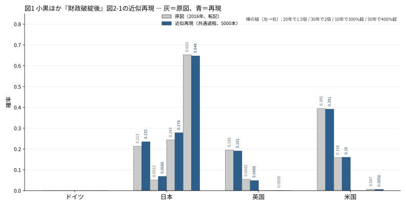

# 「財政ギャンブル」の失敗確率はどう変わったか──小黒一正ほか『財政破綻後』図2-1の近似再現と2025年版への更新

ウェブ版：[https://p72.github.io/note-draft/財政収支の推計/03\_財政ギャンブル失敗確率の近似再現と更新.html](https://p72.github.io/note-draft/%E8%B2%A1%E6%94%BF%E5%8F%8E%E6%94%AF%E3%81%AE%E6%8E%A8%E8%A8%88/03_%E8%B2%A1%E6%94%BF%E3%82%AE%E3%83%A3%E3%83%B3%E3%83%96%E3%83%AB%E5%A4%B1%E6%95%97%E7%A2%BA%E7%8E%87%E3%81%AE%E8%BF%91%E4%BC%BC%E5%86%8D%E7%8F%BE%E3%81%A8%E6%9B%B4%E6%96%B0.html)
GitHub：[https://github.com/p72/note-draft/blob/main/財政収支の推計/03\_財政ギャンブル失敗確率の近似再現と更新.md](https://github.com/p72/note-draft/blob/main/%E8%B2%A1%E6%94%BF%E5%8F%8E%E6%94%AF%E3%81%AE%E6%8E%A8%E8%A8%88/03_%E8%B2%A1%E6%94%BF%E3%82%AE%E3%83%A3%E3%83%B3%E3%83%96%E3%83%AB%E5%A4%B1%E6%95%97%E7%A2%BA%E7%8E%87%E3%81%AE%E8%BF%91%E4%BC%BC%E5%86%8D%E7%8F%BE%E3%81%A8%E6%9B%B4%E6%96%B0.md)

小黒一正ほか『財政破綻後 危機のシナリオ分析』（日本経済新聞出版社）の図2-1「財政ギャンブル失敗の確率」は、日本の債務残高が50年でGDP比400％を超える確率を65.30％と示し、日本の突出した危険を印象づけてきた。本稿は、この図を公表情報の範囲で近似再現し、そのうえで初期条件を2025年の値に更新して、同じ物差しで測り直す。作業は2026年11月20日に行った。

結論を先に述べる。再現については、4か国共通の金利・成長率過程を置くことで原図の16指標を平均絶対誤差0.006まで近似できた。すなわち、原図の国間差は各国の金利と成長率の動学の差ではなく、初期債務と基礎的財政収支の差でほぼ決まっている。更新については、順位が反転する。2016年時点で最も危険とされた日本は全指標で最も低くなり、代わって基礎的収支が黒字から赤字に転じたドイツと、赤字幅の大きい米国・英国の確率が上昇する。

## 1 原図とモデル

図2-1の原典は、小黒一正（2009）「ギャンブルとしての財政赤字に関する一考察」（『日本経済研究』No.60、19～35ページ）であり、手法は Ball, Elmendorf and Mankiw（1998）"The Deficit Gamble" に倣う。小黒のアゴラ記事（2018年1月7日）によれば、IMFの世界経済見通し（WEO）のデータを用い、5,000本のモンテカルロ経路で確率を計算している。

モデルの骨格は次のとおりである。債務残高比率 b は

> b_t ＝ X_t ・ b_{t－1} － pb、　X_t ＝（1＋r_t）／（1＋g_t）

で遷移する。r は金利、g は名目GDP成長率、pb は基礎的財政収支（対GDP比）であり、pb と初期債務 b0 は期間を通じて固定される。X は対数でAR(1)過程に従い、正規ショックを受ける。この骨格は、小黒（2009）のサーベイ（吉岡ほか、長崎大学リポジトリ収録）および神戸大学ディスカッションペーパーNo.1716に記された定式化に基づく。

「失敗」は4つの指標で測る。(1) 20年後に債務比率が初期値の1.5倍以上、(2) 30年後に初期値の2倍以上、(3) 10年後に300％超、(4) 50年後に400％超、である。原図の値と2016年の初期条件は次のとおりである。なお、アゴラ記事の本文には日本の30年・2倍を「50.12％」とする箇所があるが、図の値0.0512（5.12％）が正しい。本文の記述は誤植と判断した。

**表1 原図（2016年）の初期条件と失敗確率**

| 国 | 初期債務（％） | 基礎的収支（％） | 20年で1.5倍 | 30年で2倍 | 10年で300％超 | 50年で400％超 |
|---|---|---|---|---|---|---|
| ドイツ | 68 | ＋1.8 | 0.0000 | 0.0000 | 0.0000 | 0.0000 |
| 日本 | 240 | －3.9 | 0.2132 | 0.0512 | 0.2434 | 0.6530 |
| 英国 | 90 | －1.3 | 0.1954 | 0.0542 | 0.0000 | 0.0006 |
| 米国 | 107 | －2.3 | 0.3946 | 0.1578 | 0.0000 | 0.0070 |

原図の確率はすべて1/5000の整数倍であり、5,000本の経路で数えた頻度であることが裏側からも確認できる。したがって、再現の一致度はモンテカルロ誤差（最大で標準誤差約0.7ポイント）の範囲で評価すべきものであり、小数第4位までの一致に意味はない。

## 2 近似再現

再現の障害は、X過程のパラメータ（r の定義、推計期間、AR(1)の平均・自己相関・ショックの標準偏差）が公表情報だけでは特定できないことにある。そこで、長期金利（FRED経由のOECD長期金利、年平均）と名目GDP（世界銀行、各国通貨建て）から1960～2016年の X を実際に構築し、3つの仕様を試した。日本のOECDベンチマーク金利は1989年開始であるため、日本の標本は28年分しかない。

**表2 歴史データから作った X の要約（1960～2016年）**

|  | X の平均 | X の標準偏差 | 標本数 |
|---|---|---|---|
| ドイツ | 1.0070 | 0.0271 | 56 |
| 日本 | 1.0117 | 0.0239 | 28 |
| 英国 | 0.9966 | 0.0282 | 56 |
| 米国 | 0.9975 | 0.0250 | 56 |

結果は次のとおりである。

- **国別推計は失敗する。** 各国の歴史パラメータをそのまま使うと平均絶対誤差は0.135～0.149にとどまる。とりわけ日本は、1989年以降の標本では平均して r＞g であったため、確率が全面に過大になる（例：50年で400％超が原図0.6530に対して1.00）。
- **プールした歴史値でも届かない。** 4か国プールの logX（平均＋0.0013、標準偏差0.0278、国別AR(1)のイノベーション標準偏差0.020～0.027）から組んだ過程（平均0.0013、自己相関0.588、イノベーション標準偏差0.0225）では、平均絶対誤差0.039、系統的に過大である。
- **較正した共通過程は一致する。** logX の平均0、自己相関0.3、イノベーション標準偏差0.03（定常標準偏差は約0.031）の4か国共通の過程を置くと、平均絶対誤差0.0061、最大誤差0.035まで一致する。経路数を20万本に増やしても平均絶対誤差は0.0066であり、乱数の当たり外れではない。

**表3 原図と近似再現の比較（共通過程、5,000本）**

| 国 | 区分 | 20年で1.5倍 | 30年で2倍 | 10年で300％超 | 50年で400％超 |
|---|---|---|---|---|---|
| ドイツ | 原図／再現 | 0.0000／0.0000 | 0.0000／0.0000 | 0.0000／0.0000 | 0.0000／0.0000 |
| 日本 | 原図／再現 | 0.2132／0.2350 | 0.0512／0.0686 | 0.2434／0.2780 | 0.6530／0.6476 |
| 英国 | 原図／再現 | 0.1954／0.1910 | 0.0542／0.0486 | 0.0000／0.0000 | 0.0006／0.0000 |
| 米国 | 原図／再現 | 0.3946／0.3912 | 0.1578／0.1600 | 0.0000／0.0000 | 0.0070／0.0056 |



この結果が示すのは、原図の国間差は、各国の金利・成長率過程の差ではなく、初期債務と基礎的収支の差によってほぼ説明できるということである。小黒（2009）が共通の（あるいはプールした）X過程を用いた可能性が高い。ただし断り書きが必要である。本稿のパラメータは原図の数値からの逆算を含んでおり、小黒（2009）のパラメータ表そのものによる確認はできていない。ここで得たのは「この程度に単純な仕様で原図は再現できる」という事実であり、原論文の推計手順の特定ではない。

## 3 現在版への更新（2025年）

次に、X過程は再現で較正した共通過程に固定し、初期条件だけを現在に差し替える。出典はIMF WEO 2026年10月号（2026年10月13日公表）であり、債務は一般政府総債務（GGXWDG_NGDP）、基礎的収支は GGXONLB_NGDP、いずれも対GDP比である。基準年は2025年（推計値）とした。2026年は見通しであるため基準年には使わない。

**表4 初期条件の変化（対GDP比、％）**

| 国 | 債務 2016（原図） | 債務 2016（現行系列） | 債務 2025 | 基礎的収支 2016（原図） | 基礎的収支 2016（現行系列） | 基礎的収支 2025 |
|---|---|---|---|---|---|---|
| ドイツ | 68 | 68.1 | 62.7 | ＋1.8 | ＋2.06 | －2.06 |
| 日本 | 240 | 202.1 | 204.8 | －3.9 | －2.53 | －0.51 |
| 英国 | 90 | 87.2 | 102.1 | －1.3 | －1.67 | －2.67 |
| 米国 | 107 | 107.5 | 124.4 | －2.3 | －2.37 | －3.88 |

注意すべきは日本の債務である。WEOの現行系列では、日本の2016年の総債務は240％ではなく202.1％に遡及改定されている。定義の見直しが入ったためであり、240％と204.8％の差（35ポイント）の大半は実物の改善ではない。この点は後の分解で分けて扱う。

**表5 2025年版の失敗確率（5,000本。括弧内は2016年原図）**

| 国 | 20年で1.5倍 | 30年で2倍 | 10年で300％超 | 50年で400％超 |
|---|---|---|---|---|
| ドイツ | **0.7406**（0.0000） | **0.4882**（0.0000） | 0.0000（0.0000） | 0.0000（0.0000） |
| 日本 | **0.0308**（0.2132） | **0.0026**（0.0512） | **0.0038**（0.2434） | **0.0304**（0.6530） |
| 英国 | **0.5472**（0.1954） | **0.2790**（0.0542） | 0.0000（0.0000） | **0.0112**（0.0006） |
| 米国 | **0.6972**（0.3946） | **0.4330**（0.1578） | 0.0000（0.0000） | **0.1600**（0.0070） |


順位は完全に反転した。駆動要因は各国の基礎的収支の変化である。ドイツは黒字（＋1.8％）から赤字（－2.06％）へ転じ、日本は赤字幅が－3.9％から－0.51％へ縮小し、米国は－2.3％から－3.88％へ拡大した。債務水準の変化はこれに比べれば小さい。

読み取りには3つの留保が要る。

第一に、**ドイツの0.7406は「危機の接近」を意味しない。** 指標(1)(2)は相対指標であり、債務の低い国が赤字を出すと機械的に跳ね上がる。62.7％の1.5倍は94.0％にすぎず、絶対指標である300％超・400％超の確率はドイツでは依然としてゼロである。相対指標は「今の財政運営を続ければ債務比率が速く膨らむ」という以上の意味を持たない。この物差しの粗さは、2016年には日本を突出して危険に見せ、2025年にはドイツを最悪に見せる。物差し自体の性質として理解すべきである。

第二に、**日本の改善は定義変更と実改善の合成であり、分解できる。** 現行系列の2016年値（債務202.1％、基礎的収支－2.53％）で回し直すと、日本の確率は0.1500／0.0328／0.0130／0.2238となる。原図（240％、－3.9％）からここまでの低下が定義変更と系列改定の分であり、ここから2025年値（0.0308／0.0026／0.0038／0.0304）までの低下が、主として基礎的収支の改善（－2.53％→－0.51％）による実改善である。同一定義で比べれば、日本の債務比率は2016年から2025年にかけてほぼ横ばい（202.1％→204.8％）であり、改善はフロー側で起きた。

第三に、**結果は基準年の基礎的収支に大きく左右される。** 頑健性チェックとして2024年の値で回すと、英国（0.8916／0.7180／0／0.0926）と米国（0.8572／0.6568／0／0.2922）はさらに悪化し、日本も0.0668／0.0104／0.0170／0.1200と2025年版より悪い。単年の基礎的収支を50年間固定するこのモデルの性質上、基準年の取り方自体が結果の一部である。また本稿では X 過程を2016年の較正のまま固定した。2020年代の高名目成長期まで含めて X を再推計すれば、X の水準が下がり、全か国の確率はもう一段低下するはずである。これは今後の課題として残す。

## 4 限界

本稿の再現は近似であり、小黒（2009）のパラメータ表による照合は未了である。更新版についても、(i) 基礎的収支と初期債務を50年間固定する、(ii) 金利・成長率過程を全か国共通とする、(iii) 財政反応（債務増に対する増税・歳出抑制）や金利の内生的な上昇を入れない、という原モデルの単純化をそのまま引き継いでいる。したがって本稿の数値は予測ではなく、「2016年の物差しを2025年に当てると絵がどう変わるか」を示す計算である。その範囲では、結論は明快である。財政ギャンブルの失敗確率は、債務の絶対水準よりも、その時々の基礎的収支で決まる。2016年に日本を最悪と描いた同じ物差しは、2025年には日本を最良と描く。

## 付録 コード

再現・更新の計算はすべて次のコード（抜粋）で行った。全文は [`code/03_gamble.py`](code/03_gamble.py) に置く。初期条件と結果の一覧は [`03_data.csv`](03_data.csv) である。

```python
import numpy as np

MU, RHO, INNOV = 0.0, 0.3, 0.03  # 共通X過程 (logX の AR(1)) -- 較正値

def simulate(b0, pb, nsim=5000, seed=777, years=50):
    """債務比率の経路を nsim 本生成し、4指標の到達確率を返す。"""
    rng = np.random.default_rng(seed)
    logx = np.empty((nsim, years))
    prev = np.full(nsim, MU)
    for t in range(years):
        prev = MU + RHO * (prev - MU) + rng.normal(0.0, INNOV, size=nsim)
        logx[:, t] = prev
    x = np.exp(logx)
    b = np.empty((nsim, years + 1))
    b[:, 0] = b0
    for t in range(1, years + 1):
        b[:, t] = x[:, t - 1] * b[:, t - 1] - pb
    return (float(np.mean(b[:, 20] >= 1.5 * b0)),
            float(np.mean(b[:, 30] >= 2.0 * b0)),
            float(np.mean(b[:, 10] >= 3.0)),
            float(np.mean(b[:, 50] >= 4.0)))
```

## データの取得方法

- 原図の値と2016年の初期条件：小黒一正のアゴラ記事（2018年1月7日）に掲載された図2・図3の転記、および同記事の本文。
- 歴史データ（X の構築）：長期金利はFRED（セントルイス連銀）経由のOECD長期金利指標（IRLTLT01、年平均）、名目GDPは世界銀行API（NY.GDP.MKTP.CN、各国通貨建て）。いずれも2026年11月20日取得。
- 現在版の初期条件：IMF「World Economic Outlook」2026年10月号（2026年10月13日公表）。一般政府総債務 GGXWDG_NGDP、基礎的財政収支 GGXONLB_NGDP を、新データポータルのSDMX API（api.imf.org/external/sdmx/2.1/data/WEO）から2026年11月20日に取得した。OECD経済見通し第119号でも照合したが、日本の債務定義が約26ポイント低いなど定義差が大きいため、原図との比較可能性を優先してWEOを採用した。

## 参考文献

- 小黒一正（2009）「ギャンブルとしての財政赤字に関する一考察」『日本経済研究』No.60、19～35ページ。
- 小黒一正ほか（2018）『財政破綻後 危機のシナリオ分析』日本経済新聞出版社。
- 小黒一正（2018）「財政破綻への『ギャンブル』はいつまで続けられるか」アゴラ、2018年1月7日。
- Ball, L., D. W. Elmendorf and N. G. Mankiw (1998), "The Deficit Gamble," Journal of Money, Credit and Banking, 30(4), pp. 699-720.
- IMF (2026), World Economic Outlook, October 2026.
