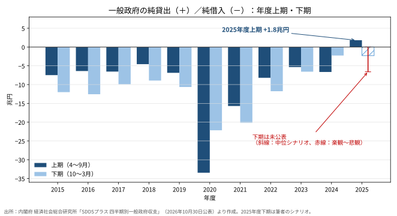
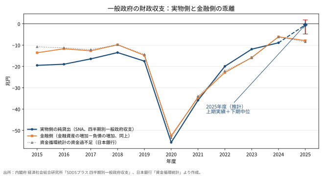

# 2025年度の一般政府PBと財政収支は確報で黒字になるか──四半期別一般政府収支と中長期試算による推計

ウェブ版：[https://p72.github.io/note-draft/財政収支の推計/04\_2025年度の一般政府PBと財政収支は確報で黒字になるか.html](https://p72.github.io/note-draft/%E8%B2%A1%E6%94%BF%E5%8F%8E%E6%94%AF%E3%81%AE%E6%8E%A8%E8%A8%88/04_2025%E5%B9%B4%E5%BA%A6%E3%81%AE%E4%B8%80%E8%88%AC%E6%94%BF%E5%BA%9CPB%E3%81%A8%E8%B2%A1%E6%94%BF%E5%8F%8E%E6%94%AF%E3%81%AF%E7%A2%BA%E5%A0%B1%E3%81%A7%E9%BB%92%E5%AD%97%E3%81%AB%E3%81%AA%E3%82%8B%E3%81%8B.html)
GitHub：[https://github.com/p72/note-draft/blob/main/財政収支の推計/04\_2025年度の一般政府PBと財政収支は確報で黒字になるか.md](https://github.com/p72/note-draft/blob/main/%E8%B2%A1%E6%94%BF%E5%8F%8E%E6%94%AF%E3%81%AE%E6%8E%A8%E8%A8%88/04_2025%E5%B9%B4%E5%BA%A6%E3%81%AE%E4%B8%80%E8%88%AC%E6%94%BF%E5%BA%9CPB%E3%81%A8%E8%B2%A1%E6%94%BF%E5%8F%8E%E6%94%AF%E3%81%AF%E7%A2%BA%E5%A0%B1%E3%81%A7%E9%BB%92%E5%AD%97%E3%81%AB%E3%81%AA%E3%82%8B%E3%81%8B.md)

※ 本稿は、内閣府 経済社会総合研究所（ESRI）の「SDDSプラス 四半期別一般政府収支」（2026年10月30日公表）、国民経済計算「2024年度年次推計」、内閣府「中長期の経済財政に関する試算」（2025年8月・2026年7月）、日本銀行「資金循環統計」をもとにした推計である。2025年度の数値は筆者の推計・仮定を含み、公式の値ではない。2025年度の国民経済計算年次推計（フロー編）は、例年どおりであれば2026年12月下旬に公表される。

2025年度の国・地方のプライマリーバランス（PB）は、2026年7月の内閣府試算で▲0.2兆円とされ、ほぼ均衡するところまで改善した。では、社会保障基金を含む一般政府で見たPBと財政収支は、年次推計（いわゆる確報）で黒字になるのか。年次推計の公表を前に、現時点で入手できる統計から推計する。

結論を先に書く。

- **一般政府PBは＋2兆円前後（名目GDP比＋0.3％前後）が中心値である。** 幅は▲4〜＋4兆円で、黒字になる確率は6〜7割とみる。
- **一般政府の財政収支（純貸出）は＋0.5兆円前後で、ほぼ均衡する。** 幅は▲5〜＋2.5兆円である。
- **国・地方に限れば、財政収支は▲6〜7兆円（GDP比▲1％前後）の赤字が残る。** PBが均衡しても、利払費の分だけ財政収支は赤字である。
- **根拠の中心は、四半期別一般政府収支で2025年度上期（4〜9月）の純貸出が＋1.8兆円の黒字になったことである。** 前年同期から8.4兆円改善しており、その大半は税収の増加による。
- **ただし下振れリスクは大きい。** 2024年度は、夏の試算から年次推計にかけてPBが約4兆円下方修正された。また、同じ統計の金融側や資金循環統計では、2025年度の一般政府の収支はむしろ悪化している。

## 二つのPB：国・地方PBと一般政府PB

政府が財政健全化目標に掲げてきたのは、国と地方を合わせた「国・地方PB」である。これに対し、国際比較で用いるのは、中央政府・地方政府・社会保障基金を合わせた「一般政府」である。

国民経済計算（SNA）における一般政府のPBは、次の式で定義される。

- PB ＝ 純貸出（＋）／純借入（－） ＋ 支払利子 － 受取利子

ここでの利子は、FISIM（間接的に計測される金融仲介サービス）調整前の、実際に受け払いした利子である。控除するのは利子だけであり、配当（日本銀行の国庫納付金、年金積立金の株式配当など）はPBに残る。株式や債券の評価益は、そもそも純貸出に計上されない。

純貸出は、税・社会負担・社会給付・財産所得・経常移転から可処分所得を求め、政府最終消費支出を差し引いた貯蓄に、資本移転と公共投資などの非金融資産の純取得を加減して求める。発生主義の概念であり、国債の発行・償還や貸付・出資といった金融取引は含まない。

両者の違いは、範囲と除外項目にある。

- **範囲：** 国・地方PBは社会保障基金を含まない。社会保障基金の黒字は年金積立金の積み増しであり、将来の給付に充てる資金であるためである。
- **除外項目：** 内閣府試算の国・地方PBは、復旧・復興対策、GX対策、AI・半導体支援の経費と財源を除いたベースで示されている（含めたベースも参考値として公表されている）。SNAの一般政府PBは、こうした調整を行わない。

2024年度の年次推計では、一般政府PBは▲8.2兆円（GDP比▲1.3％）であった。内訳は中央政府▲14.4兆円、地方政府＋3.1兆円、社会保障基金＋3.1兆円である。中央政府と地方政府の合計▲11.3兆円は、2026年7月試算の2024年度の国・地方PB（実績）▲11.3兆円と一致する。同年度の一般政府の純貸出は▲8.9兆円であり、PBとの差（純支払利子）は0.7兆円にとどまる。国の支払う国債利子の一部が、社会保障基金や外国為替資金特別会計の受取利子として一般政府の内部で相殺されるためである。

## 中長期試算（2026年7月）が示す2025年度

2026年7月の中長期試算は、2025年度の国の決算概要を反映している。2025年度の国・地方の姿は次のとおりである（除外項目を除いたベース）。

- 国・地方PB：▲0.2兆円（GDP比▲0.0％）。除外項目を含めたベースでは▲1.7兆円（▲0.2％）
- 国のPB：▲8.4兆円、地方のPB：＋8.2兆円
- 国・地方の財政収支：▲5.9兆円（▲0.9％）。うち国▲13.1兆円、地方＋7.2兆円

2026年6月の試算では2025年度の国・地方PBは▲7.0兆円であり、税収等の上振れと歳出の不用・繰越によって6.8兆円改善した。

ただし、試算自身が注記しているとおり、2025年度の値は見込みである。SNAの数値は2026年1〜3月期の四半期別GDP速報をもとにした推計であり、年次推計の公表後に冬の試算で改定される。

## 四半期別一般政府収支：上期は1.8兆円の黒字

ESRIは、IMFの「SDDSプラス」に基づき、SNAと同じ定義の四半期別一般政府収支を公表している。2026年10月30日の公表分で、実物側（収入・支出・純貸出）は2025年7〜9月期まで、つまり2025年度上期まで利用できる。年度に組み替えた2024年度の純貸出は▲8.9兆円であり、年次推計の値と一致する。

2025年度上期の一般政府の姿は次のとおりである（前年同期との比較）。

- 収入：122.6兆円（2024年度上期112.7兆円）
- うち税：68.2兆円（同60.4兆円）
- うち社会負担：42.2兆円（同41.4兆円）
- 支出：121.0兆円（同119.3兆円）
- うち支払利子：5.4兆円（同4.5兆円）
- **純貸出：＋1.8兆円（同▲6.6兆円）**

純貸出は前年同期から8.4兆円改善し、黒字になった。改善の大半は税の7.8兆円増である。2024年6月に実施された定額減税の反動を含むが、それを除いても税収の伸びは大きい。支出の増加は1.7兆円にとどまる。一方で、支払利子は上期だけで0.9兆円増えており、金利上昇の影響が表れ始めている。

## 下期のシナリオと通年の推計

2025年度下期（2025年10月〜2026年3月）の四半期別一般政府収支は、まだ公表されていない。下期には、2025年度補正予算（経済対策関係経費17.7兆円）の執行、電気・ガス料金の補助、ガソリン税の暫定税率の廃止といった悪化要因がある。

過去の実績を見ると、下期の純貸出は上期より悪いことが多い。2015〜2019年度と2021〜2023年度は、いずれも下期の赤字が上期を上回った。例外は、上期にコロナ対策が集中した2020年度と、下期の赤字が▲2.3兆円まで縮んだ2024年度である。そこで、下期について三つのシナリオを置く。

- **楽観：** 税収の伸びが続き、下期は0兆円。通年の純貸出は＋1.8兆円
- **中位：** 2024年度下期と同じ▲2.3兆円。通年の純貸出は▲0.5兆円
- **悲観：** 2023年度下期並みの▲6.6兆円。通年の純貸出は▲4.8兆円

PBは、純貸出に一般政府の純支払利子を加えて求める。2024年度の純支払利子は0.7兆円であった。2025年度は支払利子が上期だけで0.9兆円増えているため、受取利子の増加を差し引いて通年1.2兆円程度と置く。この場合、通年のPBは楽観で＋3.0兆円、中位で＋0.7兆円、悲観で▲3.6兆円となる。

## 部門別の積み上げによる推計

別の方法として、中長期試算の国・地方の値に、社会保障基金の値を足し合わせる。

- **国・地方：** PBは除外項目を含めたベースで▲1.7兆円。財政収支は、PBと同じ除外項目の差（1.5兆円）を除外項目を除いたベースの▲5.9兆円に加え、▲7.4兆円程度とみる。
- **社会保障基金のPB：** 2024年度は＋3.1兆円であった。賃金上昇に伴う社会保険料収入の増加とマクロ経済スライドにより、2025年度は＋4〜5兆円と推定する。
- **社会保障基金の純貸出：** 2024年度は、一般政府の純貸出▲8.9兆円から国・地方の財政収支▲16.4兆円を差し引いて＋7.5兆円となる。資金循環統計では、社会保障基金の資金過不足が2024年度の＋5.2兆円から2025年度の＋8.1兆円へ2.9兆円増えた。この増加の一部を見込み、2025年度は＋8.5〜10兆円とする。

これらを合計すると、一般政府PBは＋2.3〜3.3兆円、一般政府の純貸出は＋1〜2.6兆円となる。

## 推計結果

二つの方法を合わせ、2025年度の推計を次のようにまとめる。名目GDPは約660兆円として換算した。

- **一般政府PB：** 中心値＋2兆円前後（GDP比＋0.3％前後）、幅▲4〜＋4兆円
- **一般政府の財政収支（純貸出）：** 中心値＋0.5兆円前後（GDP比±0％前後）、幅▲5〜＋2.5兆円
- **国・地方PB（内閣府試算）：** ▲0.2兆円（除外項目を含めたベースで▲1.7兆円）
- **国・地方の財政収支（内閣府試算）：** ▲5.9兆円（除外項目を含めたベースで▲7.4兆円程度）

一般政府の純貸出の中心値は、本シリーズ02で紹介した、2026年7月試算における2025年度の一般政府ISバランス（GDP比＋0.2％）とおおむね整合する。一般政府の純貸出は、2020年度▲55.6兆円、2021年度▲35.9兆円、2022年度▲20.0兆円、2023年度▲11.9兆円、2024年度▲8.9兆円と縮小を続けてきた。2025年度に黒字が確定すれば、02で述べたとおり1991年度以来となる。

国・地方の財政収支と一般政府の財政収支の差は、社会保障基金の黒字である。国・地方の財政収支とPBの差（純利払費）は、2024年度の5.1兆円から2025年度の5.7兆円へ広がった。金利が上がるほど、PBが均衡しても財政収支は改善しにくくなる。

## 下振れリスク：前年の改定と、実物側と金融側の乖離

推計には、下方修正の方向に二つのリスクがある。

一つ目は、年次推計による改定である。2025年8月の試算では、2024年度の国・地方PBは▲7.4兆円（GDP比▲1.2％）とされていた。これが、年次推計を反映した後には▲11.3兆円（▲1.8％）となり、約4兆円悪化した。この改定には2020年基準改定の影響も含まれるが、同じ規模の改定が2025年度にも生じれば、一般政府PBの中心値は▲2兆円前後に、財政収支は▲3〜4兆円になる。

二つ目は、実物側と金融側の乖離である。同じ四半期別一般政府収支の金融側（金融資産の純取得－負債の純発生）で見ると、一般政府の収支は2024年度の▲6.1兆円から2025年度の▲7.8兆円へと悪化している。日本銀行の資金循環統計でも、一般政府の資金過不足は▲6.2兆円から▲8.4兆円へと悪化し、特に地方公共団体は＋5.8兆円から▲0.5兆円へと赤字に転じた。

実物側と金融側の差（統計上の不突合）は、毎年数兆円の規模で生じる。2015〜2019年度は実物側が金融側より約3〜7兆円悪く、2022〜2023年度は逆に金融側が悪かった。2025年度上期の実物側の大幅な改善が、金融側にはほとんど表れていないことは、年次推計で地方決算などの基礎統計が反映されたときに、実物側が下方修正される可能性を示している。

## 結論

2025年度の一般政府PBは、四半期別一般政府収支の上期実績と中長期試算の積み上げのいずれから見ても、黒字となる可能性が高い。一般政府の財政収支も、ほぼ均衡するところまで改善している。改善の主因は名目成長に伴う税収の増加であり、社会保障基金の黒字がそれを上乗せしている。

一方、国・地方の財政収支は依然としてGDP比1％前後の赤字であり、利払費の増加によってPBとの差は広がりつつある。また、前年の改定幅と金融側の統計を踏まえれば、年次推計で黒字が確定するとは言い切れない。答え合わせは、2026年12月下旬に公表される見込みの2025年度年次推計（フロー編）である。

## データと参考資料

- 内閣府 経済社会総合研究所「SDDSプラス 四半期別一般政府収支（General Government Operations）」（2026年10月30日公表、10億円）：[https://www.esri.cao.go.jp/en/sna/sddsplus/tables/ggo.xlsx](https://www.esri.cao.go.jp/en/sna/sddsplus/tables/ggo.xlsx)。四半期値を年度の上期（4〜9月）・下期（10〜3月）・通年に集計した。
- 内閣府 経済社会総合研究所「2024年度国民経済計算年次推計 純貸出（＋）／純借入（－）、プライマリーバランス」：[https://www.esri.cao.go.jp/jp/sna/data/data\_list/kakuhou/files/2024/sankou/pdf/junkashi\_20251223.pdf](https://www.esri.cao.go.jp/jp/sna/data/data_list/kakuhou/files/2024/sankou/pdf/junkashi_20251223.pdf)
- 内閣府「中長期の経済財政に関する試算」（2026年7月30日）：[https://www5.cao.go.jp/keizai2/keizai-syakai/shisan/2607hontai.pdf](https://www5.cao.go.jp/keizai2/keizai-syakai/shisan/2607hontai.pdf)、ポイント：[https://www5.cao.go.jp/keizai2/keizai-syakai/shisan/2607point.pdf](https://www5.cao.go.jp/keizai2/keizai-syakai/shisan/2607point.pdf)
- 内閣府「中長期の経済財政に関する試算」（2025年8月7日）：[https://www5.cao.go.jp/keizai2/keizai-syakai/shisan/r7chuuchouki2508.pdf](https://www5.cao.go.jp/keizai2/keizai-syakai/shisan/r7chuuchouki2508.pdf)
- 日本銀行「資金循環統計」（時系列統計データ検索サイト API、DB＝FF、年度・フロー）：一般政府 FOF\_FFYF420L700、中央政府 FOF\_FFYF421L700、地方公共団体 FOF\_FFYF422L700、社会保障基金 FOF\_FFYF423L700
- 社会保障基金の黒字の要因：第一生命経済研究所 星野卓也「資金循環統計（2026年4-6月期）」（2026年9月17日）
- 下期のシナリオ、純支払利子、社会保障基金のPB・純貸出、名目GDP約660兆円は筆者の推計・仮定である。
- グラフ：`04_chart_halfyear.svg`、`04_chart_real_vs_fin.svg`、データ：`04_data.csv`、データ取得・集計・作図コード：`code/04_ggo.py`
