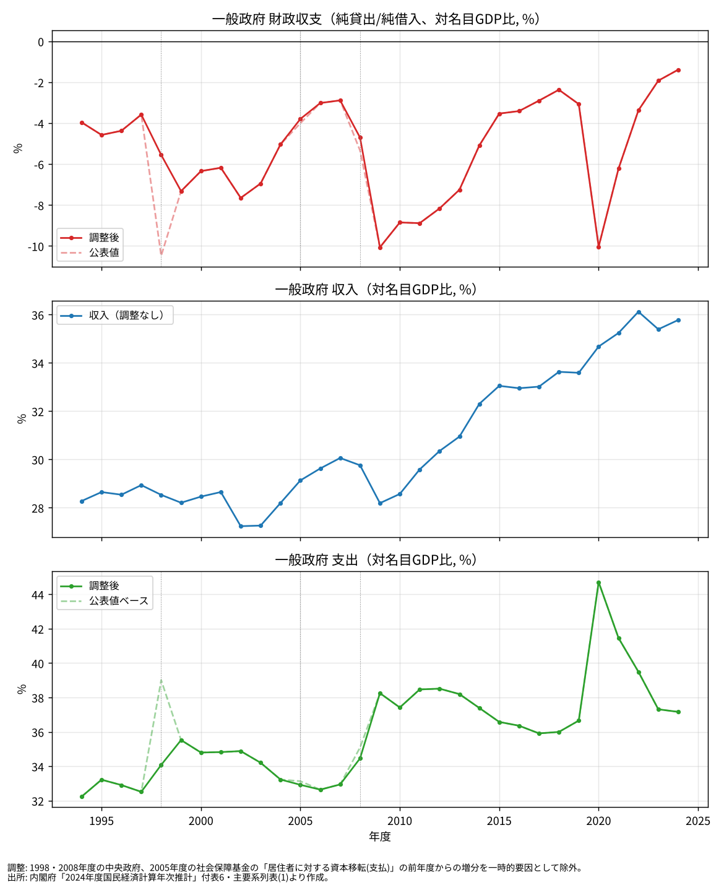

# 一般政府の収入と支出の30年──一時的な債務承継を除いて財政収支を見る

ウェブ版：[https://p72.github.io/note-draft/財政収支の推計/06\_一般政府の収入と支出の30年.html](https://p72.github.io/note-draft/%E8%B2%A1%E6%94%BF%E5%8F%8E%E6%94%AF%E3%81%AE%E6%8E%A8%E8%A8%88/06_%E4%B8%80%E8%88%AC%E6%94%BF%E5%BA%9C%E3%81%AE%E5%8F%8E%E5%85%A5%E3%81%A8%E6%94%AF%E5%87%BA%E3%81%AE30%E5%B9%B4.html)

GitHub：[https://github.com/p72/note-draft/blob/main/財政収支の推計/06\_一般政府の収入と支出の30年.md](https://github.com/p72/note-draft/blob/main/%E8%B2%A1%E6%94%BF%E5%8F%8E%E6%94%AF%E3%81%AE%E6%8E%A8%E8%A8%88/06_%E4%B8%80%E8%88%AC%E6%94%BF%E5%BA%9C%E3%81%AE%E5%8F%8E%E5%85%A5%E3%81%A8%E6%94%AF%E5%87%BA%E3%81%AE30%E5%B9%B4.md)

※ この記事は、内閣府 経済社会総合研究所（ESRI）の国民経済計算（2024年度年次推計）の付表6「一般政府の部門別勘定」と主要系列表(1)（名目GDP、年度）を使って計算している。年次推計は1994年度まで遡及済みの一本系列であり、旧基準の系列とは接続していない。

一般政府（中央政府・地方政府・社会保障基金）の財政収支（純貸出／純借入）を、収入と支出に分けて1994年度から2024年度まで並べた。あわせて、1998・2005・2008年度に計上された一時的な債務承継などの資本移転を除いた「調整後」の系列を作った。

結論を先に書く。

- **2024年度の財政収支は対GDP比▲1.4％で、1994年度以降で最も赤字が小さい。** 収入は35.8％、支出は37.2％である。
- **収入は2000年代の28〜30％から、2014年度以降に大きく上がった。** 消費税率の引上げ（2014・2019年度）による生産・輸入品に課される税の増加と、社会負担（保険料）の増加が主因である。2024年度は所得・富等に課される経常税も伸びた。
- **支出は景気後退期に跳ね、平時は36〜37％程度に戻る形を繰り返している。** 中身は、社会給付と現物の社会移転（医療・介護など）が増え、公的固定資本形成と利払いが減った。
- **1998年度の▲10.5％のうち約5ポイントは国鉄清算事業団・国有林野の債務承継による。** これを除くと1998年度は▲5.6％であり、1990年代後半の赤字の大きな山は1999年度以降の景気対策と税収減によるものである。2008年度の約3.3兆円（GDP比0.6ポイント）、2005年度の約1.1兆円（同0.2ポイント）も除いた。

## 収入と支出の定義

付表6の一般政府「合計」は、中央政府・地方政府・社会保障基金の単純合計であり、部門間の移転（国から地方への地方交付税、国から社会保障基金への国庫負担など）が受取と支払の両方に残っている。このため、「一般政府内の経常移転」と「他の一般政府部門からの（に対する）資本移転」を受取・支払の両方から除いて連結した。

収入と支出は次のとおり定義した。

- **収入** ＝ 生産・輸入品に課される税 ＋ 所得・富等に課される経常税 ＋ 社会負担 ＋ 財産所得（受取） ＋ その他の経常移転（受取） ＋ 資本移転（受取）
- **支出** ＝ 補助金 ＋ 財産所得（支払） ＋ 現物社会移転以外の社会給付 ＋ その他の経常移転（支払） ＋（最終消費支出 － 固定資本減耗） ＋ 資本移転（支払） ＋ 総固定資本形成 ＋ 在庫変動 ＋ 土地の購入（純）

この定義で「収入 － 支出 ＝ 純貸出／純借入」が端数を除いて一致することを確認した。

最終消費支出から固定資本減耗を引いているのは、総固定資本形成を総額で計上しているためである。一般政府の産出額には固定資本減耗が含まれるため、最終消費支出をそのまま使うと、投資を総額で数えたうえで減耗分を二重に数えることになる。

なお、付表6には政府が販売した財・サービスの額（非市場産出のうち販売分）が載っていないため、収入にも支出にも含めていない。このため、OECD や Eurostat の「Total revenue／Total expenditure」より水準がやや低めに出る。差は収入と支出で同額であり、財政収支には影響しない。

## 収入：消費税と保険料で7ポイント上がった

収入の対GDP比は、1994年度の28.3％から2024年度の35.8％へ、7.5ポイント上がった。内訳の変化は次のとおりである（1994年度 → 2024年度、対GDP比）。

- 生産・輸入品に課される税：6.4％ → 8.7％
- 所得・富等に課される経常税：10.1％ → 11.0％
- 社会負担：8.4％ → 13.0％
- 財産所得（受取）：2.2％ → 1.9％

最も大きく増えたのは社会負担（保険料）であり、4.6ポイント増えた。年金保険料率の段階的な引上げ（2004年改正で2017年まで）と、医療・介護保険料の増加による。消費税率の引上げは、生産・輸入品に課される税を2ポイント余り押し上げた。

所得・富等に課される経常税は、2000年代を通じて10％前後で横ばいだったが、2024年度に11.0％まで上がった。名目成長による所得税・法人税の伸びが表れている。

## 支出：社会保障が増え、公共投資と利払いが減った

支出の対GDP比は、1994年度の32.2％から2024年度の37.2％へ、5.0ポイント上がった。内訳の変化は次のとおりである（1994年度 → 2024年度、対GDP比）。

- 現物社会移転以外の社会給付（年金など現金給付）：7.3％ → 11.6％
- 最終消費支出（固定資本減耗を除く）：11.9％ → 16.6％（うち現物社会移転（医療・介護など）は7.9％ → 12.0％）
- 総固定資本形成：6.2％ → 3.8％
- 財産所得（支払、主に利払い）：3.2％ → 1.3％

年金などの現金給付と、医療・介護などの現物給付を合わせた社会保障の給付は、15.2％から23.6％へ8.4ポイント増えた。一方で、公的固定資本形成は2.4ポイント、利払いは1.9ポイント減った。支出全体の増加が5.0ポイントにとどまったのは、この2つの減少が社会保障の増加の一部を相殺したからである。

支出は、1998年度、2009年度、2020年度に跳ねている。2009年度はリーマン・ショック後の経済対策、2020年度は特別定額給付金や事業者向けの給付金などのコロナ対策である。2020年度は、その他の経常移転・資本移転などの支出が8.7％に達した（2019年度は2.4％）。

## 一時的な資本移転を除く

財政収支の推移を見るときに注意が必要なのが、政府が公的企業などの債務を引き継いだ年度である。債務の承継は、SNAでは政府から引き継ぎ元への資本移転（支払）として記録され、その年度の支出と赤字を一時的に膨らませる。

付表6で中央政府・社会保障基金の「居住者に対する資本移転（支払）」を見ると、次の3つの年度が突出している。

- **1998年度**：中央政府が28.4兆円（前年度は1.7兆円）。日本国有鉄道清算事業団の長期債務と国有林野事業の累積債務を一般会計が承継した分である。
- **2005年度**：社会保障基金が1.15兆円（前年度は0.03兆円）。年金特別会計から年金資金運用基金への資金の移転である。根拠法は「年金福祉事業団の解散及び業務の承継等に関する法律」である。
- **2008年度**：中央政府が4.4兆円（前年度は1.1兆円）。一般会計による日本高速道路保有・債務返済機構の債務承継であり、高速道路利便増進事業の財源に充てるための一時的な支払である。

2005年度と2008年度の扱いは、内閣府の国民経済計算研究会の資料が、2008SNA対応の検討の中で「政府から公的企業への例外的支払」として資本移転のまま計上すると整理している。

ここでは、各年度の資本移転（支払）の前年度からの増分を一時的要因とみなし、支出から除いた。除いた額は、1998年度が26.7兆円、2005年度が1.1兆円、2008年度が3.3兆円である。前年度を基準にしたのは、翌年度（1999・2009年度）に景気対策による資本移転の増加があり、前後の平均を基準にすると一時的要因を過小に見積もるからである。

調整の結果は次のとおりである（公表値 → 調整後、対GDP比）。

- 1998年度：財政収支 ▲10.5％ → ▲5.6％、支出 39.0％ → 34.1％
- 2005年度：財政収支 ▲4.0％ → ▲3.8％、支出 33.1％ → 32.9％
- 2008年度：財政収支 ▲5.3％ → ▲4.7％、支出 35.1％ → 34.5％

調整後で見ると、財政収支の赤字は1997年度の▲3.6％から、1998年度▲5.6％、1999年度▲7.3％、2002年度▲7.7％へと段階的に広がっている。1998年度に一気に赤字がGDP比1割に達したわけではない。2008年度も、赤字が大きく広がったのはリーマン・ショック後の2009年度（▲10.1％）であり、2008年度の悪化の一部は債務承継によるものである。

なお、平成23年基準改定（2016年）以降、財政投融資特別会計の積立金を一般会計や国債整理基金特別会計に繰り入れるような、公的企業から政府への例外的支払は、資本移転ではなく持分の引出しとして扱われるようになった。旧基準ではこれが資本移転（受取）として純貸出やプライマリーバランスを押し上げていたが、現在の系列にはその影響は入っていない。

## まとめ

- 一般政府の財政収支は、2024年度に対GDP比▲1.4％と、1994年度以降で最も赤字が小さくなった。
- 収入は30年で7.5ポイント上がった。主因は社会負担（保険料）と消費税である。
- 支出は30年で5.0ポイント上がった。社会保障の給付が8.4ポイント増える一方、公共投資と利払いの減少が増加の一部を相殺した。
- 1998年度の赤字の約半分、2008年度の赤字の約1割は、一時的な債務承継によるものである。財政収支の長期推移を論じるときは、これを除いて見る必要がある。

## データとコード

- グラフ：`06_chart_revexp.png`
- データ：`06_data.csv`（収入・支出・財政収支の対GDP比、調整後の支出・財政収支、除いた一時的資本移転の額（10億円）、名目GDPは含まない）
- コード：`code/06_revexp.py`

出典

- 内閣府 経済社会総合研究所「2024年度国民経済計算年次推計」：[https://www.esri.cao.go.jp/jp/sna/data/data\_list/kakuhou/files/2024/2024\_kaku\_top.html](https://www.esri.cao.go.jp/jp/sna/data/data_list/kakuhou/files/2024/2024_kaku_top.html)
- 付表6「一般政府の部門別勘定」：[https://www.esri.cao.go.jp/jp/sna/data/data\_list/kakuhou/files/2024/tables/2024s6\_jp.xlsx](https://www.esri.cao.go.jp/jp/sna/data/data_list/kakuhou/files/2024/tables/2024s6_jp.xlsx)
- 主要系列表(1) 国内総生産（支出側）名目・年度：[https://www.esri.cao.go.jp/jp/sna/data/data\_list/kakuhou/files/2024/tables/2024ffm1n\_jp.xlsx](https://www.esri.cao.go.jp/jp/sna/data/data_list/kakuhou/files/2024/tables/2024ffm1n_jp.xlsx)
- 内閣府 経済社会総合研究所「一般政府と公的企業の間の例外的支払について」（国民経済計算研究会資料）：[https://www.esri.cao.go.jp/jp/sna/seibi/kenkyu/pdf/shiryo2\_20130628.pdf](https://www.esri.cao.go.jp/jp/sna/seibi/kenkyu/pdf/shiryo2_20130628.pdf)
- 平山智基「平成23年基準国民経済計算における一般政府と公的企業の間の例外的支払について」（ESR No.18、2017年秋号）：[https://www.esri.cao.go.jp/jp/esri/esr/esr\_report/esr\_018/esr\_018\_g.pdf](https://www.esri.cao.go.jp/jp/esri/esr/esr_report/esr_018/esr_018_g.pdf)
